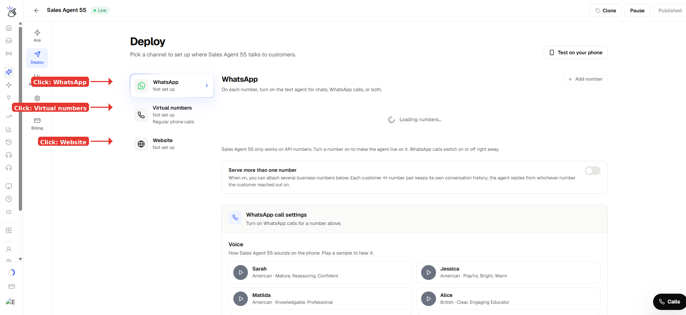
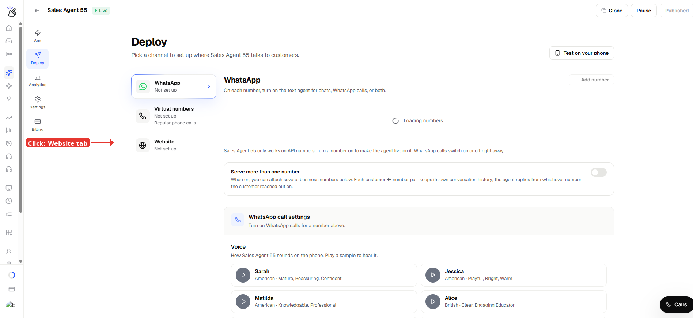
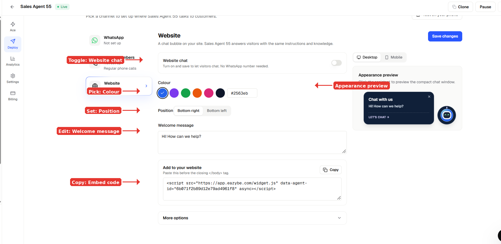
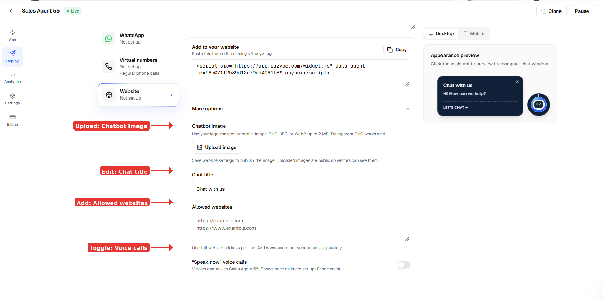
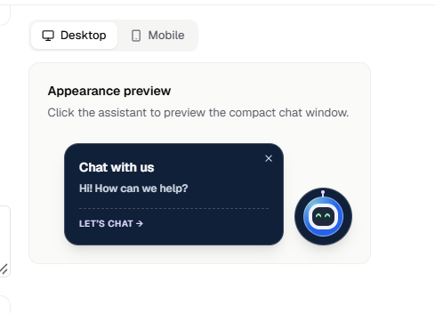
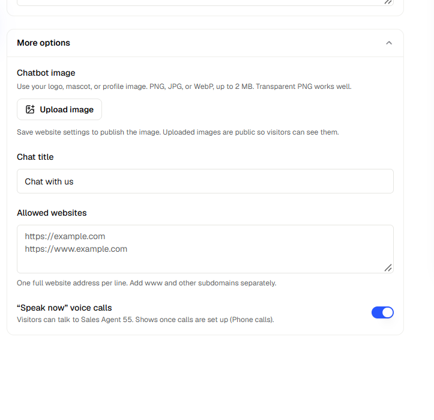

Your AI agent can be deployed beyond WhatsApp — directly on your website as a chat widget. The same agent with the same instructions and knowledge works across all channels: WhatsApp, virtual numbers, and your website.

## Deployment Channels Overview

Your AI agent can be deployed on three channels from the **Deploy** section:



1. **WhatsApp** — Deploy the agent on your WhatsApp Business API numbers for text and voice conversations.
2. **Virtual numbers** — Deploy the agent on regular phone call numbers (virtual numbers).
3. **Website** — Add the agent as a chat widget on your website. Visitors can text and optionally call the agent directly from your site.

<Note>
The agent's behavior, instructions, and knowledge remain the same across all three channels. You configure the agent once and deploy it everywhere.
</Note>

## Setting Up the Website Agent

### Step 1: Navigate to Deploy

Open your agent in the dashboard, then click the **Deploy** tab in the sidebar.

### Step 2: Select Website

Click **Website** in the channel list on the left side.



### Step 3: Enable Website Chat

Toggle **Website chat** to on. This activates the chat widget for your website — no WhatsApp number is needed.

### Step 4: Customize Appearance

Configure how the widget looks on your site:



1. **Color** — Choose a theme color for the chat widget. Pick from the preset colors (blue, purple, green, orange, pink, black) or enter a custom hex code.
2. **Position** — Set where the widget appears: **Bottom right** or **Bottom left** of the page.
3. **Welcome message** — The first message visitors see when they open the chat. For example: "Hi! How can we help?"
4. **Embed code** — Copy this script tag and paste it into your website before the closing `</body>` tag. This is what loads the agent on your site.

### Step 5: Configure More Options

Scroll down and expand **More options** to customize further:



1. **Chatbot image** — Upload your logo, mascot, or profile image. PNG, JPG, or WebP format, up to 2 MB. A transparent PNG works best.
2. **Chat title** — The title shown at the top of the chat widget (e.g., "Chat with us").
3. **Allowed websites** — List the websites where the agent should appear. Add one full URL per line, including `www` and other subdomains separately.
4. **"Speak now" voice calls** — Toggle this on to let visitors talk to the agent by voice directly from the website. Voice calls must be set up first (requires a connected phone number).

### Step 6: Preview the Widget

Use the **Appearance preview** panel on the right to see how the chat widget will look:

- Click **Desktop** to preview the widget on a computer screen.
- Click **Mobile** to preview how it appears on a phone.

<div style={{ display: 'flex', gap: '24px', alignItems: 'flex-start' }}>
  <div>
    <strong>Desktop preview</strong>
    
  </div>
  <div>
    <strong>Mobile preview</strong>
    
  </div>
</div>

Click the assistant icon in the preview to expand the compact chat window and see the full widget.

### Step 7: Add the Widget to Your Website

Copy the embed code from the **Add to your website** section:

```html
<script src="https://app.eazybe.com/widget.js" data-agent-id="YOUR_AGENT_ID" async></script>
```

Paste this code into your website's HTML, just before the closing `</body>` tag. The widget will appear on all pages where this code is included.

### Step 8: Save Changes

Click **Save changes** to publish your settings. The widget will go live on your allowed websites.

## Key Points

- **Same agent, all channels** — Your agent uses the same instructions, knowledge, and flow whether a customer reaches it via WhatsApp, a phone call, or your website.
- **No WhatsApp number needed** — The website chat works independently. You don't need a connected WhatsApp number to deploy the website widget.
- **Voice on website** — If you enable "Speak now" voice calls, visitors can talk to the agent by voice directly from your website, without leaving the page.
- **Multiple websites** — You can allow the agent on multiple websites by adding each URL to the Allowed websites list.
- **API numbers** — The same agent can also be deployed on virtual (API) numbers for regular phone calls. Select the number in the Deploy section and the agent handles calls on that number.
