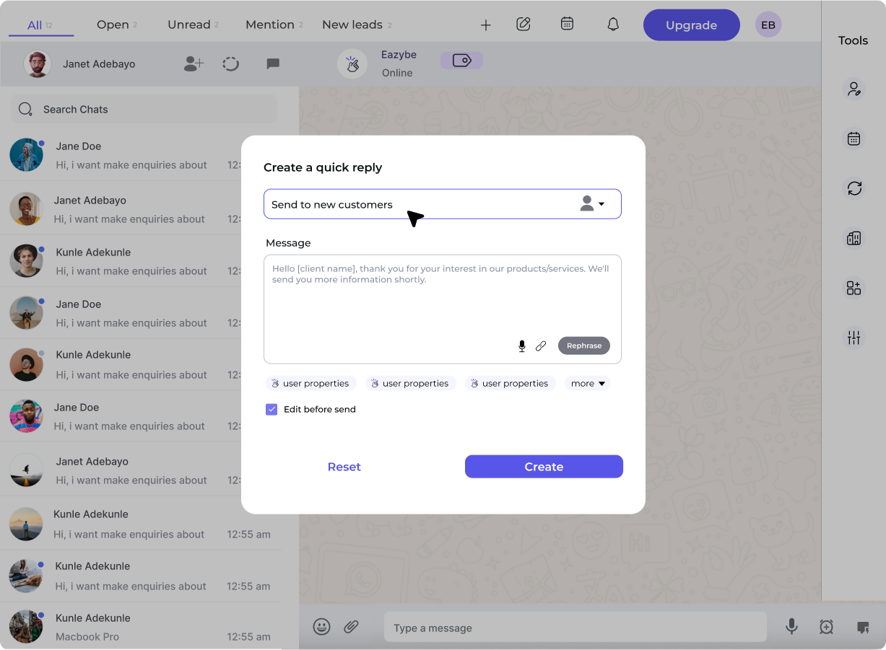

<Frame>
  
</Frame>

## Create a Template

<Tabs>
  <Tab title="From Workspace">
    <Steps>
      <Step title="Navigate to Templates">
        Go to **Workspace** → **WABA** → **Templates** → **Create Template**
      </Step>
      
      <Step title="Choose Category">
        Select the appropriate category:
        - **Marketing** – Promotions, offers, announcements
        - **Utility** – Order updates, reminders, alerts
        - **Authentication** – OTPs, verification codes
        
        <Warning>
        Choose carefully! Category affects pricing and approval criteria.
        </Warning>
      </Step>
      
      <Step title="Name Your Template">
        Use lowercase letters, numbers, and underscores only:
        - ✅ `order_confirmation`
        - ✅ `summer_sale_2026`
        - ❌ `Order Confirmation`
        - ❌ `summer-sale`
      </Step>
      
      <Step title="Select Language">
        Choose the primary language. You can add translations later.
      </Step>
      
      <Step title="Add Header (Optional)">
        Choose header type:
        - **None** – No header
        - **Text** – Short headline (up to 60 characters)
        - **Image** – JPG or PNG (max 5MB)
        - **Video** – MP4 (max 16MB)
        - **Document** – PDF (max 100MB)
      </Step>
      
      <Step title="Write Body">
        Enter your main message. Use `{{1}}`, `{{2}}`, etc. for variables:
        
        ```
        Hi {{1}}! 👋
        
        Your order #{{2}} is on its way! 🚚
        
        Estimated delivery: {{3}}
        
        Track your package: {{4}}
        ```
        
        <Tip>
        Emojis are allowed and can increase engagement!
        </Tip>
      </Step>
      
      <Step title="Add Footer (Optional)">
        Small text at the bottom (max 60 characters):
        - "Reply STOP to unsubscribe"
        - "Powered by Eazybe"
      </Step>
      
      <Step title="Add Buttons (Optional)">
        Up to 3 buttons:
        
        **Quick Reply** – Predefined responses
        - "Yes, I'm interested"
        - "No thanks"
        
        **Call to Action**
        - Visit Website (URL)
        - Call Phone Number
      </Step>
      
      <Step title="Submit for Approval">
        Click **Submit** to send template to Meta for review.
      </Step>
    </Steps>
  </Tab>
  
  <Tab title="From Extension">
    <Steps>
      <Step title="Open Template Manager">
        In WhatsApp Web with Eazybe extension:
        
        Click **WABA** icon → **Templates** → **Create New**
      </Step>
      
      <Step title="Fill Template Details">
        Complete the same fields as workspace method:
        - Category, Name, Language
        - Header, Body, Footer
        - Buttons
      </Step>
      
      <Step title="Preview & Submit">
        Preview your template, then click **Submit for Approval**
      </Step>
    </Steps>
  </Tab>
</Tabs>

## Template Examples

### Marketing Template

```
🎉 Flash Sale Alert! 🎉

Hi {{1}}, our biggest sale of the year is HERE!

Get up to 50% OFF on all products for the next 48 hours only.

Use code: FLASH50 at checkout

Shop now 👇
```

**Buttons:**
- [Visit Website] → https://yourstore.com/sale

---

### Utility Template (Order Update)

```
Hi {{1}},

Great news! Your order #{{2}} has been shipped. 📦

Courier: {{3}}
Tracking ID: {{4}}
Expected delivery: {{5}}

Track your order using the button below.
```

**Buttons:**
- [Track Order] → &#123;&#123;5&#125;&#125;

---

### Authentication Template

```
Your verification code is: {{1}}

This code expires in 10 minutes. Do not share it with anyone.
```

## Variable Best Practices

| Do ✅ | Don't ❌ |
|------|---------|
| Use sequential numbering: `{{1}}`, `{{2}}`, `{{3}}` | Skip numbers: `{{1}}`, `{{3}}` |
| Provide sample values when submitting | Leave samples blank |
| Use variables for dynamic content | Hardcode content that changes |
| Test with real data before sending | Send without testing |

## After Submission

Your template enters **Pending** status. Meta reviews within **24-48 hours**.

<CardGroup cols={2}>
  <Card title="Approved ✅" icon="check">
    Template is ready to use in broadcasts
  </Card>
  <Card title="Rejected ❌" icon="x">
    Review rejection reason, edit template, and resubmit
  </Card>
</CardGroup>

<Card title="Learn About Approval" icon="arrow-right" href="/waba/templates/approval-process">
  Understand what Meta looks for when reviewing templates
</Card>
