 
> **Documentation Index**
> Before exploring individual pages, fetch the complete index at [https://help.eazybe.com/llms.txt](https://help.eazybe.com/llms.txt) to understand available topics.
 
# Connecting Eazybe MCP Server with AI Tools
 
> Connect your Eazybe workspace to Claude Code, OpenAI Codex, or any MCP-compatible AI tool — giving it direct access to your CRM, WhatsApp conversations, team analytics, campaigns, and more.
 
The Eazybe MCP (Model Context Protocol) server lets you query and manage your Eazybe workspace directly from any AI tool that supports the MCP standard. Once connected, you can search CRM records, read customer conversations, check team analytics, inspect campaigns, and perform workspace operations — all through natural language.
 
## Supported AI Tools
 
The Eazybe MCP server works with any tool that supports the Model Context Protocol, including:
 
- **Claude Code** — Anthropic's AI coding assistant (desktop app or VS Code extension)
- **OpenAI Codex / ChatGPT** — OpenAI's AI assistant with MCP support
- **Any MCP-compatible client** — Cursor, Windsurf, Cline, and other tools that support MCP servers
> [!NOTE]
> The setup steps are similar across all tools. Choose your AI tool below to see the specific instructions.
 
---
 
<Tabs>
<Tab title="Claude Code">
## What You Need Before Starting
 
Make sure you have the following ready:
 
- **Claude Code** — the desktop app or the VS Code extension, installed and running
- **An Eazybe workspace account** — with admin or authorized user access
- **Your Eazybe MCP server URL** — your dev team or workspace admin will provide this
---
 
## Step 1: Open MCP Server Settings in Claude Code
 
**1. Open Claude Code** on your computer (desktop app or VS Code).
 
**2. Open the MCP servers panel.** You can find it by clicking the **MCP icon** in the sidebar, or through **Settings > MCP Servers**.
 
You will see a list of MCP servers. If this is your first time, the list may be empty or show only default Claude servers (Claude Docs, Google Drive, Notion).
 
---
 
## Step 2: Add the Eazybe Server
 
**1. Click "Add MCP Server"** (or the **+** button) to add a new server.
 
**2. Enter the server details:**
 
| Field | What to Enter |
|---|---|
| **Server name** | `eazybe` |
| **Server URL** | The MCP endpoint URL provided by your dev team |
 
> [!NOTE]
> The server URL depends on your environment. Your dev team will give you the correct URL. It typically ends in `/sse`. If you are unsure, ask your workspace admin before proceeding.
 
**3. Click Save.**
 
The server appears in your MCP servers list. You will see a **"Connecting..."** status badge next to it.
 
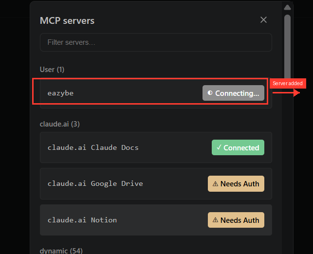
 
*The Eazybe server appears under "User" with a yellow "Connecting..." badge.*
 
---
 
## Step 3: Authenticate Your Connection
 
The first connection attempt will usually **time out after 30 seconds**. This is expected — the server needs you to log in before it can connect.
 
**1. You will see a "Failed" status** with an error message: *"MCP server eazybe connection timed out after 30000ms"*.
 
**2. Click the "Authenticating..." button.** This opens a browser window where you can log in.
 
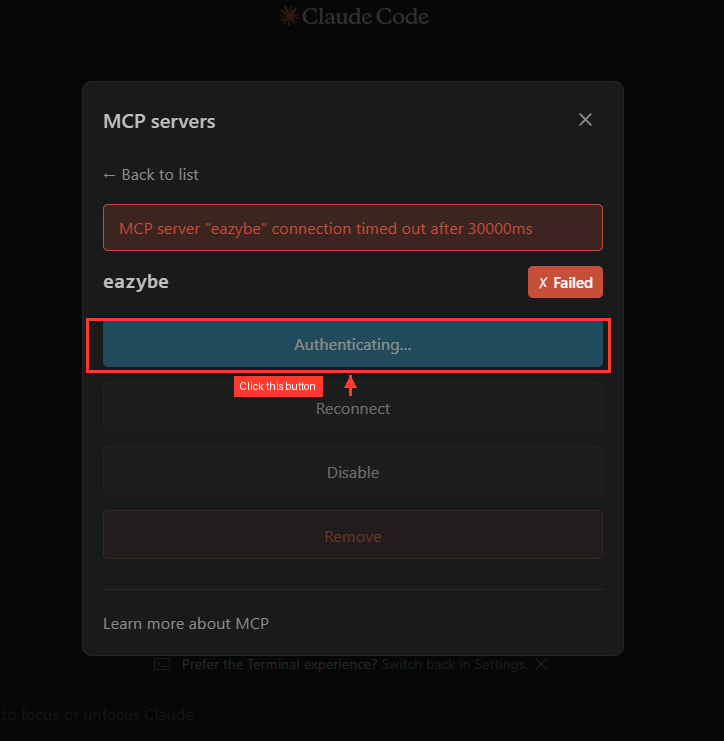
 
*Click the yellow "Authenticating..." button to open the login page in your browser.*
 
**3. Sign in with your Eazybe credentials** in the browser window that opens. Use the same email and password you use to log into your Eazybe workspace.
 
**4. You will see a success confirmation page** once authentication is complete.
 
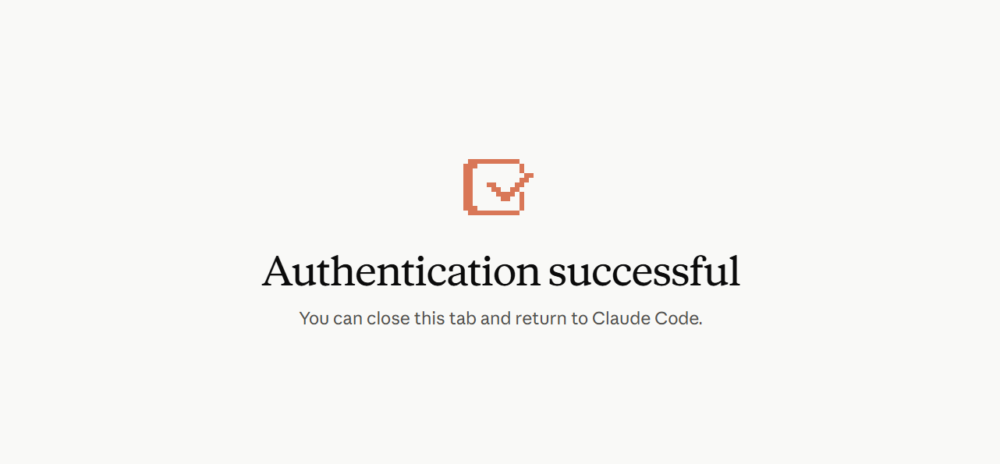
 
*"Authentication successful" — you can now close this browser tab and go back to Claude Code.*
 
**5. Close the browser tab** and return to Claude Code.
 
---
 
## Step 4: Reconnect and Confirm
 
**1. Back in Claude Code**, the server may still show as **Failed**. Click **"Reconnect"**.
 
**2. The server should now show a green "Connected" badge.**
 
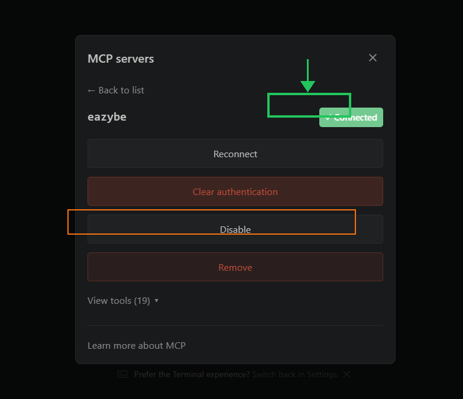
 
*The green "Connected" badge confirms the server is ready. You will also see options for Reconnect, Clear authentication, Disable, and Remove.*
 
> [!NOTE]
> If Reconnect does not work, click **"Clear authentication"** and repeat Step 3 from the beginning. Make sure you are using the correct Eazybe workspace credentials.
 
---
 
## Step 5: Verify Your Tools Are Loaded
 
**1. Click "View tools"** at the bottom of the server details panel.
 
**2. You should see 19 or more tools listed.** These are the MCP operations Claude can use on your workspace.
 
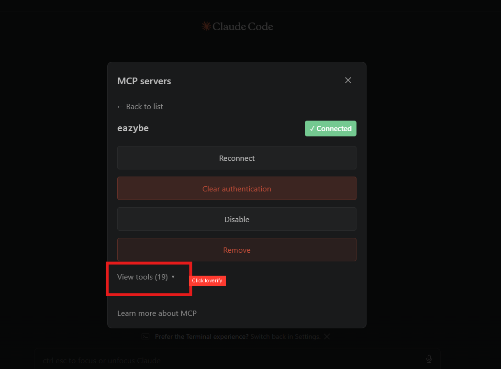
 
*Click "View tools (19)" to confirm all tools loaded correctly. If you see 0 tools, disconnect and reconnect the server.*
 
---
 
## Step 6: Run Your First Query
 
**1. Open a new chat** in Claude Code.
 
**2. Type this test query:**
 
```
What services does Eazybe provide for this workspace? List every available operation grouped by category.
```
 
**3. Claude will call the `business_capabilities` tool** and return your workspace's full operation list.
 
**4. A successful response shows:**
 
- Your organization ID and plan details
- Connected providers (e.g., HubSpot, Google Calendar)
- Total number of available operations
- Any readiness limitations
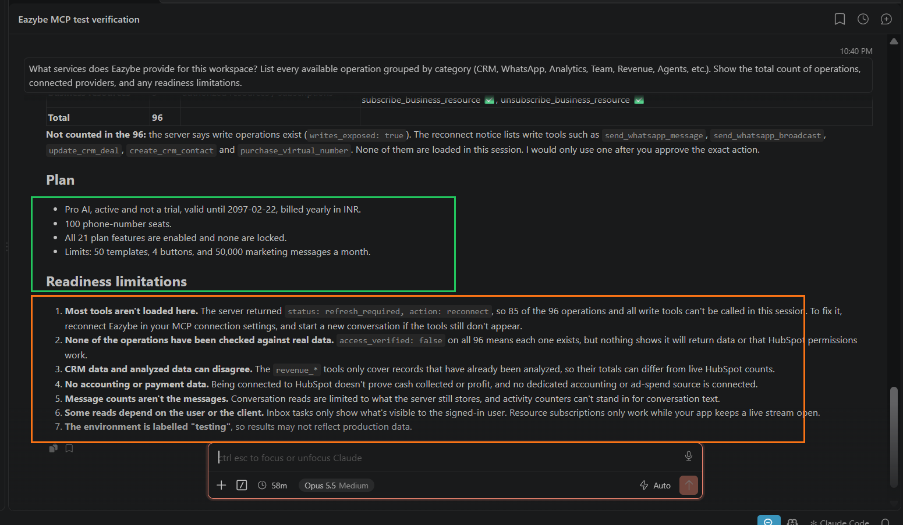
 
*A successful first query confirms your MCP connection is fully working.*
 
If you see this response, your setup is complete. You can now use Claude to query your Eazybe workspace.
 
 
</Tab>
<Tab title="OpenAI Codex">
## What You Need Before Starting
 
Make sure you have the following ready:
 
- **OpenAI Codex CLI** — installed on your machine (`npm install -g @openai/codex`)
- **An Eazybe workspace account** — with admin or authorized user access
- **Your Eazybe MCP server URL** — your dev team or workspace admin will provide this
---
 
## Step 1: Create the Config File
 
OpenAI Codex uses a JSON config file to connect to MCP servers.
 
**1. Open your terminal** and create the config directory:
 
```bash
mkdir -p ~/.codex
```
 
**2. Create or edit the config file** at `~/.codex/config.json` (Mac/Linux) or `%USERPROFILE%\.codex\config.json` (Windows):
 
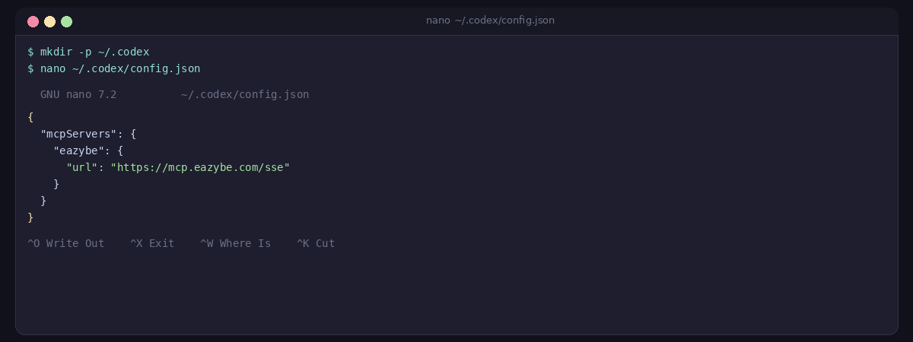
 
*Add the Eazybe MCP server URL to your Codex config file.*
 
**3. Add the Eazybe server configuration:**
 
```json
{
  "mcpServers": {
    "eazybe": {
      "url": "YOUR_EAZYBE_MCP_SERVER_URL"
    }
  }
}
```
 
> [!NOTE]
> Replace `YOUR_EAZYBE_MCP_SERVER_URL` with the MCP endpoint URL provided by your dev team. It typically ends in `/sse`.
 
**4. Save the file.**
 
---
 
## Step 2: Launch Codex and Authenticate
 
**1. Open your terminal and run:**
 
```bash
codex
```
 
**2. Codex will attempt to connect to the Eazybe MCP server.** The first connection will time out after 30 seconds — this is expected and normal.
 
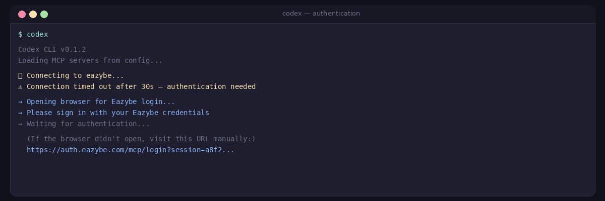
 
*The timeout is expected. Codex will open your browser for authentication.*
 
**3. A browser window will open automatically for authentication.** Sign in with your Eazybe workspace credentials (the same email and password you use to log into Eazybe).
 
**4. You will see an "Authentication successful" confirmation page.**
 
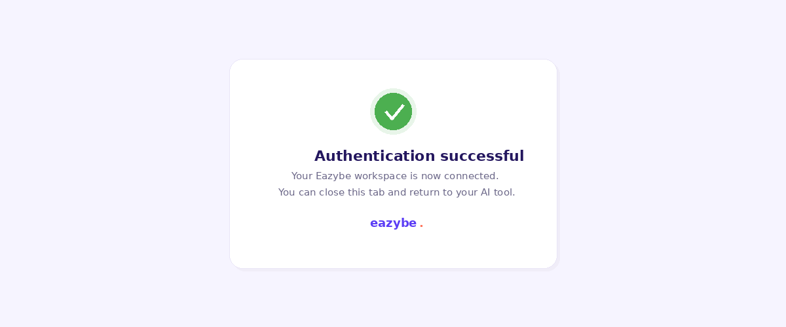
 
*"Authentication successful" — close this tab and return to your terminal.*
 
**5. Close the browser tab** and return to the terminal. Codex will reconnect automatically.
 
---
 
## Step 3: Verify Your Connection
 
Once authenticated, Codex will show a connection summary with all available tools.
 
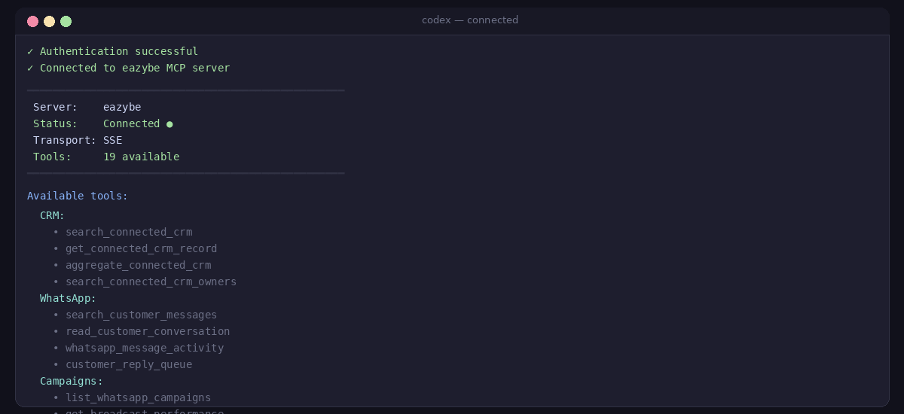
 
*Codex is connected to Eazybe with 19 tools loaded across CRM, WhatsApp, Campaigns, Analytics, and Agents.*
 
---
 
## Step 4: Run Your First Query
 
**1. In the Codex terminal, type:**
 
```
What services does Eazybe provide for this workspace? List every available operation grouped by category.
```
 
**2. Codex will call the `business_capabilities` tool** and return your workspace's operation list.
 
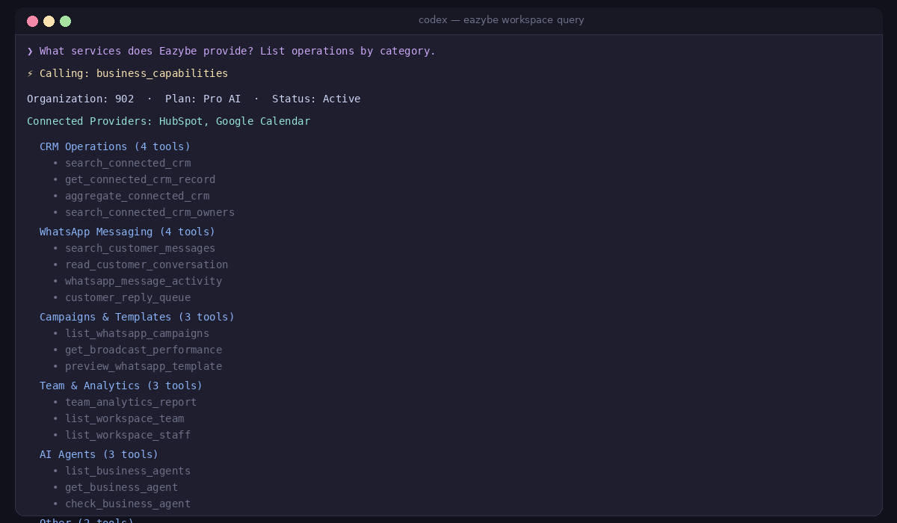
 
*A successful query shows your organization ID, plan, connected providers, and all 19 operations grouped by category.*
 
**3. A successful response shows:**
 
- Your organization ID and plan details
- Connected providers (e.g., HubSpot, Google Calendar)
- Total number of available operations
If you see this response, your setup is complete.
 
</Tab>
<Tab title="Other AI Tools">
## Connecting with Any MCP-Compatible Tool
 
The Eazybe MCP server works with any AI tool that supports the Model Context Protocol standard. This includes tools like **Cursor**, **Windsurf**, **Cline**, and others.
 
---
 
## What You Need
 
- **An MCP-compatible AI tool** — installed and running
- **An Eazybe workspace account** — with admin or authorized user access
- **Your Eazybe MCP server URL** — your dev team or workspace admin will provide this (ends in `/sse`)
---
 
## General Setup Steps
 
**1. Open your AI tool's MCP server settings.** Most tools have this under Settings, Extensions, or a dedicated MCP panel.
 
**2. Add a new MCP server with these details:**
 
| Field | What to Enter |
|---|---|
| **Server name** | `eazybe` |
| **Server URL / Endpoint** | The MCP endpoint URL provided by your dev team |
| **Transport** | SSE (Server-Sent Events) |
 
**3. Save and connect.** The first attempt will usually time out while waiting for authentication.
 
**4. Authenticate.** A browser window will open — sign in with your Eazybe workspace credentials.
 

 
*"Authentication successful" — close this tab and return to your AI tool.*
 
**5. Reconnect** after authentication. The server should show as connected.
 
**6. Verify** by running this test query:
 
```
What services does Eazybe provide for this workspace? List every available operation grouped by category.
```
 
A successful response shows your organization ID, plan details, connected providers, and available operations.
 
> [!NOTE]
> If your AI tool requires a specific configuration format (JSON, YAML, TOML), refer to that tool's documentation for how to add an MCP server. The server URL and authentication flow are the same across all tools.
 
---
 
## Tool-Specific Setup Guides
 
### Cursor
 
Open Cursor's MCP settings panel or create the config file at `~/.cursor/mcp.json`:
 
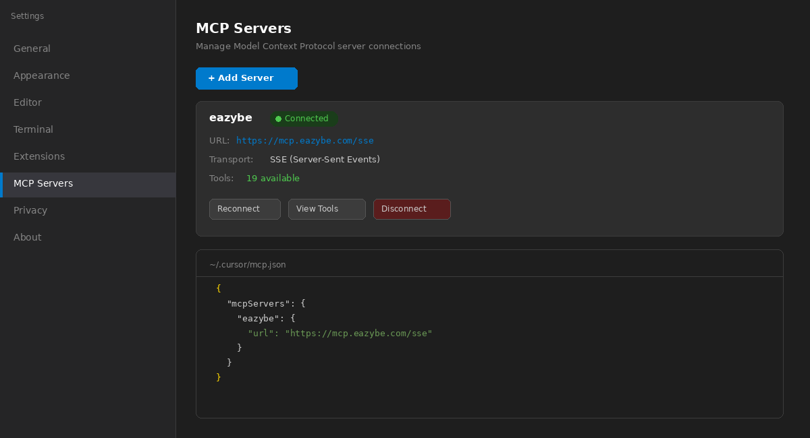
 
*Cursor's MCP settings panel showing the Eazybe server connected with 19 available tools.*
 
```json
{
  "mcpServers": {
    "eazybe": {
      "url": "YOUR_EAZYBE_MCP_SERVER_URL"
    }
  }
}
```
 
### Windsurf
 
Open Windsurf's MCP configuration panel or create the config file at `~/.windsurf/mcp_config.json`:
 
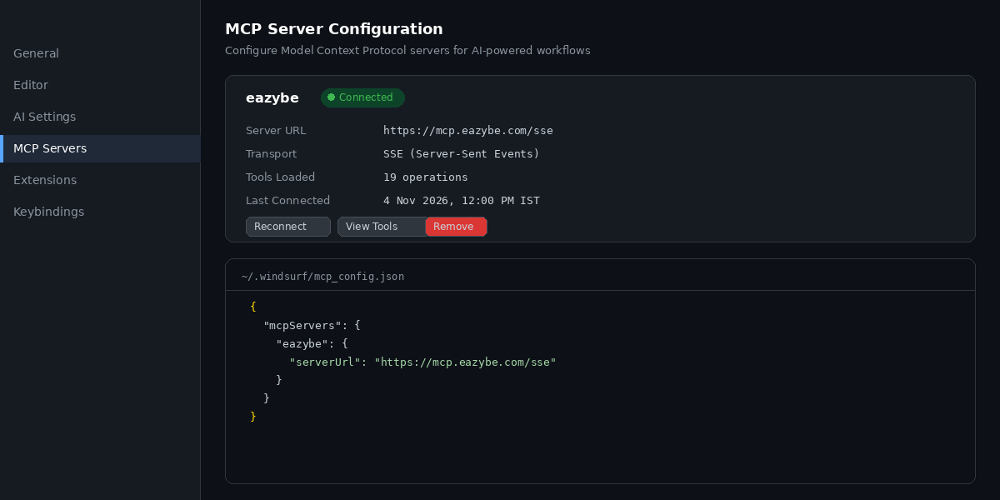
 
*Windsurf's MCP Server Configuration panel showing the Eazybe server connected and active.*
 
```json
{
  "mcpServers": {
    "eazybe": {
      "serverUrl": "YOUR_EAZYBE_MCP_SERVER_URL"
    }
  }
}
```
 
### Cline (VS Code Extension)
 
In VS Code with Cline installed, open the Cline MCP panel from the sidebar:
 
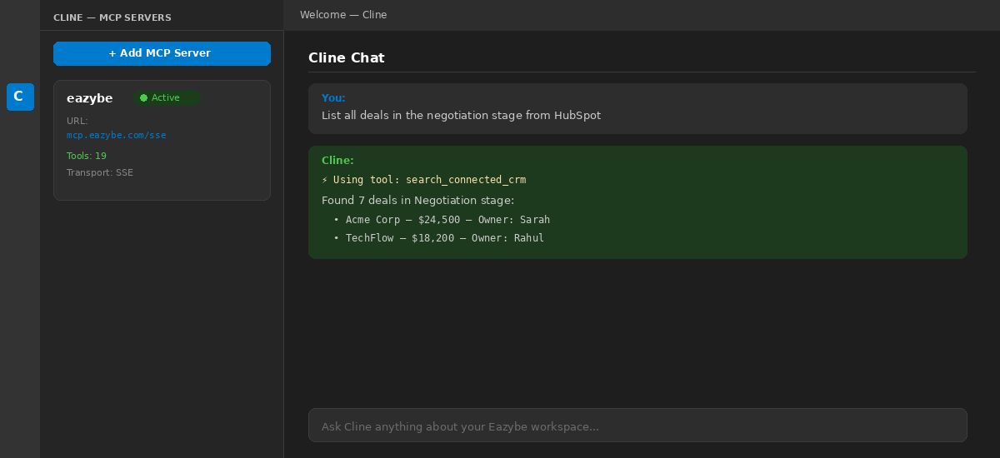
 
*Cline's MCP panel in VS Code showing the Eazybe server connected and a CRM query running.*
 
Click **"+ Add MCP Server"** → enter `eazybe` as the name and your MCP endpoint URL → authenticate in the browser when prompted.
 
 
</Tab>
</Tabs>
---
 
## What You Can Do Once Connected
 
Once the MCP server is connected, you can ask your AI tool to:
 
- **Search CRM records** — find deals, contacts, companies, or tickets by any field, owner, date, or stage
- **Check team analytics** — see messaging activity, rep performance, and week-over-week comparisons
- **Read customer conversations** — search WhatsApp messages across languages, read full threads, check who is waiting for a reply
- **Inspect campaigns and broadcasts** — list campaigns, check delivery and read rates, view individual recipient statuses
- **Preview templates** — see rendered template messages with test values, without sending anything
- **Check wallet balance** — see your messaging credit balance and currency
- **List agents and labels** — inspect AI agents, their readiness, versions, and business labels with funnel structures
- **Manage CRM records** — create, update, or archive deals, contacts, companies, and tickets (requires your explicit approval)
> [!NOTE]
> **All write operations require your explicit approval.** Your AI tool will always show you the exact action (what will be created, changed, or deleted) and wait for you to confirm before making any changes. No messages are sent and no records are modified without your permission.
 
---
 
## Troubleshooting
 
**Connection times out after 30 seconds**
 
This means authentication is needed. Look for an "Authenticating" button or a browser window prompt. Log in with your Eazybe credentials, then reconnect.
 
**Server shows "Failed" after authentication**
 
Click **Reconnect**. If it still fails, clear any saved authentication and go through the login steps again. Make sure you are using the correct credentials for your Eazybe workspace.
 
**Tools show 0 or are not loading**
 
The server may need a refresh. Disconnect the Eazybe server, reconnect it, and start a **new conversation**. If tools still do not appear, check with your dev team that the MCP server is running.
 
**"access_verified: false" on all operations**
 
This is normal and expected. It means the connection exists, but each data source is verified the first time you actually run a query against it. If a specific query fails with a permissions error, check your Eazybe role or HubSpot account permissions.
 
**"connection_store_unavailable" error on a query**
 
This is an intermittent backend issue. Simply retry the same query — it usually works on the second attempt. If it keeps happening, the MCP server may need a restart by the dev team.
 
**Google Calendar shows "connected" but calendar queries fail**
 
The `read_calendar_events` tool is not currently exposed through the MCP connector. Calendar-related queries (meeting availability, booked demos) will not work until this tool is added. Contact the dev team to request it.
 
**Your AI tool says "most tools aren't loaded" or "status: refresh_required"**
 
Disconnect the Eazybe MCP server in your settings, reconnect it, and start a new conversation. This happens when the session token has expired and needs a fresh connection.
 
---
