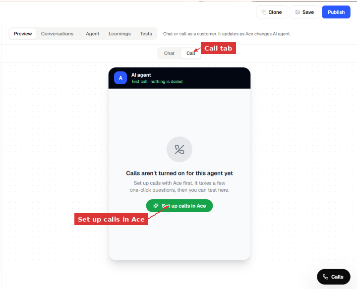
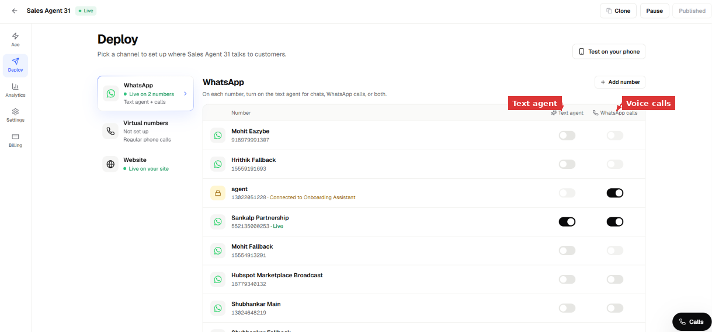
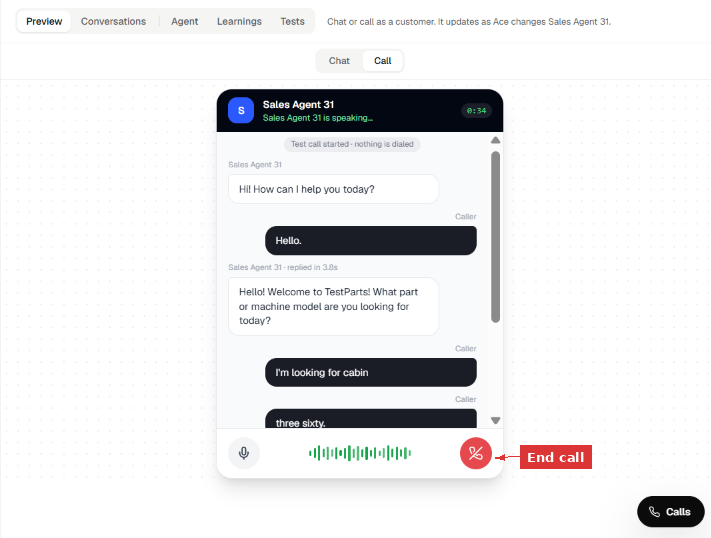
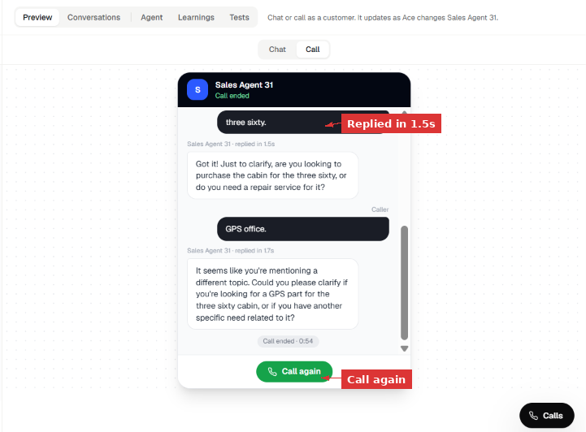

# Voice AI Agent

> Enable voice calling so your AI agent can handle phone conversations on WhatsApp and virtual numbers.

Your AI agent uses the same prompt, knowledge base, and tools for voice calls as it does for text chats. You enable the voice layer, deploy it on your numbers, and the agent handles calls automatically.

---

## How It Works

Your AI agent already knows how to respond to customers by text. Voice AI adds a speech layer on top:

1. A customer calls your WhatsApp number or virtual number.
2. The AI agent listens to the customer's voice and converts it to text.
3. The agent processes the message using your prompt, knowledge base, and tools — the same way it handles text chats.
4. The agent's reply is converted to natural-sounding speech and played back to the caller.

The entire conversation is also logged as a text transcript in your Team Inbox, so your team can review what was said.

---

## Setting Up Voice Calls

### Step 1: Enable voice in Ace

**1.** Open your agent and go to the **Preview** tab.

**2.** Switch from **Chat** to **Call**.

**3.** If calls are not enabled yet, you will see a message: "Calls aren't turned on for this agent yet." Click **Set up calls in Ace**.

**4.** Ace will walk you through a few quick questions to configure the voice settings for your agent.

*Switch to the Call tab in Preview. Click "Set up calls in Ace" to enable voice for your agent.*

### Step 2: Deploy voice on your numbers

Once voice is enabled, go to the **Deploy** tab to choose which numbers receive voice calls.

**1.** Click **Deploy** in the left sidebar.

**2.** Under **WhatsApp**, you will see a list of your connected numbers with two toggle columns:
   - **Text agent** — enables the AI for text chats on that number.
   - **WhatsApp calls** — enables the AI for voice calls on that number.

**3.** Toggle **WhatsApp calls** on for the numbers you want. You can enable text only, voice only, or both on each number.

**4.** Under **Virtual numbers**, you can set up regular phone numbers (not WhatsApp) for voice calls. This is useful if you want a dedicated phone line for your AI agent.

*The Deploy page. Each number has separate toggles for text and voice. Enable WhatsApp calls on the numbers you want the AI to answer.*

> [!NOTE]
> You can enable voice on multiple numbers. Each number can have text, voice, or both enabled independently. Changes take effect immediately — no need to republish the agent.

---

## Testing Voice Calls

Before going live, test your agent's voice in the **Preview** tab.

**1.** Go to **Preview** → **Call**.

**2.** The test call starts automatically — you will see "Test call - nothing is dialed" at the top. This means the call is simulated and does not use a real phone number.

**3.** Speak into your microphone. The agent will respond in real time. You can see the live transcript of the conversation as it happens.

**4.** The agent's status shows at the top — "is speaking..." when the agent is talking, and the response time (e.g., "replied in 1.5s") appears next to each message.

*A test call in progress. The agent responds in real time and you can see the full transcript. Response times are shown next to each reply.*

**5.** When you are done, click the red **end call** button. You will see "Call ended" with the total duration and a **Call again** button to start a new test.

*After ending a call, review the transcript and click "Call again" to run another test.*

---

## What to Check When Testing

When testing your voice agent, pay attention to:

- **Response speed** — how quickly the agent replies after you finish speaking. Aim for under 3 seconds.
- **Voice clarity** — does the agent sound natural? Are words pronounced correctly?
- **Filler words** — the agent should not add unnecessary "yeah", "okay", or "hmm" sounds before responding.
- **Background noise** — there should be no keystroke sounds, typing noises, or other artifacts in the agent's voice.
- **Conversation flow** — does the agent follow your prompt correctly? Does it ask the right questions in the right order?
- **Language** — if your agent supports multiple languages, test that it responds in the correct language when you speak in that language.

---

## Tips and Best Practices

- **Keep your prompt concise** — voice conversations move faster than text. Long, complex prompts can cause delays. Shorter instructions help the agent respond quicker.
- **Test with real scenarios** — don't just say "hello." Walk through the actual customer journey your agent handles (qualification, booking, FAQ, etc.).
- **Enable on one number first** — start with voice on a single number, monitor the calls, then expand to more numbers once you are confident.
- **Review transcripts regularly** — every voice call is logged in Team Inbox as a text transcript. Use these to spot issues and improve your agent's prompt.
- **Use virtual numbers for dedicated voice lines** — if you want a separate phone number just for AI calls (not WhatsApp), set up a virtual number in the Deploy tab.

---

## Troubleshooting

**"Calls aren't turned on for this agent yet"**

Go to Preview → Call and click "Set up calls in Ace." Ace will guide you through enabling voice for this agent.

**Agent responds slowly**

Check your prompt length — very long prompts can increase response time. Also check if you have many tools enabled that the agent searches through before responding.

**Agent adds filler words or background sounds**

This is a known issue with some voice configurations. Report it to the Eazybe team so they can adjust the voice settings for your agent.

**Voice is enabled but calls go unanswered**

Make sure the WhatsApp calls toggle is turned on for the correct number in Deploy. Also verify the agent is Published (not Paused or Draft).

**Customer hears nothing when they call**

Check that the number is connected and live. Go to Deploy → WhatsApp and confirm the number shows a green "Live" status.

