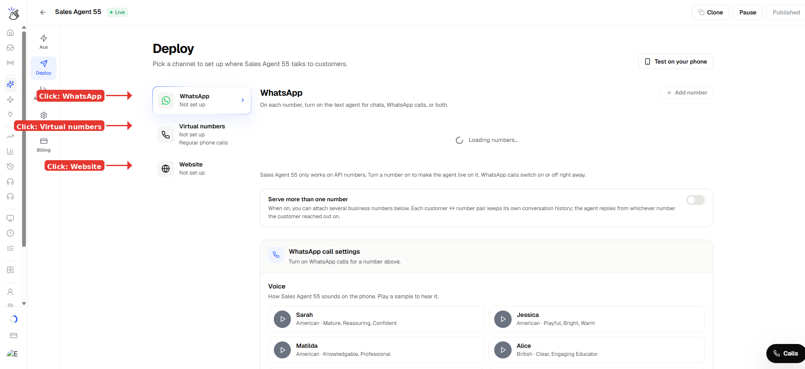
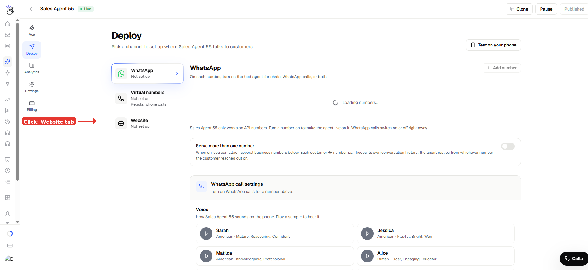
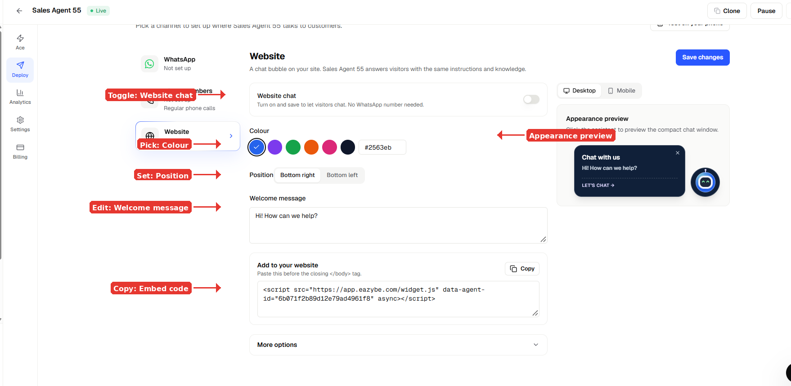
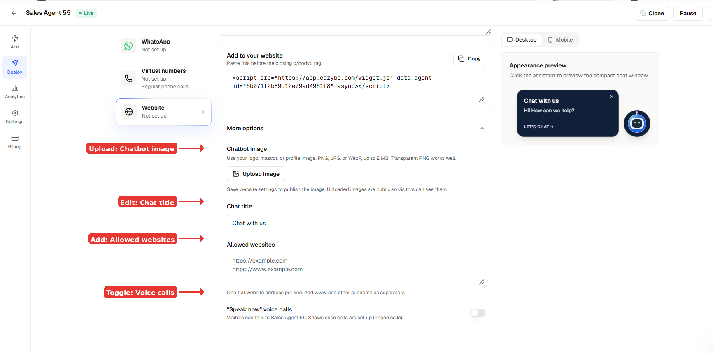

AI ajanınız WhatsApp'ın ötesinde — doğrudan web sitenizde bir sohbet aracı olarak dağıtılabilir. Aynı talimatlar ve bilgi birikimine sahip aynı ajan tüm kanallarda çalışır: WhatsApp, sanal numaralar ve web siteniz.

## Dağıtım Kanallarına Genel Bakış

AI ajanınız **Deploy** bölümünden üç kanalda dağıtılabilir:



1. **WhatsApp** — Ajanı WhatsApp Business API numaralarınızda metin ve sesli konuşmalar için dağıtın.
2. **Sanal numaralar** — Ajanı normal telefon araması numaralarında (sanal numaralar) dağıtın.
3. **Web sitesi** — Ajanı web sitenize sohbet aracı olarak ekleyin. Ziyaretçiler sitenizden doğrudan ajana yazabilir ve isteğe bağlı olarak arayabilir.

<Note>
Ajanın davranışı, talimatları ve bilgi birikimi üç kanalda da aynı kalır. Ajanı bir kez yapılandırır ve her yere dağıtırsınız.
</Note>

## Web Sitesi Ajanını Kurma

### Adım 1: Deploy'a Gidin

Panelde ajanınızı açın ve kenar çubuğundaki **Deploy** sekmesine tıklayın.

### Adım 2: Website'i Seçin

Sol taraftaki kanal listesinden **Website**'e tıklayın.



### Adım 3: Web Sitesi Sohbetini Etkinleştirin

**Website chat** düğmesini açın. Bu, web siteniz için sohbet aracını etkinleştirir — WhatsApp numarasına gerek yoktur.

### Adım 4: Görünümü Özelleştirin

Aracın sitenizde nasıl görüneceğini yapılandırın:



1. **Renk** — Sohbet aracı için bir tema rengi seçin. Önceden tanımlanmış renklerden (mavi, mor, yeşil, turuncu, pembe, siyah) seçin veya özel bir hex kodu girin.
2. **Konum** — Aracın nerede görüneceğini ayarlayın: Sayfanın **Sağ alt** veya **Sol alt** köşesi.
3. **Karşılama mesajı** — Ziyaretçilerin sohbeti açtıklarında gördüğü ilk mesaj. Örneğin: "Merhaba! Size nasıl yardımcı olabiliriz?"
4. **Gömme kodu** — Bu script etiketini kopyalayın ve web sitenizin HTML'ine kapanış `</body>` etiketinden önce yapıştırın. Bu kod ajanı sitenize yükler.

### Adım 5: Daha Fazla Seçeneği Yapılandırın

Aşağı kaydırın ve daha fazla özelleştirme için **More options**'ı genişletin:



1. **Chatbot görüntüsü** — Logonuzu, maskotunuzu veya profil resminizi yükleyin. PNG, JPG veya WebP formatı, en fazla 2 MB. Şeffaf PNG en iyi sonucu verir.
2. **Sohbet başlığı** — Sohbet aracının üstünde gösterilen başlık (ör: "Bizimle sohbet edin").
3. **İzin verilen web siteleri** — Ajanın görünmesi gereken web sitelerini listeleyin. Her satıra bir tam URL ekleyin, `www` ve diğer alt alan adlarını ayrı ayrı ekleyin.
4. **"Speak now" sesli aramalar** — Ziyaretçilerin web sitesinden doğrudan ajanla sesli konuşmasına izin vermek için bunu açın. Sesli aramaların önce kurulması gerekir (bağlı bir telefon numarası gerektirir).

### Adım 6: Aracı Önizleyin

Sohbet aracının nasıl görüneceğini görmek için sağdaki **Appearance preview** panelini kullanın:

- Bilgisayar ekranında aracı önizlemek için **Desktop**'a tıklayın.
- Telefonda nasıl göründüğünü önizlemek için **Mobile**'a tıklayın.

Kompakt sohbet penceresini genişletmek ve tam aracı görmek için önizlemedeki asistan simgesine tıklayın.

### Adım 7: Aracı Web Sitenize Ekleyin

**Add to your website** bölümünden gömme kodunu kopyalayın:

```html
<script src="https://app.eazybe.com/widget.js" data-agent-id="AJAN_ID_NIZ" async></script>
```

Bu kodu web sitenizin HTML'ine, kapanış `</body>` etiketinden hemen önce yapıştırın. Araç, bu kodun dahil edildiği tüm sayfalarda görünecektir.

### Adım 8: Değişiklikleri Kaydedin

Ayarlarınızı yayınlamak için **Save changes**'e tıklayın. Araç, izin verilen web sitelerinizde canlı olacaktır.

## Önemli Noktalar

- **Aynı ajan, tüm kanallar** — Ajanınız, müşteri WhatsApp, telefon araması veya web siteniz üzerinden ulaşsın, aynı talimatları, bilgi birikimini ve akışı kullanır.
- **WhatsApp numarası gerekmez** — Web sitesi sohbeti bağımsız çalışır. Web sitesi aracını dağıtmak için bağlı bir WhatsApp numarasına ihtiyacınız yoktur.
- **Web sitesinde ses** — "Speak now" sesli aramaları etkinleştirirseniz, ziyaretçiler sayfadan ayrılmadan doğrudan web sitenizden ajanla sesli konuşabilir.
- **Birden fazla web sitesi** — İzin verilen web siteleri listesine her URL'yi ekleyerek ajanı birden fazla web sitesinde etkinleştirebilirsiniz.
- **API numaraları** — Aynı ajan, normal telefon aramaları için sanal (API) numaralarında da dağıtılabilir. Deploy bölümünde numarayı seçin ve ajan o numaradaki aramaları yönetir.
