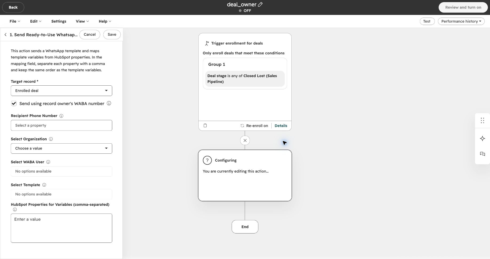
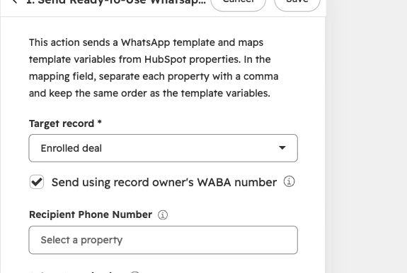
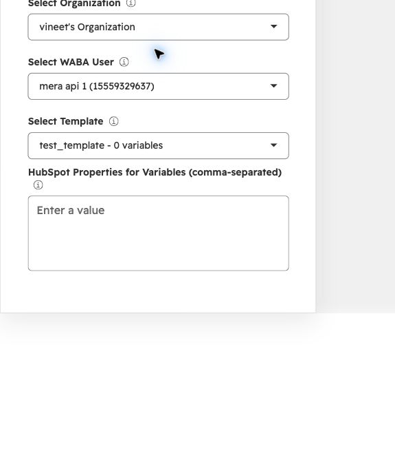
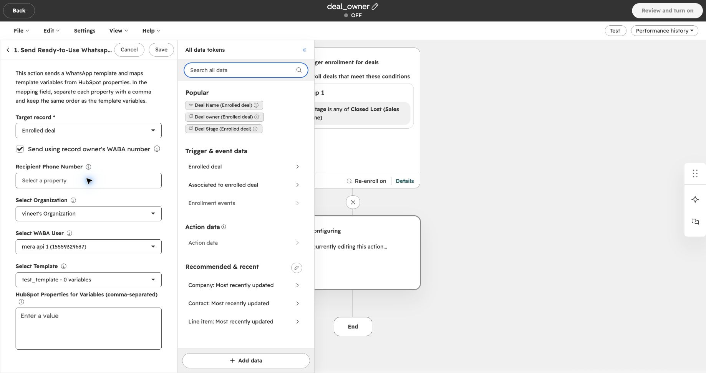
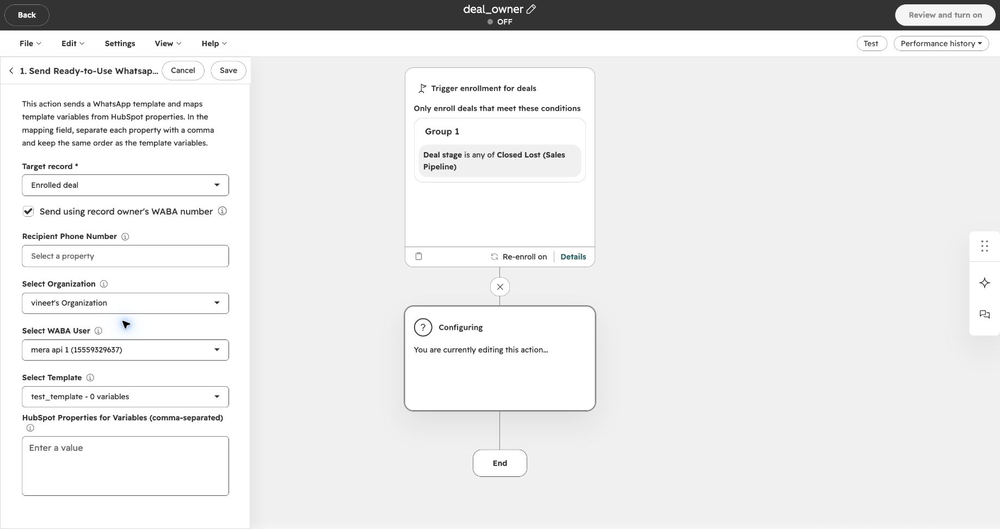

Send a WhatsApp template from the number of the person responsible for a HubSpot deal or contact. Enable **Send using record owner's WABA number** in your Eazybe workflow action to choose the sender automatically for each enrolled record.

## Before You Begin

Check these prerequisites for **each owner** whose number should send messages:

| Check | What you need |
| --- | --- |
| Record owner | The enrolled deal has a **Deal owner**, or the enrolled contact has a **Contact owner**. |
| Connected WABA number | The owner's WhatsApp Business API (WABA / Meta API) number is connected to Eazybe. A WhatsApp Web connection alone is not enough. If it is not connected, follow [Connect with WABA](https://help.eazybe.com/en/waba/connect-waba). |
| HubSpot user mapping | That WABA user is mapped to the same HubSpot user who owns the record, in the correct HubSpot account and Eazybe organization. If the mapping is missing, follow [Map WABA API Number Users](https://help.eazybe.com/en/integrations/hubspot/waba-api-number-integration). |
| One clear owner mapping | The owner must resolve to one Eazybe user. If the same HubSpot owner maps to multiple Eazybe users, Eazybe keeps the workflow-selected sender. |
| Matching approved template | The owner's WhatsApp Business Account has an **approved** template with the same name and language as the template selected in the action. Its component layout, header format, variable positions, and button types must also match. |
| Workflow access | You can create or edit HubSpot workflows, and **WhatsApp Integration by Eazybe** is installed. |
| Default sender and recipients | You have a connected WABA user to select as the fallback sender, a usable template, and valid recipient phone numbers. For deal workflows, check that contacts are associated with the deal. |

<Warning>
  This setting does not require every message to come from the owner. If Eazybe cannot use the owner's number or matching template, it falls back to **Select WABA User** and **Select Template** in the action. Choose a default number that you are comfortable using to message customers.
</Warning>

## Which Owner Sends the Message?

| Workflow type | Owner used to choose the sender |
| --- | --- |
| Deal-based | The owner of the enrolled **deal**, even if its associated contacts have different owners. |
| Contact-based | The owner of the enrolled **contact**. |

For example, if a deal belongs to Priya and its contact belongs to Alex, a deal-based workflow uses Priya's eligible WABA number. The customer remains the recipient; this option does not send a notification to Priya.

<Note>
  Owner-based sending is supported for contact and deal workflows. Company and lead workflows keep the selected WABA user. Existing workflows also keep their selected sender unless you enable the checkbox.
</Note>

## Set Up the Workflow Action

If you have not created a workflow yet, follow [Send Ready-to-Use Template through HubSpot Workflow](https://help.eazybe.com/en/waba/broadcasting/hubspot-workflow/send-ready-to-use-template) to create the workflow and set its enrollment conditions. That guide illustrates a contact workflow; use a deal-based workflow when you want the **deal owner** to determine the sender.

Return here when you reach the Eazybe action settings.

<Steps>
  <Step title="Open the Eazybe template action">
    Open **Send Ready-to-Use Whatsapp Template** in your workflow. Confirm that **Target record** is the enrolled record you intend to use. In this deal-based example, it is **Enrolled deal**.

    
  </Step>

  <Step title="Enable sending from the record owner">
    Select **Send using record owner's WABA number**. Eazybe checks the enrolled record's owner when this action runs and tries to use that owner's mapped, connected WABA number.

    

    <Note>
      Clearing this checkbox makes the action use the WABA user you select manually.
    </Note>
  </Step>

  <Step title="Select the organization, default sender, and template">
    Choose **Select Organization**, then **Select WABA User**, then **Select Template**. Keep these fields configured even when owner-based sending is enabled: they provide the fallback sender and identify the template to match on the owner's account.

    If the template has variables, fill **HubSpot Properties for Variables (comma-separated)** in the same order as the template variables. The workflow's variable configuration is retained when Eazybe switches to the owner's matching template.

    

      
    

    <Note>
      The screenshot uses an example template with **0 variables**, so its variable field is empty. Select your own organization, number, and approved template. If the WABA user or template list is empty, first check the preceding selection and the WABA connection.
    </Note>
  </Step>

  <Step title="Choose who receives the message">
    For a deal workflow:

    1. Click **Recipient Phone Number**.
    2. Under **All data tokens**, choose **Contact: Most recently updated**.
    3. Select **Phone Number**. Make sure it contains the customer's WhatsApp number.

    

    <Note>
      This sends to **one associated contact per deal**—the contact whose record was updated most recently. It does not send to all contacts associated with the deal.
    </Note>

    <Warning>
      - Select **Phone Number**, not **Deal owner**, **Contact owner**, or **Record ID**. These contain IDs, not the customer's phone number.
      - The **Send using record owner's WABA number** checkbox determines who sends the message.
      - Keep **Recipient Phone Number** filled to target one contact. Leaving it blank can send to contacts among the deal's **five most recently updated associated contacts** that have phone numbers. Duplicate numbers within that group receive one message.
    </Warning>
  </Step>

  <Step title="Review and save the action">
    Check the owner checkbox, recipient, organization, fallback WABA user, template, and variable values. Click **Save** to save the action.

    

    <Note>
      This screenshot shows an unfinished example with a blank recipient field and the workflow **OFF**. Complete your own recipient settings before saving. Saving an action is separate from turning on the workflow.
    </Note>

    Use the [workflow review and activation steps](https://help.eazybe.com/en/waba/broadcasting/hubspot-workflow/send-ready-to-use-template) when you are ready to enable it. Before enrolling customers in bulk, verify the sender and delivery with a controlled record and a recipient number you manage.

    <Warning>
      Activating a workflow can send real WhatsApp messages to enrolled recipients. Review enrollment and re-enrollment settings before turning it on. Normal messaging charges apply; see [WhatsApp message pricing](/en/waba/broadcast-rate-list-1-october-2026).
    </Warning>
  </Step>
</Steps>

## What Happens When the Action Runs?

Eazybe reads the enrolled record's owner, checks the owner's HubSpot mapping and WABA connection in the selected organization, and looks for a compatible approved template on the owner's account. If these checks pass, the message uses the owner's number and matching template.

If any owner lookup, mapping, connection, or template check cannot be completed, Eazybe keeps the selected default sender and template. That sender must still pass the normal connection and template checks; fallback does not guarantee delivery.

<Note>
  The checkbox changes the **sender**, not your enrollment rules, recipient selection, or template-variable mapping. If the owner is already the selected WABA user, the sender stays the same.
</Note>

## Troubleshooting

| What you notice | What to check |
| --- | --- |
| The message came from the default number | Confirm the checkbox is enabled and the enrolled record has an owner. Then check that owner's WABA connection, HubSpot mapping, and matching approved template. |
| The owner's WABA number is disconnected | [Connect or reconnect WABA](https://help.eazybe.com/en/waba/connect-waba). Until it is eligible again, the action can use the default sender. |
| The owner has a number but it is not being used | [Check the HubSpot user mapping](https://help.eazybe.com/en/integrations/hubspot/waba-api-number-integration). Verify the owner, HubSpot account, and Eazybe organization match, and resolve mappings to multiple Eazybe users. |
| The template exists, but sending still uses the default number | Check approval status, exact template name, language, component layout, header format, variables, and buttons on the owner's account. A matching name alone is not enough. |
| A deal message did not use the contact owner's number | Deal workflows use the **deal owner**. Check the deal's ownership and that owner's mapping. |
| More than one contact received the message | Check whether **Recipient Phone Number** was left blank. Deal workflows can use associated-contact sending in that case. |
| No message was delivered | Check the actual sender's connection and template availability, the recipient number, and the deal's associated contacts. Review the workflow's **Performance history** and [broadcast delivery analytics](/en/broadcasts/view-analytics). |
| You changed the organization in the action | Select the WABA user and template again so they belong to the new organization. |

## Related Guides

- [Connect with WABA](https://help.eazybe.com/en/waba/connect-waba)
- [Map WABA API Number Users](https://help.eazybe.com/en/integrations/hubspot/waba-api-number-integration)
- [Create and activate a HubSpot template workflow](https://help.eazybe.com/en/waba/broadcasting/hubspot-workflow/send-ready-to-use-template)
- [Troubleshoot HubSpot workflows](/en/integrations/hubspot/workflow-troubleshoot)
