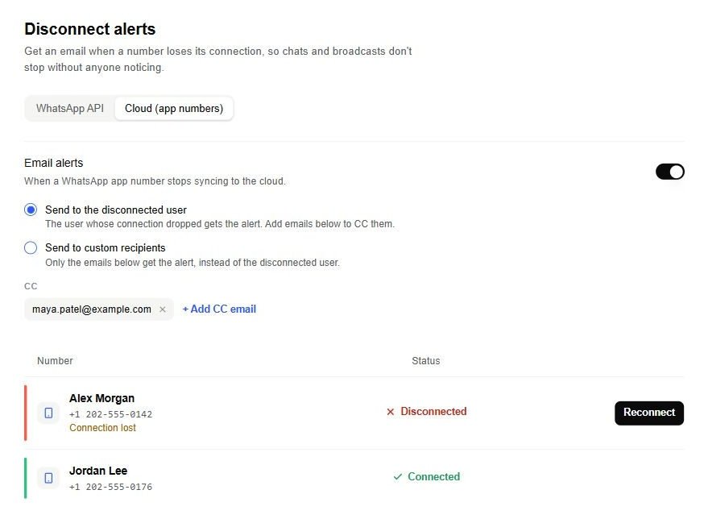
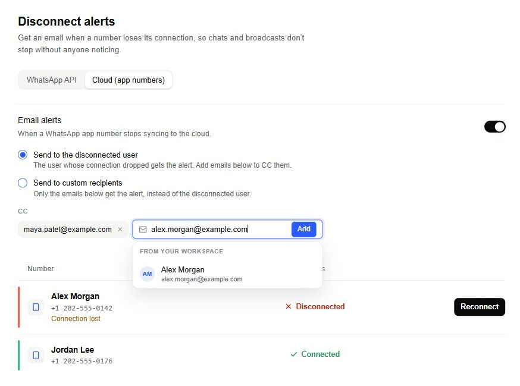
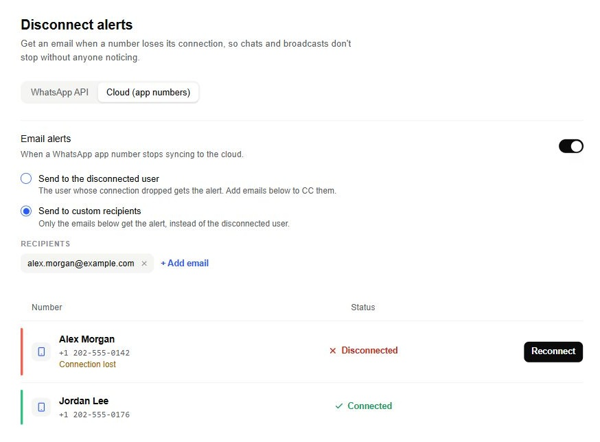

Notify the user when their Cloud connection disconnects, and add CC email addresses to keep teammates informed. You can also send alerts to a custom recipient list from **Settings → Disconnect alerts → Cloud (app numbers)**.

<Note>
Only workspace admins can manage disconnect alerts.
</Note>

## Set up Cloud alerts with CC emails

<Steps>
  <Step title="Open Cloud alerts and turn on email notifications">
    Open [Eazybe Settings](https://app.eazybe.com/settings), select **Disconnect alerts**, and choose **Cloud (app numbers)**.

    Turn on the **Email alerts** switch to display the recipient options. Select **Send to the disconnected user**: the user whose connection dropped receives the alert, and addresses under **CC** receive a copy of the same email.

    This is the default recipient option. Check that **Email alerts** is on; the recipient option alone does not enable alerts.

    
  </Step>

  <Step title="Add optional CC emails">
    Under **CC**, select **+ Add CC email**. Choose a teammate under **FROM YOUR WORKSPACE**, or enter an email address and select **Add**. Addresses outside your workspace are supported too.

    Repeat for each person who needs a copy, such as a manager or the team responsible for restoring the connection. Saved addresses appear as chips. You can add up to 10 CC addresses.

    Changes save automatically. Wait for each change to finish saving before making the next one. If a save fails, try again and check that the address appears in the list.

    

    <Note>
    CC is optional. With no CC addresses, you see *No one in CC. Only the disconnected user is notified.* You do not need to add the disconnected user's address to CC.
    </Note>
  </Step>

  <Step title="Choose custom recipients if needed">
    To send alerts only to a specific list, select **Send to custom recipients**. Under **Recipients**, select **+ Add email**, choose a teammate or enter an email address, and select **Add**. You can add up to 10 recipients.

    Review the displayed addresses, including any prefilled admin address, to confirm who will receive alerts.

    

    <Note>
    In this mode, the disconnected user is not automatically notified. Include their address in **Recipients** if they should receive the alert too. CC applies only to **Send to the disconnected user**.
    </Note>
  </Step>
</Steps>

The CC and custom recipient lists are saved separately. Switching options displays the corresponding list; it does not move addresses between lists.

## Manage recipients or stop alerts

Use **×** beside an email chip to remove it. If some addresses are hidden, select **+N more** to view and search the full list.

- With **Send to the disconnected user** selected, you can remove every CC address. The disconnected user still receives alerts while **Email alerts** is on.
- With **Send to custom recipients** selected, keep at least one recipient while alerts are on. Turn **Email alerts** off before removing the last recipient.

To stop Cloud disconnect emails, turn off **Email alerts**. Your recipient settings are saved for when you turn alerts on again. Keep **Cloud (app numbers)** selected while editing Cloud alerts.

## Review and reconnect a disconnected number

Below the alert settings, find the affected number in the table. Check its **Status**: **Disconnected** means the connection needs attention. A reason, such as **Connection lost**, may appear beneath the number.

Select **Reconnect** beside that number to open the [Channels page](https://app.eazybe.com/numbers-connected). Find the matching number and follow the Cloud connection flow. Opening **Reconnect** takes you to Channels; it does not by itself restore the connection.

## Frequently asked questions

<AccordionGroup>
  <Accordion title="Can I notify only the disconnected user?">
    Yes. Turn on **Email alerts**, select **Send to the disconnected user**, and leave **CC** empty. Removing all CC addresses does not turn alerts off.
  </Accordion>
  <Accordion title="Why did nobody receive a disconnect alert?">
    Confirm that **Email alerts** is on in **Cloud (app numbers)**. Check the selected recipient option: the affected user and CC addresses receive the email in the first mode; only the **Recipients** list receives it in custom mode. Check that your changes saved, and ask the intended recipient to check their spam folder.
  </Accordion>
  <Accordion title="Why can't I change the recipient options?">
    Only workspace admins can manage these settings. If you see **Admin only**, ask an admin to update them. If you are an admin, turn on **Email alerts** to display the options and wait for any current save to finish.
  </Accordion>
</AccordionGroup>
