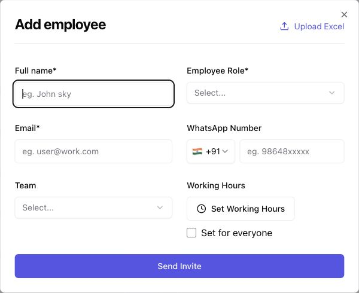

Invite employees using their work email addresses, then share your main organization's code so they can join the right team.

<Steps>
  <Step title="Open the employee invitation section">
    Sign in to [app.eazybe.com](https://app.eazybe.com) as an admin of your main organization. Open **Staff** and select **Add Employee** to invite an employee.

    
  </Step>
  <Step title="Enter the employee details and send the invitation">
    In **Add employee**, enter **Full name**, choose **Employee Role**, and enter the employee's **Email**. Complete **WhatsApp Number**, **Team**, and **Working Hours** if needed, then select **Send Invite**.

    Eazybe sends an invitation to that email address. The employee can use the email link or sign in directly at [app.eazybe.com](https://app.eazybe.com) with the same email.

    

    <Note>
    Ask the employee to install the extension and sign in before joining your organization. Send them the [employee onboarding guide](/en/getting-started/onboarding/employee).
    </Note>
  </Step>
</Steps>

## Share your main organization's code

On the **Staff** page, find **ORGANIZATION CODE** and use **Copy Organization Code**. Share it with the invited employee.

You can also find **Organization Code** in the Eazybe **My Account** panel inside WhatsApp Web. Confirm that **Organization Name** is your main organization before copying its code.

<Warning>
Share the **Organization Code**, not the **Access Code** or **Auth Key**. Those are separate credentials and are not needed to join the organization.
</Warning>

The employee opens **Join Organisation** in the extension and pastes your code into **Organization Code**. After they join, check that they appear in your main organization's **Staff** list with the intended role.

## Finish CRM setup

If your organization uses **HubSpot, Salesforce, or Zoho**, connect the CRM as an admin if it is not already connected. Employees should be mapped automatically when the admin has connected the CRM; if someone is not mapped, use **Settings → User Mapping** within that CRM integration.

[Follow the CRM mapping guide →](/en/getting-started/onboarding/crm)

## Frequently asked questions

<AccordionGroup>
  <Accordion title="What if the employee does not receive the email?">
    Check the email address you entered and ask the employee to check spam or junk. They can also open app.eazybe.com directly, sign in with that same email, and use your organization code in the extension.
  </Accordion>
  <Accordion title="Which organization code should I share?">
    Share the code for your main organization—the one where you want the employee to work. Confirm the organization name first.
  </Accordion>
  <Accordion title="Does an invitation also connect the employee's CRM?">
    The invitation and CRM setup are separate. For HubSpot, Salesforce, or Zoho, check automatic mapping after the employee joins. For other CRMs, the employee needs to integrate their own account.
  </Accordion>
</AccordionGroup>
