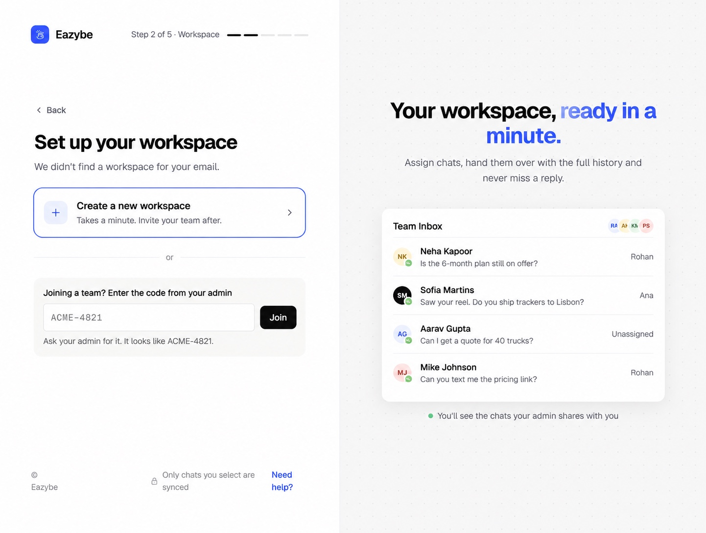
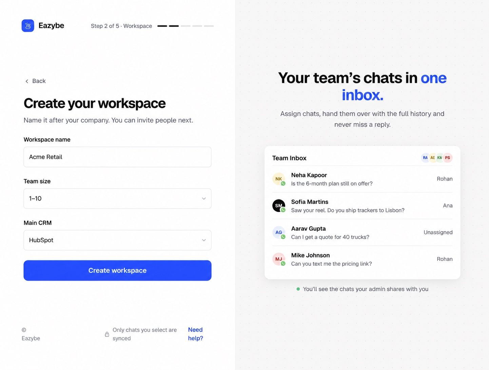

<Note>
This guide follows the new onboarding on dev. Screens after sign-in use the supplied prototype as a visual reference; sample names, numbers, prices, progress counts, and prototype-only buttons are illustrative. Follow the controls shown in your Eazybe app.
</Note>

Complete [sign-in and your work number](/en/getting-started/onboarding/overview) first. Create a workspace only if you are setting up a new company team.

<Steps>
<Step title="Choose Create a new workspace">
On **Set up your workspace**, select **Create a new workspace**. If your company already has a workspace, ask its admin for the code and use **Join** instead.

</Step>
<Step title="Enter your workspace details">
Enter **Workspace name**, select **Team size**, and choose **Main CRM**. Then select **Create workspace**. Choose the no-CRM option if you do not use a CRM yet. Selecting a CRM here records your preference; it does not authorize or connect the CRM.

</Step>

</Steps>

## Continue setup

[Install the extension and connect WhatsApp or calling →](/en/getting-started/onboarding/crm)

## Invite your team

After onboarding, use **Invite your team** in the Home checklist, or open **Staff → Add Employee**. Enter the employee's name, role, and work email, then select **Send Invite**. They can open the email link or sign in at app.eazybe.com with that email.

Share your main workspace's **Organization Code** from **Staff**. Employees paste it into the joining field during workspace setup. Share the organization code, not the separate access code or auth key.

[Send employees the joining guide →](/en/getting-started/onboarding/employee)

## Check CRM mapping

For HubSpot, Salesforce, or Zoho, employees can be mapped automatically after the admin connects the CRM. If a mapping is missing, open that CRM's **Settings → User Mapping** and select the correct CRM user. Employees using other CRMs complete their own integration.
