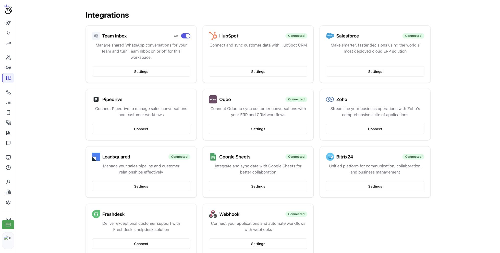
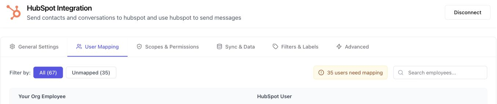
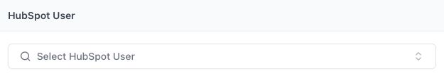

First [join your main organization](/en/getting-started/onboarding/employee). Then use the path that matches your CRM.

| Your CRM | What the employee does | What the admin does |
| --- | --- | --- |
| HubSpot, Salesforce, or Zoho—already connected by the admin | Check that your account is mapped automatically. | Complete missing mappings in the CRM's **Settings → User Mapping**. |
| HubSpot, Salesforce, or Zoho—not connected yet | Ask your admin to connect the organization's CRM. | Connect the CRM, then check employee mappings. |
| Another CRM | Integrate your own CRM account, even if the admin has connected theirs. | Help the employee identify the correct account and setup guide if needed. |
| No CRM | Continue using the features your organization has set up. | No CRM setup is required for joining the organization. |

## HubSpot, Salesforce, and Zoho

Employees should be mapped automatically when the admin has already connected the CRM. If mapping is missing, the **admin** completes these steps.

<Steps>
  <Step title="Open your CRM's settings">
    In [app.eazybe.com](https://app.eazybe.com), open **Integrations**. Find **HubSpot**, **Salesforce**, or **Zoho**, then select **Settings** on the connected CRM card.

    If the card shows **Connect**, the admin needs to complete the CRM connection first.

    
  </Step>
  <Step title="Find the employee in User Mapping">
    Open **User Mapping**. Find the employee by name or email. In HubSpot, you can use **Unmapped** and the employee search field to find accounts that still need mapping.

    

    <Note>
    The screenshots show HubSpot as the example. Open the settings for the CRM your organization actually uses.
    </Note>
  </Step>
  <Step title="Map the employee to the correct CRM user">
    In the employee's row, choose their matching CRM account. In HubSpot, this control is labelled **Select HubSpot User**. Confirm that the selected CRM user belongs to that employee, then check that their row shows the mapped user.

    

    Ask the employee to check the CRM connection in Eazybe after the mapping is complete.
  </Step>
</Steps>

## Other CRMs: connect your own account

Each employee completes their own integration. Open **Integrations**, select your CRM, and follow its connection flow using your own CRM account. Your admin's connection does not replace this step.

Use the integration guide for your CRM for its specific login, authorization, or configuration requirements. After connecting, return to Eazybe and confirm that your CRM is available.

## Frequently asked questions

<AccordionGroup>
  <Accordion title="I am in the organization but not mapped to HubSpot, Salesforce, or Zoho.">
    Ask your admin to open Integrations, choose your CRM's Settings, and check User Mapping. Give them the email address you use for Eazybe and the CRM account that should be linked to you.
  </Accordion>
  <Accordion title="Should I reconnect a CRM the admin has already connected?">
    For HubSpot, Salesforce, or Zoho, ask the admin to check your mapping first. For other CRMs, you need to complete your own integration.
  </Accordion>
  <Accordion title="Does joining an organization require a CRM?">
    No. Join your main organization first. Complete CRM setup only if your team uses a CRM with Eazybe.
  </Accordion>
</AccordionGroup>
