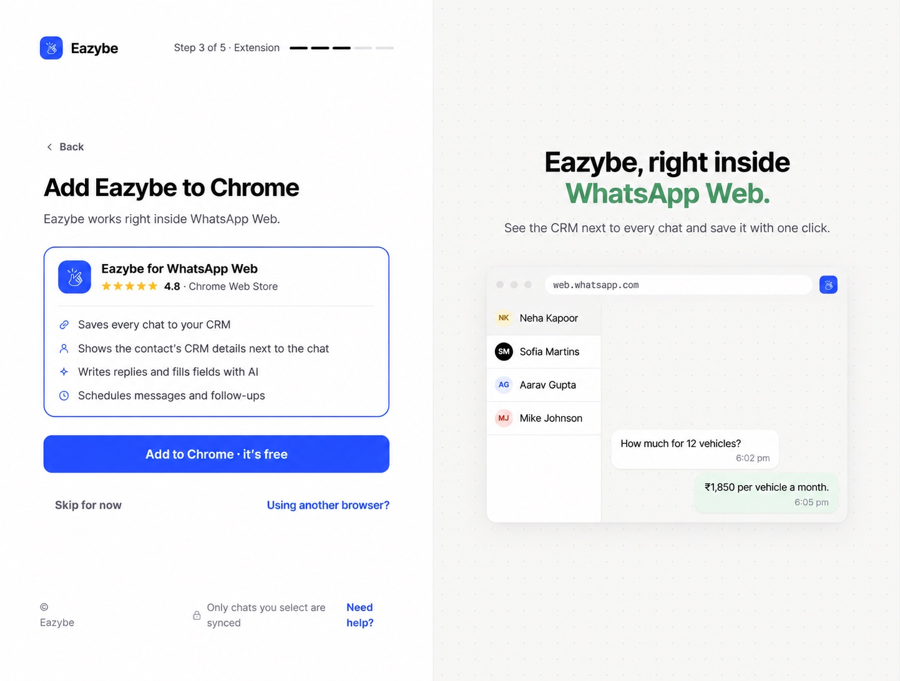
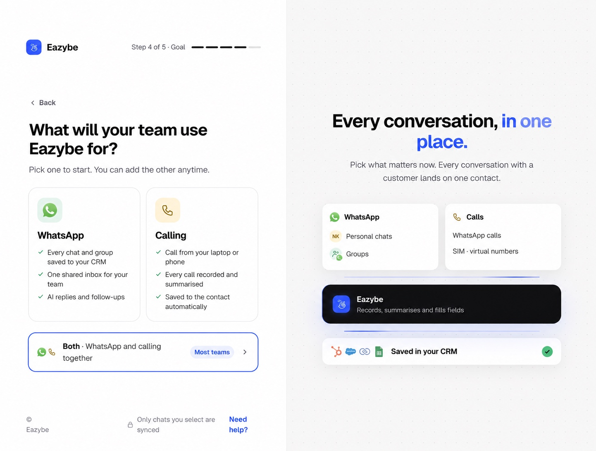
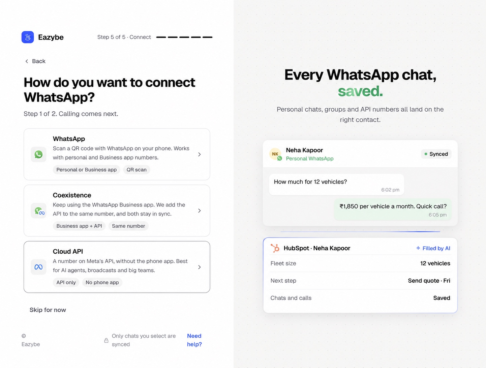
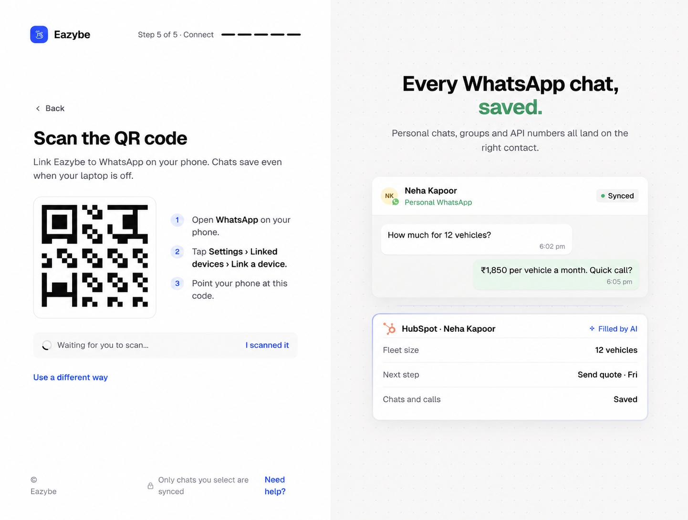
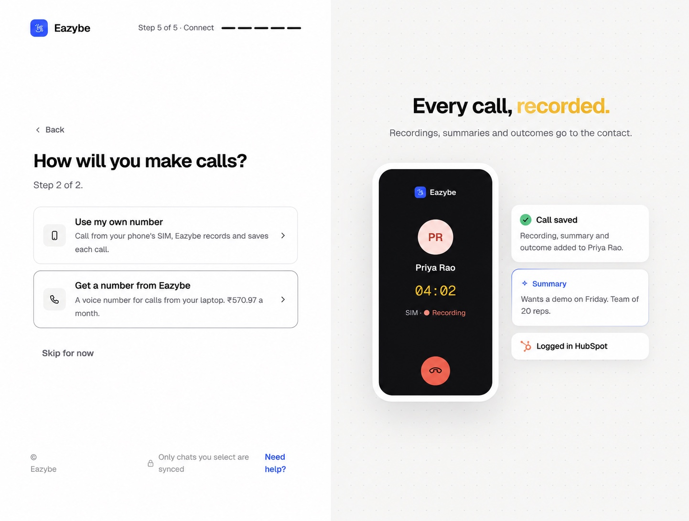
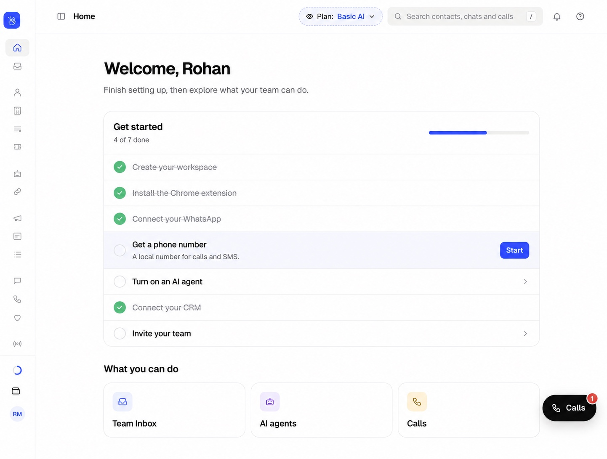

<Note>
This guide follows the new onboarding on dev. Screens after sign-in use the supplied prototype as a visual reference; sample names, numbers, prices, progress counts, and prototype-only buttons are illustrative. Follow the controls shown in your Eazybe app.
</Note>

Continue here after creating or joining your workspace.

<Steps>
<Step title="Add Eazybe to Chrome">
On **Add Eazybe to Chrome**, select **Add to Chrome · it’s free**. You can also open the [Chrome Web Store listing](https://chromewebstore.google.com/detail/whatsapp-ai-agents-with-c/clgficggccelgifppbcaepjdkklfcefd) directly. In the store, choose **Add to Chrome**, then **Add extension**. Install it only once. If Eazybe detects it already, select **Continue**. **Skip for now** lets you finish other setup, but install the extension before using Eazybe inside WhatsApp Web.

</Step>
<Step title="Choose what your team will use">
On **What will your team use Eazybe for?**, select **WhatsApp**, **Calling**, or **Both**. Both takes you through WhatsApp first and then calling. You can add the other option later.

</Step>
<Step title="Choose your WhatsApp connection">
If you selected WhatsApp or Both, choose a method below. Coexistence and Cloud API setup require an admin; ask your admin if those options are unavailable.

</Step>

</Steps>

| Method | When to use it | Next action |
| --- | --- | --- |
| **WhatsApp** | Connect a personal or WhatsApp Business app number. | Scan the QR code with your phone. |
| **Coexistence** | Keep the WhatsApp Business app and add the API to the same number. | Select **Connect with Meta** and follow the business-app connection flow. |
| **Cloud API** | Use a number on Meta's API without the phone app. | Select **Connect with Meta** and complete Meta's setup. |

## Connect with a QR code

On your phone, open WhatsApp, go to **Settings → Linked devices → Link a device**, and scan the code shown in your Eazybe session. Wait for **WhatsApp connected** before continuing. Use **New code** if a QR error appears, or **Use a different way** to change methods.

<Note>The QR code in this image is an illustration. Scan the current code in your own Eazybe app. The prototype's **I scanned it** button is a demo control; the implemented flow detects the connection.</Note>

## Set up calling

If you selected Both, choose **Next: set up calling** after WhatsApp. If you selected Calling, you go straight to the calling options.

- **Use my own number:** Install the Eazybe app on your Android phone, sign in with the same email, and follow the call-access prompts.
- **Get a number from Eazybe:** Select **Choose my number** to open Phone Numbers, choose a country and area code, and review the actual price before activating a number. The price in the prototype is illustrative.

You can use **Skip for now** where offered and finish later. Skipping does not connect a number.

## Finish from Home

Use the **Get started** checklist to finish any remaining tasks, including **Connect your CRM** and **Invite your team**. The checklist depends on what you selected and completed.

Selecting **Main CRM** during workspace creation does not connect it. Open **Connect your CRM** or **Integrations** and complete your CRM's authorization. For HubSpot, Salesforce, or Zoho, the admin checks **Settings → User Mapping** if an employee is not mapped automatically. Other CRM users complete their own integration.
