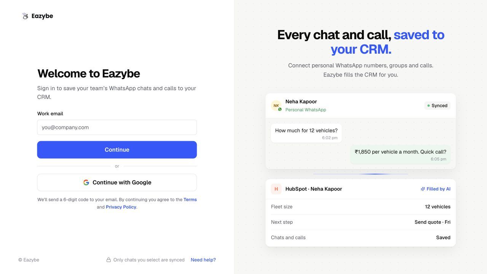
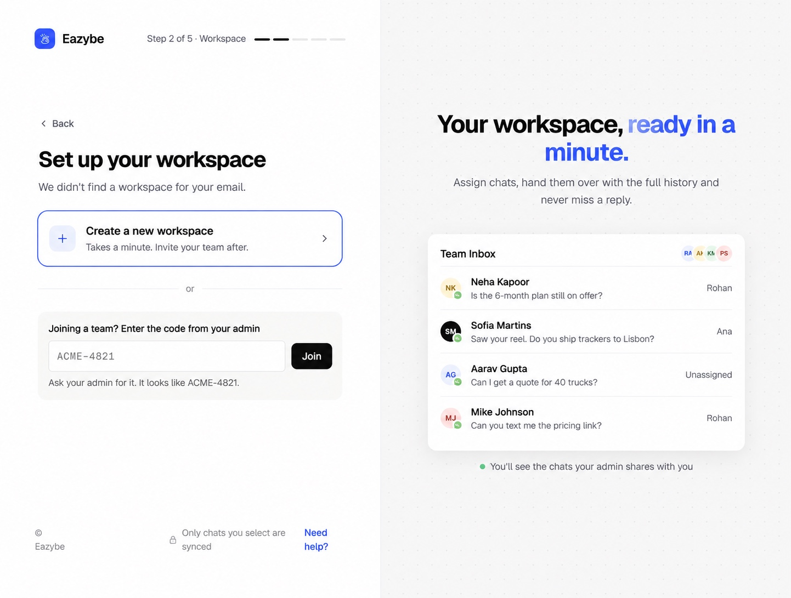

<Note>
This guide follows the new onboarding on dev. Screens after sign-in use the supplied prototype as a visual reference; sample names, numbers, prices, progress counts, and prototype-only buttons are illustrative. Follow the controls shown in your Eazybe app.
</Note>

Ask your admin for the main organization's code and use the email address they invited. You can follow the invitation link or sign in directly at app.eazybe.com.

<Steps>
<Step title="Sign in and add your work number">
Complete [sign-in, email verification, and your work WhatsApp number](/en/getting-started/onboarding/overview). Use your invited work email. Signing in to WhatsApp itself is separate from signing in to Eazybe.

</Step>
<Step title="Join with the code from your admin">
On **Set up your workspace**, find **Joining a team? Enter the code from your admin**. Paste your main organization’s code and select **Join**. This joins the existing workspace during onboarding; you do not need to create a separate workspace first.

</Step>

</Steps>

## Continue with the extension and connections

[Follow the extension, WhatsApp, and calling setup →](/en/getting-started/onboarding/crm)

The extension can be installed from the onboarding screen or directly from the Chrome Web Store. Both options install the same extension. Use your invited email when signing in to the extension.

## If something does not match

<AccordionGroup>
  <Accordion title="My invitation email has not arrived">
    Check spam and confirm the address with your admin. You can sign in directly with the invited email and join using the code your admin shares.
  </Accordion>
  <Accordion title="The organization code does not work">
    Paste it again without extra spaces. Ask the admin to confirm it belongs to the main organization. Do not use the sample code in the screenshot.
  </Accordion>
  <Accordion title="My CRM is not connected after joining">
    For HubSpot, Salesforce, or Zoho, ask the admin to check the CRM connection and Settings → User Mapping. For other CRMs, integrate your own account. Joining a workspace alone does not authorize a CRM connection.
  </Accordion>
</AccordionGroup>
