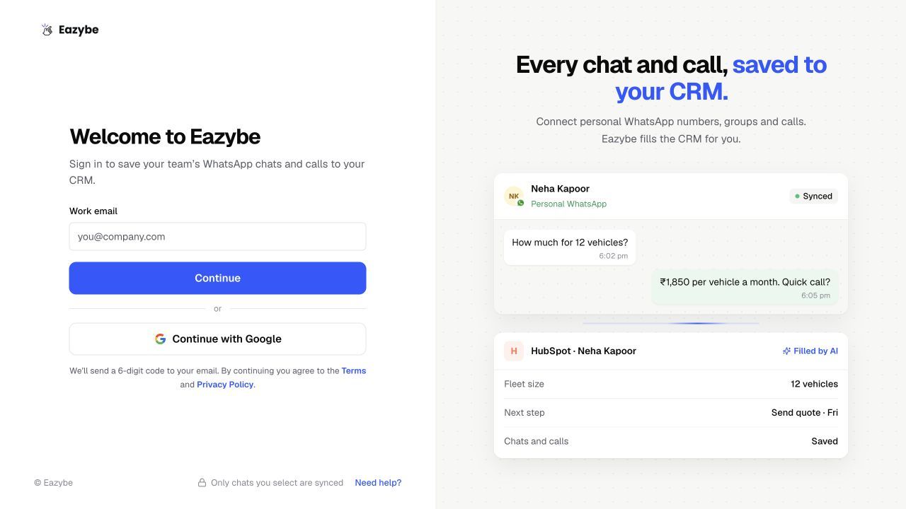
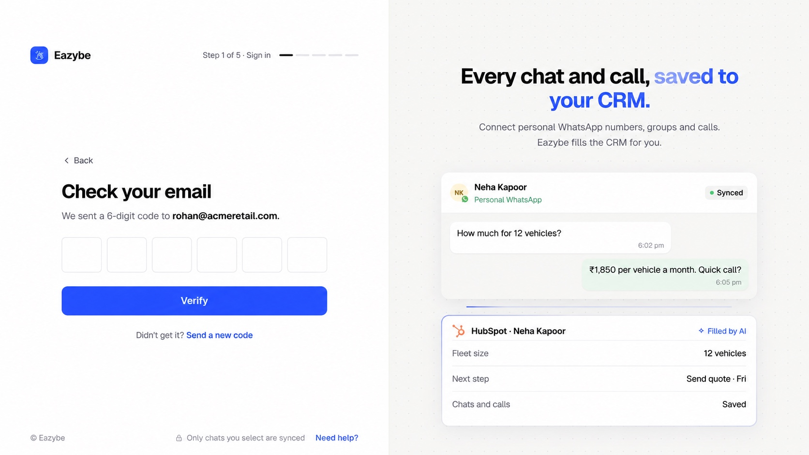
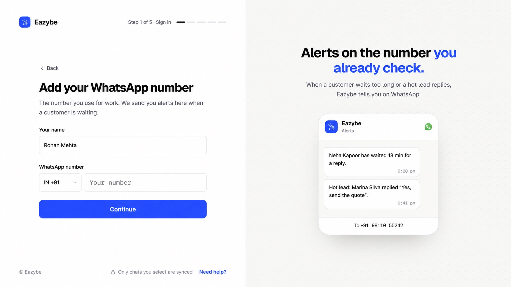

<Note>
This guide follows the new onboarding on dev. Screens after sign-in use the supplied prototype as a visual reference; sample names, numbers, prices, progress counts, and prototype-only buttons are illustrative. Follow the controls shown in your Eazybe app.
</Note>

Start at [Eazybe](https://app.eazybe.com/signin). To review the new flow before release, use [dev](https://dev-app.eazybe.com/signin).

The flow is **Sign in → Your WhatsApp → Workspace → Extension → Goal → Connect**. Some screens may be skipped when your account already has the required information.

<Steps>
<Step title="Sign in with your work email">
Enter **Work email** and select **Continue**, or choose **Continue with Google**. If your admin invited you, use that same email address.

</Step>
<Step title="Verify your email">
Enter the six-digit code from your email and select **Verify**. Use **Send a new code** if needed, or **Back** to correct your email. Google sign-in may not require this email-code screen.

</Step>
<Step title="Add your work WhatsApp number">
Enter **Your name**, choose the country code, and enter your **WhatsApp number**. Select **Continue**. This is the number used for alerts; adding it here does not connect WhatsApp chat sync.

</Step>

</Steps>

## Create or join a workspace

- **Setting up for your company?** [Create your workspace](/en/getting-started/onboarding/admin).
- **Joining an existing team?** [Join with your admin’s code](/en/getting-started/onboarding/employee).

Use the same work email across Eazybe, its extension, and the mobile app. Your organization's CRM connection is completed separately from email verification.
