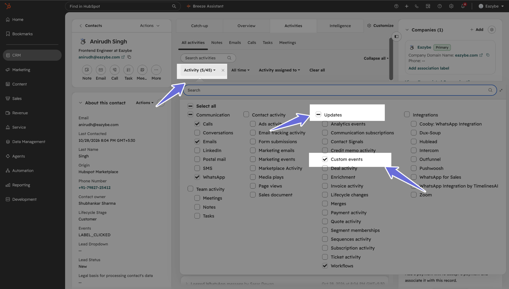
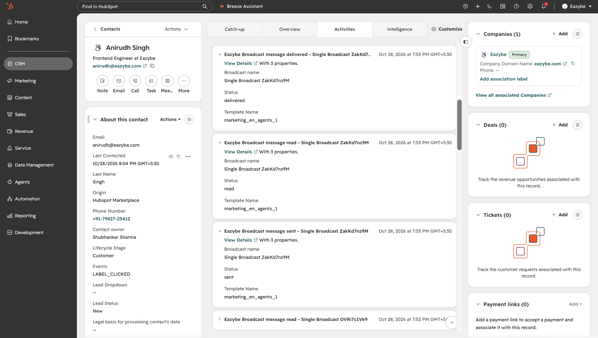

Track your WhatsApp broadcast activity directly on a HubSpot contact's timeline. Expand an Eazybe custom event to see the broadcast name, message status, template name, and any available failure reason.

## Before You Begin

- Use a HubSpot **Professional or Enterprise** subscription that includes **Custom events**. Check [HubSpot's custom event availability](https://knowledge.hubspot.com/reports/create-custom-events) for your subscription.
- Connect your Eazybe workspace to the HubSpot account containing the recipient's contact record. See [Connect Your HubSpot Account](/en/integrations/hubspot/account-connection).
- Make sure the broadcast recipient is associated with the correct HubSpot contact through your Eazybe integration.
- Send through an Eazybe WhatsApp Business API broadcast flow.

### Required HubSpot Permissions

To enable the required permission scopes, integrate HubSpot with Eazybe and approve the requested access during HubSpot authorization. Follow [Connect Your HubSpot Account](/en/integrations/hubspot/account-connection) to complete the integration.

Your HubSpot connection needs both permissions below, in addition to its existing contact access:

| Permission | What Eazybe uses it for |
| --- | --- |
| `analytics.behavioral_events.send` | Send broadcast status event occurrences to HubSpot. |
| `behavioral_events.event_definitions.read_write` | Read, create, and update the custom event definition. |

If you connected HubSpot before these permissions were requested, reauthorize the integration from Eazybe's HubSpot integration area. Select the correct HubSpot account and approve the requested access. Ask your HubSpot administrator to complete authorization if you cannot grant it.

<Note>
  An existing connection does not confirm that both permissions have been granted. After authorization, use a new test broadcast to check the connection. Eazybe creates or finds its event definition automatically; you do not need to create a custom event manually.
</Note>

## Show Broadcast Events on the Timeline

In HubSpot, open **CRM → Contacts**, select the recipient's contact record, and open **Activities → All activities**.

<Steps>
  <Step title="Select Custom events in the activity filter">
    Open the **Activity** dropdown above the timeline. The dropdown shows a selected-item count, such as **Activity (5/45)** in the screenshot. Under **Updates**, select **Custom events**, then close the dropdown.

    Make sure the date filter includes your broadcast's send date. Choose **All time** while checking for an event.

    

    <Note>
      Some HubSpot layouts label the filter **Filter activity** and the option **Custom event**. Selecting it changes which activities you see; it does not send a WhatsApp message or email.
    </Note>
  </Step>

  <Step title="Expand an Eazybe broadcast event">
    Find an entry beginning with **Eazybe Broadcast message**. Click the arrow beside the entry to expand it and review **Broadcast name**, **Status**, and **Template Name**. The event's date and time appear beside its title.

    Each reported status appears as a separate entry. The screenshot shows **delivered**, **read**, and **sent** events for the same broadcast.

    

    <Warning>
      The contact, broadcast names, template names, and timestamps in these screenshots are examples. Check your own recipient's contact record for their broadcast activity.
    </Warning>
  </Step>
</Steps>

## Understand the Status and Details

Event titles include the status followed by the broadcast name, for example: **Eazybe Broadcast message delivered - Single Broadcast ZakKd7nz9M**.

| Status | What it means |
| --- | --- |
| **sent** | WhatsApp reported the message as sent. |
| **delivered** | WhatsApp reported the message as delivered. |
| **read** | WhatsApp reported the message as read. |
| **failed** | WhatsApp reported a delivery failure. Expand the event to check any available **Failure reason**. |

**Broadcast name** identifies the campaign, and **Template Name** identifies the WhatsApp template used. A **Failure reason** appears only for failed statuses when an explanation is available. The event timestamp reflects when the provider reported the status, displayed by HubSpot.

<Note>
  Only reported statuses appear. A message does not need to have every status, and **delivered** does not automatically mean **read**. A newer broadcast does not replace older broadcast events.
</Note>

## Which Messages Appear?

This feature tracks provider-reported statuses for Eazybe WhatsApp Business API broadcasts. Workspace broadcasts and HubSpot workflow sends that use this broadcast flow are included. Extension and other CRM sends are included only when they use the same broadcast flow; ordinary free-form chats are not automatically included.

Historical broadcasts are not automatically added when you enable the feature. Sends rejected locally before reaching the provider, including sends suppressed because a contact opted out, do not generate these provider-status events.

## Troubleshoot Missing Events

| What you see | What to check |
| --- | --- |
| No Eazybe broadcast events | Select **Updates → Custom events**, choose **All time**, and confirm you opened the correct contact in the connected HubSpot account. |
| **Custom events** is unavailable | Ask your administrator to confirm that your HubSpot subscription includes custom events. |
| Events are missing after an older integration setup | Reauthorize the Eazybe HubSpot connection with both permissions listed above, then check a new broadcast. |
| A new broadcast has no event yet | Status updates depend on provider callbacks and background synchronization. Refresh the timeline later; do not resend a broadcast only to refresh its activity. |
| No **read** entry | A read status may not have been reported. A delivered event alone does not confirm that the message was read. |
| A **failed** event has no explanation | The provider may not have supplied a failure reason. |
| Older broadcasts are missing | Enabling the filter does not backfill historical broadcasts. |

If events are still missing, contact [Eazybe support](mailto:support@eazybe.com) with your HubSpot account ID, contact record link, broadcast name, approximate send time and timezone, expected status, and a screenshot of the activity filter. Do not include passwords or access tokens.
