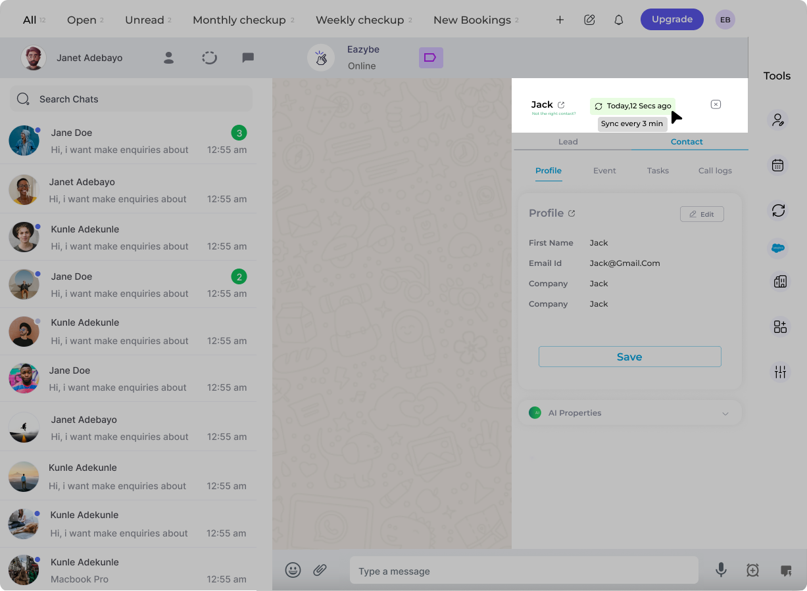
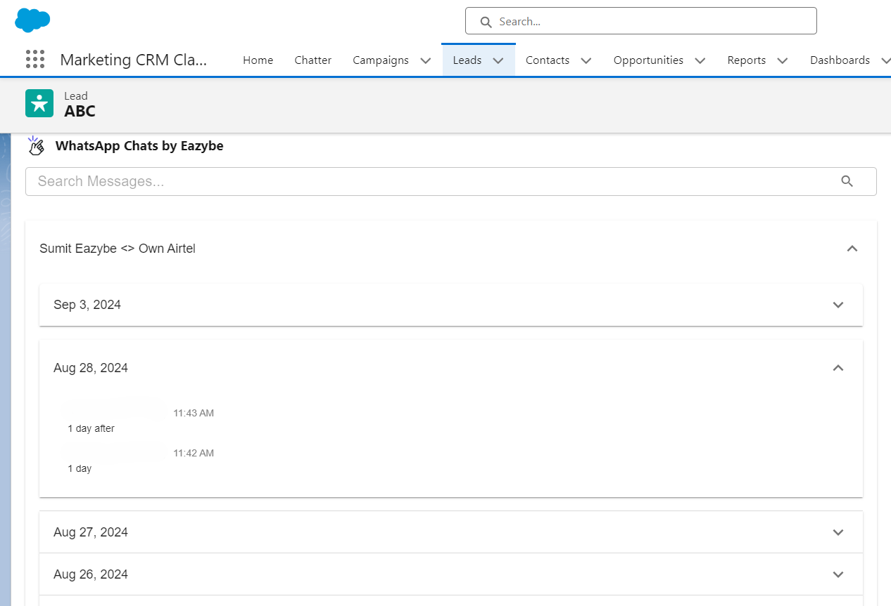
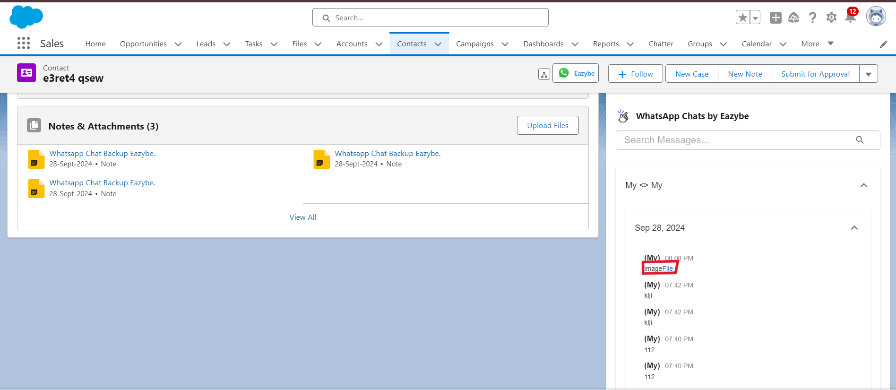

This guide explains how WhatsApp conversations are automatically synchronized with your Salesforce contacts and leads.

## Match numbers stored in custom fields

Use [Number mapping](/en/integrations/salesforce/number-mapping) to choose which Salesforce fields Eazybe searches to find the Lead or Contact for chat backup. An admin can use standard fields, all Phone-type fields, or selected Phone and Text fields. If a number is stored in a custom field, make sure that field is included in the saved configuration.

## Automatic Synchronization

<Info>
  WhatsApp conversations with your Salesforce contacts or leads are automatically synced every **3 minutes**.
</Info>

The last synced date and time displays in the EazyBe extension. You can verify the sync completion by clicking the icon to access the contact's Salesforce page.

## Initial Integration

When you first integrate Salesforce with EazyBe, the system automatically provides backup data spanning the **past 3 days**. This ensures you have recent conversation history available immediately.

## Backup in Activities

With **Back up in activities** enabled, Eazybe saves **1:1 and group conversations as completed Tasks** on the associated Salesforce **Contact or Lead**. Messages are appended to the conversation’s daily activity as backups run.

See the setup steps and examples in [Backup in Activities](/en/integrations/salesforce/activity-backup).

## When activity backup is off

With this setting off, Eazybe uses the existing Salesforce backup route: the **WhatsApp Chats by Eazybe** custom object, plus **Notes & Attachments** for Contacts. Enabling activity backup sends subsequent chat backups to completed Tasks instead of that route.

WhatsApp chats are stored in two locations within Salesforce:

<Steps>
  <Step title="Notes & Attachments Section">
    For Contacts, chats appear in the Notes & Attachments section of the contact record.

    
  </Step>
  <Step title="Custom Activity Object">
    A custom activity object called **WhatsApp Chats by EazyBe** stores all conversation data for both Contacts and Leads.

    
  </Step>
</Steps>

### Attachments Backup

<Tip>
  Attachments from WhatsApp conversations are stored in the **WhatsApp Chats by EazyBe** custom activity object for both Leads and Contacts pages.
</Tip>

## Need Help?

If you have any questions or need assistance, contact our support team at **hey@eazybe.com**.
