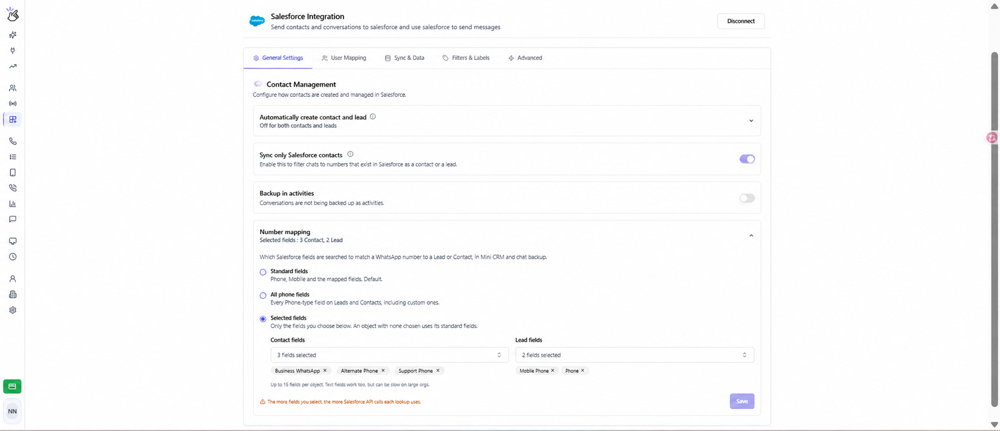

Use **Number mapping** to choose which Salesforce fields Eazybe searches when matching a WhatsApp number to a Lead or Contact. This matching is used in the Mini CRM and chat backup, including when the number is stored in a custom field.

## Open Number mapping

Sign in to the Eazybe workspace as an **admin**, open **Integrations → Salesforce → General Settings**, and expand **Number mapping** under **Contact Management**. Salesforce must be connected.

## Choose which fields to search

| Option | Fields searched | When to use it |
| --- | --- | --- |
| **Standard fields** | Phone, Mobile, and previously mapped fields. This is the default. | Your team uses the standard number fields or existing mappings. |
| **All phone fields** | Every accessible Phone-type field on Leads and Contacts, including custom Phone fields. | Numbers are spread across several Phone-type fields. |
| **Selected fields** | Only the fields you select separately for Contacts and Leads. Eligible Phone and Text fields are available. | You want to use specific custom fields or a Text field containing a phone number. |

<Note>
  In **Selected fields**, Phone and Mobile are not automatically included for an object with selected fields. Select them explicitly if you want them searched too. If you leave one object's selection empty, that object uses its standard fields. Choose at least one field across Contacts and Leads to save this mode.
</Note>

## Set up custom fields

1. Select **Selected fields**.
2. Open **Contact fields** and search by field label or API name. Select the fields that contain your customers' WhatsApp numbers.
3. Open **Lead fields** and choose the fields used for Leads. You can select up to **15 fields per object**.
4. To remove a field, click the **×** on its selected chip.
5. Click **Save**. Wait for the **Number mapping updated** confirmation. Changes apply only after saving.

The edited screenshot uses example Contact field names: **Business WhatsApp**, **Alternate Phone**, and **Support Phone**. Leads use **Mobile Phone** and **Phone**. Choose the actual fields in your Salesforce organization; selecting fields here does not create new Salesforce fields.

For example, if a Contact's WhatsApp number is stored only in **Business WhatsApp**, select that field so Eazybe can find the Contact for the Mini CRM and chat backup. With the configuration shown, the Contact's Phone and Mobile fields are not searched unless you add them.

<Warning>
  Searching all phone fields or selecting more fields increases Salesforce API usage per lookup. Text fields can be slower in large Salesforce organizations. Select the fields your team actually uses.
</Warning>

## Check the result

Open a WhatsApp chat whose number is stored in one of the configured fields. Check that the expected Lead or Contact appears in the Mini CRM, then check the [message sync status](/en/integrations/salesforce/message-sync).

If the record is not found:

- Confirm that the WhatsApp number is stored correctly in a field included in the saved mode.
- Check the Contact and Lead selections separately.
- For numbers stored in Text fields, use **Selected fields** and select the field explicitly.
- If a field is missing from the picker, check that the connected Salesforce user can access it. Only eligible Phone and Text fields are listed.
- If fields fail to load, check the Salesforce connection and try again.

To restore the default matching, select **Standard fields** and click **Save**. Your selected-field choices are retained when you switch modes.

See [Linking Contacts](/en/integrations/salesforce/linking-contacts) for how matched records are used. For assistance, contact **hey@eazybe.com**.
