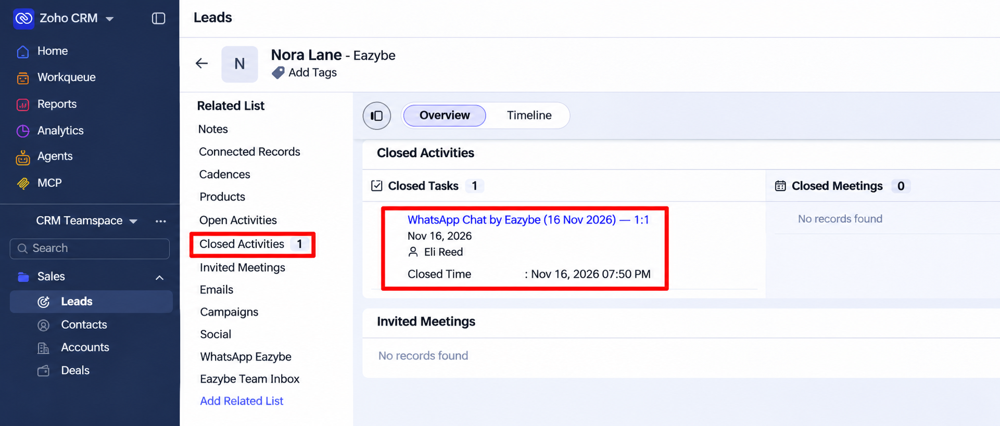
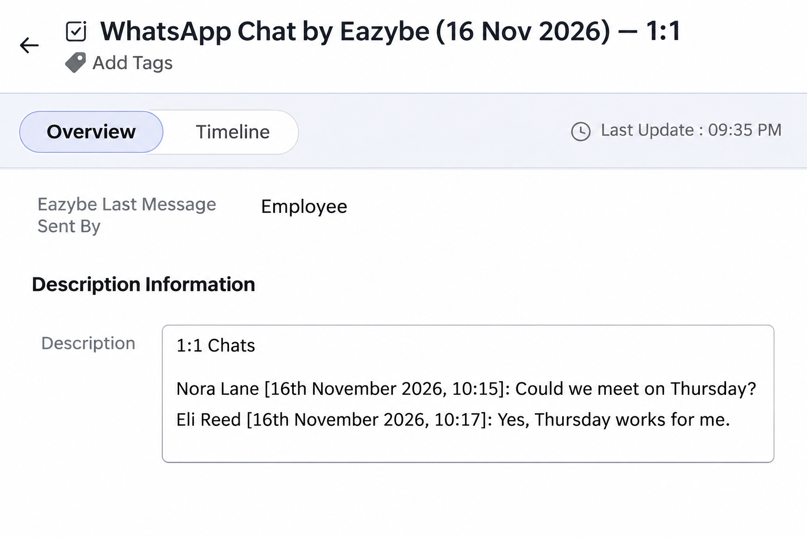

Eazybe creates one completed task per chat per day on the matching lead or contact. Open the task to read that day’s synced messages.

## Enable activity backup

1. In your Eazybe workspace, open **Integrations**, select your connected **Zoho CRM** account and open **General Settings**.
2. Turn on **Backup in activities**. The setting confirms that conversations are being backed up as completed tasks.

Administrators and managers change this setting for the whole organization. Other users change it for their own Zoho connection.

## Find a saved conversation in Zoho

1. Open the **Leads** or **Contacts** module and select the person whose chat you want to read.
2. In the **Related List** on the left, select **Closed Activities**. Under **Closed Tasks**, open **WhatsApp Chat by Eazybe** for the date you want.

In the task’s **Overview**, scroll to **Description Information**. The **Description** field shows the sender, time and text of each synced message.

