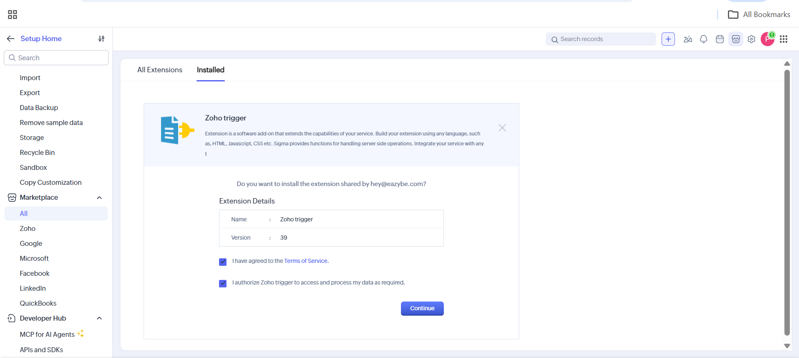
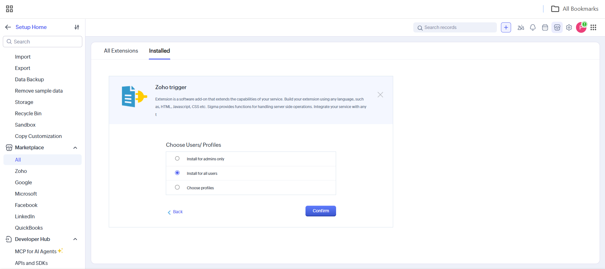
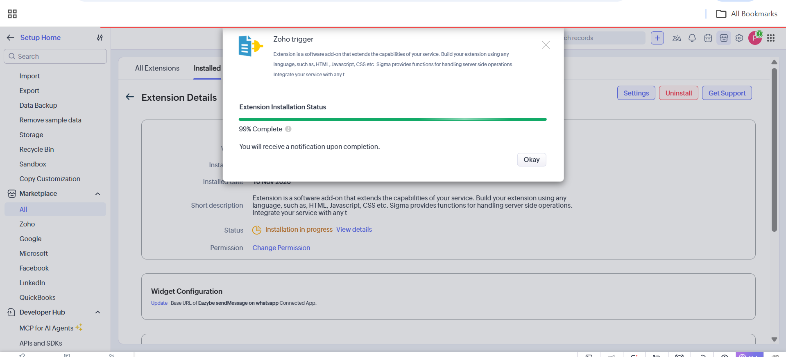
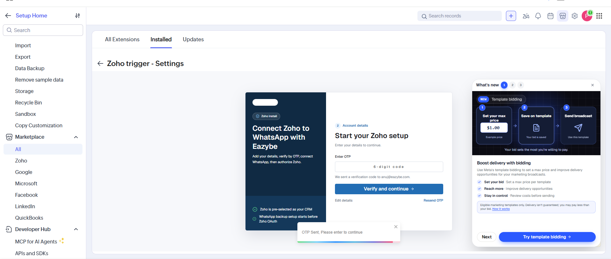
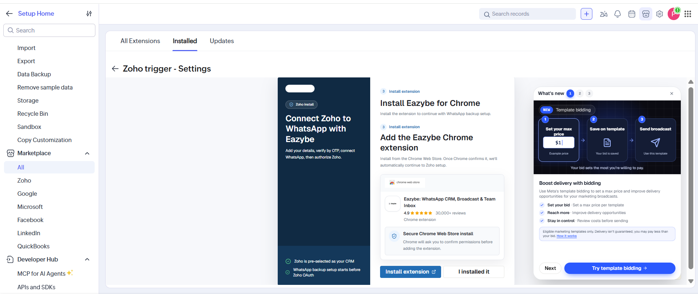
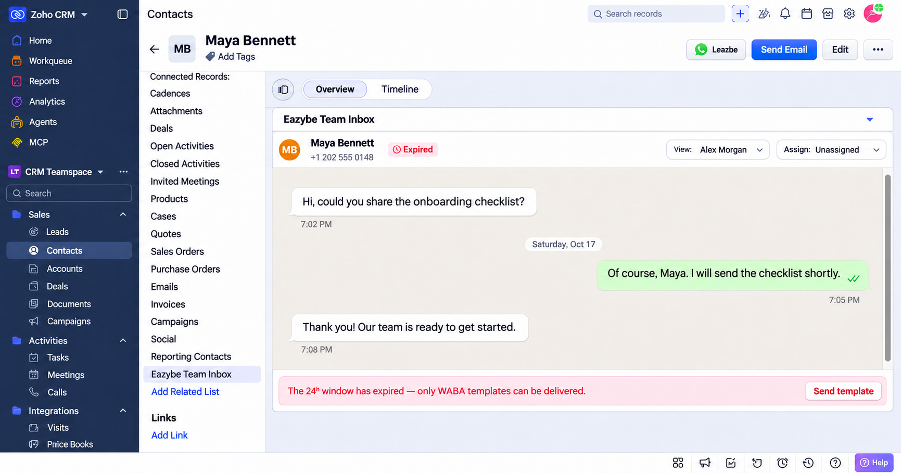
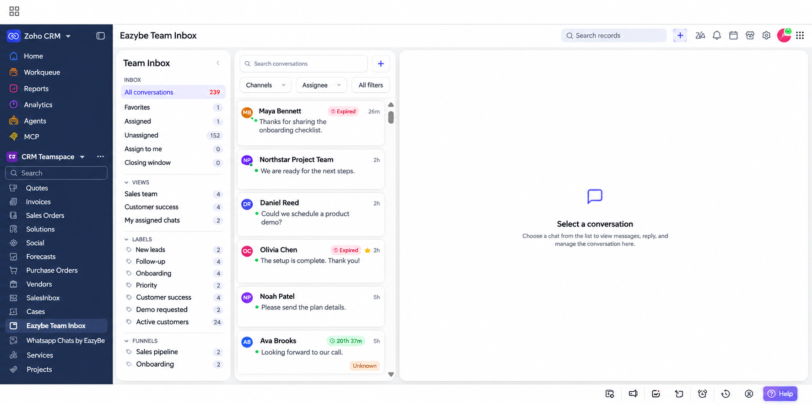

Eazybe Team Inbox brings your WhatsApp conversations into Zoho CRM. Open a Contact or Lead's conversation from their record, or use the overall Team Inbox to manage the conversations available to you in one place.

<Note>
The same **Zoho trigger** package includes both the WhatsApp workflow action and Team Inbox. After installation, it adds the **Eazybe Team Inbox** related list to Contact and Lead records and an **Eazybe Team Inbox** entry in Zoho's module navigation. You do not need separate packages for these features.
</Note>

## Install the Package

Use a Zoho CRM account with permission to install extensions. If this package is already installed, confirm that **Zoho trigger** is **Active** under **Setup → Marketplace → All → Installed**, then open an inbox below.

<Steps>
  <Step title="Open the package and review access">
    Open [Install Zoho trigger and Team Inbox](https://crm.zoho.com/market/installPrivatePlugin.do?portalName=rajatverma&nameSpace=zohotrigger&versionIndex=4520363000000438001) in your Zoho CRM account.

    The installation page shows **Zoho trigger** as the extension name. Review the Terms of Service and data-access authorization. If you agree, select both checkboxes and click **Continue**.

    
  </Step>
  <Step title="Choose who can use the extension">
    Under **Choose Users/Profiles**, select **Install for all users** to make the extension available to your team, then click **Confirm**. If access should be limited, use **Install for admins only** or **Choose profiles** instead.

    
  </Step>
  <Step title="Wait for installation to finish">
    Zoho displays **Extension Installation Status**. Click **Okay** to close the progress window and wait for the completion notification. Confirm that the installed extension's **Status** is **Active** before continuing.

    <Note>
    The screenshot shows **99% Complete**, which is still in progress. Wait for installation to finish; this screen alone does not confirm a successful installation.
    </Note>

    
  </Step>
  <Step title="Verify your Eazybe account">
    Open the installed extension's **Settings** and follow the Eazybe setup. Enter your account details when prompted. At **Enter OTP**, enter the six-digit code sent to your email and click **Verify and continue**. Use **Resend OTP** if you need a new code, or **Edit details** to correct your email.

    
  </Step>
  <Step title="Review the WhatsApp backup setup">
    The onboarding flow may show **Install Eazybe for Chrome** for WhatsApp backup setup. If you are setting up this backup feature, click **Install extension** or **I installed it**, as appropriate.

    Follow the setup prompts to connect your account and authorize Zoho. **Team Inbox is included in the Zoho package; the overall inbox does not require the Chrome extension or an open WhatsApp Web tab.**

    
  </Step>
</Steps>

<Tip>
To configure a WhatsApp workflow with the same package, follow [Send WhatsApp Messages through a Zoho Workflow](/en/waba/broadcasting/zoho-workflow/send-whatsapp-message). Installing the package makes the action available; you still need to create and activate your workflow rule.
</Tip>

## Open Team Inbox on a Contact or Lead

1. Open **Contacts** or **Leads** in Zoho CRM and select the record.
2. In the record's **Related List** on the left, scroll down and click **Eazybe Team Inbox**. You can also scroll down the record page to the section with the same name.
3. Review the record's conversation in the embedded inbox. Use **View:** to choose an available conversation view and **Assign:** to manage assignment according to your access.

<Warning>
The example below is an edited capture with fictional customer details and sample messages. It illustrates the Contact record layout; the same entry is available on Lead records after package installation.
</Warning>

<Note>
If the conversation shows **Expired** and **The 24h window has expired — only WABA templates can be delivered**, use **Send template** to continue through the template flow. The screenshot illustrates this expired-window state.
</Note>

## Open the Overall Team Inbox

1. In Zoho's module navigation, find **Eazybe Team Inbox** alongside modules such as **Vendors**, **Services**, and **Projects**. Scroll through the module list if needed. In the layout shown below, this navigation is on the left.
2. Click **Eazybe Team Inbox**. The overall inbox opens inside Zoho CRM and shows the conversations available to you across your workspace.
3. Choose an inbox list such as **All conversations**, **Favorites**, **Assigned**, **Unassigned**, or **Assign to me**. Use **Search conversations**, **Channels**, **Assignee**, and **All filters** to narrow the list.
4. Select a conversation to view its messages on the right. Until you select one, the panel shows **Select a conversation**.

<Warning>
The example below is an edited capture with fictional customer names, message previews, and custom view and label names.
</Warning>

## Manage Conversations in Zoho

Your Eazybe permissions determine which conversations you can view and manage inside Zoho CRM.

With a connected **WhatsApp Business API** or **Coexistence (CoEx)** number, you can send and receive messages directly from Team Inbox.

For conversation controls and messaging, see [Manage Conversations](/en/team-inbox-hd/manage-conversations-en) and [Messages, Templates, and Quick Replies](/en/team-inbox-hd/messages-templates-quick-replies-en).

## Troubleshooting

### Why Is the Team Inbox Entry Missing?

Confirm that you installed the package linked above and that **Zoho trigger** is **Active**. Check that your user or profile was included during installation, then refresh Zoho CRM. For a record inbox, open a Contact or Lead and scroll through its **Related List**. For the overall inbox, scroll through Zoho's module navigation.

### Why Is a Contact or Lead's Conversation Missing?

Check that the record contains the customer's correct WhatsApp number, including the international country code. Confirm your Zoho account is connected to Eazybe and that you can access the conversation in Eazybe. Check the selected **View:** as well.

### Why Does the Overall Inbox Not Load or Show the Expected Chats?

Confirm that the Zoho package is installed and active, that your user has access, and that your account is connected to Eazybe. Reload the Zoho inbox, compare your access at [app.eazybe.com](https://app.eazybe.com), and clear search text or filters that may hide the conversation. The overall inbox is provided by the installed Zoho package and does not depend on the Chrome extension.
