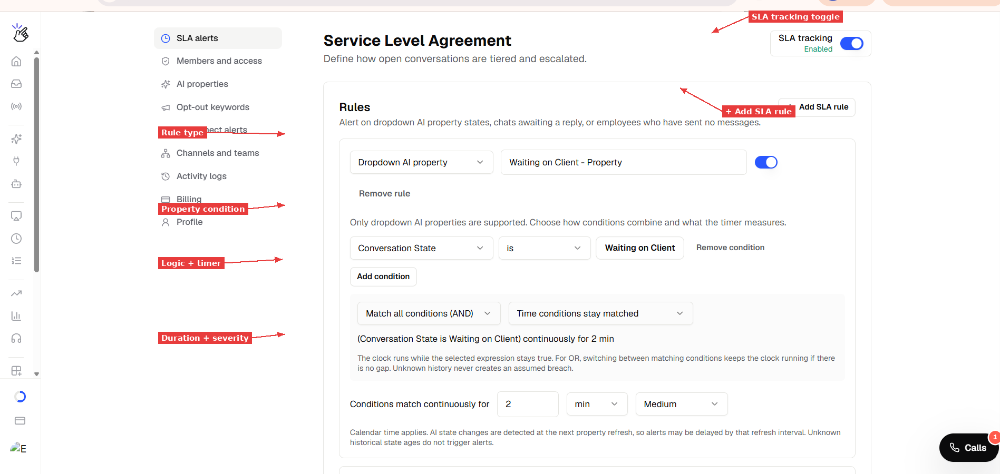
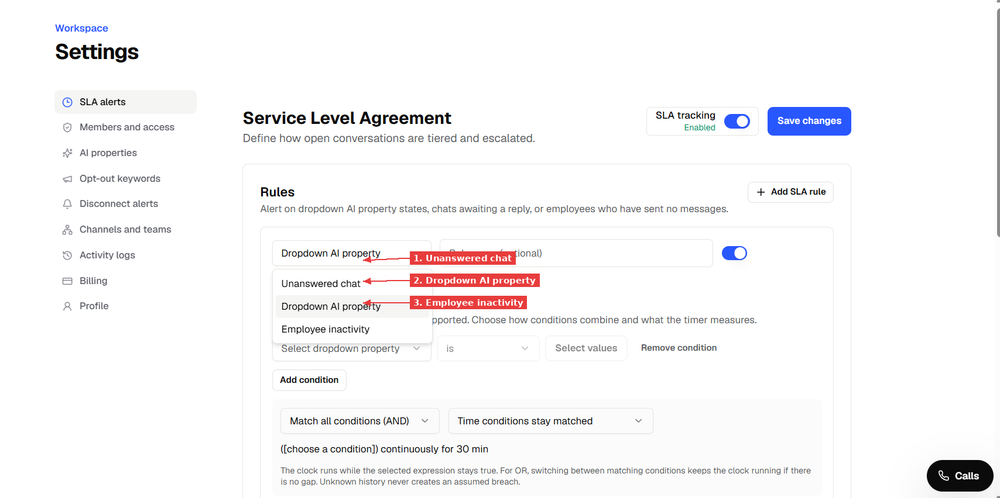
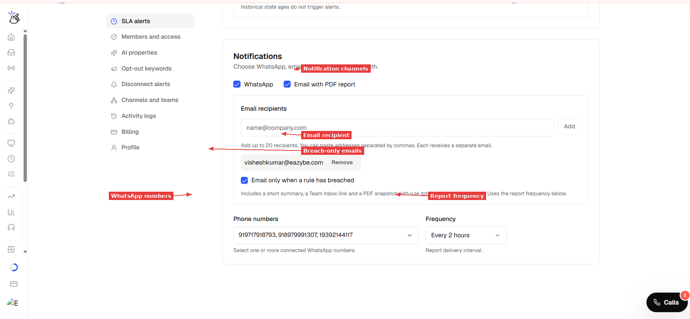

> **Documentation Directory**
> Before exploring individual pages, see the full index at [https://help.eazybe.com/llms.txt](https://help.eazybe.com/llms.txt) for all available topics.

# SLA Alerts — Monitor Response Times and Property States

> Define time-based rules on your AI properties, unanswered chats and employee activity. When a rule breaches, Eazybe sends a report to your WhatsApp and email — so your team can act before customers wait too long.

SLA (Service Level Agreement) alerts help you catch conversations that have been sitting too long without attention. You set the rules — Eazybe watches your chats and notifies you when something needs action.

## What Can SLA Alerts Track?

SLA alerts support three types of rules:

- **Dropdown AI property** — Alert when a conversation stays in a specific AI property state too long. For example: "Conversation State is Waiting on Client for more than 2 hours."
- **Unanswered chat** — Alert when a customer has been waiting for a team reply beyond your threshold. For example: "No team reply for 30 minutes."
- **Employee inactivity** — Alert when an employee has not sent any qualifying message within your threshold. For example: "Employee has sent no message for 4 hours."

You can combine conditions too. For example: "Conversation State is Waiting on Client **AND** Preferred Language is English — for more than 5 minutes."

> [!NOTE]
> Only **dropdown** AI properties are supported in SLA rules. Text and number properties cannot be used as conditions yet.

---

## What You Need Before Starting

- **Admin or authorized access** to your Eazybe workspace
- **At least one AI property** defined in Settings → AI Properties (dropdown type)
- **A WhatsApp number** connected to the workspace (for WhatsApp reports)
- **An email address** for receiving PDF reports (optional)

---

## Step 1: Open SLA Settings

**1.** Go to **Settings** in the left sidebar of your Eazybe dashboard.

**2.** Click **SLA alerts** in the settings menu.

**3.** You'll see the Service Level Agreement page with the rules section and notification settings.

*The SLA alerts page. SLA tracking toggle is in the top right. Click "+ Add SLA rule" to create your first rule.*

---

## Step 2: Create Your First Rule

**1.** Click **"+ Add SLA rule"** to add a new rule.

**2.** Choose the rule type from the dropdown:

| Type | What It Watches |
|---|---|
| **Dropdown AI property** | A specific AI property value staying too long (e.g., Conversation State = Waiting on Client) |
| **Unanswered chat** | Time since the customer's last message with no team reply |
| **Employee inactivity** | Time since an employee last sent a qualifying message |

*Choose your rule type. Each type measures a different kind of delay.*

**3.** Give your rule a **name** (optional but recommended for clarity in reports).

---

## Step 3: Configure the Rule Conditions

### For Dropdown AI Property Rules

**1.** Select the **dropdown property** from the list (e.g., Conversation State).

**2.** Choose the **operator** (e.g., "is").

**3.** Select the **value** to watch (e.g., "Waiting on Client").

**4.** Optionally click **"Add condition"** to add a second condition. For example, add "Preferred Lang is English" to create a combined rule.

**5.** Choose how conditions combine:
- **Match all conditions (AND)** — all conditions must be true
- **Match any condition (OR)** — at least one condition must be true

**6.** Choose what the timer measures:
- **Time conditions stay matched** — how long the property has had this value
- **No team reply** — how long since the customer's last unanswered message, while the condition holds

*A property rule watching for "Conversation State is Waiting on Client" continuously for 2 minutes. The summary at the bottom confirms the rule logic.*

> [!NOTE]
> AI properties are re-evaluated on a refresh schedule (every 30 minutes for dropdown properties). A state change is only detected at the next refresh, so alerts may be delayed by up to one refresh interval. If your rule's timer is shorter than the refresh interval, the alert may not fire as precisely as expected.

### For Unanswered Chat Rules

No conditions to configure — this rule simply watches for customer messages that have received no team reply.

**1.** Set the duration threshold (e.g., 5 minutes).

**2.** Choose severity.

### For Employee Inactivity Rules

**1.** Set the duration threshold (e.g., 2 minutes).

**2.** Choose severity.

> [!NOTE]
> Only recorded human direct messages with an employee sender ID reset the inactivity timer. Templates, automation, broadcasts, and unattributed sends do not count.

---

## Step 4: Set the Timer and Severity

**1.** Set **"Conditions match continuously for"** — enter a number and choose the unit (min, hours, or days).

**2.** Choose the **severity** level:

| Severity | When to Use |
|---|---|
| **Critical** | Urgent — needs immediate attention |
| **High** | Important — should be handled soon |
| **Medium** | Standard tracking |
| **Low** | Informational — nice to know |

**3.** Make sure the **toggle** is switched **ON** (blue) to enable the rule.

---

## Step 5: Configure Notifications

Scroll down to the **Notifications** section.

**1.** Choose your notification channels:
- **WhatsApp** — sends a text report to your connected numbers
- **Email with PDF report** — sends a summary email with a PDF attachment

**2.** For email notifications:
- Enter the email address in the **Email recipients** field and click **Add**
- Check **"Email only when a rule has breached"** if you only want emails when something needs attention (recommended)

**3.** For WhatsApp notifications:
- Select one or more **phone numbers** from your connected WhatsApp numbers
- Choose the **Frequency** — how often reports are sent (Every 2 hours, 3 hours, or 4 hours)

*Configure both WhatsApp and email notifications. The email includes a PDF with a snapshot of all breaches.*

> [!NOTE]
> The frequency controls how often reports are **delivered**, not how often rules are **checked**. A chat can breach a 2-minute rule but only appear in the next scheduled report. For faster awareness, use shorter report intervals.

---

## Step 6: Save and Enable

**1.** Make sure **SLA tracking** is toggled **ON** (top right corner — shows "Enabled" in green).

**2.** Click **"Save changes"** (blue button, top right).

**3.** Refresh the page (F5) to confirm your rules persisted.

---

## Step 7: Verify in Team Inbox

**1.** Go to **Team Inbox** from the left sidebar.

**2.** Scroll down in the left panel to find **SLA TRACKING**.

**3.** You should see your rules listed with **live breach counts**.

*SLA Tracking in Team Inbox shows live counts for each rule. Click a rule name to filter the chat list to only matching conversations.*

**4.** Click on any rule name to **filter the chat list** and see only the conversations that breached that rule.

**5.** When you reply to a breaching chat, the count updates on the next check.

> [!NOTE]
> Employee inactivity rules appear in the email report but may not show in the Team Inbox sidebar. This is a known limitation.

---

## Understanding the Email Report

When a rule breaches, you receive an email with:

- **Total breach count** — how many chats or employees crossed the threshold
- **Rule breakdown** — each rule listed with its breach count and severity
- **A PDF attachment** — a snapshot with examples of breaching conversations

The report looks like this:

| Field | Example |
|---|---|
| Subject | "SLA breaches need attention" |
| Workspace | Workspace 902 |
| Chat breaches | 211 |
| Inactivity breaches | 4 |
| Rules listed | All enabled rules with individual counts |

> [!NOTE]
> A chat can breach more than one rule, so the total counts rule matches — not unique chats. If the same chat matches both "Waiting on Client" and "Unanswered 5min," it counts under both.

---

## What Resets Each Timer?

| Timer Type | What Resets It |
|---|---|
| **Property state** | The property value changes to something that no longer matches the condition |
| **Unanswered chat** | Any team member replies to the chat. More customer messages do **not** restart the timer |
| **Employee inactivity** | That specific employee sends a qualifying message. Messages from other employees or automation do not reset it |

---

## Tips and Best Practices

- **Start with longer thresholds** (30 min+) and tighten them as your team adjusts
- **Use combined rules** (AND) to focus alerts on high-value segments — e.g., "Waiting on Client AND Lead Stage is Negotiation"
- **Name your rules clearly** — the name shows in Team Inbox and email reports
- **Use "Email only when breached"** to avoid empty reports cluttering your inbox
- **Check the refresh interval** — a 2-minute SLA threshold on a property that refreshes every 30 minutes won't fire precisely

---

## Troubleshooting

**SLA Tracking says "SLA is disabled" in Team Inbox**

Make sure SLA tracking is toggled ON in Settings → SLA alerts, and that you have at least one enabled rule saved. Click Save changes, then refresh Team Inbox.

**Rule count is 0 but I know chats should match**

Check that the AI property value matches exactly. Go to a chat you expect to breach, check its AI properties panel, and confirm the value matches your rule condition.

**Email report not arriving**

Verify the email address is added correctly in Notifications. Check spam/junk folders. The report only sends at the configured frequency interval and only when "Email only when breached" has breaches to report.

**WhatsApp report not arriving**

Confirm the phone numbers in Notifications are connected WhatsApp Business numbers. If the messaging window is closed, the report is sent as the `sla_notice` template — the recipient taps "Send report" to receive the full text.

**Employee inactivity shows 0 even though no one is replying**

The timer only starts when SLA tracking is enabled. It does not count time from before you turned it on. Wait for the threshold duration after enabling.

---

*Last updated: November 2026*
