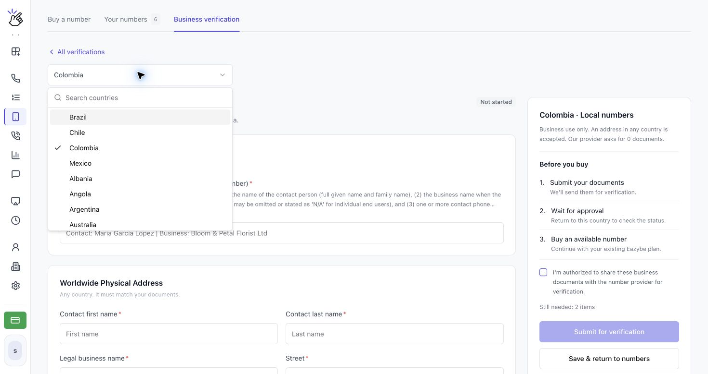
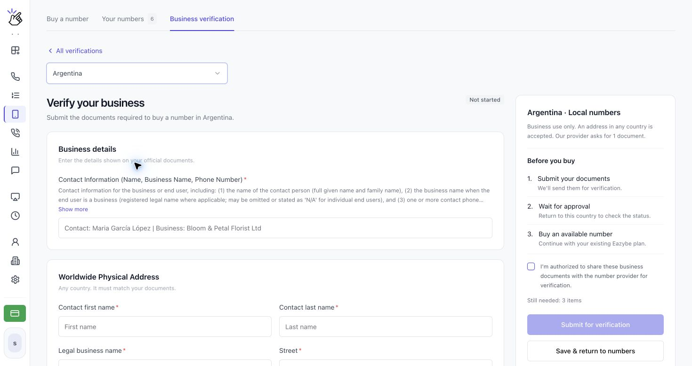
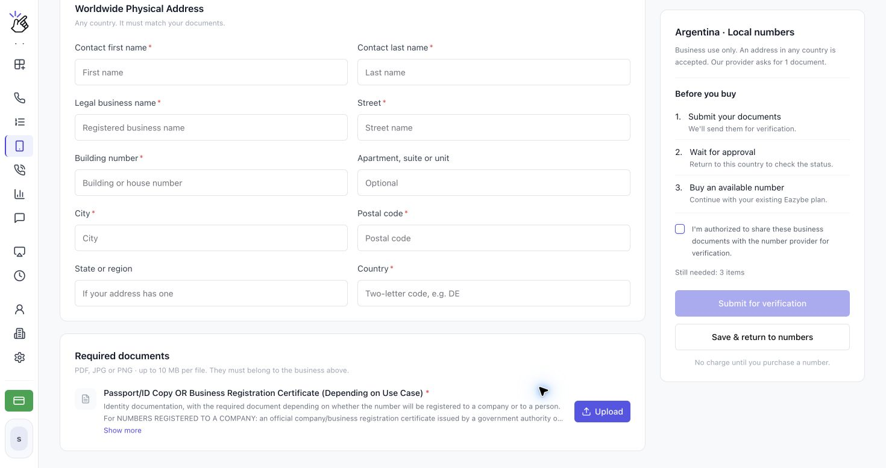
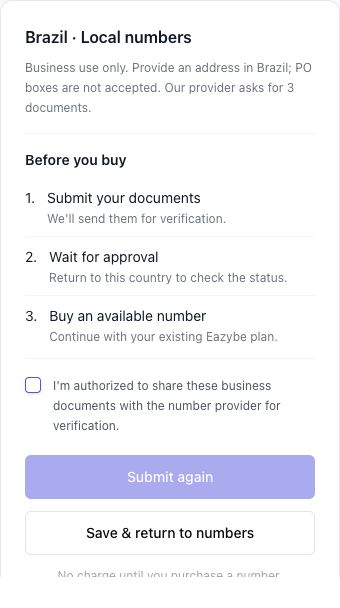
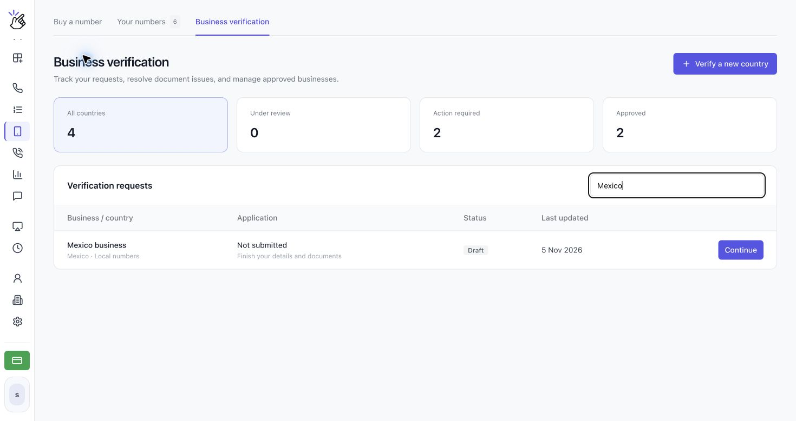
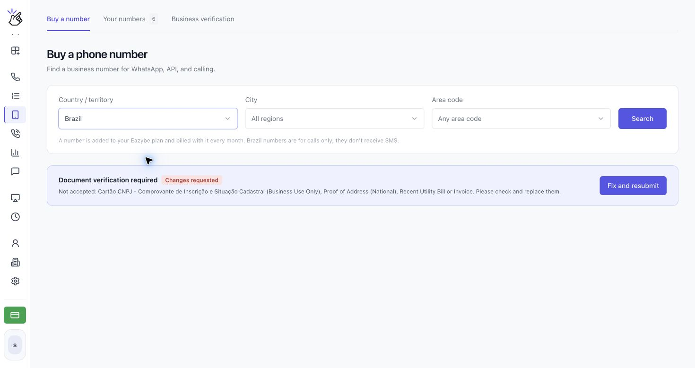

Complete **Business verification** before buying a number in a country that requires it, including Brazil. Submit a separate verification for each country where you want to buy numbers.

<Note>The form changes by country. The screenshots below show different countries to illustrate the flow; use the fields and document requirements displayed for your selected country. Placeholder names are examples to replace with your own details.</Note>

## Submit Your Verification

<Steps>
  <Step title="Open Business verification">
    Open **CALLS → Phone Numbers → Business verification**. Click **Verify a new country**, then choose the country in the selector. You can also click **Verify business** from the **Document verification required** notice under **Buy a number**.

    

    <Note>If the page says the country is not available yet because its identity check cannot be offered here, you cannot complete that country's verification in Eazybe yet. Choose another available country.</Note>
  </Step>
  <Step title="Enter your business details">
    On **Verify your business**, complete the required fields under **Business details** using the information on your official documents. Click **Show more** under a requirement to read its full instructions. Fields marked with an asterisk are required.

    

    For Brazil, the form asks for **Contact Information (Name, Business Name, Phone Number)** and **Brazilian CPF Tax Number (Personal Use Only)**. Use the authorized representative's personal details for the personal-use requirements and the business's details for business-use requirements. A CNPJ business identifier does not replace a CPF.
  </Step>
  <Step title="Add the address and upload the required documents">
    Complete the address section. If the form requires an address in the number's country, use a matching local address; Brazil requires an address in Brazil and does not accept PO boxes. Where **Worldwide Physical Address** appears, the form accepts an address in any country that matches your documents.

    Under **Required documents**, read each requirement and click **Upload** next to it. Use clear **PDF, JPG or PNG** files, up to **10 MB per file**. After uploading, use **View** to check a file or **Replace** to correct it.

    

    <Note>Some countries request details and an address without file uploads. Follow the form for your country rather than uploading the same documents for every country.</Note>
  </Step>
  <Step title="Review and submit your verification">
    Review **Before you buy** and any **Still needed** items. Once the required fields and documents are complete, select **I'm authorized to share these business documents with the number provider for verification.**, then click **Submit for verification**. If you are correcting a rejected submission, the button says **Submit again**.

    

    <Tip>Use **Save & return to numbers** to keep a draft and finish later. Saving a draft does not submit it for review.</Tip>

    <Warning>Submit only documents you are authorized to share with the number provider. Submission sends them for verification. It does not purchase a number or charge you.</Warning>
  </Step>
  <Step title="Track your request and return after approval">
    Open **Business verification** to see **Verification requests**. Filter by **All countries**, **Under review**, **Action required**, or **Approved**, or use **Search business, country or ID**. Open a request using its action button.

    

    Review may take a few working days. Eazybe emails you when the request has been checked. Once **Approved**, return to **Buy a number**, select the same country, and search for an available number.
  </Step>
</Steps>

## Prepare Documents for Brazil

The Brazil form currently requests the following. Read **Show more** for the latest accepted-document details before uploading.

| Requirement | What to provide |
| --- | --- |
| Contact information | Contact person's full name, legal business name, and contact phone number. |
| Brazilian CPF | The authorized representative's CPF, matching their personal details. |
| Physical address in Brazil | The business address matching the supporting documents; no PO box. |
| Proof of Address (National), Recent Utility Bill or Invoice | Accepted proof showing the name and full address in Brazil. Non-government documents must be issued within the last three months; government-issued identification must be unexpired where an expiry date applies. |
| Cartão CNPJ - Comprovante de Inscrição e Situação Cadastral (Business Use Only) | The business's official CNPJ registration document showing active registration. A passport is not a substitute. |
| ID/Passport Copy (Personal Use Only) | A clear copy of the authorized representative's valid, unexpired government-issued ID or passport. |

## Understand Your Status

| Status | What to do next |
| --- | --- |
| **Not started** | Complete the country-specific form. |
| **Draft** | Click **Continue** in the request list, finish the missing items, and submit. |
| **Under review** | Wait for review. Details cannot be changed during review. Open the request and use **Check status** for an update. |
| **Changes requested** | Click **Fix and resubmit**, read the reason, correct the details or use **Replace** for the affected files, then **Submit again**. |
| **Approved** | Buy an available number in that country. Check the displayed expiry date, if any. |
| **Expired** | Click **Update documents** and submit again before buying more numbers. Numbers you already own keep working. |

<Warning>Changing an approved verification's details requires a new review before you can buy more numbers in that country.</Warning>

The **Buy a number** screen also shows the current verification status and the next action for that country.

## Why Is the Submit Button Disabled?

Check **Still needed**, complete every required field, upload each required document, and select the authorization checkbox. A saved draft or uploaded file alone is not a submitted verification.

## Why Can I Still Not Buy a Number?

Confirm that the verification for the selected country is **Approved**. Approval in another country, a draft, or a request still under review does not unlock purchasing. Approval also does not reserve stock: if no numbers are available, try another area code or search all regions.

After approval, continue with [Buy and Manage Phone Numbers](/en/voice-number/phone-numbers). Brazil and other calls-only numbers use a phone call, rather than SMS, for WhatsApp verification.
