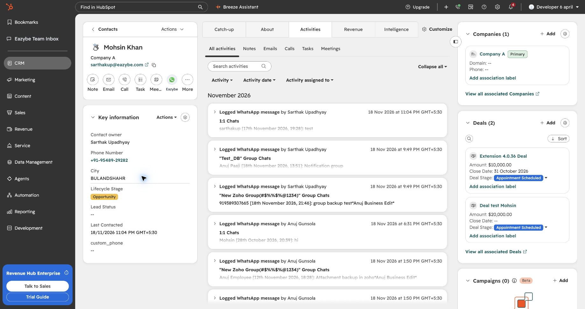
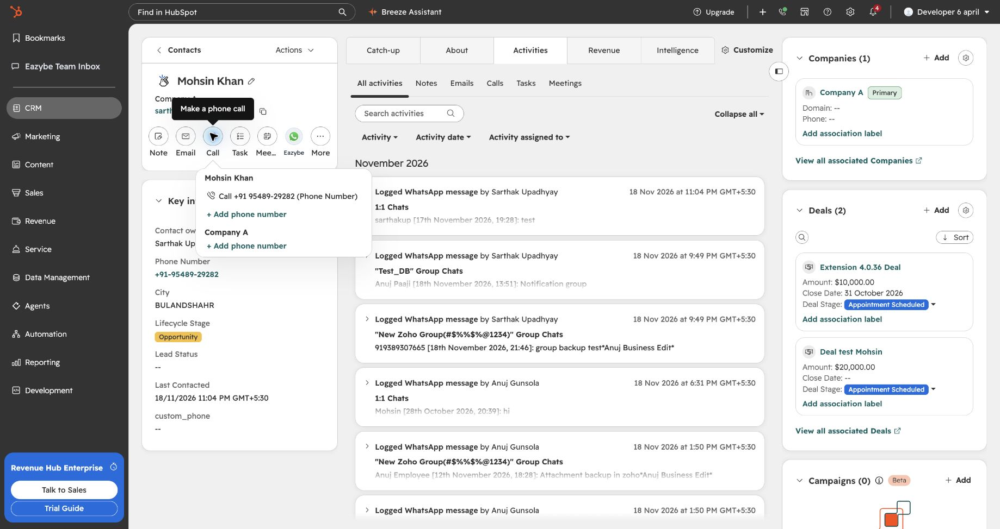
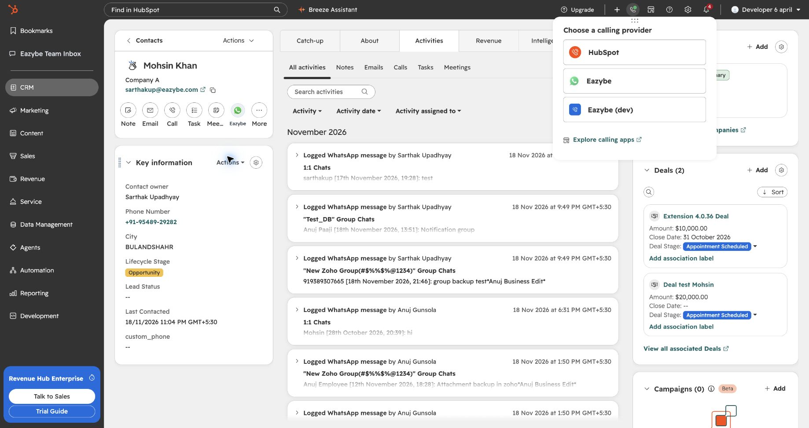
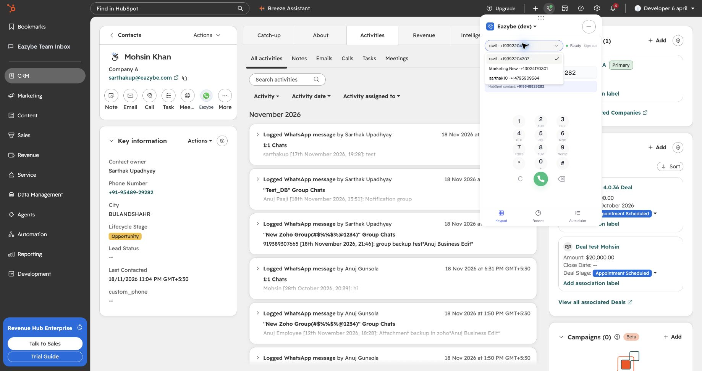
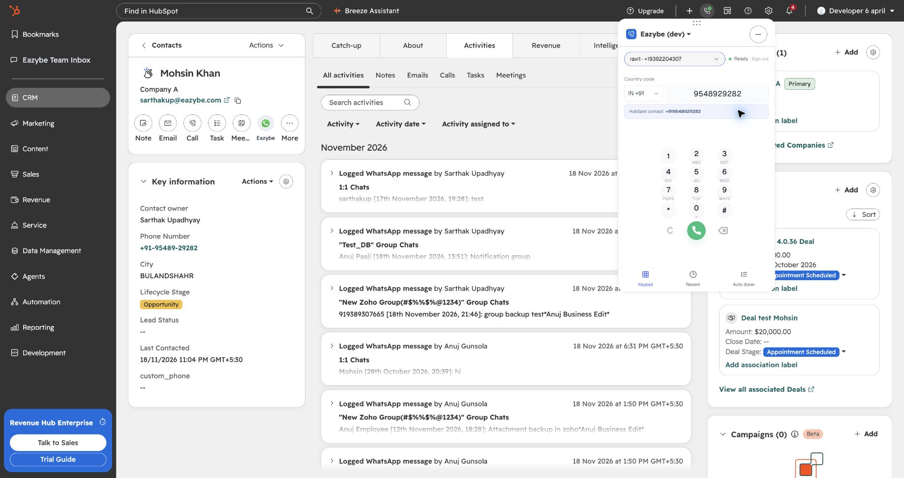
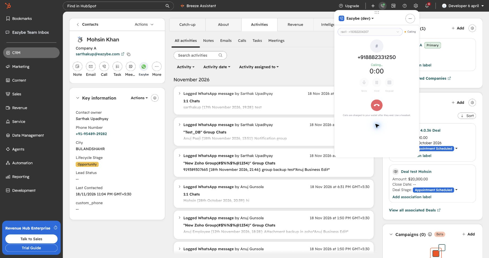
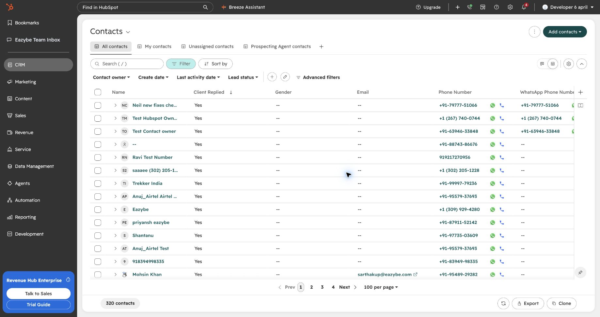
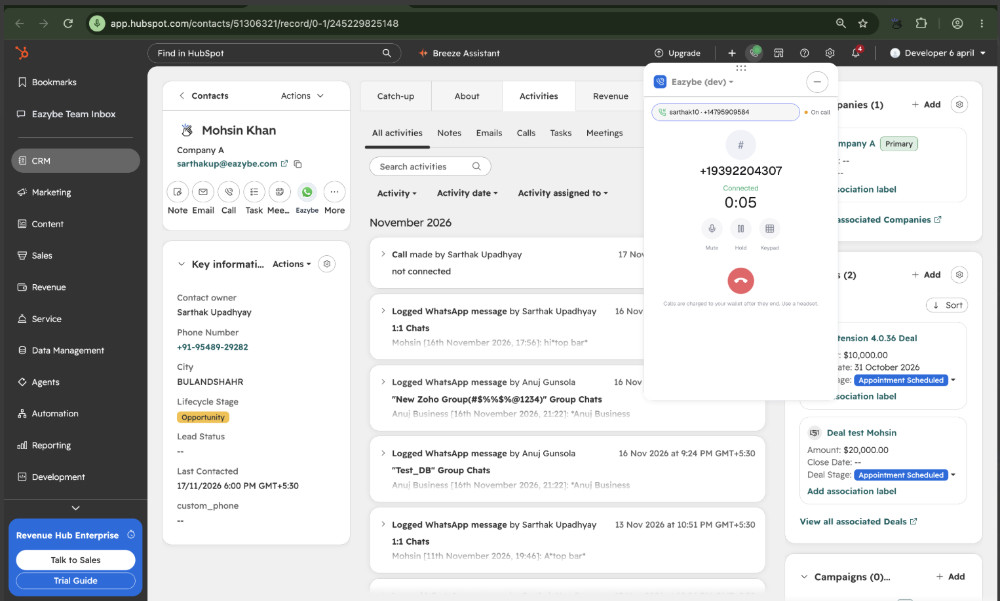
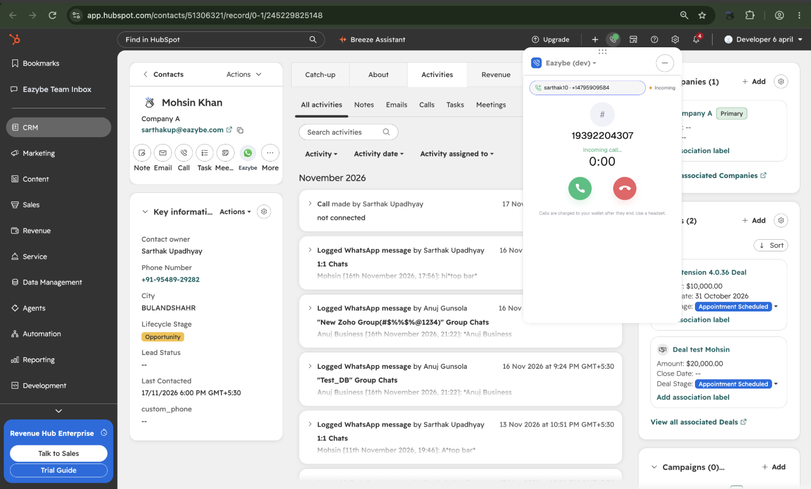
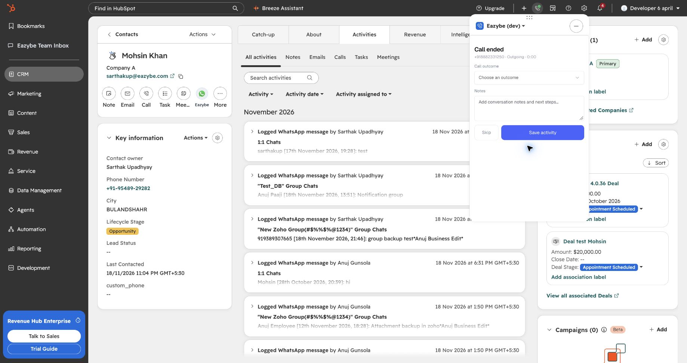

Use the Eazybe dialer to call a contact without leaving HubSpot. Choose your business voice number, check the contact's number, and manage the call in the same window.

## Before You Start

- Connect your HubSpot account to Eazybe and sign in to Eazybe.
- Make sure an active Eazybe voice number is available to you, your plan includes calling, and your wallet has enough balance.
- Use a headset and allow microphone access when your browser asks.

<Note>
To use the **Call with Eazybe** button in the HubSpot contact list, keep the **Eazybe extension open** in the same Chrome profile as HubSpot.
</Note>

<Note>
These screenshots use an example account. Some show **Eazybe (dev)** as the calling provider; choose the Eazybe provider set up for your account. Your contact names and available voice numbers will differ.
</Note>

## Call From a Contact Record

<Steps>
  <Step title="Open the Contact and Click Call">
    Open a contact in HubSpot. Under the contact's name, click **Call** (the phone icon). Its tooltip says **Make a phone call**.

    
  </Step>

  <Step title="Select the Contact's Phone Number">
    Click **Call** followed by the number you want to use. The Eazybe dialer opens, or HubSpot asks you to choose a calling provider.

    

    <Note>
    If no number is saved, use **+ Add phone number** under the contact's name before continuing.
    </Note>
  </Step>

  <Step title="Choose Eazybe as Your Calling Provider">
    If you see **Choose a calling provider**, select your Eazybe provider. You can skip this step when the Eazybe dialer opens directly.

    
  </Step>

  <Step title="Choose Your Outgoing Voice Number">
    Open the number dropdown at the top of the dialer and choose the Eazybe voice number you want to call from. Wait until the status shows **Ready**.

    

    <Note>
    The number at the top is your outgoing business number. The number below **Country code** is the person you will call.
    </Note>
  </Step>

  <Step title="Check the Recipient's Number">
    Check **Country code** and the phone number beside it. If the phone field is empty and **Use phone number** appears, click it to fill the number shown beside **HubSpot contact**.

    You can also type a different number. Select its country code and enter the remaining digits without repeating the country code.

    
  </Step>

  <Step title="Start the Call">
    Click the green phone button. The dialer shows the number being called and **Calling…** while the call starts. When the person answers, it shows **Connected** and the call timer.

    

    <Warning>
    The green phone button starts a real call. Check the recipient's number first. Calls are charged to your wallet after they end.
    </Warning>
  </Step>
</Steps>

## Call From the Contact List

Keep the **Eazybe extension open** while you use this shortcut.

<Steps>
  <Step title="Find the Contact's Call Button">
    Open **CRM → Contacts**. In the contact's row, find the blue phone icon beside their phone number. This button is labelled **Call with Eazybe**.

    
  </Step>

  <Step title="Open the Dialer and Check the Number">
    Click **Call with Eazybe**. In the dialer, check your outgoing voice number, the recipient's country code, and their phone number. Then click the green phone button to start the call.

    

    <Note>
    If the list's Call button is missing or does not respond, check that the Eazybe extension is open in this Chrome profile. You can also open the contact record and use **Call** there.
    </Note>
  </Step>
</Steps>

## During a Call

Once the call connects, use the controls in the dialer:

| Control | What you can do |
| --- | --- |
| **Mute** | Turn off your microphone so the other person cannot hear you. |
| **Hold** | Put the connected call on hold. |
| **Keypad** | Enter digits for a phone menu during the call. |
| Red phone button | End the call. |

## Answer an Incoming Call

When an incoming call appears, the dialer shows **Incoming call…** and the caller's number. Click the green phone button to answer or the red phone button to decline.

## Finish the Call

<Steps>
  <Step title="Add an Outcome and Notes">
    After the call ends, the **Call ended** screen shows the number, direction, and duration. Choose a **Call outcome**, add any **Notes**, and click **Save activity**. Use **Skip** if you do not want to add these details.

    
  </Step>
</Steps>

## Need Help?

### The Contact's Number Is Not Filled In

Click **Use phone number** if it appears beside the HubSpot contact details. Otherwise, enter the recipient's number and select the correct **Country code**. Always check the phone field before calling, especially after switching contacts.

### My Voice Number Is Missing

Check that you are signed in to the correct Eazybe account. Ask your admin to check that the voice number is active and available to you.

### I Cannot Start a Call

Wait for **Ready**, select an outgoing voice number, and check the recipient's number. Finish any current call first. If Eazybe shows a subscription or balance message, ask your admin to check your calling plan or recharge the wallet.

### The Other Person Cannot Hear Me

Check your browser's microphone permission and headset connection. If you muted the call, turn your microphone back on using the same control.
