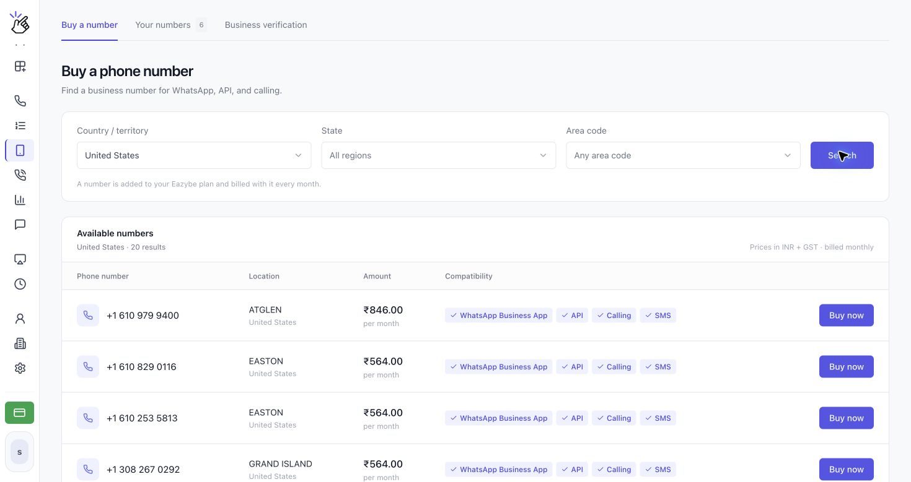
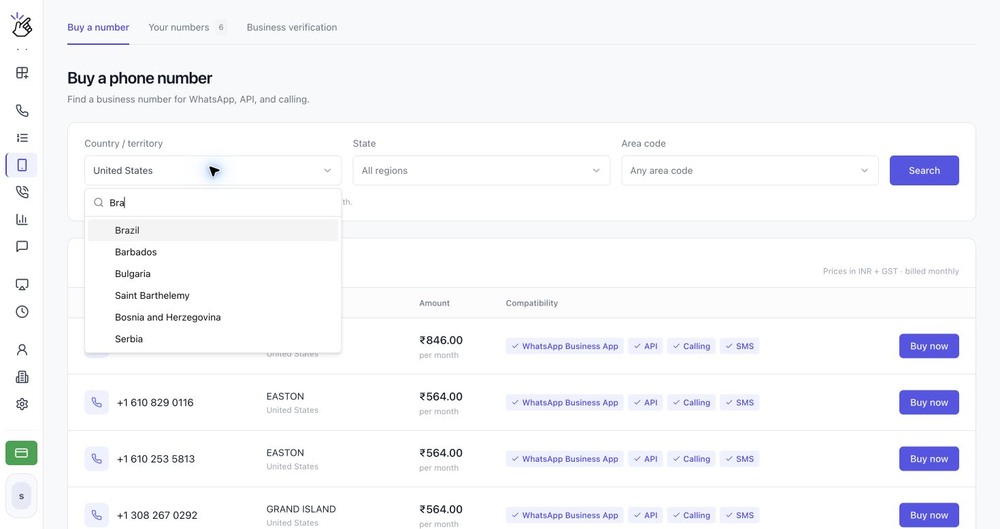
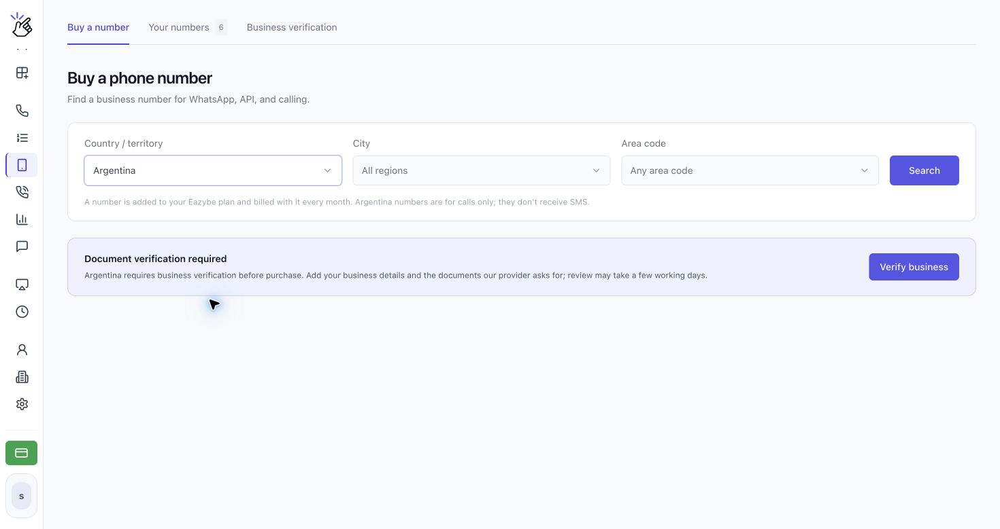
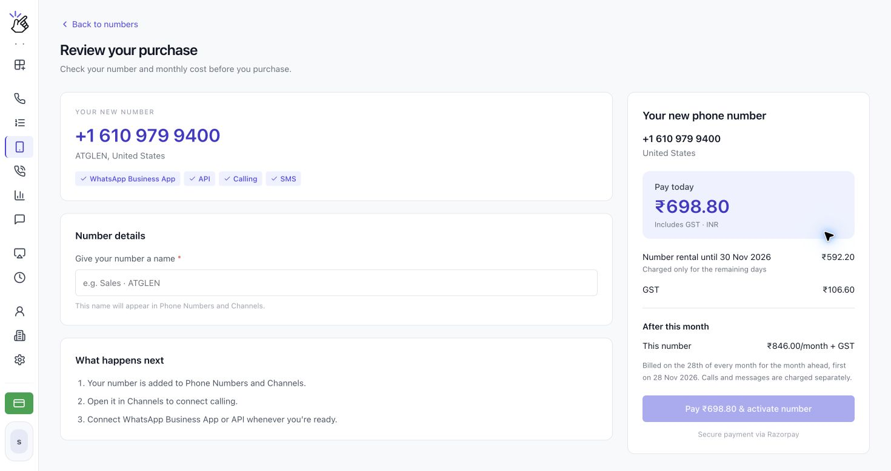

Use **Phone Numbers** to buy a business voice number in Brazil and other available countries, then manage the numbers your organization owns. Countries that require business verification need approval before you can purchase.

## Choose a Country

The **Country / territory** selector now includes Brazil, Chile, Colombia, Mexico, Argentina, and many other countries, alongside the United States, Canada, Puerto Rico, and US Virgin Islands. Search the selector for your country to see the current choices.

<Note>A country in the selector does not guarantee available stock. Verification requirements and available numbers depend on the country. Follow the requirements displayed for your selection.</Note>

## Buy a Number

<Steps>
  <Step title="Open Phone Numbers">
    Open **Phone Numbers** under **CALLS**, then choose **Buy a number**. The other tabs are **Your numbers** and **Business verification**.

    
  </Step>
  <Step title="Choose your country and location">
    Open **Country / territory** and search for a country, such as **Brazil**. Choose **City** or **State** and **Area code** when available, then click **Search**. Leave **All regions** and **Any area code** selected to search more broadly.

    

    <Note>If you see **No numbers available here today**, try another area code or search all regions. If regions cannot be loaded, you can still search the whole country.</Note>
  </Step>
  <Step title="Complete business verification if required">
    If **Document verification required** appears, click **Verify business**. Follow [Verify Your Business](/en/voice-number/business-verification) to enter your details, upload the requested documents, and submit them for review. You can also start from **Business verification → Verify a new country**.

    If you already started, the button may say **Continue verification**, **View details**, **Fix and resubmit**, or **Update documents**. Return to buy a number after approval.

    

    <Note>Verification is specific to the country. Approval for one country does not verify your business for every other country. There is no charge until you purchase a number.</Note>
  </Step>
  <Step title="Compare available numbers">
    The results show **Phone number**, **Location**, **Amount**, and **Compatibility**. Check the capabilities of the number you want, then click **Buy now** to open **Review your purchase**.

    

    <Warning>Brazil and other countries marked as calls-only do not receive SMS. For WhatsApp verification on these numbers, use a phone call instead of requesting an SMS code.</Warning>
  </Step>
  <Step title="Review the price and activate your number">
    On **Review your purchase**, check the number, country, and compatibility. Under **Number details**, enter a name in **Give your number a name**. This name appears in Phone Numbers and Channels.

    Review **Pay today**, **Number rental until**, any **GST**, and **After this month**. When you are ready to purchase, click **Pay … & activate number**, where the button shows your total. Follow the payment flow shown for your account.

    

    <Warning>Activating a number is a paid purchase with recurring rental. Payment may charge your saved card or open a payment provider. Confirm the total, rental period, and renewal schedule before continuing. Calls and messages are charged separately; screenshot prices are examples, not a quote for your account.</Warning>
  </Step>
  <Step title="Review Your numbers">
    Open **Your numbers** to see each number's name, country, monthly amount, purchase date, and renewal date. Use **View in Channels** to open its channel settings. **More actions** includes **Verification code** and, for managers, **Cancel subscription**.

    
  </Step>
</Steps>

<Warning>A cancelled number remains available until the paid period ends, then it is released and cannot be recovered. Cancel before the 28th to avoid the next monthly charge.</Warning>

## Connect WhatsApp with your Voice Number

A purchased number can be used with the **WhatsApp Business App** or the **WhatsApp API** when the number’s compatibility shows that option. The verification method depends on whether your number receives SMS. Business verification for purchasing a number is separate from verifying that number with WhatsApp.

### Connect the WhatsApp Business App

1. Install and open the **WhatsApp Business** app on your phone.
2. Start the account setup and enter the Voice Number shown in Eazybe, including its country code.
3. For an SMS-capable number, request the verification code by SMS and find it in [**SMS in Eazybe**](https://app.eazybe.com/calls/sms). For a calls-only number, such as a Brazil number, choose **Call me** when WhatsApp offers it.
4. If using **Call me**, keep the Eazybe phone on, answer the incoming WhatsApp call on this number, and note the code read aloud.
5. Return to WhatsApp Business and enter the code to finish verifying the number.

### Connect WhatsApp API

1. Open **Channels** in Eazybe and select **Add channel**.
2. Choose **WhatsApp** to continue to Meta, then sign in and follow the setup prompts.
3. Enter the Voice Number shown in Eazybe. Request SMS verification if the number supports SMS, or choose phone-call verification for a calls-only number.
4. Read the SMS code in [**SMS in Eazybe**](https://app.eazybe.com/calls/sms), or keep the Eazybe phone on and answer the verification call to hear the code.
5. Return to Meta, enter the code, and complete the connection.

### If WhatsApp shows “Login not available right now”

WhatsApp can temporarily block sign-in for security reasons. If this message appears, connect your VPN to the country where you purchased the Voice Number, then retry the sign-in. For example, use a US VPN for a US number when you are connecting from India. Request a new code by SMS or phone call, according to your number’s capabilities, after retrying and enter the new code in WhatsApp Business or Meta.

<Warning>Use the country that matches the purchased number when choosing the VPN location. Request a fresh code after changing the connection, because an earlier code may expire.</Warning>
