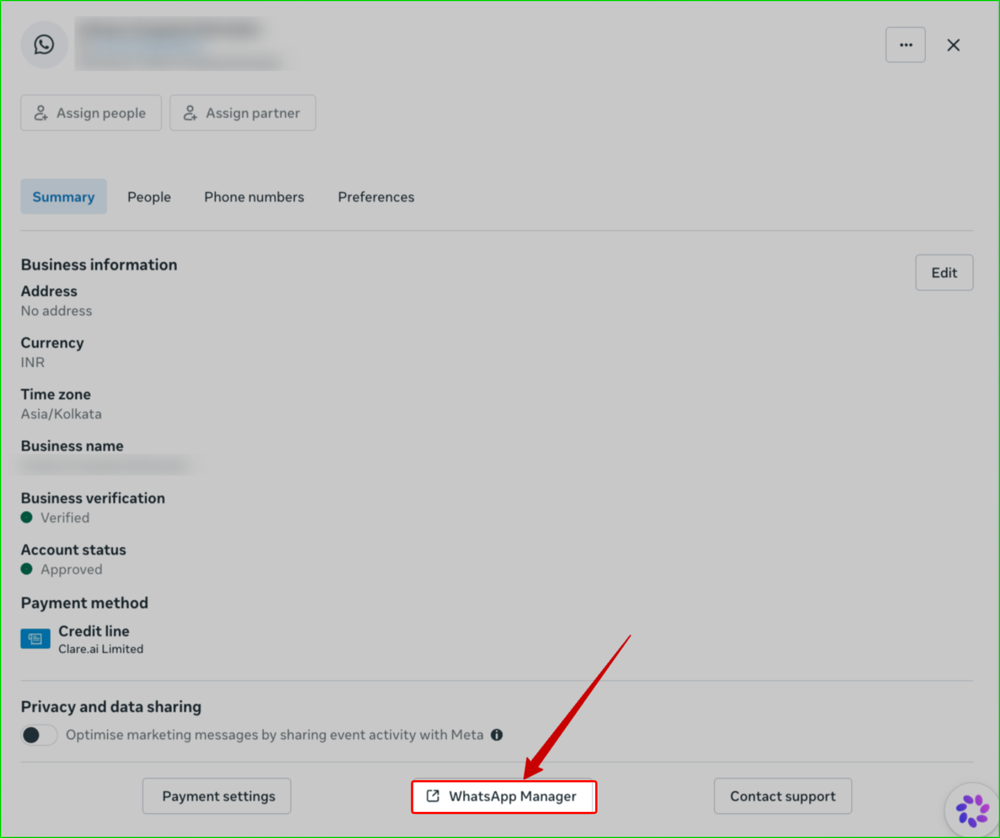
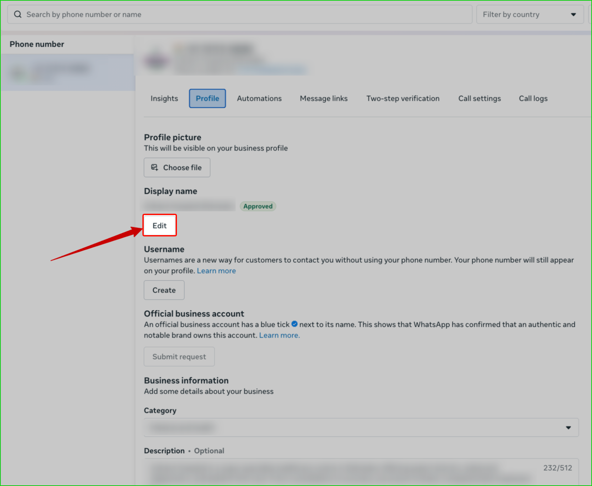
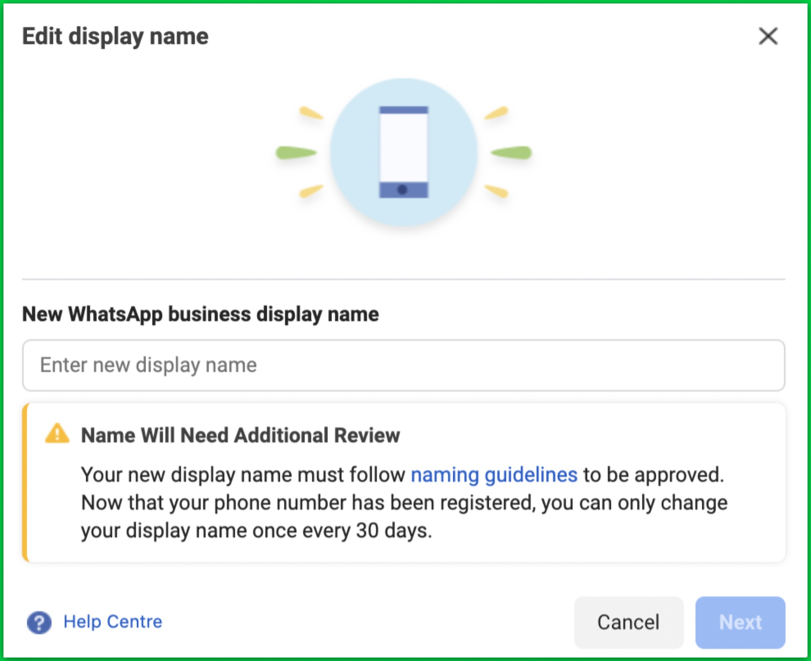
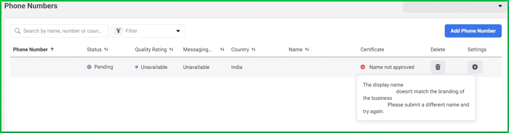
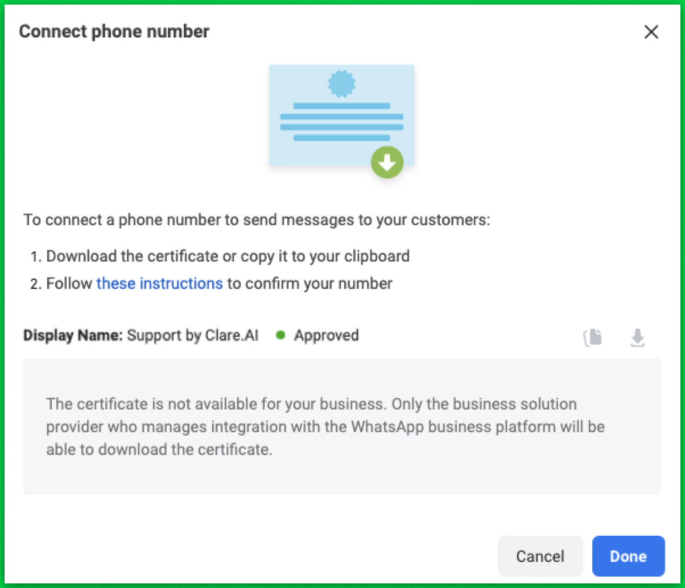

Use WhatsApp Manager to request a new name for the WhatsApp number connected to Eazybe. Meta must approve the request before you can use the new name.

<Note>
These screenshots show Meta in English. Your layout may differ; the account details are examples.
</Note>

<Steps>
  <Step title="Open WhatsApp Manager">
    Sign in to [Meta Business Manager](https://business.facebook.com/), select your WhatsApp business account, and open **WhatsApp Manager**.

    
  </Step>
  <Step title="Select your phone number">
    Find the correct number under **Phone numbers**, then select its settings gear.

    
  </Step>
  <Step title="Edit the profile name">
    Open **Profile** and choose **Edit** beneath **Display name**.

    
  </Step>
  <Step title="Submit your new name">
    Enter the name in **New WhatsApp business display name**, choose **Next**, and complete the review submission. Read the naming guidelines and any change restrictions shown in the dialog.

    
  </Step>
</Steps>

## Check the Review Result

Return to the number’s profile in WhatsApp Manager to check the display-name review. A pending review is still awaiting a decision. **Approved** means Meta accepted the name; **Name not approved** means you need to revise it.

## If Your Name Is Rejected

Read the rejection reason, correct the name, and use **Edit** to submit another request. For example, the screenshot below shows a name that does not match the business branding. A new submission starts another review.

## After Approval

Check whether the approved name appears for your connected number. If it does not, or Meta shows a certificate or registration prompt, contact [Eazybe Support](mailto:support@eazybe.com) with your number and a screenshot of the status for guidance.

## Frequently Asked Questions

### How long does review take?

Allow time for Meta to review the request. Check WhatsApp Manager for the latest result; approval is not immediate and review times can vary.

### Where should I check approval?

Use the display-name status in WhatsApp Manager. A phone number’s connection status is separate from its name approval.

### Do I need to download a certificate?

Some Meta layouts show a certificate dialog, as in the example above. If you see it, ask Eazybe Support which next step applies to your connection.

## Related Guide

[Verify your business in Meta](/en/waba/facebook-business-verification)
