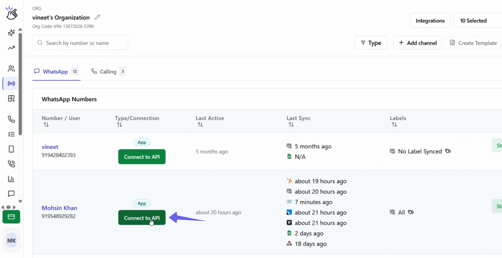
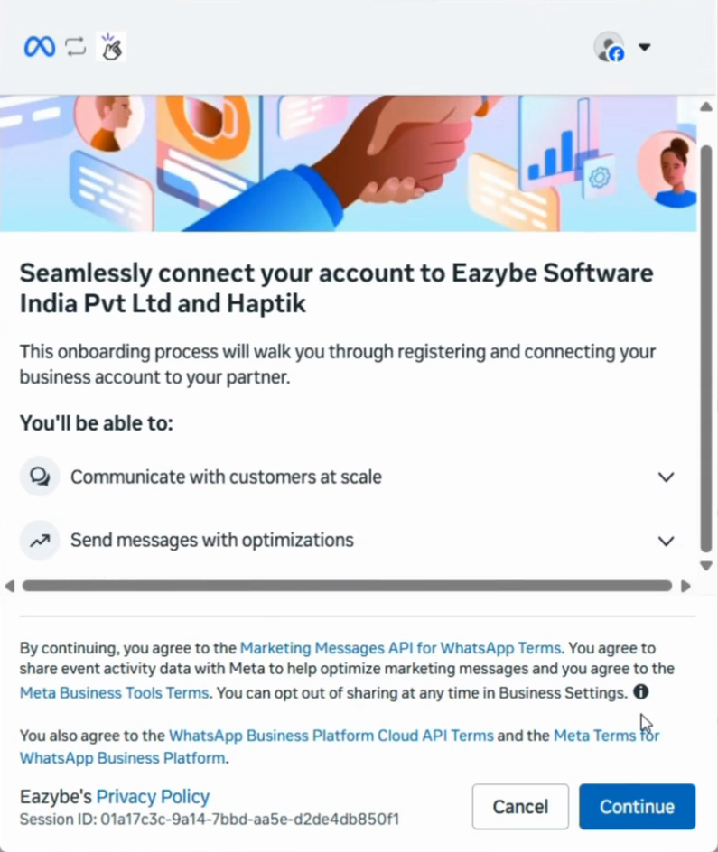
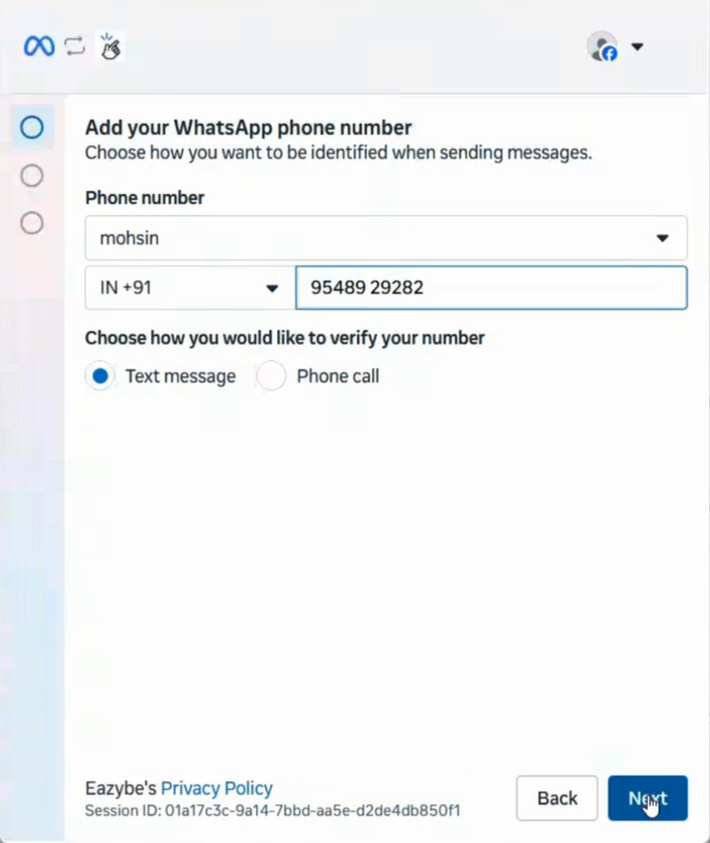
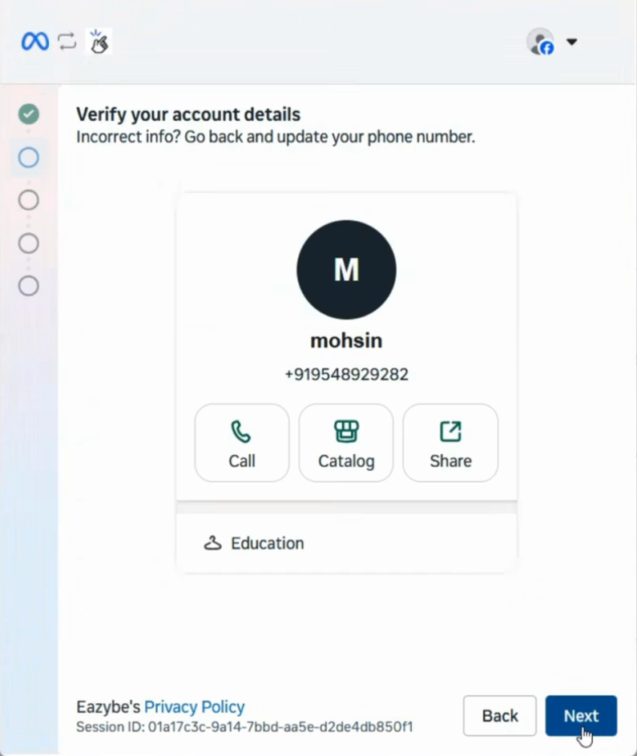
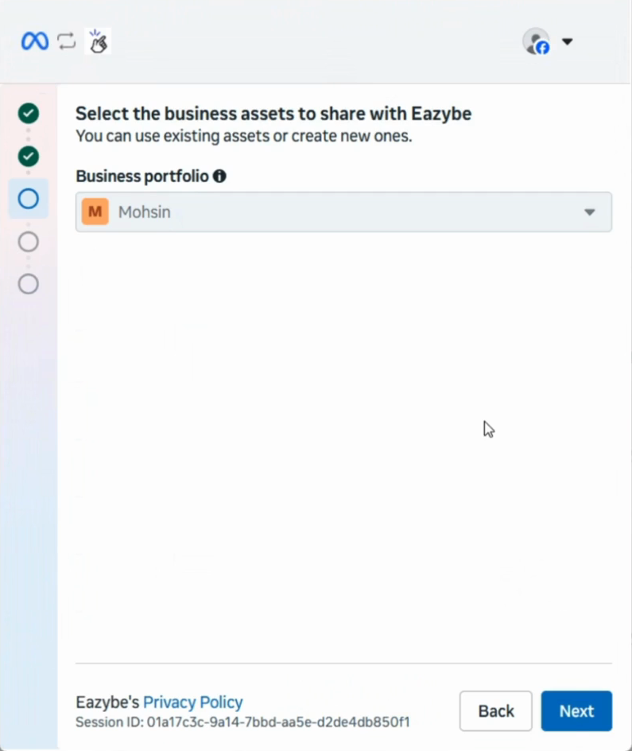
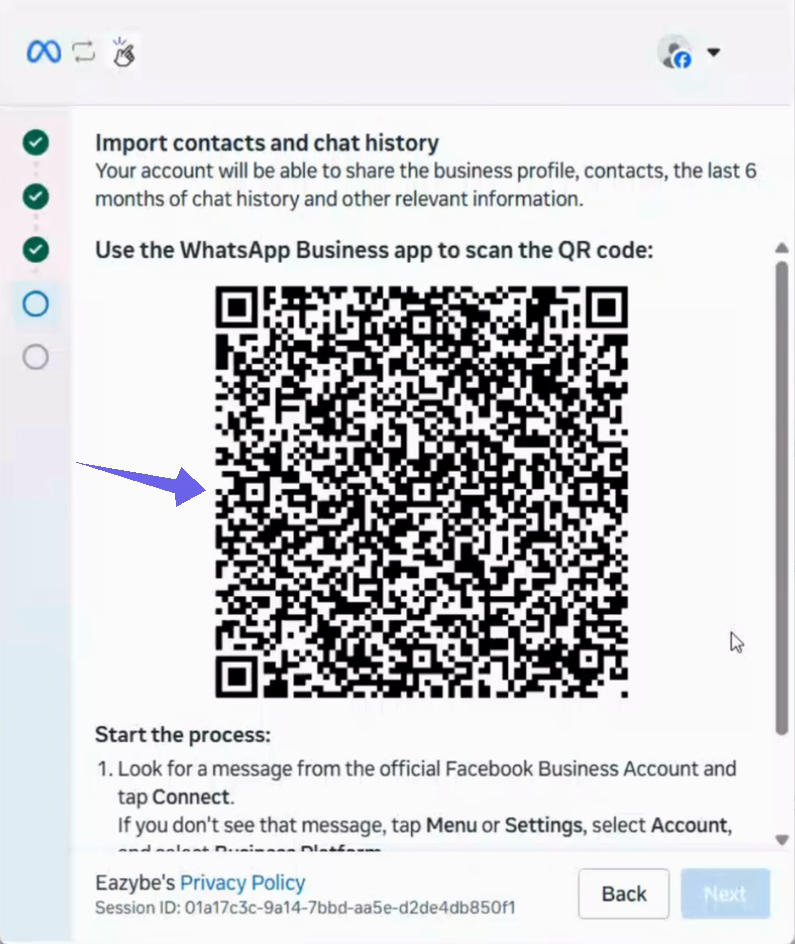
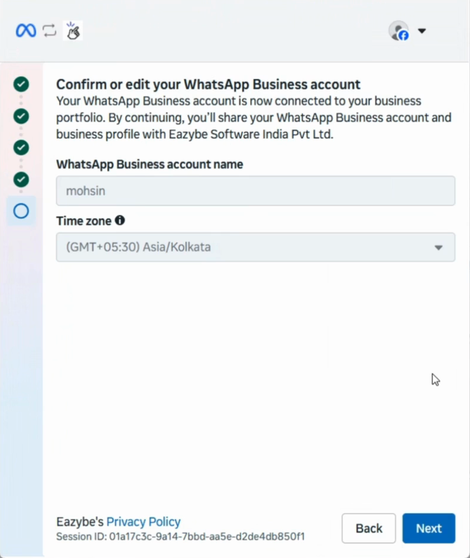
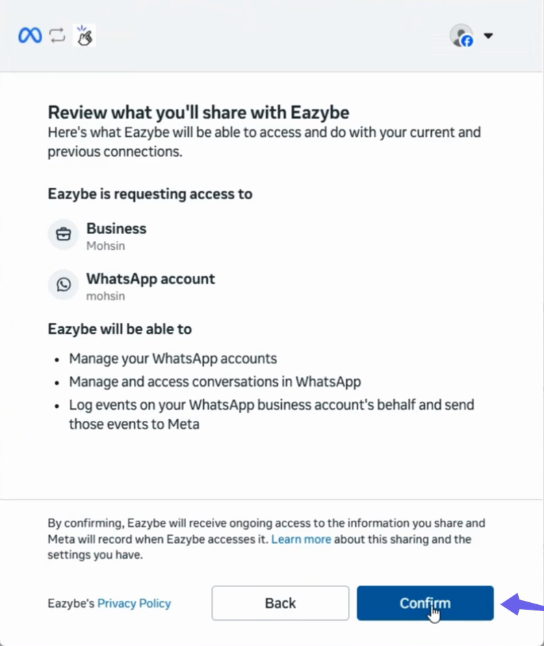
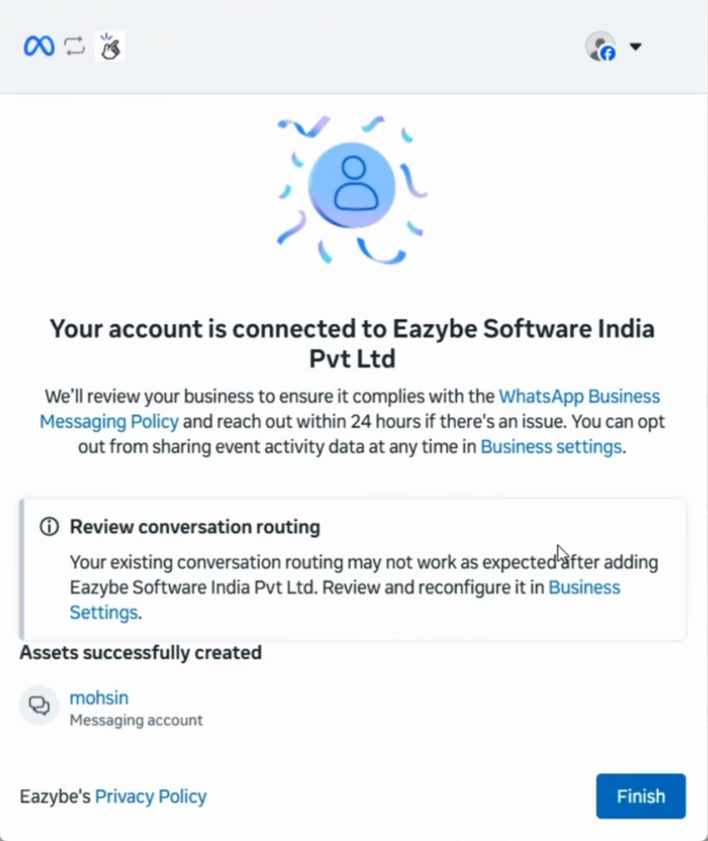
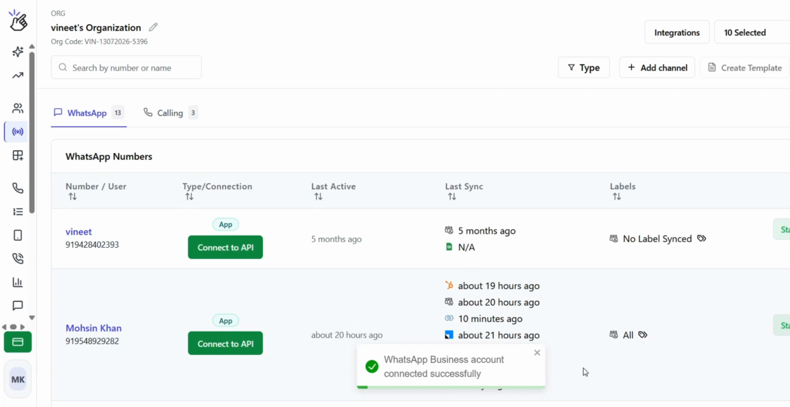

Connect your WhatsApp Business Account (WABA) from your Eazybe workspace using Meta's Embedded Signup. This guide follows the flow for connecting an existing WhatsApp Business app number, including pairing your phone and confirming access.

## Watch the Walkthrough

Follow the English video walkthrough, or use the illustrated steps below.

<video controls playsInline preload="metadata" className="w-full aspect-video rounded-xl" poster="/images/connect-waba/eazybe-connect-to-api.png" src="/images/connect-waba/embedded-signup-english.mp4" aria-label="English walkthrough of connecting WhatsApp Business to Eazybe through Meta Embedded Signup">
  Your browser does not support embedded video. [Download the walkthrough](/images/connect-waba/embedded-signup-english.mp4).
</video>

## Before You Start

Have your Eazybe workspace open, access to the Facebook profile that manages your business, and the phone with your WhatsApp Business app ready.

<Note>
  The screenshots show an example account. Select your own business portfolio and phone number. Meta's screens can vary depending on whether you connect an existing WhatsApp Business app number or add a new number.
</Note>

## Step-by-Step Connection Guide

<Steps>
  <Step title="Start from Eazybe Channels">
    Open **Channels** in your Eazybe workspace and select the **WhatsApp** tab. Under **WhatsApp Numbers**, find the number you want to connect and click **Connect to API**.

    
  </Step>
  <Step title="Continue with Meta signup">
    In the Meta signup window, review the introduction and terms, then click **Continue**. If prompted to log in, use the Facebook profile that manages your business.

    
  </Step>
  <Step title="Add your WhatsApp phone number">
    On **Add your WhatsApp phone number**, select or enter your number. Check the country code and phone number, then click **Next**.

    If Meta asks you to verify the number by **Text message** or **Phone call**, follow the prompts and enter the code you receive.

    
  </Step>
  <Step title="Check your account details">
    On **Verify your account details**, confirm that the business profile and phone number belong to the account you want to connect. Click **Next**, or go back to correct the number.

    
  </Step>
  <Step title="Select your business portfolio">
    On **Select the business assets to share with Eazybe**, choose the appropriate **Business portfolio** from the dropdown, then click **Next**.

    
  </Step>
  <Step title="Connect your WhatsApp Business app">
    For an existing WhatsApp Business app number, Meta displays **Import contacts and chat history** with a QR code. Keep this window open on your computer.

    On your phone:

    1. Open **WhatsApp Business** and go to **Settings**.
    2. Select **Account** → **Business Platform**.
    3. Tap **Connect to the Business Platform** and follow the prompts to open the scanner.
    4. Scan the QR code in your own Meta signup window and complete the prompts on your phone.

    You may also see a message from the official Facebook Business account with a **Connect** option.

    

    <Note>
      Scan the code in your active signup window, not the example above. If prompted to share chat history, review the choice before continuing. See [6-Month Chat Backup](/en/waba/6-month-chat-backup) for details.
    </Note>
  </Step>
  <Step title="Confirm your WhatsApp Business account">
    On **Confirm or edit your WhatsApp Business account**, check the **WhatsApp Business account name** and **Time zone**, then click **Next**.

    
  </Step>
  <Step title="Review access and confirm">
    On **Review what you'll share with Eazybe**, check the selected business, WhatsApp account, and requested permissions. Click **Confirm** to proceed.

    Keep the signup window open while Meta connects your account.

    
  </Step>
  <Step title="Finish Meta signup">
    Wait for the message **Your account is connected to Eazybe Software India Pvt Ltd**. Review any account notices, then click **Finish** to return to Eazybe.

    
  </Step>
  <Step title="Check the connection in Eazybe">
    Back in your workspace, look for the **WhatsApp Business account connected successfully** confirmation on the Channels page.

    
  </Step>
</Steps>

## Next Steps

<CardGroup cols={2}>
  <Card title="Create Templates" icon="file-lines" href="/en/waba/templates/create-template">
    Design and submit message templates for Meta approval.
  </Card>
  <Card title="Send Broadcasts" icon="paper-plane" href="/en/broadcasts/create-broadcast">
    Launch your first broadcast campaign.
  </Card>
</CardGroup>

## Need Help?

If signup does not complete, note the step and any error message, then contact [support@eazybe.com](mailto:support@eazybe.com).
