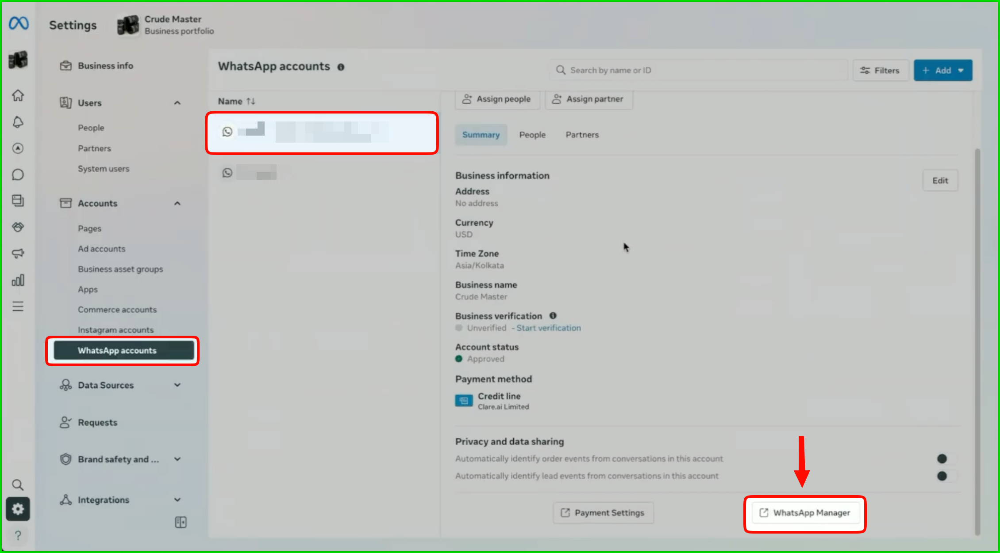
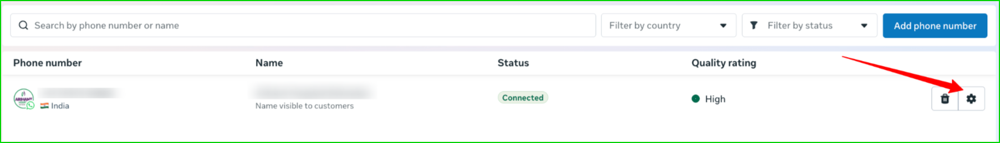

## What the Rating Means

- Meta's phone-number quality rating reflects recent customer feedback, including blocks and reports, over the past seven days.
- **High (green):** Maintain your current focus on relevant messages.
- **Medium (yellow):** Review your audience, message content, and frequency.
- **Low (red):** Investigate negative feedback promptly and review Meta's alerts.

## How to Check Your Rating

1. Open [Meta Business Suite](https://business.facebook.com/) and select your business portfolio.
2. Go to **Settings > Accounts > WhatsApp accounts** and select your account.
3. Click **WhatsApp Manager**. If you cannot access the account, ask your business administrator to review your permissions.

4. Open **Phone numbers** and locate the number you use for Eazybe broadcasts.
5. Read its **Quality rating** alongside **Status**.

<Note>
  These screenshots show Meta's interface. Account names and menu layouts may differ from yours.
</Note>

## What to Do If Quality Drops

1. **Review recent campaigns:** In Eazybe, inspect [broadcast analytics](/en/broadcasts/view-analytics) for failures and opt-outs. Note which audience and template were used before the drop; this helps investigation but does not prove a cause.
2. **Recheck audience permission:** Remove opted-out customers and avoid messaging people who do not expect your updates.
3. **Improve relevance:** Narrow your audience and tailor the message to their interests.
4. **Reduce excessive frequency:** Coordinate campaigns and give unengaged customers a break.
5. **Review Meta's alerts:** Address any account or template issues and monitor the rating after changing your approach.

For the wider sending checklist, see [Improve Broadcast Deliverability](/en/waba/improve-broadcast-deliverability).

## Keep These Checks Separate

- **Phone-number quality:** Feedback associated with your sending number.
- **Template status:** Whether the individual template is approved and available to use. Check [Template Guidelines](/en/waba/templates/guideline).
- **Connection status:** A connected number can still have delivery problems. Review errors separately.
- **Messaging limits:** Check the current allowance in WhatsApp Manager. Messaging limits apply at the business portfolio level.

## Also Check Your Template's Quality

- **Template quality is separate from phone-number quality.** Meta assesses each template using usage, customer feedback, and engagement, including read rates.
- In WhatsApp Manager, open [Manage templates](https://business.facebook.com/latest/whatsapp_manager/message_templates) to check the template you plan to send.
- Approved templates can show **Quality pending**, **High quality**, **Medium quality**, or **Low quality**. New templates start with a pending rating, which updates as Meta gathers data.
- Medium or Low quality can put a template at risk of being paused or disabled. Review feedback and improve the message before expanding its use.
- Quality can affect template pacing and pausing. If a template loses its **Approved** status, it cannot be sent until that status is restored.

**Official reference:** [Meta — Template quality rating](https://developers.facebook.com/documentation/business-messaging/whatsapp/templates/template-quality). This guidance concerns individual message templates; use the **Phone numbers** view described above to check your sending number's quality.

## Common Questions

### Does a High rating guarantee delivery?

No. Review recipient-level failures in [broadcast analytics](/en/broadcasts/view-analytics) even when the rating is High.

### Will increasing my bid fix a Low rating?

A bid cap controls the maximum delivery price. It should not be treated as a way to repair negative customer feedback. Review audience relevance and frequency first; see [Maximum Bidding Price](/en/waba/templates/max-bidding-price) for pricing behavior.

### What should I share with support?

Send [support@eazybe.com](mailto:support@eazybe.com) your sending number, current rating, relevant Meta alert, campaign name, and failure reasons. Include a screenshot of the rating and hide unrelated account details.
