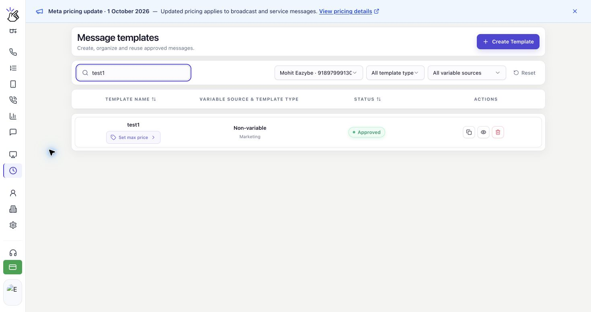
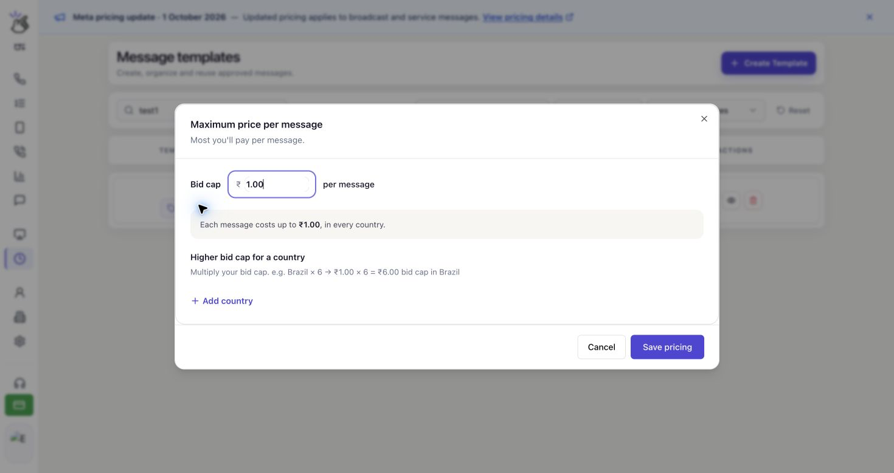
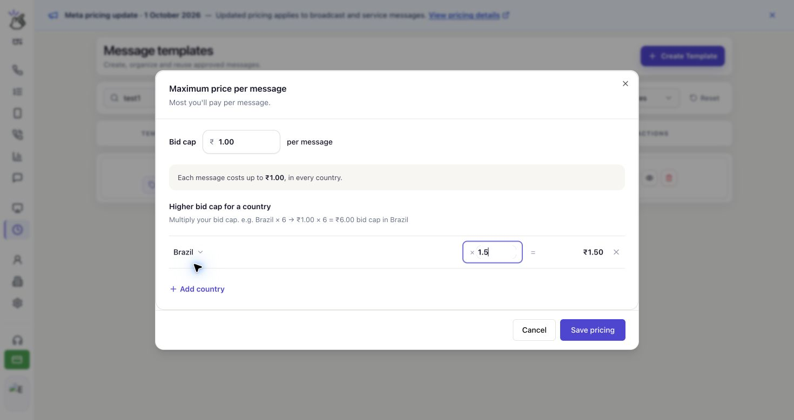

Set the most you are willing to pay for each delivered WhatsApp marketing message. You save this **Bid cap** on your message template, then use that template for your broadcast.

## How the Maximum Price Works

The bid cap is a limit per delivered message, not a total campaign budget or a fixed charge. The actual delivery cost can be lower, and setting a cap does not guarantee delivery.

You can use one cap for all countries or adjust it for individual countries with a multiplier. Countries without an adjustment keep the base cap.

<Note>
  Maximum pricing is available for **Marketing** templates on eligible WhatsApp accounts with MM Lite enabled. Only **INR (Indian rupees)** and **USD (US dollars)** are supported. Utility and Authentication templates do not have this setting.
</Note>

## Set the Template's Bid Cap

<Warning>
  The ₹1.00 bid cap and Brazil multiplier shown below are examples, not recommended prices. Choose amounts for your campaign and check the currency shown in your account.
</Warning>

<Steps>
  <Step title="Open pricing for your marketing template">
    Open **Templates** in the Eazybe sidebar. On **Message templates**, choose your WhatsApp number and use **Search templates** to find the template you want to use.

    Click **Set max price** below its name. If the template already has a cap, click the **Max … / delivery** button instead to review or change it.

    

    <Note>
      Your template must be **Approved** before you can use it for a broadcast.
    </Note>
  </Step>

  <Step title="Enter your bid cap">
    In **Maximum price per message**, enter a positive amount in **Bid cap**. Enter the price for one delivered message, using the currency shown beside the field.

    Enter the bid cap in your WhatsApp account's currency:

    - **INR:** Enter the amount in Indian rupees. For example, **1.00** sets a cap of **INR 1.00** per delivered message.
    - **USD:** Enter the amount in US dollars. For example, **1.00** sets a cap of **USD 1.00** per delivered message.

    The summary below the field updates as you type.

    

    <Note>
      The **1.00** placeholder is not a saved price. Enter your own amount before saving. You do not need to convert the amount to a price per 1,000 messages.
    </Note>
  </Step>

  <Step title="Adjust the cap by country if needed">
    To keep the same cap everywhere, skip this adjustment. To set a different cap for a destination, click **Add country** under **Higher bid cap for a country**.

    Select the country, then enter a multiplier in the field beside **×**. The amount after **=** is that country's resulting cap.

    

    With a ₹1.00 base cap, **1.5** sets a ₹1.50 cap for Brazil. A multiplier of **1** keeps the base cap; a value below **1**, such as **0.8**, lowers it.

    Multipliers must be greater than **0** and no more than **10**. You can add up to **50** countries. Click the **×** remove button at the end of a country row to remove its adjustment and use the base cap there again.

    <Warning>
      A multiplier above 1 increases the maximum you allow for each delivery to that country. Review the calculated amount before saving.
    </Warning>
  </Step>

  <Step title="Review and save your pricing">
    Check the **Bid cap** and each country amount, then click **Save pricing**. Wait for the confirmation: **Pricing saved. Refresh before sending a campaign.**

    

    Click **Cancel** if you want to close the dialog without saving your edits. Saving pricing updates the template; it does not send a broadcast.

    <Warning>
      This setting belongs to the template and can affect broadcasts that use it. Avoid changing its pricing while broadcasts using that template are being sent.
    </Warning>
  </Step>
</Steps>

## Before You Send a Broadcast

Follow [Create a New Broadcast](/en/broadcasts/create-broadcast) to choose your sending number, approved template, and recipients.

For a template with maximum pricing, review **Marketing delivery pricing** and use **Refresh pricing** to load the current settings. With recipients selected, **Maximum Meta delivery cost** shows the maximum delivery exposure for that audience. The country breakdown shows recipient counts, the maximum price per delivery, and each country's maximum exposure.

<Warning>
  A maximum exposure or estimate is not your final charge. For max-priced messages, wallet charges are settled when Meta reports the delivery cost. If a cost has not arrived yet, it is pending, not a free delivery. Do not add **Estimated wallet deduction** to **Maximum Meta delivery cost**; they are separate views, not two charges to total together.
</Warning>

## Common Questions

### Why can't I set a maximum price?

Check that you selected the correct WhatsApp number and a **Marketing** template. The pricing editor is available only when your account, provider, and currency support maximum pricing. If the dialog says **Maximum pricing changes are unavailable for this account, provider, or currency.**, you cannot change the cap for that selection.

If you see **Pricing is unavailable.**, click **Retry** to reload the pricing information.

### Why won't my amount save?

Use a positive decimal number, without a currency symbol in the input. If the price has more decimal places than your account supports, enter a less precise amount and try again. Country multipliers must be greater than 0 and at most 10.

### What if pricing changed after I prepared a broadcast?

Eazybe checks the template's pricing again before sending. If it has changed, affected messages are not sent using the old settings. Review the refreshed price and create a new broadcast if Eazybe asks you to recreate the campaign.

### What if the save succeeded but synchronization failed?

If you see **Saved at Meta. Local pricing synchronization failed; refresh before sending.**, the price was saved at Meta. Refresh your template pricing and verify the amounts before preparing a broadcast.

### Does a higher cap guarantee more deliveries?

No. A higher cap allows a higher price per delivery, but it does not guarantee that every recipient will receive the message.
