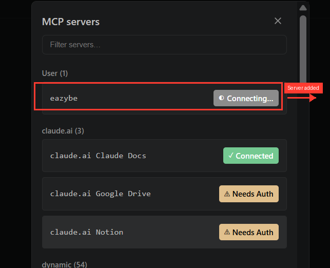
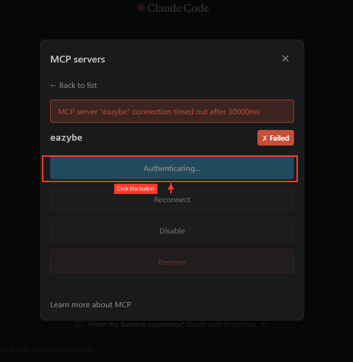
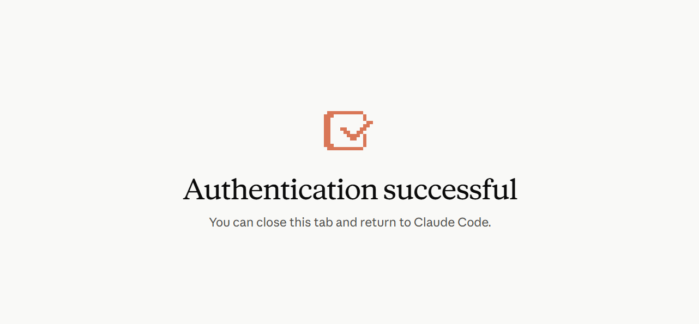
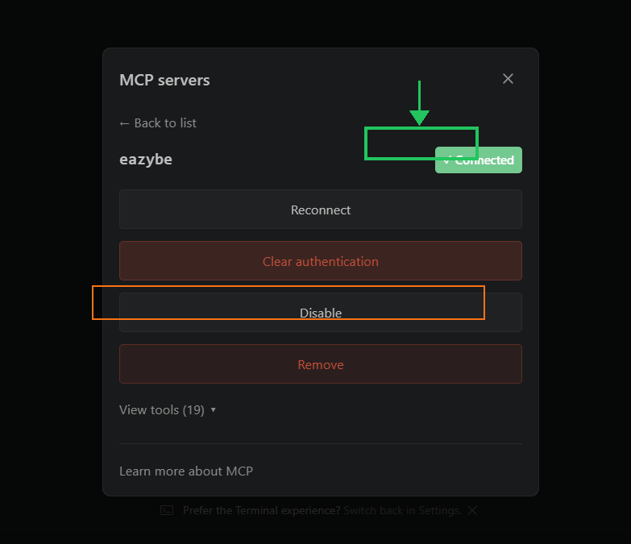
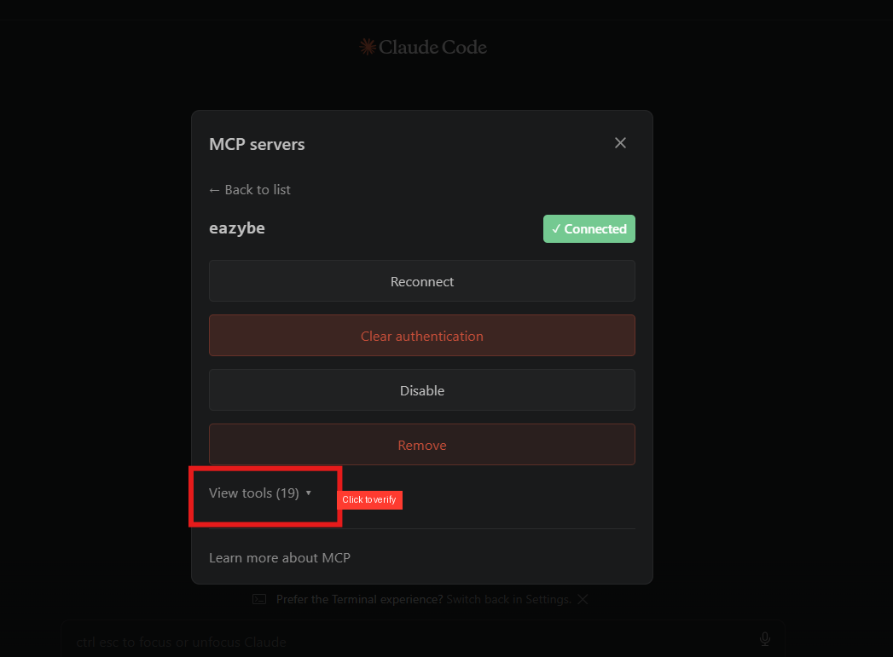
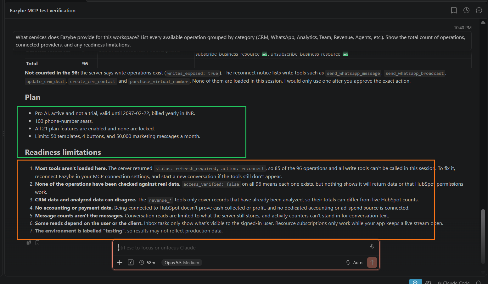

> **Indice de documentacion**
> Antes de explorar paginas individuales, consulta el indice completo en [https://help.eazybe.com/llms.txt](https://help.eazybe.com/llms.txt) para conocer los temas disponibles.

# Conectar el servidor MCP de Eazybe con Claude

> Conecta tu workspace de Eazybe a Claude Code a traves del servidor MCP, dandole a Claude acceso directo a tu CRM, conversaciones de WhatsApp, analiticas de equipo, campanas y mas.

El servidor MCP (Model Context Protocol) de Eazybe te permite consultar y gestionar tu workspace de Eazybe directamente desde Claude Code. Una vez conectado, puedes buscar registros de CRM, leer conversaciones de clientes, revisar analiticas de equipo, inspeccionar campanas y realizar operaciones en el workspace, todo mediante lenguaje natural.

## Lo que necesitas antes de empezar

Asegurate de tener lo siguiente:

- **Claude Code** — la aplicacion de escritorio o la extension de VS Code, instalada y funcionando
- **Una cuenta de workspace de Eazybe** — con acceso de administrador o usuario autorizado
- **La URL de tu servidor MCP de Eazybe** — tu equipo de desarrollo o administrador del workspace te la proporcionara

---

## Paso 1: Abrir la configuracion de servidores MCP en Claude Code

**1. Abre Claude Code** en tu computadora (aplicacion de escritorio o VS Code).

**2. Abre el panel de servidores MCP.** Puedes encontrarlo haciendo clic en el **icono de MCP** en la barra lateral, o a traves de **Settings > MCP Servers**.

Veras una lista de servidores MCP. Si es tu primera vez, la lista puede estar vacia o mostrar solo los servidores predeterminados de Claude (Claude Docs, Google Drive, Notion).

---

## Paso 2: Agregar el servidor de Eazybe

**1. Haz clic en "Add MCP Server"** (o el boton **+**) para agregar un nuevo servidor.

**2. Ingresa los datos del servidor:**

| Campo | Que ingresar |
|---|---|
| **Server name** | `eazybe` |
| **Server URL** | La URL del endpoint MCP proporcionada por tu equipo de desarrollo |

> [!NOTE]
> La URL del servidor depende de tu entorno. Tu equipo de desarrollo te dara la URL correcta. Normalmente termina en `/sse`. Si no estas seguro, consulta con el administrador de tu workspace antes de continuar.

**3. Haz clic en Save.**

El servidor aparece en tu lista de servidores MCP. Veras una insignia de estado **"Connecting..."** junto a el.



*El servidor de Eazybe aparece bajo "User" con una insignia amarilla "Connecting...".*

---

## Paso 3: Autenticar tu conexion

El primer intento de conexion normalmente **expirara despues de 30 segundos**. Esto es esperado — el servidor necesita que inicies sesion antes de poder conectarse.

**1. Veras un estado "Failed"** con un mensaje de error: *"MCP server eazybe connection timed out after 30000ms"*.

**2. Haz clic en el boton "Authenticating...".** Esto abre una ventana del navegador donde puedes iniciar sesion.



*Haz clic en el boton amarillo "Authenticating..." para abrir la pagina de inicio de sesion en tu navegador.*

**3. Inicia sesion con tus credenciales de Eazybe** en la ventana del navegador que se abre. Usa el mismo correo electronico y contrasena que usas para acceder a tu workspace de Eazybe.

**4. Veras una pagina de confirmacion** una vez que la autenticacion se complete.



*"Authentication successful" — ahora puedes cerrar esta pestana del navegador y volver a Claude Code.*

**5. Cierra la pestana del navegador** y regresa a Claude Code.

---

## Paso 4: Reconectar y confirmar

**1. De vuelta en Claude Code**, el servidor puede seguir mostrando **Failed**. Haz clic en **"Reconnect"**.

**2. El servidor deberia mostrar ahora una insignia verde "Connected".**



*La insignia verde "Connected" confirma que el servidor esta listo. Tambien veras opciones de Reconnect, Clear authentication, Disable y Remove.*

> [!NOTE]
> Si Reconnect no funciona, haz clic en **"Clear authentication"** y repite el Paso 3 desde el inicio. Asegurate de usar las credenciales correctas de tu workspace de Eazybe.

---

## Paso 5: Verificar que las herramientas estan cargadas

**1. Haz clic en "View tools"** en la parte inferior del panel de detalles del servidor.

**2. Deberias ver 19 o mas herramientas listadas.** Estas son las operaciones MCP que Claude puede usar en tu workspace.



*Haz clic en "View tools (19)" para confirmar que todas las herramientas se cargaron correctamente. Si ves 0 herramientas, desconecta y reconecta el servidor.*

---

## Paso 6: Ejecutar tu primera consulta

**1. Abre un nuevo chat** en Claude Code.

**2. Escribe esta consulta de prueba:**

```
What services does Eazybe provide for this workspace? List every available operation grouped by category.
```

**3. Claude llamara a la herramienta `business_capabilities`** y devolvera la lista completa de operaciones de tu workspace.

**4. Una respuesta exitosa muestra:**

- Tu ID de organizacion y detalles del plan
- Proveedores conectados (por ejemplo, HubSpot, Google Calendar)
- Numero total de operaciones disponibles
- Cualquier limitacion de preparacion



*Una primera consulta exitosa confirma que tu conexion MCP esta funcionando completamente.*

Si ves esta respuesta, tu configuracion esta completa. Ahora puedes usar Claude para consultar tu workspace de Eazybe.

---

## Lo que puedes hacer una vez conectado

Una vez que el servidor MCP esta conectado, puedes pedirle a Claude que:

- **Busque registros de CRM** — encontrar deals, contactos, empresas o tickets por cualquier campo, propietario, fecha o etapa
- **Revise analiticas de equipo** — ver actividad de mensajeria, rendimiento por representante y comparaciones semana a semana
- **Lea conversaciones de clientes** — buscar mensajes de WhatsApp en varios idiomas, leer hilos completos, verificar quien esta esperando una respuesta
- **Inspeccione campanas y broadcasts** — listar campanas, verificar tasas de entrega y lectura, ver estados individuales de destinatarios
- **Previsualice plantillas** — ver mensajes de plantilla renderizados con valores de prueba, sin enviar nada
- **Consulte el saldo del wallet** — ver tu saldo de creditos de mensajeria y moneda
- **Liste agentes y etiquetas** — inspeccionar agentes de IA, su preparacion, versiones y etiquetas de negocio con estructuras de embudo
- **Gestione registros de CRM** — crear, actualizar o archivar deals, contactos, empresas y tickets (requiere tu aprobacion explicita)

> [!NOTE]
> **Todas las operaciones de escritura requieren tu aprobacion explicita.** Claude siempre te mostrara la accion exacta (que se creara, cambiara o eliminara) y esperara tu confirmacion antes de realizar cualquier cambio. No se envian mensajes ni se modifican registros sin tu permiso.

---

## Solucion de problemas

**La conexion expira despues de 30 segundos**

Esto significa que se necesita autenticacion. Haz clic en **Authenticating...**, inicia sesion con tus credenciales de Eazybe en el navegador, luego regresa a Claude Code y haz clic en **Reconnect**.

**El servidor muestra "Failed" despues de la autenticacion**

Haz clic en **Reconnect**. Si sigue fallando, haz clic en **Clear authentication** y repite los pasos de autenticacion. Asegurate de usar las credenciales correctas de tu workspace de Eazybe.

**Las herramientas muestran 0 o no se cargan**

El servidor puede necesitar una actualizacion. Desconecta el servidor de Eazybe, reconectalo e inicia una **nueva conversacion** en Claude Code. Si las herramientas siguen sin aparecer, verifica con tu equipo de desarrollo que el servidor MCP este funcionando.

**"access_verified: false" en todas las operaciones**

Esto es normal y esperado. Significa que la conexion existe, pero cada fuente de datos se verifica la primera vez que ejecutas una consulta contra ella. Si una consulta especifica falla con un error de permisos, verifica tu rol en Eazybe o los permisos de tu cuenta de HubSpot.

**Error "connection_store_unavailable" en una consulta**

Este es un problema intermitente del backend. Simplemente reintenta la misma consulta — normalmente funciona en el segundo intento. Si persiste, el servidor MCP puede necesitar un reinicio por parte del equipo de desarrollo.

**Google Calendar muestra "connected" pero las consultas de calendario fallan**

La herramienta `read_calendar_events` no esta expuesta actualmente a traves del conector MCP. Las consultas relacionadas con el calendario (disponibilidad de reuniones, demos agendadas) no funcionaran hasta que se agregue esta herramienta. Contacta al equipo de desarrollo para solicitarla.

**Claude dice "most tools aren't loaded" o "status: refresh_required"**

Desconecta el servidor MCP de Eazybe en tu configuracion, reconectalo e inicia una nueva conversacion. Esto sucede cuando el token de sesion ha expirado y necesita una conexion nueva.
---

