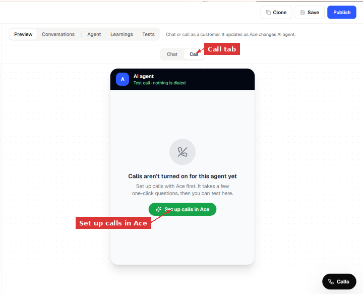
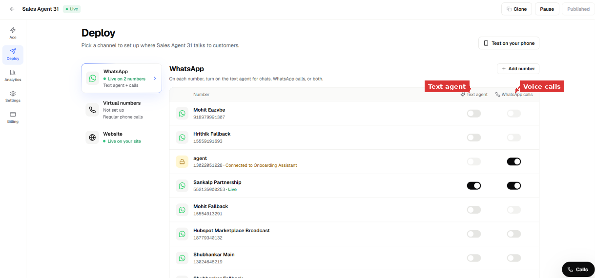
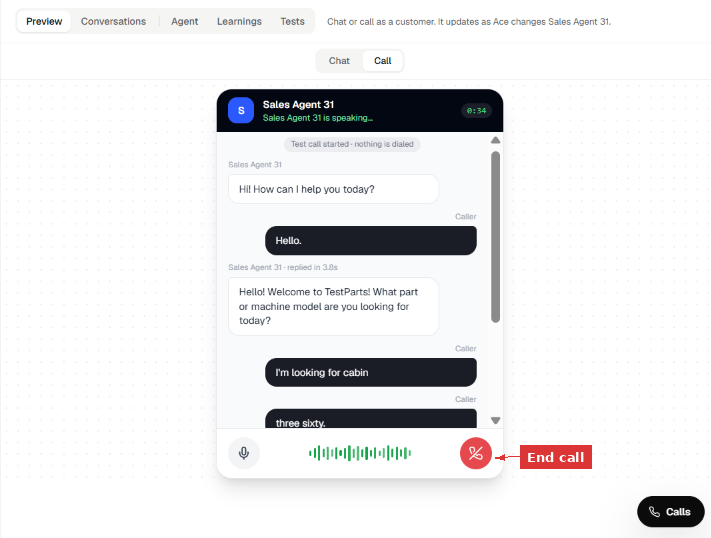
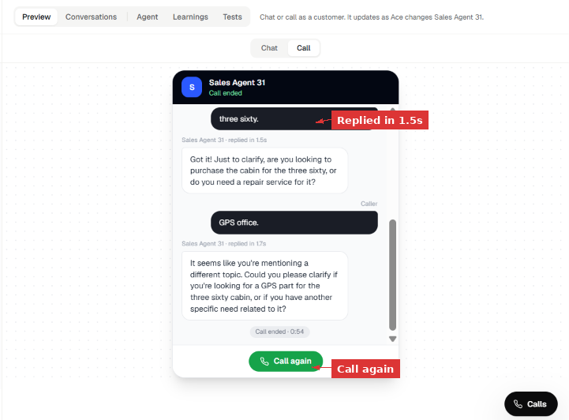

# Agente de Voz IA

> Activa las llamadas de voz para que tu agente de IA pueda atender conversaciones telefónicas en WhatsApp y números virtuales.

Tu agente de IA utiliza el mismo prompt, base de conocimiento y herramientas para las llamadas de voz que para los chats de texto. Activas la capa de voz, lo despliegas en tus números y el agente atiende las llamadas automáticamente.

---

## Cómo Funciona

Tu agente de IA ya sabe cómo responder a los clientes por texto. Voice AI agrega una capa de voz encima:

1. Un cliente llama a tu número de WhatsApp o número virtual.
2. El agente de IA escucha la voz del cliente y la convierte en texto.
3. El agente procesa el mensaje usando tu prompt, base de conocimiento y herramientas — de la misma forma que maneja los chats de texto.
4. La respuesta del agente se convierte en voz con sonido natural y se reproduce para el cliente.

Toda la conversación también se registra como transcripción de texto en tu Team Inbox, para que tu equipo pueda revisar lo que se dijo.

---

## Configuración de Llamadas de Voz

### Paso 1: Activar la voz en Ace

**1.** Abre tu agente y ve a la pestaña **Preview**.

**2.** Cambia de **Chat** a **Call**.

**3.** Si las llamadas aún no están activadas, verás un mensaje: "Calls aren't turned on for this agent yet." Haz clic en **Set up calls in Ace**.

**4.** Ace te guiará con unas pocas preguntas rápidas para configurar los ajustes de voz de tu agente.

*Cambia a la pestaña Call en Preview. Haz clic en "Set up calls in Ace" para activar la voz de tu agente.*

### Paso 2: Desplegar la voz en tus números

Una vez activada la voz, ve a la pestaña **Deploy** para elegir qué números reciben llamadas de voz.

**1.** Haz clic en **Deploy** en la barra lateral izquierda.

**2.** En **WhatsApp**, verás una lista de tus números conectados con dos columnas de alternancia:
   - **Text agent** — activa la IA para chats de texto en ese número.
   - **WhatsApp calls** — activa la IA para llamadas de voz en ese número.

**3.** Activa **WhatsApp calls** en los números que desees. Puedes activar solo texto, solo voz, o ambos en cada número.

**4.** En **Virtual numbers**, puedes configurar números telefónicos regulares (no WhatsApp) para llamadas de voz. Esto es útil si deseas una línea telefónica dedicada para tu agente de IA.

*La página Deploy. Cada número tiene alternadores separados para texto y voz. Activa WhatsApp calls en los números donde quieras que la IA responda.*

> [!NOTE]
> Puedes activar la voz en múltiples números. Cada número puede tener texto, voz o ambos activados de forma independiente. Los cambios surten efecto inmediatamente — no es necesario volver a publicar el agente.

---

## Prueba de Llamadas de Voz

Antes de salir en vivo, prueba la voz de tu agente en la pestaña **Preview**.

**1.** Ve a **Preview** → **Call**.

**2.** La llamada de prueba comienza automáticamente — verás "Test call - nothing is dialed" en la parte superior. Esto significa que la llamada es simulada y no usa un número de teléfono real.

**3.** Habla por tu micrófono. El agente responderá en tiempo real. Puedes ver la transcripción en vivo de la conversación mientras ocurre.

**4.** El estado del agente se muestra en la parte superior — "is speaking..." cuando el agente está hablando, y el tiempo de respuesta (ej. "replied in 1.5s") aparece junto a cada mensaje.

*Una llamada de prueba en curso. El agente responde en tiempo real y puedes ver la transcripción completa. Los tiempos de respuesta se muestran junto a cada respuesta.*

**5.** Cuando termines, haz clic en el botón rojo de **finalizar llamada**. Verás "Call ended" con la duración total y un botón **Call again** para iniciar una nueva prueba.

*Después de finalizar una llamada, revisa la transcripción y haz clic en "Call again" para ejecutar otra prueba.*

---

## Qué Verificar al Probar

Al probar tu agente de voz, presta atención a:

- **Velocidad de respuesta** — qué tan rápido responde el agente después de que terminas de hablar. Apunta a menos de 3 segundos.
- **Claridad de voz** — ¿el agente suena natural? ¿Las palabras se pronuncian correctamente?
- **Muletillas** — el agente no debería agregar sonidos innecesarios como "yeah", "okay" o "hmm" antes de responder.
- **Ruido de fondo** — no debería haber sonidos de teclado, ruidos de escritura ni otros artefactos en la voz del agente.
- **Flujo de conversación** — ¿el agente sigue tu prompt correctamente? ¿Hace las preguntas correctas en el orden correcto?
- **Idioma** — si tu agente soporta múltiples idiomas, verifica que responda en el idioma correcto cuando hablas en ese idioma.

---

## Consejos y Mejores Prácticas

- **Mantén tu prompt conciso** — las conversaciones de voz se mueven más rápido que el texto. Prompts largos y complejos pueden causar retrasos. Instrucciones más cortas ayudan al agente a responder más rápido.
- **Prueba con escenarios reales** — no solo digas "hola." Recorre el viaje real del cliente que tu agente maneja (calificación, reservas, preguntas frecuentes, etc.).
- **Activa en un número primero** — comienza con voz en un solo número, monitorea las llamadas, y luego expande a más números una vez que estés seguro.
- **Revisa las transcripciones regularmente** — cada llamada de voz se registra en Team Inbox como transcripción de texto. Úsalas para detectar problemas y mejorar el prompt de tu agente.
- **Usa números virtuales para líneas de voz dedicadas** — si deseas un número de teléfono separado solo para llamadas de IA (no WhatsApp), configura un número virtual en la pestaña Deploy.

---

## Solución de Problemas

**"Calls aren't turned on for this agent yet"**

Ve a Preview → Call y haz clic en "Set up calls in Ace." Ace te guiará para activar la voz de este agente.

**El agente responde lento**

Revisa la longitud de tu prompt — prompts muy largos pueden aumentar el tiempo de respuesta. También verifica si tienes muchas herramientas activadas que el agente busca antes de responder.

**El agente agrega muletillas o sonidos de fondo**

Este es un problema conocido con algunas configuraciones de voz. Repórtalo al equipo de Eazybe para que puedan ajustar la configuración de voz de tu agente.

**La voz está activada pero las llamadas no se contestan**

Asegúrate de que el alternador de WhatsApp calls esté activado para el número correcto en Deploy. También verifica que el agente esté Published (no Paused o Draft).

**El cliente no escucha nada cuando llama**

Verifica que el número esté conectado y activo. Ve a Deploy → WhatsApp y confirma que el número muestre un estado verde "Live".

