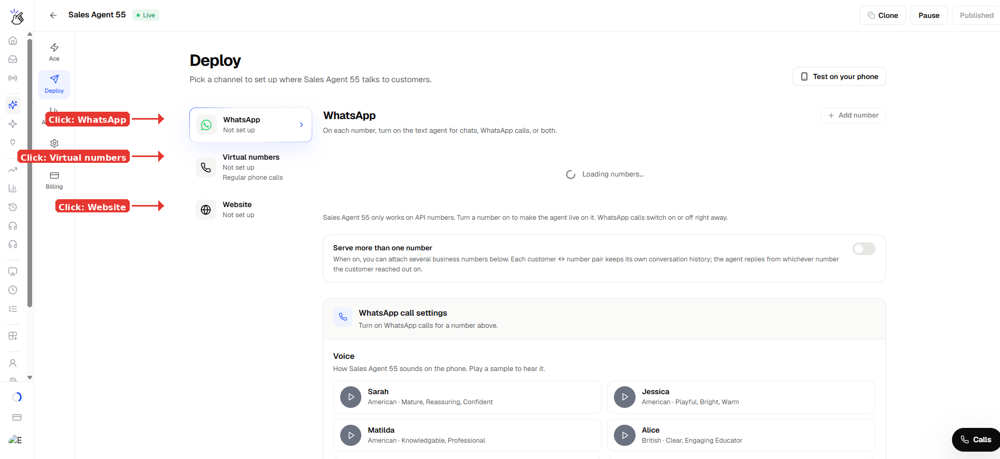
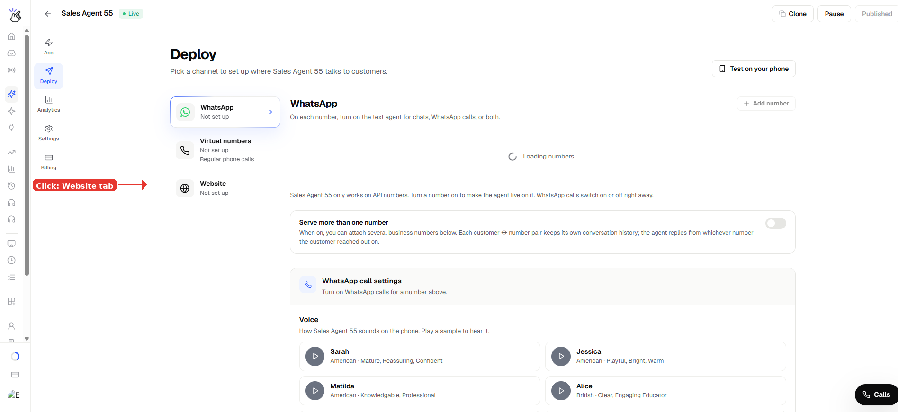
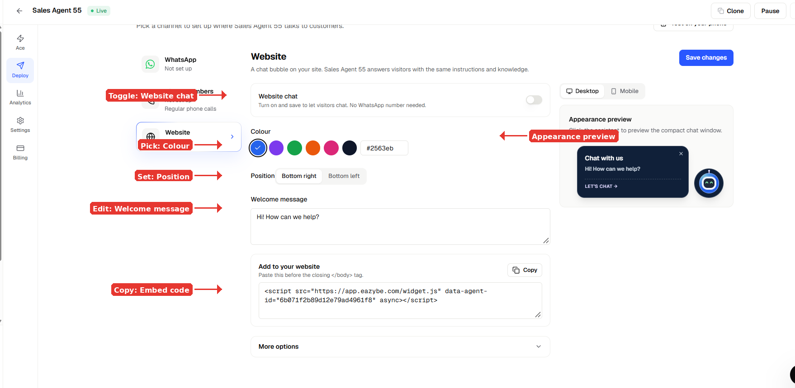
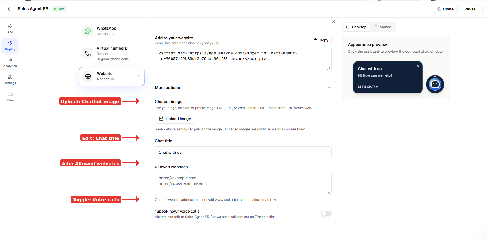
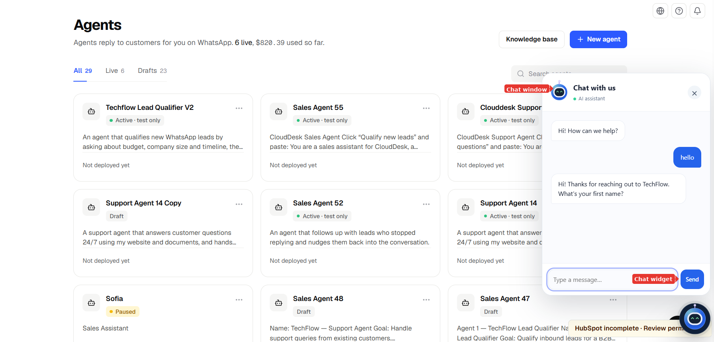

Tu agente de IA puede implementarse más allá de WhatsApp — directamente en tu sitio web como un widget de chat. El mismo agente, con las mismas instrucciones y conocimiento, funciona en todos los canales: WhatsApp, números virtuales y tu sitio web.

## Resumen de Canales de Implementación

Tu agente de IA puede implementarse en tres canales desde la sección **Deploy**:



1. **WhatsApp** — Implementa el agente en tus números de la API de WhatsApp Business para conversaciones de texto y voz.
2. **Números virtuales** — Implementa el agente en números de llamadas telefónicas regulares (números virtuales).
3. **Sitio web** — Agrega el agente como widget de chat en tu sitio web. Los visitantes pueden escribir y, opcionalmente, llamar al agente directamente desde tu sitio.

<Note>
El comportamiento, las instrucciones y el conocimiento del agente se mantienen iguales en los tres canales. Configuras el agente una vez y lo implementas en todas partes.
</Note>

## Configuración del Agente en el Sitio Web

### Paso 1: Navega a Deploy

Abre tu agente en el panel y haz clic en la pestaña **Deploy** en la barra lateral.

### Paso 2: Selecciona Website

Haz clic en **Website** en la lista de canales del lado izquierdo.



### Paso 3: Activa el Chat del Sitio Web

Activa el botón **Website chat**. Esto habilita el widget de chat para tu sitio web — no se necesita un número de WhatsApp.

### Paso 4: Personaliza la Apariencia

Configura cómo se ve el widget en tu sitio:



1. **Color** — Elige un color de tema para el widget de chat. Selecciona entre los colores predefinidos (azul, morado, verde, naranja, rosa, negro) o ingresa un código hexadecimal personalizado.
2. **Posición** — Define dónde aparece el widget: **Esquina inferior derecha** o **Esquina inferior izquierda** de la página.
3. **Mensaje de bienvenida** — El primer mensaje que los visitantes ven al abrir el chat. Por ejemplo: "¡Hola! ¿Cómo podemos ayudarte?"
4. **Código de inserción** — Copia esta etiqueta de script y pégala en el HTML de tu sitio web antes de la etiqueta de cierre `</body>`. Esto carga el agente en tu sitio.

### Paso 5: Configura Más Opciones

Desplázate hacia abajo y expande **More options** para personalizar más:



1. **Imagen del chatbot** — Sube tu logo, mascota o imagen de perfil. Formato PNG, JPG o WebP, hasta 2 MB. PNG transparente funciona mejor.
2. **Título del chat** — El título que se muestra en la parte superior del widget de chat (ej: "Chatea con nosotros").
3. **Sitios web permitidos** — Lista los sitios web donde el agente debe aparecer. Agrega una URL completa por línea, incluyendo `www` y otros subdominios por separado.
4. **Llamadas de voz "Speak now"** — Actívalo para permitir que los visitantes hablen con el agente por voz directamente desde el sitio web. Las llamadas de voz deben configurarse primero (requiere un número de teléfono conectado).

### Paso 6: Previsualiza el Widget

Usa el panel **Appearance preview** a la derecha para ver cómo se verá el widget de chat:

- Haz clic en **Desktop** para previsualizar el widget en una pantalla de computadora.
- Haz clic en **Mobile** para previsualizar cómo aparece en un teléfono.

Haz clic en el ícono del asistente en la previsualización para expandir la ventana de chat compacta y ver el widget completo.

### Paso 7: Agrega el Widget a Tu Sitio Web

Copia el código de inserción de la sección **Add to your website**:

```html
<script src="https://app.eazybe.com/widget.js" data-agent-id="TU_ID_DE_AGENTE" async></script>
```

Pega este código en el HTML de tu sitio web, justo antes de la etiqueta de cierre `</body>`. El widget aparecerá en todas las páginas donde se incluya este código.

### Paso 8: Guarda los Cambios

Haz clic en **Save changes** para publicar tu configuración. El widget se activará en tus sitios web permitidos.

## Widget Activo en Tu Sitio Web

Después de guardar tu configuración, el widget de chat aparece en tus sitios web permitidos. Los visitantes pueden hacer clic en el botón del widget para abrir la ventana de chat e iniciar una conversación con tu agente de IA.



## Puntos Clave

- **Mismo agente, todos los canales** — Tu agente usa las mismas instrucciones, conocimiento y flujo, ya sea que el cliente lo contacte por WhatsApp, llamada telefónica o tu sitio web.
- **No se necesita número de WhatsApp** — El chat del sitio web funciona de forma independiente. No necesitas un número de WhatsApp conectado para implementar el widget en el sitio.
- **Voz en el sitio web** — Si activas las llamadas de voz "Speak now", los visitantes pueden hablar con el agente por voz directamente desde tu sitio web, sin salir de la página.
- **Múltiples sitios web** — Puedes permitir el agente en varios sitios web agregando cada URL a la lista de Sitios web permitidos.
- **Números API** — El mismo agente también puede implementarse en números virtuales (API) para llamadas telefónicas regulares. Selecciona el número en la sección Deploy y el agente atiende llamadas en ese número.
