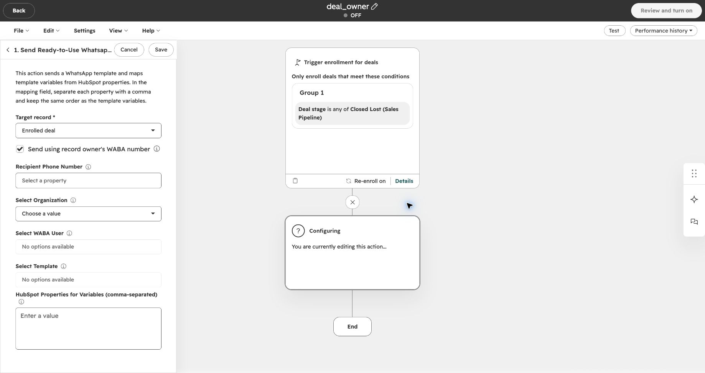
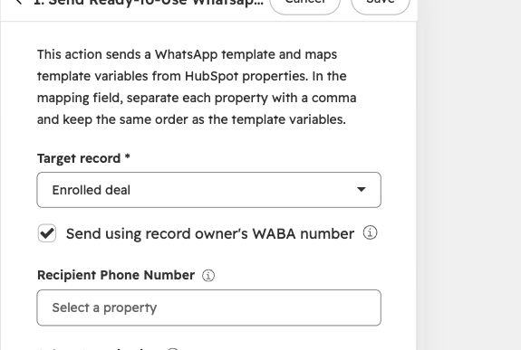
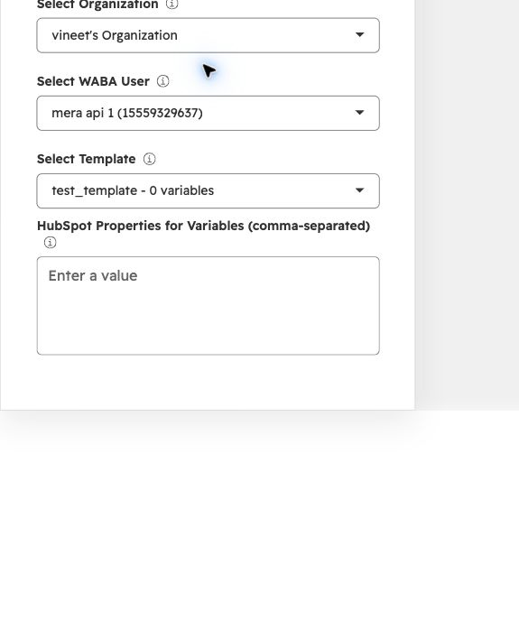
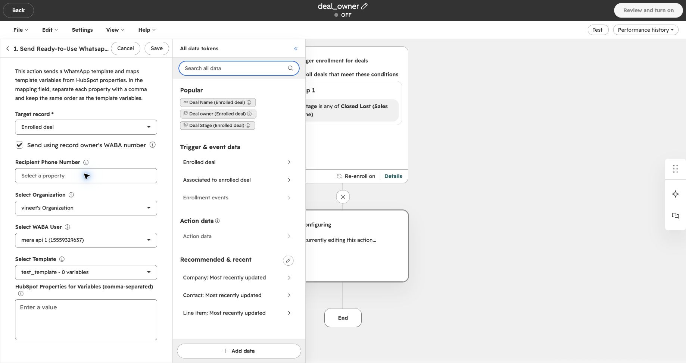
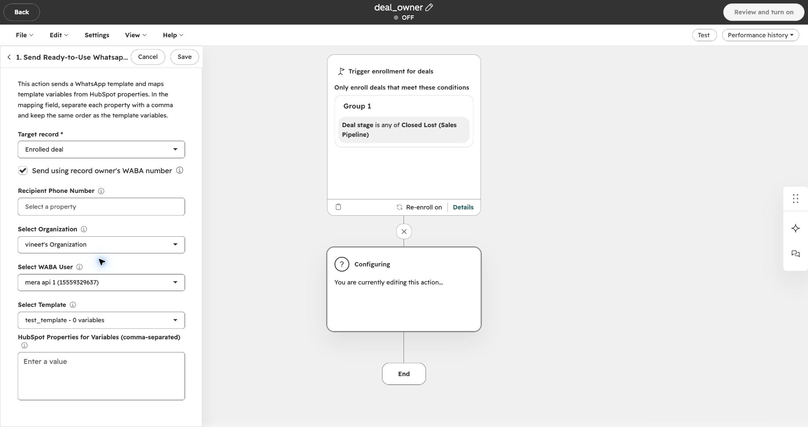

Envía una plantilla de WhatsApp desde el número de la persona responsable de un negocio o contacto de HubSpot. Activa **Send using record owner's WABA number** en la acción de Eazybe para elegir automáticamente el remitente de cada registro inscrito.

## Antes de Empezar

Comprueba estos requisitos para **cada propietario** cuyo número deba enviar mensajes:

| Comprobación | Qué necesitas |
| --- | --- |
| Propietario del registro | El negocio inscrito tiene un **Deal owner**, o el contacto inscrito tiene un **Contact owner**. |
| Número WABA conectado | El número de WhatsApp Business API (WABA / Meta API) del propietario está conectado a Eazybe. Una conexión a WhatsApp Web no es suficiente. Si no está conectado, consulta [Conectar WABA](https://help.eazybe.com/es/waba/connect-waba). |
| Asignación de usuario de HubSpot | El usuario WABA está vinculado al mismo usuario de HubSpot que es propietario del registro, en la cuenta de HubSpot y la organización de Eazybe correctas. Si falta la asignación, consulta [Vincular usuarios de números WABA API (en inglés)](https://help.eazybe.com/en/integrations/hubspot/waba-api-number-integration). |
| Una asignación de propietario inequívoca | El propietario debe corresponder a un único usuario de Eazybe. Si está vinculado a varios usuarios de Eazybe, se conserva el remitente seleccionado en el workflow. |
| Plantilla aprobada compatible | La cuenta de WhatsApp Business del propietario tiene una plantilla **aprobada** con el mismo nombre e idioma que la seleccionada en la acción. También deben coincidir la estructura de componentes, el formato del encabezado, las posiciones de las variables y los tipos de botones. |
| Acceso a workflows | Puedes crear o editar workflows de HubSpot y tienes instalada **WhatsApp Integration by Eazybe**. |
| Remitente predeterminado y destinatarios | Tienes un usuario WABA conectado para usar como remitente alternativo, una plantilla disponible y números de destinatarios válidos. En workflows de negocios, comprueba que haya contactos asociados al negocio. |

<Warning>
  Esta opción no exige que todos los mensajes salgan del número del propietario. Si Eazybe no puede usar ese número o una plantilla compatible, utiliza los valores de **Select WABA User** y **Select Template** de la acción. Elige un número predeterminado adecuado para comunicarte con tus clientes.
</Warning>

## ¿Qué Propietario Envía el Mensaje?

| Tipo de workflow | Propietario que determina el remitente |
| --- | --- |
| Basado en negocios | El propietario del **negocio** inscrito, aunque los contactos asociados tengan otros propietarios. |
| Basado en contactos | El propietario del **contacto** inscrito. |

Por ejemplo, si un negocio pertenece a Priya y su contacto pertenece a Alex, un workflow basado en negocios usa el número WABA de Priya, si cumple los requisitos. El cliente sigue siendo el destinatario; esta opción no envía una notificación a Priya.

<Note>
  El envío desde el propietario está disponible para workflows de contactos y negocios. Los workflows de empresas y leads conservan el usuario WABA seleccionado. Los workflows existentes también conservan su remitente seleccionado hasta que actives la casilla.
</Note>

## Configurar la Acción del Workflow

Si todavía no has creado un workflow, sigue [Enviar una plantilla lista para usar desde un workflow de HubSpot](https://help.eazybe.com/es/waba/broadcasting/hubspot-workflow/send-ready-to-use-template) para crearlo y definir las condiciones de inscripción. Esa guía muestra un workflow de contactos; usa uno basado en negocios si quieres que el **propietario del negocio** determine el remitente.

Vuelve aquí cuando llegues a la configuración de la acción de Eazybe. Los nombres de los campos se muestran en inglés para que coincidan con las capturas.

<Steps>
  <Step title="Abre la acción de plantilla de Eazybe">
    Abre **Send Ready-to-Use Whatsapp Template** en tu workflow. Comprueba que **Target record** sea el registro inscrito que quieres usar. En este ejemplo de negocio, es **Enrolled deal**.

    
  </Step>

  <Step title="Activa el envío desde el propietario del registro">
    Selecciona **Send using record owner's WABA number**. Cuando se ejecuta la acción, Eazybe comprueba quién es el propietario del registro e intenta usar su número WABA vinculado y conectado.

    

    <Note>
      Si desmarcas esta casilla, la acción usa el usuario WABA que selecciones manualmente.
    </Note>
  </Step>

  <Step title="Selecciona la organización, el remitente predeterminado y la plantilla">
    Elige **Select Organization**, después **Select WABA User** y luego **Select Template**. Mantén estos campos configurados aunque actives el envío desde el propietario: definen el remitente alternativo y la plantilla que debe coincidir en la cuenta del propietario.

    Si la plantilla tiene variables, completa **HubSpot Properties for Variables (comma-separated)** en el mismo orden que las variables de la plantilla. La configuración de variables del workflow se mantiene cuando Eazybe cambia a la plantilla compatible del propietario.

    

      
    

    <Note>
      La captura usa una plantilla de ejemplo con **0 variables**, por lo que el campo de variables está vacío. Selecciona tu organización, número y plantilla aprobada. Si la lista de usuarios WABA o plantillas está vacía, comprueba primero la selección anterior y la conexión WABA.
    </Note>
  </Step>

  <Step title="Elige quién recibe el mensaje">
    Para un workflow de negocios:

    1. Haz clic en **Recipient Phone Number**.
    2. En **All data tokens**, elige **Contact: Most recently updated**.
    3. Selecciona **Phone Number**. Comprueba que contenga el número de WhatsApp del cliente.

    

    <Note>
      Esto envía el mensaje a **un contacto asociado por negocio**: el contacto cuyo registro se actualizó más recientemente. No lo envía a todos los contactos asociados al negocio.
    </Note>

    <Warning>
      - Selecciona **Phone Number**, no **Deal owner**, **Contact owner** ni **Record ID**. Estos campos contienen identificadores, no el teléfono del cliente.
      - La casilla **Send using record owner's WABA number** determina quién envía el mensaje.
      - Mantén **Recipient Phone Number** completo para dirigirte a un solo contacto. Si lo dejas vacío, pueden recibir el mensaje los contactos con teléfono entre los **cinco contactos asociados actualizados más recientemente** del negocio. Los números duplicados dentro de ese grupo reciben un solo mensaje.
    </Warning>
  </Step>

  <Step title="Revisa y guarda la acción">
    Revisa la casilla del propietario, el destinatario, la organización, el usuario WABA alternativo, la plantilla y los valores de las variables. Haz clic en **Save** para guardar la acción.

    

    <Note>
      La captura muestra un ejemplo sin terminar, con el campo del destinatario vacío y el workflow **OFF**. Completa tus datos del destinatario antes de guardar. Guardar una acción y activar el workflow son operaciones distintas.
    </Note>

    Sigue los [pasos de revisión y activación del workflow](https://help.eazybe.com/es/waba/broadcasting/hubspot-workflow/send-ready-to-use-template) cuando quieras activarlo. Antes de inscribir clientes en masa, comprueba el remitente y la entrega con un registro de prueba y un número de destinatario que controles.

    <Warning>
      Activar un workflow puede enviar mensajes reales de WhatsApp a los destinatarios inscritos. Revisa las condiciones de inscripción y reinscripción antes de activarlo. Se aplican las tarifas habituales; consulta los [precios de mensajes de WhatsApp (en inglés)](/en/waba/broadcast-rate-list-1-october-2026).
    </Warning>
  </Step>
</Steps>

## ¿Qué Ocurre Cuando Se Ejecuta la Acción?

Eazybe consulta el propietario del registro inscrito, comprueba su vinculación con HubSpot y su conexión WABA en la organización seleccionada, y busca una plantilla aprobada compatible en su cuenta. Si se cumplen estas condiciones, el mensaje usa el número y la plantilla del propietario.

Si no se puede completar alguna comprobación del propietario, la vinculación, la conexión o la plantilla, Eazybe conserva el remitente y la plantilla predeterminados. Ese remitente también debe superar las comprobaciones normales de conexión y plantilla; usar el remitente alternativo no garantiza la entrega.

<Note>
  La casilla cambia el **remitente**, no las reglas de inscripción, la selección de destinatarios ni la asignación de variables. Si el propietario ya es el usuario WABA seleccionado, el remitente no cambia.
</Note>

## Solución de Problemas

| Qué observas | Qué comprobar |
| --- | --- |
| El mensaje salió del número predeterminado | Comprueba que la casilla esté activada y el registro tenga propietario. Después revisa su conexión WABA, su vinculación con HubSpot y la plantilla aprobada compatible. |
| El número WABA del propietario está desconectado | [Conecta o vuelve a conectar WABA](https://help.eazybe.com/es/waba/connect-waba). Hasta que vuelva a cumplir los requisitos, la acción puede usar el remitente predeterminado. |
| El propietario tiene un número, pero no se utiliza | [Revisa la vinculación del usuario de HubSpot (en inglés)](https://help.eazybe.com/en/integrations/hubspot/waba-api-number-integration). Comprueba el propietario, la cuenta de HubSpot y la organización de Eazybe, y corrige las vinculaciones a varios usuarios de Eazybe. |
| La plantilla existe, pero se usa el número predeterminado | Revisa la aprobación, el nombre exacto, el idioma, la estructura, el encabezado, las variables y los botones en la cuenta del propietario. El nombre por sí solo no basta. |
| Un mensaje del negocio no usó el número del propietario del contacto | Los workflows de negocios usan al **propietario del negocio**. Revisa quién es y su vinculación. |
| Varios contactos recibieron el mensaje | Comprueba si **Recipient Phone Number** quedó vacío. En ese caso, un workflow de negocios puede enviar a contactos asociados. |
| No se entregó ningún mensaje | Comprueba la conexión y la plantilla del remitente utilizado, el número del destinatario y los contactos asociados al negocio. Consulta **Performance history** y las [analíticas de entrega de difusiones](/es/broadcasts/view-analytics). |
| Cambiaste la organización de la acción | Vuelve a seleccionar el usuario WABA y la plantilla para que pertenezcan a la nueva organización. |

## Guías Relacionadas

- [Conectar WABA](https://help.eazybe.com/es/waba/connect-waba)
- [Vincular usuarios de números WABA API (en inglés)](https://help.eazybe.com/en/integrations/hubspot/waba-api-number-integration)
- [Crear y activar un workflow de plantillas de HubSpot](https://help.eazybe.com/es/waba/broadcasting/hubspot-workflow/send-ready-to-use-template)
- [Solucionar problemas de workflows de HubSpot](/es/integrations/hubspot/workflow-troubleshoot)
