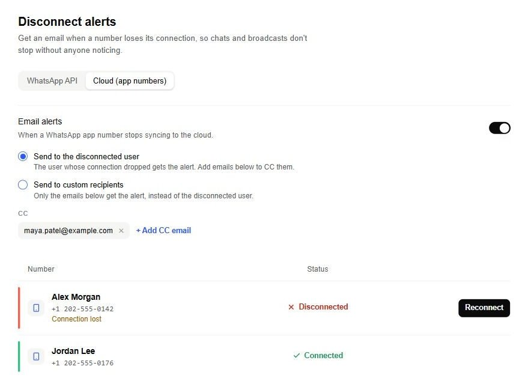
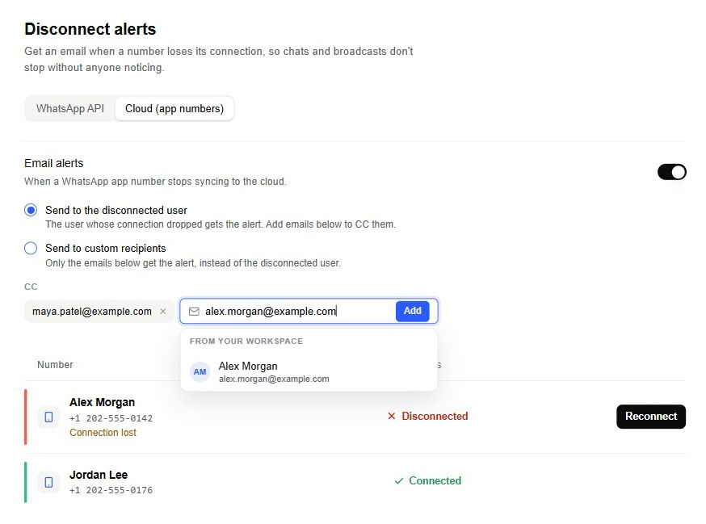
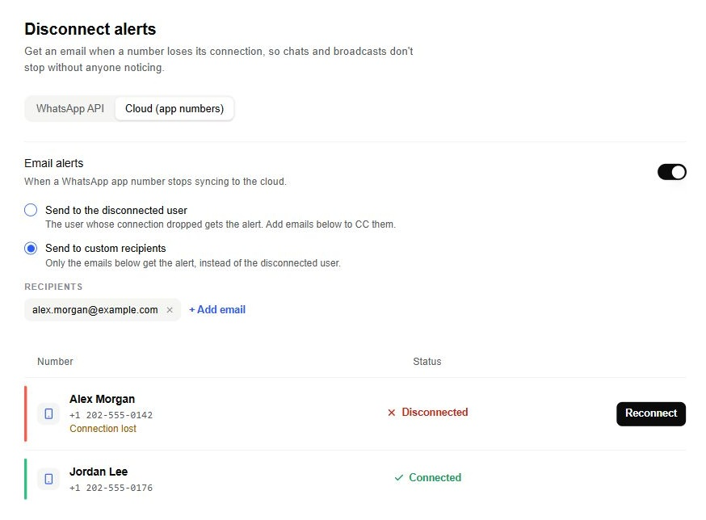

Notifica al usuario cuando su conexión de Cloud se desconecte y añade direcciones en CC para mantener informado al equipo. También puedes enviar las alertas a una lista personalizada desde **Settings → Disconnect alerts → Cloud (app numbers)**.

<Note>
Solo los administradores del espacio de trabajo pueden gestionar estas alertas.
</Note>

## Configurar alertas de Cloud con correos en CC

<Steps>
  <Step title="Abrir las alertas de Cloud y activar las notificaciones">
    Abre [Settings de Eazybe](https://app.eazybe.com/settings), selecciona **Disconnect alerts** y elige **Cloud (app numbers)**.

    Activa **Email alerts** para mostrar las opciones de destinatarios. Selecciona **Send to the disconnected user**: el usuario cuya conexión se interrumpió recibe la alerta y las direcciones de **CC** reciben una copia del mismo correo.

    Esta es la opción de destinatario predeterminada. Comprueba que **Email alerts** esté activado; elegir el destinatario no activa las alertas por sí solo.

    
  </Step>

  <Step title="Añadir correos opcionales en CC">
    En **CC**, selecciona **+ Add CC email**. Elige un compañero en **FROM YOUR WORKSPACE** o introduce un correo y selecciona **Add**. También puedes añadir direcciones externas al espacio de trabajo.

    Repite el proceso para cada persona que necesite una copia, como un responsable o el equipo encargado de restablecer la conexión. Las direcciones guardadas aparecen como etiquetas. Puedes añadir hasta 10 direcciones en CC.

    Los cambios se guardan automáticamente. Espera a que termine cada guardado antes de realizar el siguiente cambio. Si falla, inténtalo de nuevo y comprueba que la dirección aparezca en la lista.

    

    <Note>
    CC es opcional. Si está vacío, aparece *No one in CC. Only the disconnected user is notified.* Esto significa que solo se notifica al usuario desconectado. No necesitas añadir su dirección a CC.
    </Note>
  </Step>

  <Step title="Elegir destinatarios personalizados si lo necesitas">
    Para enviar alertas solo a una lista concreta, selecciona **Send to custom recipients**. En **Recipients**, selecciona **+ Add email**, elige un compañero o introduce un correo y selecciona **Add**. Puedes añadir hasta 10 destinatarios.

    Revisa las direcciones mostradas, incluida cualquier dirección de administrador añadida previamente, para confirmar quién recibirá las alertas.

    

    <Note>
    En este modo, no se notifica automáticamente al usuario desconectado. Incluye su dirección en **Recipients** si también debe recibir la alerta. CC solo se aplica a **Send to the disconnected user**.
    </Note>
  </Step>
</Steps>

Las listas de CC y de destinatarios personalizados se guardan por separado. Al cambiar de opción se muestra la lista correspondiente; las direcciones no se trasladan entre listas.

## Gestionar destinatarios o detener las alertas

Usa **×** junto a un correo para eliminarlo. Si hay direcciones ocultas, selecciona **+N more** para ver y buscar en la lista completa.

- Con **Send to the disconnected user**, puedes eliminar todas las direcciones de CC. El usuario desconectado seguirá recibiendo alertas mientras **Email alerts** esté activado.
- Con **Send to custom recipients**, conserva al menos un destinatario mientras las alertas estén activadas. Desactiva **Email alerts** antes de eliminar el último.

Para detener los correos de desconexión de Cloud, desactiva **Email alerts**. La configuración de destinatarios se conserva para cuando vuelvas a activar las alertas. Mantén **Cloud (app numbers)** seleccionado al editar estas opciones.

## Revisar y reconectar un número desconectado

Busca el número afectado en la tabla debajo de las alertas. Comprueba **Status**: **Disconnected** indica que la conexión necesita atención. Debajo del número puede aparecer un motivo, como **Connection lost** (conexión perdida).

Selecciona **Reconnect** junto al número para abrir la [página Channels](https://app.eazybe.com/numbers-connected). Busca el número correspondiente y sigue el proceso de conexión de Cloud. **Reconnect** abre Channels; por sí solo no restablece la conexión.

## Preguntas frecuentes

<AccordionGroup>
  <Accordion title="¿Puedo notificar solo al usuario desconectado?">
    Sí. Activa **Email alerts**, selecciona **Send to the disconnected user** y deja **CC** vacío. Eliminar todas las direcciones de CC no desactiva las alertas.
  </Accordion>
  <Accordion title="¿Por qué nadie recibió una alerta?">
    Confirma que **Email alerts** esté activado en **Cloud (app numbers)**. Comprueba la opción elegida: en el primer modo reciben el correo el usuario afectado y las direcciones de CC; en el modo personalizado, solo la lista **Recipients**. Comprueba que los cambios se hayan guardado y pide al destinatario que revise su carpeta de spam.
  </Accordion>
  <Accordion title="¿Por qué no puedo cambiar los destinatarios?">
    Solo los administradores pueden gestionar esta configuración. Si aparece **Admin only**, pide a un administrador que la actualice. Si eres administrador, activa **Email alerts** para mostrar las opciones y espera a que termine cualquier guardado en curso.
  </Accordion>
</AccordionGroup>
