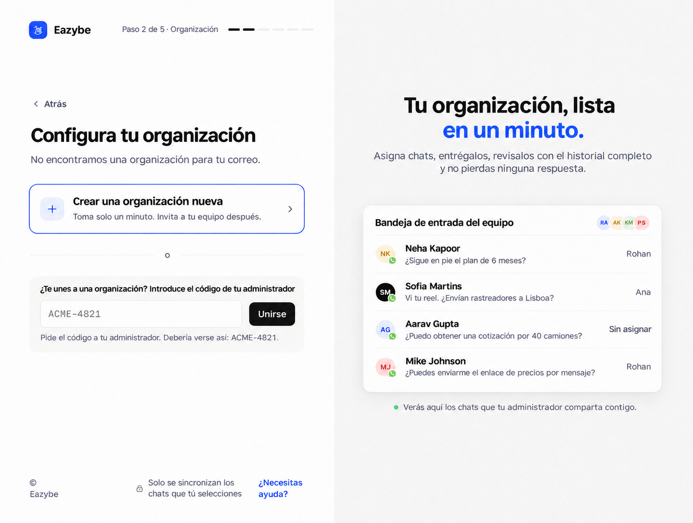
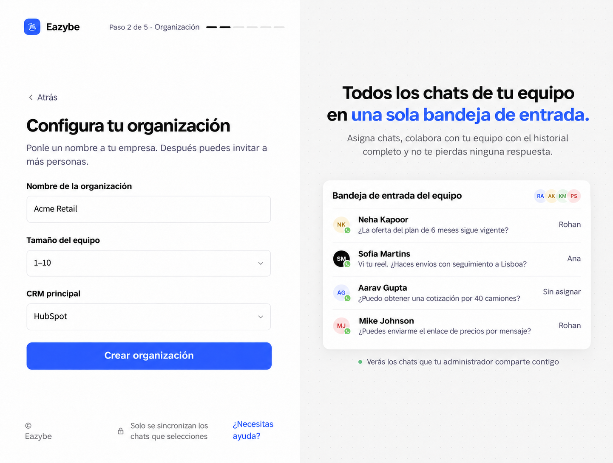

<Note>
Esta guía sigue el nuevo proceso de incorporación de dev. Las capturas posteriores al inicio de sesión usan el prototipo de referencia: los nombres, números, precios, contadores de pasos y botones exclusivos del prototipo son ilustrativos. Sigue los controles de tu aplicación Eazybe.
</Note>

Completa primero [el inicio de sesión y tu número de trabajo](/es/getting-started/onboarding/overview). Crea una organización solo si estás configurando un equipo nuevo para tu empresa.

<Steps>
<Step title="Selecciona Crear una organización nueva">
En **Configura tu organización**, selecciona **Crear una organización nueva**. Si tu empresa ya tiene una organización, pide el código a su administrador y usa **Unirse**.

</Step>
<Step title="Introduce los datos de la organización">
Completa **Nombre de la organización**, selecciona **Tamaño del equipo** y elige **CRM principal**. Después, selecciona **Crear organización**. Elige la opción sin CRM si todavía no usas uno. Esta selección guarda tu preferencia; no autoriza ni conecta el CRM.

</Step>

</Steps>

## Continúa la configuración

[Instala la extensión y conecta WhatsApp o llamadas →](/es/getting-started/onboarding/crm)

## Invita a tu equipo

Después de la incorporación, usa **Invita a tu equipo** en la lista de Inicio o abre **Staff → Add Employee**. Introduce el nombre, el rol y el correo de trabajo del empleado y selecciona **Send Invite**. Puede abrir el enlace del correo o iniciar sesión en app.eazybe.com con ese correo.

Comparte el **Organization Code** de la organización principal desde **Staff**. Los empleados lo pegan en el campo para unirse durante la configuración. Comparte el código de organización, no las credenciales independientes Access Code o Auth Key.

[Comparte la guía para empleados →](/es/getting-started/onboarding/employee)

## Comprueba la asignación del CRM

En HubSpot, Salesforce o Zoho, los empleados pueden asignarse automáticamente cuando el administrador conecta el CRM. Si falta una asignación, abre **Settings → User Mapping** de ese CRM y selecciona el usuario correcto. Quienes usan otros CRM completan su propia integración.
