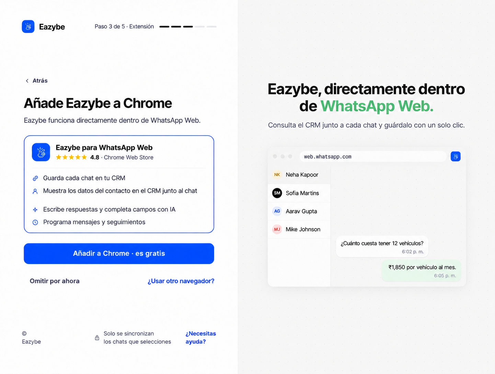
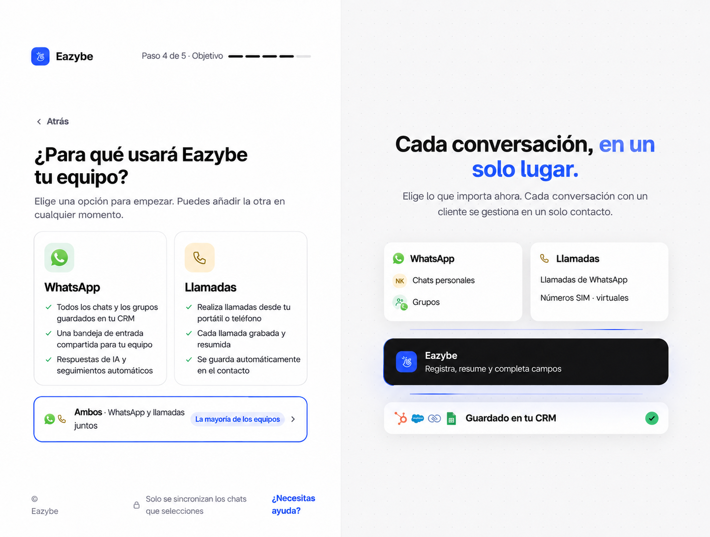
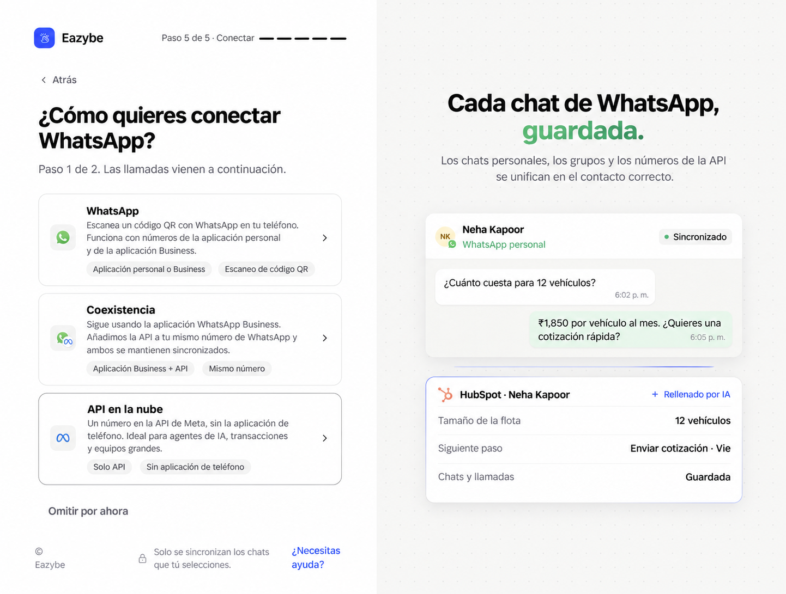
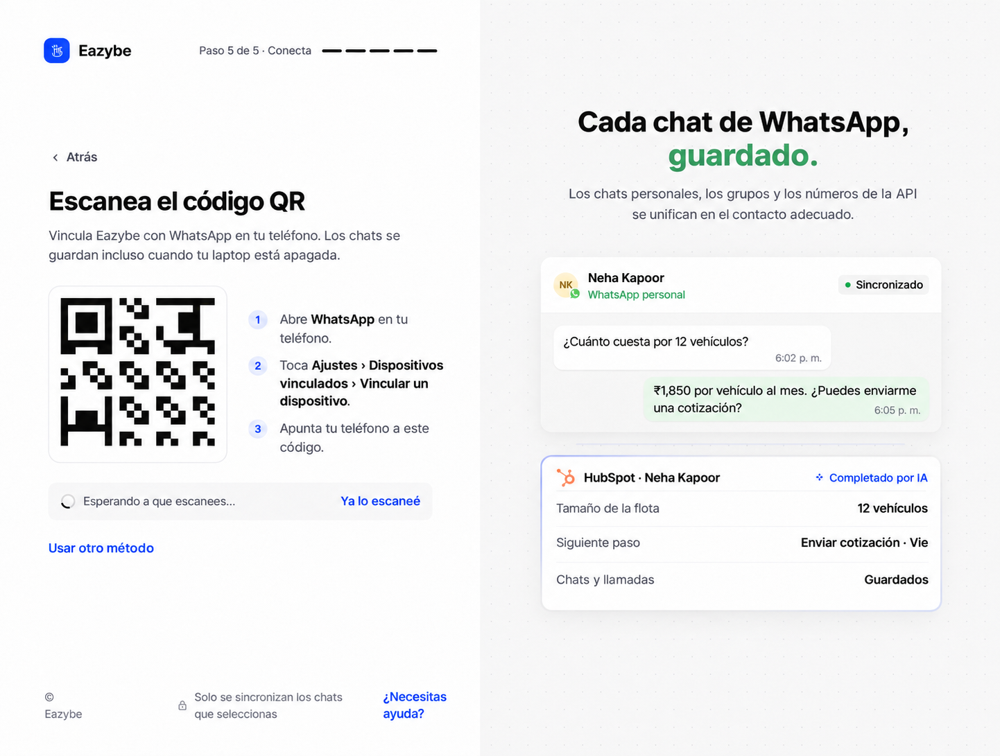
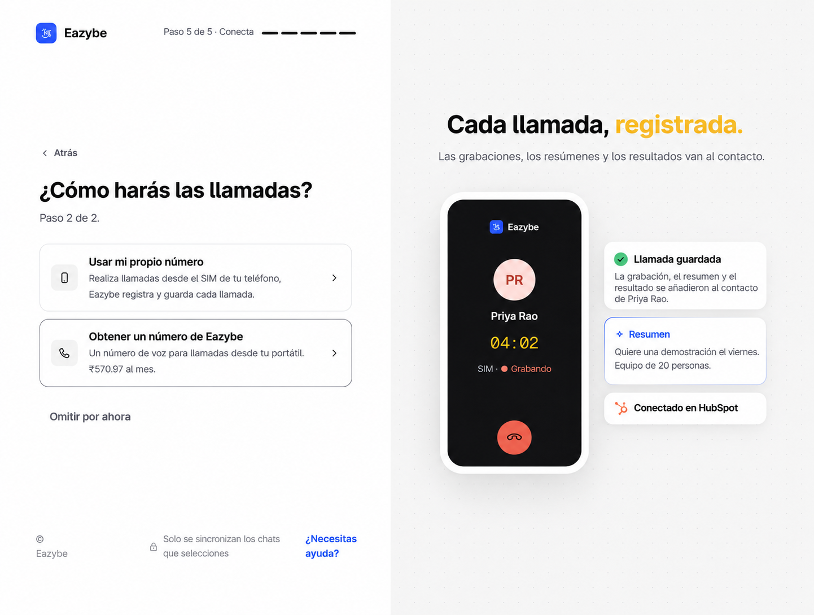
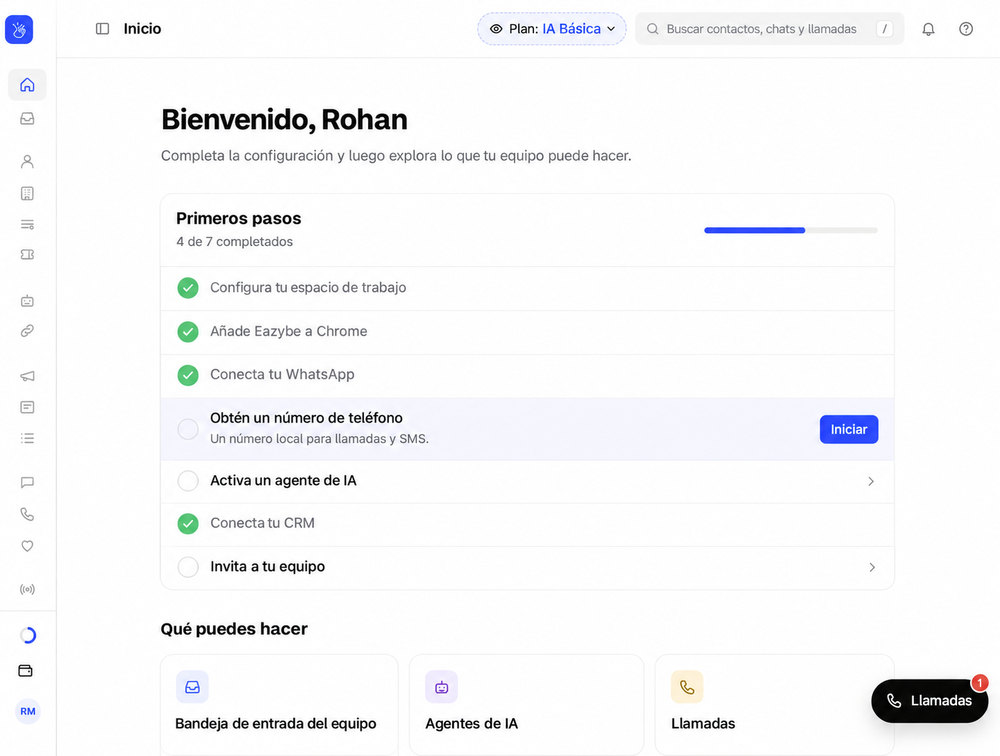

<Note>
Esta guía sigue el nuevo proceso de incorporación de dev. Las capturas posteriores al inicio de sesión usan el prototipo de referencia: los nombres, números, precios, contadores de pasos y botones exclusivos del prototipo son ilustrativos. Sigue los controles de tu aplicación Eazybe.
</Note>

Continúa aquí después de crear o unirte a tu espacio de trabajo.

<Steps>
<Step title="Añade Eazybe a Chrome">
En **Añade Eazybe a Chrome**, selecciona **Añadir a Chrome · es gratis**. También puedes abrir la [ficha de Chrome Web Store](https://chromewebstore.google.com/detail/whatsapp-ai-agents-with-c/clgficggccelgifppbcaepjdkklfcefd) directamente. En la tienda, elige **Add to Chrome** y luego **Add extension**. Instálala una sola vez. Si Eazybe ya la detecta, selecciona **Continuar**. **Omitir por ahora** permite completar otras tareas, pero instala la extensión antes de usar Eazybe dentro de WhatsApp Web.

</Step>
<Step title="Elige para qué usará Eazybe tu equipo">
En **¿Para qué usará Eazybe tu equipo?**, selecciona **WhatsApp**, **Llamadas** o **Ambos**. Ambos configura primero WhatsApp y después las llamadas. Puedes añadir la otra opción más adelante.

</Step>
<Step title="Elige la conexión de WhatsApp">
Si elegiste WhatsApp o Ambos, selecciona un método de la tabla. Coexistencia y API en la nube requieren un administrador; consúltalo si esas opciones no están disponibles.

</Step>

</Steps>

| Método | Cuándo usarlo | Siguiente acción |
| --- | --- | --- |
| **WhatsApp** | Conectar un número personal o de la aplicación WhatsApp Business. | Escanea el QR con tu teléfono. |
| **Coexistencia** | Mantener WhatsApp Business y añadir la API al mismo número. | Selecciona **Connect with Meta** y sigue el flujo de conexión de la aplicación Business. |
| **API en la nube** | Usar un número en la API de Meta sin la aplicación del teléfono. | Selecciona **Connect with Meta** y completa la configuración de Meta. |

## Conecta con un código QR

En el teléfono, abre WhatsApp, ve a **Ajustes → Dispositivos vinculados → Vincular un dispositivo** y escanea el código de tu sesión de Eazybe. Espera a **WhatsApp connected** antes de continuar. Usa **New code** si aparece un error del QR o **Usar otro método** para cambiar de método.

<Note>El QR de la imagen es ilustrativo. Escanea el código actual de tu aplicación Eazybe. **Ya lo escaneé** es un control de demostración del prototipo; el flujo implementado detecta la conexión.</Note>

## Configura las llamadas

Si elegiste Ambos, selecciona **Next: set up calling** después de WhatsApp. Si elegiste Llamadas, llegarás directamente a las opciones de llamadas.

- **Usar mi propio número:** Instala Eazybe en tu teléfono Android, inicia sesión con el mismo correo y sigue las indicaciones de acceso a llamadas.
- **Obtener un número de Eazybe:** Selecciona **Choose my number** para abrir Phone Numbers, elige país y código de área y revisa el precio real antes de activar un número. El precio del prototipo es ilustrativo.

Puedes usar **Omitir por ahora** cuando aparezca y terminar después. Omitir un paso no conecta un número.

## Termina desde Inicio

Usa la lista **Primeros pasos** para completar tareas pendientes, como **Conecta tu CRM** e **Invita a tu equipo**. La lista depende de lo que seleccionaste y completaste.

Elegir **CRM principal** al crear el espacio no lo conecta. Abre **Conecta tu CRM** o **Integrations** y completa la autorización. En HubSpot, Salesforce o Zoho, el administrador revisa **Settings → User Mapping** si un empleado no se asigna automáticamente. Los usuarios de otros CRM completan su propia integración.
