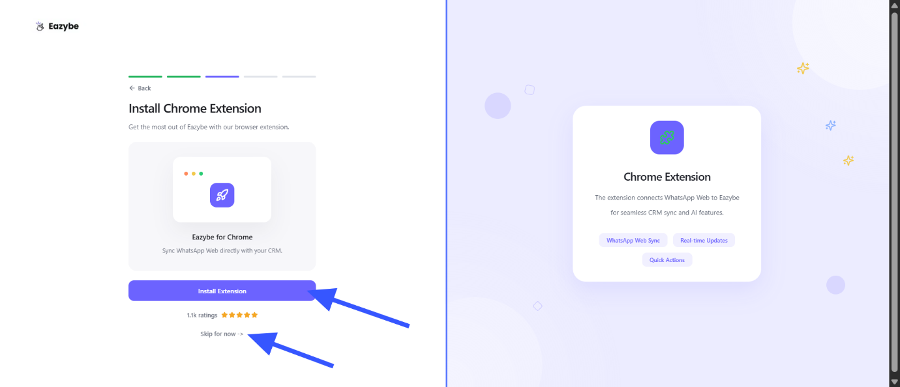
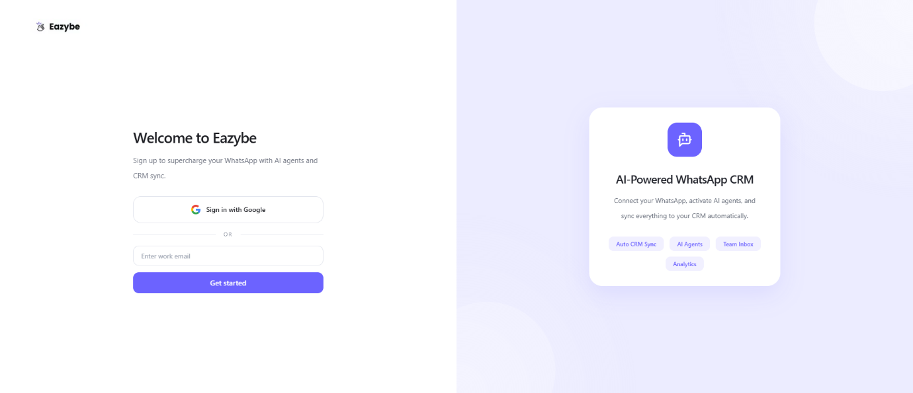
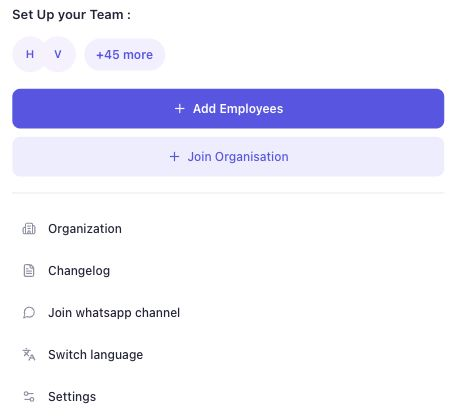
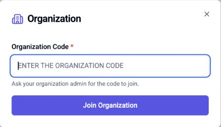

Tu administrador te enviará una invitación y compartirá el código de tu organización principal. Completa estos pasos en la computadora donde usas WhatsApp Web.

<Note>Los nombres de los controles se mantienen en inglés para que coincidan con las capturas.</Note>

<Steps>
  <Step title="Instala primero la extensión de Eazybe">
    Puedes instalar la extensión desde cualquiera de estos dos lugares:

    - **Desde Eazybe:** En la pantalla de incorporación de [app.eazybe.com](https://app.eazybe.com), haz clic en **Install Extension** (Instalar extensión), como se muestra abajo. Se abrirá la ficha de Chrome Web Store.
    - **Desde Chrome Web Store:** Abre directamente la [ficha de la extensión de Eazybe](https://chromewebstore.google.com/detail/whatsapp-ai-agents-with-c/clgficggccelgifppbcaepjdkklfcefd).

    En ambos casos, haz clic en **Add to Chrome** (Añadir a Chrome) y confirma con **Add extension** (Añadir extensión). Ambas opciones instalan la misma extensión; solo necesitas instalarla una vez.

    

    <Note>
    Aunque la pantalla general ofrece **Skip for now** (Omitir por ahora), instala la extensión antes de continuar con esta configuración de WhatsApp Web.
    </Note>
  </Step>
  <Step title="Inicia sesión con el correo que invitó tu administrador">
    Abre [WhatsApp Web](https://web.whatsapp.com) y vincula tu cuenta de WhatsApp si se te solicita. Inicia sesión en la extensión de Eazybe con el mismo correo de trabajo que usó tu administrador para la invitación.

    Puedes abrir el enlace del correo de invitación o ir directamente a [app.eazybe.com](https://app.eazybe.com) e iniciar sesión con ese mismo correo. A continuación se muestra la pantalla de acceso de la aplicación; verifica tu correo si se te solicita.

    

    <Note>
    Iniciar sesión en WhatsApp e iniciar sesión en Eazybe son pasos separados. Comprueba que has iniciado sesión en Eazybe con el correo que recibió la invitación.
    </Note>
  </Step>
  <Step title="Abre Join Organisation en la extensión">
    En WhatsApp Web, haz clic en el **icono de Eazybe** en la parte superior de la barra de herramientas derecha para abrir **My Account** (Mi cuenta). En **Set Up your Team** (Configura tu equipo), selecciona **Join Organisation** (Unirse a una organización).

    
  </Step>
  <Step title="Pega el código de tu organización principal">
    Pide al administrador el código de la organización principal. Pégalo en **Organization Code** (Código de la organización) y selecciona **Join Organization** (Unirse a la organización).

    

    Después de unirte, abre **My Account** y comprueba **Organization Name** (Nombre de la organización). Debe coincidir con tu organización principal. Si tienes dudas, pide al administrador que confirme tu incorporación en **Staff**.
  </Step>
</Steps>

## Conecta tu CRM

Para **HubSpot, Salesforce o Zoho**, si el administrador ya conectó el CRM, tu usuario debería asignarse automáticamente. Si no está asignado, pide al administrador que vincule tu cuenta de Eazybe al usuario correcto del CRM en **Settings → User Mapping** (Configuración → Asignación de usuarios) de la integración.

Para **otros CRM**, debes integrar tu propia cuenta aunque el administrador ya haya conectado la suya.

[Continúa con la configuración del CRM →](/es/getting-started/onboarding/crm)

## Preguntas frecuentes

<AccordionGroup>
  <Accordion title="¿Puedo unirme sin abrir el correo de invitación?">
    Sí. Instala la extensión, inicia sesión con el correo invitado y usa el código que comparta tu administrador. También puedes iniciar sesión directamente en app.eazybe.com.
  </Accordion>
  <Accordion title="¿Qué hago si el código de la organización no funciona?">
    Copia el código de nuevo sin espacios adicionales. Pide al administrador que confirme que pertenece a la organización principal y que estás usando el correo invitado.
  </Accordion>
  <Accordion title="¿Debo crear una organización nueva?">
    Si te unes a un equipo existente, usa el código de tu administrador. Crear otra organización no te incorporará a la organización principal de tu equipo.
  </Accordion>
  <Accordion title="Ya me uní, pero mi CRM no está conectado. ¿Qué hago?">
    Para HubSpot, Salesforce o Zoho, pide al administrador que revise la conexión y tu asignación de usuario. Para otros CRM, completa la integración con tu propia cuenta.
  </Accordion>
</AccordionGroup>
