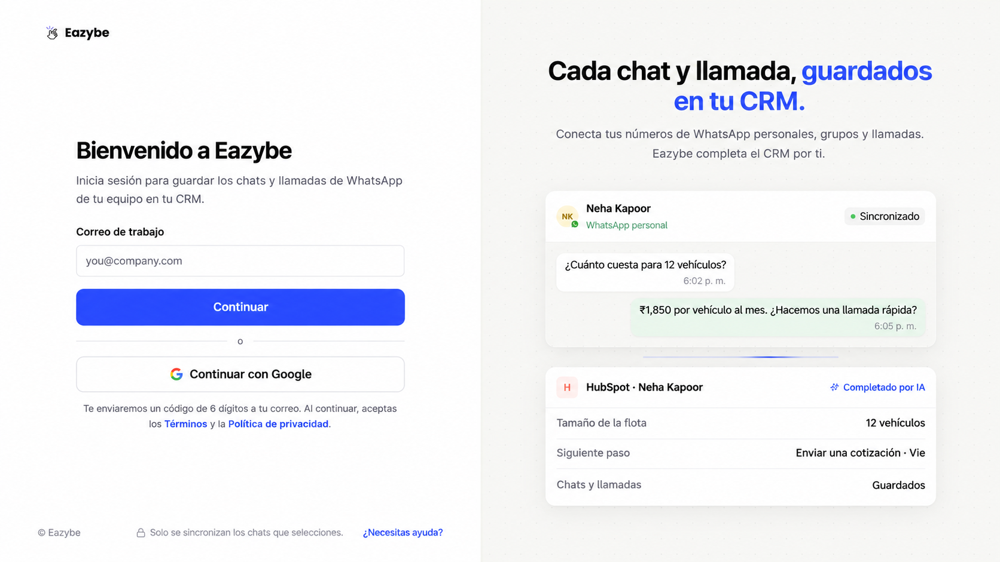
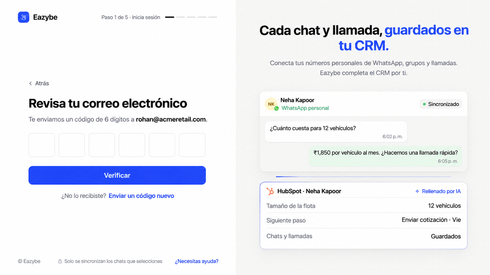
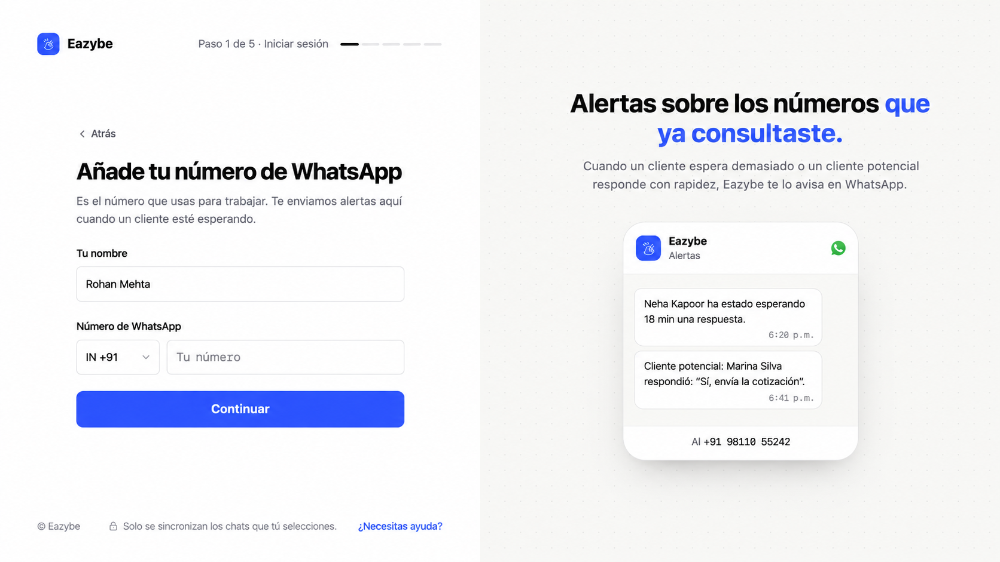

<Note>
Esta guía sigue el nuevo proceso de incorporación de dev. Las capturas posteriores al inicio de sesión usan el prototipo de referencia: los nombres, números, precios, contadores de pasos y botones exclusivos del prototipo son ilustrativos. Sigue los controles de tu aplicación Eazybe.
</Note>

Empieza en [Eazybe](https://app.eazybe.com/signin). Para revisar el nuevo flujo antes de su lanzamiento, usa [dev](https://dev-app.eazybe.com/signin).

El recorrido es **Inicio de sesión → Tu WhatsApp → Espacio de trabajo → Extensión → Objetivo → Conexión**. Algunas pantallas pueden omitirse si tu cuenta ya tiene la información necesaria.

<Steps>
<Step title="Inicia sesión con tu correo de trabajo">
Introduce **Correo de trabajo** y selecciona **Continuar**, o elige **Continuar con Google**. Si tu administrador te invitó, usa ese mismo correo.

</Step>
<Step title="Verifica tu correo">
Introduce el código de seis dígitos recibido por correo y selecciona **Verificar**. Usa **Enviar un código nuevo** si lo necesitas o **Atrás** para corregir el correo. El acceso con Google puede no requerir esta pantalla.

</Step>
<Step title="Añade tu número de WhatsApp de trabajo">
Introduce **Tu nombre**, elige el prefijo del país e introduce **Número de WhatsApp**. Selecciona **Continuar**. Este número se usa para alertas; añadirlo aquí no conecta la sincronización de chats.

</Step>

</Steps>

## Crea o únete a un espacio de trabajo

- **¿Configuras Eazybe para tu empresa?** [Crea tu espacio de trabajo](/es/getting-started/onboarding/admin).
- **¿Te unes a un equipo existente?** [Usa el código del administrador](/es/getting-started/onboarding/employee).

Usa el mismo correo de trabajo en Eazybe, la extensión y la aplicación móvil. La conexión del CRM se completa por separado de la verificación del correo.
