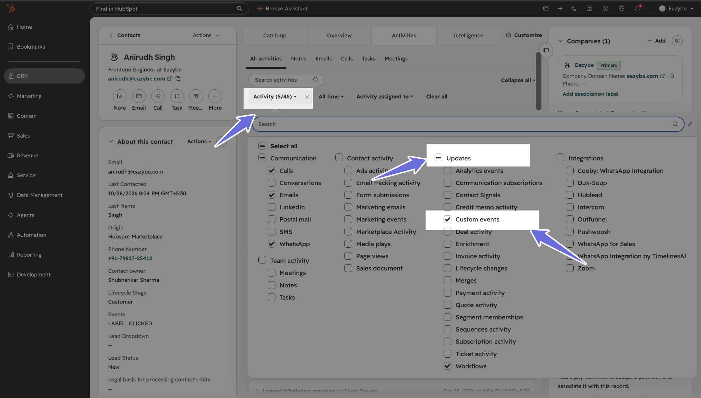
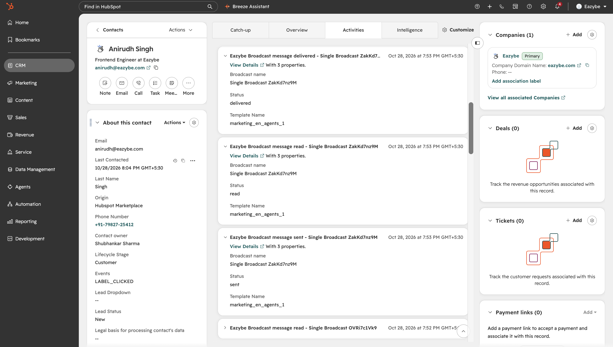

Consulta la actividad de tus difusiones de WhatsApp directamente en la cronología de un contacto de HubSpot. Expande un evento personalizado de Eazybe para ver el nombre de la difusión, el estado del mensaje, el nombre de la plantilla y el motivo del error, si está disponible.

## Antes de empezar

- Usa una suscripción de HubSpot **Professional o Enterprise** que incluya **Custom events** (Eventos personalizados). Consulta la [disponibilidad de eventos personalizados de HubSpot](https://knowledge.hubspot.com/reports/create-custom-events) para tu suscripción.
- Conecta tu espacio de trabajo de Eazybe a la cuenta de HubSpot que contiene el registro del contacto destinatario. Consulta [Conectar tu cuenta de HubSpot](/es/integrations/hubspot/account-connection).
- Asegúrate de que el destinatario de la difusión esté asociado al contacto correcto de HubSpot mediante la integración de Eazybe.
- Envía los mensajes mediante un flujo de difusión de la API de WhatsApp Business de Eazybe.

### Permisos necesarios de HubSpot

Para habilitar los permisos necesarios, integra HubSpot con Eazybe y aprueba el acceso solicitado durante la autorización de HubSpot. Sigue los pasos de [Conectar tu cuenta de HubSpot](/es/integrations/hubspot/account-connection) para completar la integración.

Tu conexión de HubSpot necesita los dos permisos siguientes, además del acceso a los contactos que ya tiene:

| Permiso | Para qué lo usa Eazybe |
| --- | --- |
| `analytics.behavioral_events.send` | Enviar a HubSpot las ocurrencias de eventos de estado de las difusiones. |
| `behavioral_events.event_definitions.read_write` | Leer, crear y actualizar la definición del evento personalizado. |

Si conectaste HubSpot antes de que se solicitaran estos permisos, vuelve a autorizar la integración desde el área de integración con HubSpot de Eazybe. Selecciona la cuenta correcta de HubSpot y aprueba el acceso solicitado. Si no puedes concederlo, pide a tu administrador de HubSpot que complete la autorización.

<Note>
  Tener una conexión existente no confirma que se hayan concedido ambos permisos. Después de la autorización, usa una nueva difusión de prueba para comprobar la conexión. Eazybe crea o encuentra automáticamente la definición de su evento; no necesitas crear un evento personalizado de forma manual.
</Note>

## Mostrar los eventos de difusión en la cronología

En HubSpot, abre **CRM → Contacts** (Contactos), selecciona el registro del contacto destinatario y abre **Activities → All activities** (Actividades → Todas las actividades).

<Steps>
  <Step title="Selecciona los eventos personalizados en el filtro de actividad">
    Abre el menú desplegable **Activity** (Actividad) situado encima de la cronología. El menú muestra el número de elementos seleccionados, como **Activity (5/45)** en la captura de pantalla. En **Updates** (Actualizaciones), selecciona **Custom events** (Eventos personalizados) y cierra el menú.

    Asegúrate de que el filtro de fechas incluya la fecha de envío de la difusión. Elige **All time** (Todo el tiempo) al buscar un evento.

    

    <Note>
      En algunos diseños de HubSpot, el filtro se llama **Filter activity** (Filtrar actividad) y la opción, **Custom event** (Evento personalizado). Seleccionarla cambia las actividades que ves; no envía mensajes de WhatsApp ni correos electrónicos.
    </Note>
  </Step>

  <Step title="Expande un evento de difusión de Eazybe">
    Busca una entrada que empiece por **Eazybe Broadcast message**. Haz clic en la flecha junto a la entrada para expandirla y revisar **Broadcast name** (Nombre de la difusión), **Status** (Estado) y **Template Name** (Nombre de la plantilla). La fecha y la hora del evento aparecen junto a su título.

    Cada estado informado aparece como una entrada independiente. La captura muestra los eventos **delivered** (entregado), **read** (leído) y **sent** (enviado) de la misma difusión.

    

    <Warning>
      El contacto, los nombres de las difusiones y las plantillas, y las fechas y horas de estas capturas son ejemplos. Consulta el registro de tu propio contacto destinatario para ver su actividad de difusión.
    </Warning>
  </Step>
</Steps>

## Entender el estado y los detalles

Los títulos de los eventos incluyen el estado seguido del nombre de la difusión, por ejemplo: **Eazybe Broadcast message delivered - Single Broadcast ZakKd7nz9M**.

| Estado | Qué significa |
| --- | --- |
| **sent** (enviado) | WhatsApp informó que el mensaje se envió. |
| **delivered** (entregado) | WhatsApp informó que el mensaje se entregó. |
| **read** (leído) | WhatsApp informó que el mensaje se leyó. |
| **failed** (fallido) | WhatsApp informó de un error de entrega. Expande el evento para consultar **Failure reason** (Motivo del error), si está disponible. |

**Broadcast name** (Nombre de la difusión) identifica la campaña y **Template Name** (Nombre de la plantilla) identifica la plantilla de WhatsApp utilizada. **Failure reason** (Motivo del error) solo aparece para los estados fallidos cuando hay una explicación disponible. La fecha y hora del evento reflejan el momento en que el proveedor informó del estado, tal como lo muestra HubSpot.

<Note>
  Solo aparecen los estados informados. Un mensaje no tiene que pasar por todos los estados y **delivered** (entregado) no significa automáticamente **read** (leído). Una difusión nueva no reemplaza los eventos de difusiones anteriores.
</Note>

## ¿Qué mensajes aparecen?

Esta función registra los estados informados por el proveedor para las difusiones de la API de WhatsApp Business de Eazybe. Se incluyen las difusiones del espacio de trabajo y los envíos de flujos de trabajo de HubSpot que usan este flujo de difusión. Los envíos desde la extensión y otros CRM solo se incluyen cuando usan el mismo flujo de difusión; los chats habituales con mensajes de texto libre no se incluyen automáticamente.

Las difusiones anteriores no se añaden automáticamente al habilitar la función. Los envíos rechazados localmente antes de llegar al proveedor, incluidos los que se omiten porque un contacto canceló su suscripción, no generan estos eventos de estado del proveedor.

## Solucionar problemas de eventos que no aparecen

| Qué ves | Qué comprobar |
| --- | --- |
| No hay eventos de difusión de Eazybe | Selecciona **Updates → Custom events** (Actualizaciones → Eventos personalizados), elige **All time** (Todo el tiempo) y confirma que abriste el contacto correcto en la cuenta de HubSpot conectada. |
| **Custom events** (Eventos personalizados) no está disponible | Pide a tu administrador que confirme que tu suscripción de HubSpot incluye eventos personalizados. |
| Faltan eventos después de una configuración antigua de la integración | Vuelve a autorizar la conexión de Eazybe con HubSpot con los dos permisos indicados anteriormente y comprueba una nueva difusión. |
| Una nueva difusión aún no tiene ningún evento | Las actualizaciones de estado dependen de las notificaciones del proveedor y de la sincronización en segundo plano. Actualiza la cronología más tarde; no vuelvas a enviar una difusión solo para actualizar su actividad. |
| No hay ninguna entrada **read** (leído) | Es posible que no se haya informado de un estado de lectura. Un evento de entrega por sí solo no confirma que el mensaje se haya leído. |
| Un evento **failed** (fallido) no tiene explicación | Es posible que el proveedor no haya proporcionado un motivo del error. |
| Faltan difusiones anteriores | Habilitar el filtro no añade los eventos de difusiones anteriores. |

Si los eventos siguen sin aparecer, contacta con el [soporte de Eazybe](mailto:support@eazybe.com) e incluye el ID de tu cuenta de HubSpot, el enlace al registro del contacto, el nombre de la difusión, la hora aproximada de envío y la zona horaria, el estado esperado y una captura del filtro de actividad. No incluyas contraseñas ni tokens de acceso.
