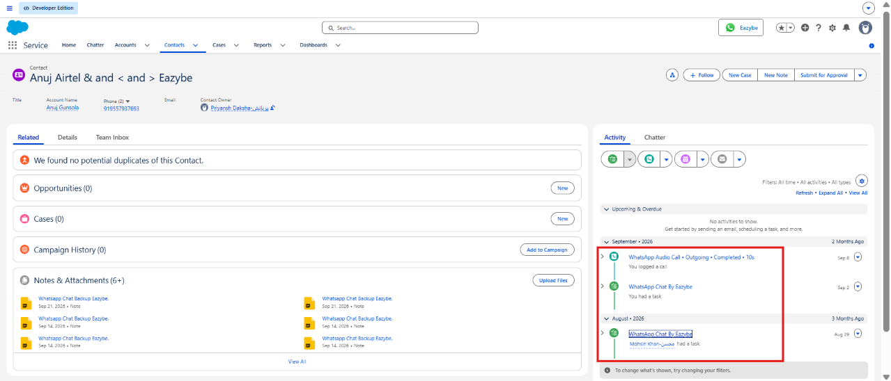

Con **Back up in activities** activado, Eazybe guarda las **conversaciones individuales y grupales como tareas completadas** en el **Contacto o Lead** asociado de Salesforce. Los mensajes se añaden a la actividad diaria de la conversación a medida que se ejecutan los respaldos.

## Encontrar una conversación guardada en Salesforce

1. Abre el registro del **Contacto** o **Lead** asociado en Salesforce.
2. Abre **Actividad** (Activity) y busca la entrada **WhatsApp Chat by Eazybe** de la fecha que quieras consultar.
3. Abre la tarea completada y lee los mensajes sincronizados en **Descripción** (Description).

Consulta los pasos y ejemplos en [Respaldo en actividades](/es/integrations/salesforce/activity-backup).

## Cuando el respaldo en actividades está desactivado

Con esta opción desactivada, Eazybe utiliza el respaldo existente de Salesforce: el objeto personalizado **WhatsApp Chats by Eazybe** y, para Contactos, **Notas y archivos adjuntos**. Al activar el respaldo en actividades, los siguientes respaldos de chats se guardan como tareas completadas en lugar de utilizar ese método.

### Página de Contacto de Salesforce

Las conversaciones de WhatsApp sincronizadas aparecen en dos ubicaciones dentro de las páginas de Contactos de Salesforce respectivas:

<CardGroup cols={2}>
  <Card title="Notas y Archivos Adjuntos">
    Encuentre sus conversaciones sincronizadas en la sección de Notas y Archivos Adjuntos.
  </Card>
  <Card title="WhatsApp Chats por Eazybe">
    Vea las conversaciones en el objeto de actividad personalizado.
  </Card>
</CardGroup>

### Página de Lead de Salesforce

Las conversaciones de WhatsApp sincronizadas se muestran en el objeto de actividad personalizado **"WhatsApp Chats por Eazybe"** dentro de las páginas de Leads de Salesforce respectivas.

<Tip>
  Tanto las páginas de Contactos como de Leads proporcionan fácil acceso a sus conversaciones de WhatsApp sincronizadas, ayudándole a mantener un historial de comunicación completo dentro de Salesforce.
</Tip>

### ¿Necesita Ayuda?

Si tiene alguna pregunta o necesita más asistencia, no dude en contactarnos en [hey@eazybe.com](mailto:hey@eazybe.com).
