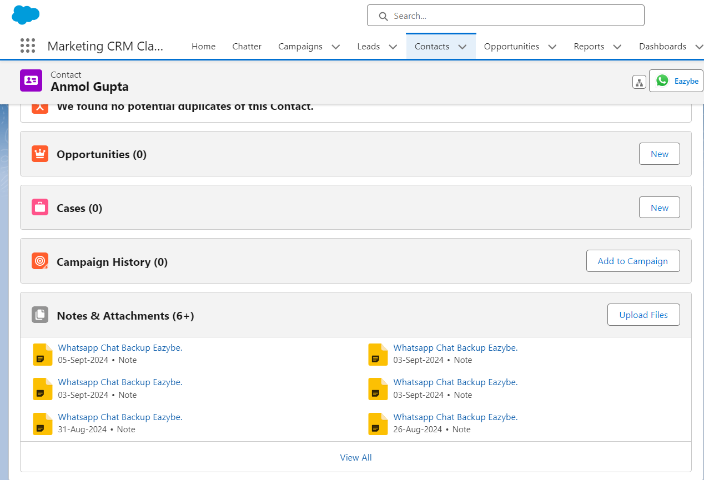
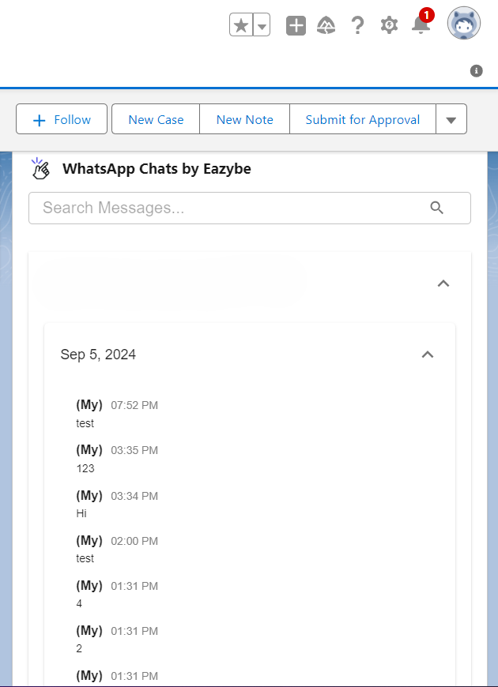
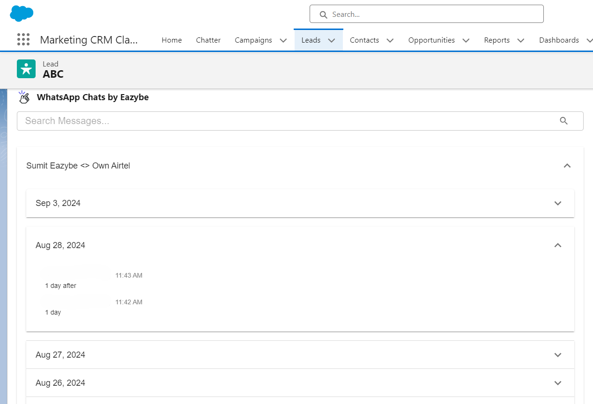

Esta guía explica cómo se vinculan los contactos de WhatsApp y Salesforce, habilitando el respaldo y sincronización automática de chats.

## Cómo Funciona la Vinculación de Contactos

Los números de WhatsApp se vinculan con Leads y Contactos de Salesforce mediante los campos configurados en [Asignación de números](/es/integrations/salesforce/number-mapping). La opción predeterminada utiliza Teléfono, Móvil y los campos asignados anteriormente. Los administradores pueden buscar en todos los campos de tipo Teléfono o elegir campos específicos de Teléfono y Texto, incluidos los personalizados. También puedes:

- Crear contactos directamente desde WhatsApp usando EazyBe
- Vincular contactos existentes de Salesforce a números de teléfono de WhatsApp

## Qué Sucede Después de la Vinculación

<Info>
  Una vez vinculado, la tarjeta del contacto aparece en la vista Mini-CRM de EazyBe, brindándote acceso instantáneo a los detalles del contacto mientras chateas.
</Info>

Tanto los chats 1:1 como los chats grupales asociados con el contacto se respaldarán en Salesforce:

- **Para Contactos**: El contenido del chat y los archivos adjuntos se muestran en la Sección de Notas y Archivos Adjuntos y en el objeto Actividad de Chats de WhatsApp por EazyBe
- **Para Leads**: Los chats aparecen en los Objetos de Actividad de Chats de WhatsApp

## Sincronización Automática

<Steps>
  <Step title="Creación de Contacto">
    Al crear nuevos contactos de Salesforce a través de la extensión EazyBe WhatsApp, los contactos se vinculan automáticamente a Salesforce.
  </Step>
  <Step title="Respaldo de Chat">
    Los chats de WhatsApp se respaldan automáticamente cada 3 minutos.
  </Step>
  <Step title="Estado de Sincronización">
    El tiempo de la última sincronización se actualiza en el espacio de trabajo EazyBe para que puedas verificar la sincronización.
  </Step>
</Steps>

<Tip>
  Comprueba que el número correcto de WhatsApp esté en un campo incluido en la configuración guardada de Number mapping.
</Tip>

## ¿Necesitas Ayuda?

Si tienes alguna pregunta o necesitas asistencia, contacta a nuestro equipo de soporte en **hey@eazybe.com**.
