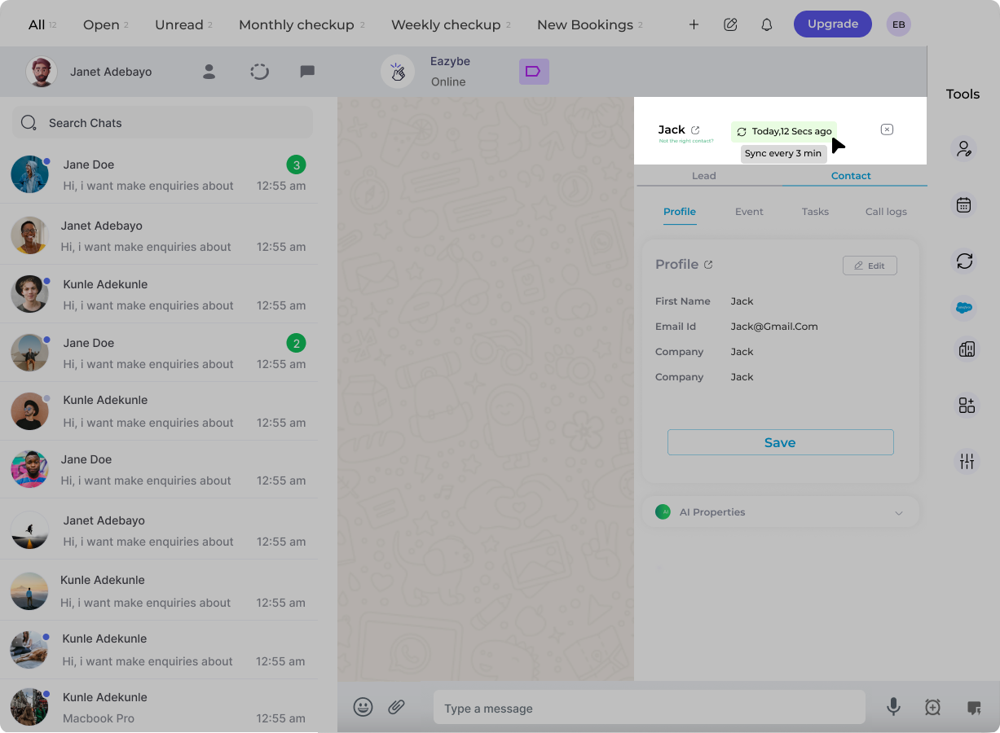
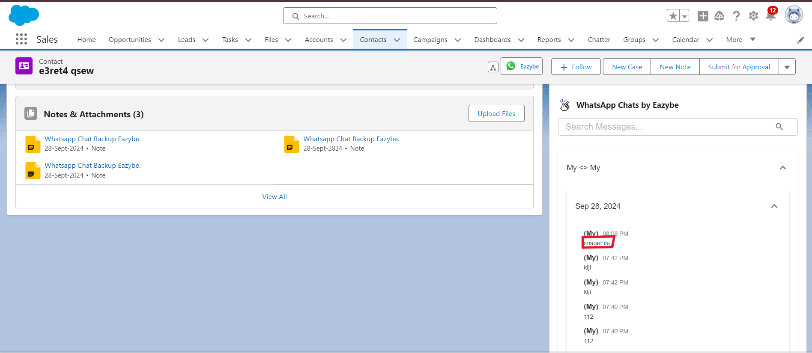

Esta guía explica cómo las conversaciones de WhatsApp se sincronizan automáticamente con tus contactos y leads de Salesforce.

## Buscar números en campos personalizados

Utiliza [Asignación de números](/es/integrations/salesforce/number-mapping) para elegir los campos en los que Eazybe busca el Lead o Contacto para el respaldo de chats. Un administrador puede utilizar los campos estándar, todos los campos de tipo Teléfono o campos seleccionados de Teléfono y Texto. Si el número está en un campo personalizado, comprueba que esté incluido en la configuración guardada.

## Sincronización Automática

<Info>
  Las conversaciones de WhatsApp con tus contactos o leads de Salesforce se sincronizan automáticamente cada **3 minutos**.
</Info>

La fecha y hora de la última sincronización se muestra en la extensión EazyBe. Puedes verificar que la sincronización se completó haciendo clic en el icono para acceder a la página de Salesforce del contacto.

## Integración Inicial

Cuando integras Salesforce con EazyBe por primera vez, el sistema proporciona automáticamente datos de respaldo de los **últimos 3 días**. Esto asegura que tengas el historial de conversaciones reciente disponible inmediatamente.

## Respaldo en actividades

Con **Back up in activities** activado, Eazybe guarda las **conversaciones individuales y grupales como tareas completadas** en el **Contacto o Lead** asociado de Salesforce. Los mensajes se añaden a la actividad diaria de la conversación a medida que se ejecutan los respaldos.

Consulta los pasos y ejemplos en [Respaldo en actividades](/es/integrations/salesforce/activity-backup).

## Cuando el respaldo en actividades está desactivado

Con esta opción desactivada, Eazybe utiliza el respaldo existente de Salesforce: el objeto personalizado **WhatsApp Chats by Eazybe** y, para Contactos, **Notas y archivos adjuntos**. Al activar el respaldo en actividades, los siguientes respaldos de chats se guardan como tareas completadas en lugar de utilizar ese método.

Los chats de WhatsApp se almacenan en dos ubicaciones dentro de Salesforce:

<Steps>
  <Step title="Sección de Notas y Archivos Adjuntos">
    Para Contactos, los chats aparecen en la sección de Notas y Archivos Adjuntos del registro del contacto.

    
  </Step>
  <Step title="Objeto de Actividad Personalizado">
    Un objeto de actividad personalizado llamado **WhatsApp Chats by EazyBe** almacena todos los datos de conversación tanto para Contactos como para Leads.

    
  </Step>
</Steps>

### Respaldo de Archivos Adjuntos

<Tip>
  Los archivos adjuntos de las conversaciones de WhatsApp se almacenan en el objeto de actividad personalizado **WhatsApp Chats by EazyBe** tanto para las páginas de Leads como de Contactos.
</Tip>

## ¿Necesitas Ayuda?

Si tienes alguna pregunta o necesitas asistencia, contacta a nuestro equipo de soporte en **hey@eazybe.com**.
