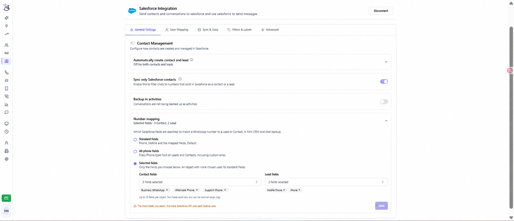

**Number mapping** permite elegir los campos de Salesforce en los que Eazybe busca un número de WhatsApp para encontrar un Lead o Contacto. Esta búsqueda se utiliza en el Mini CRM y en el respaldo de chats, incluso cuando el número está en un campo personalizado.

## Abrir la configuración

Accede al espacio de trabajo de Eazybe como **administrador**, abre **Integrations → Salesforce → General Settings** y despliega **Number mapping** en **Contact Management**. Salesforce debe estar conectado. Los nombres de los controles se mantienen en inglés para que puedas identificarlos en la interfaz.

## Elegir los campos de búsqueda

| Opción | Campos incluidos | Cuándo usarla |
| --- | --- | --- |
| **Standard fields** | Teléfono, Móvil y los campos asignados anteriormente. Es la opción predeterminada. | El equipo utiliza los campos estándar o las asignaciones existentes. |
| **All phone fields** | Todos los campos accesibles de tipo Teléfono de Leads y Contactos, incluidos los personalizados. | Los números están repartidos entre varios campos de tipo Teléfono. |
| **Selected fields** | Solo los campos elegidos por separado para Contactos y Leads. Incluye campos de Teléfono y Texto compatibles. | Quieres buscar en campos personalizados específicos o en un campo de Texto que contiene un número. |

<Note>
  En **Selected fields**, Teléfono y Móvil no se incluyen automáticamente si el objeto tiene campos seleccionados. Añádelos si también quieres buscarlos. Si dejas vacía la selección de un objeto, ese objeto utiliza sus campos estándar. Debes elegir al menos un campo entre Contactos y Leads para guardar este modo.
</Note>

## Configurar campos personalizados

1. Selecciona **Selected fields**.
2. Abre **Contact fields**, busca por etiqueta o nombre de API y elige los campos que contienen los números de WhatsApp de tus clientes.
3. Abre **Lead fields** y elige los campos de Leads. Puedes seleccionar hasta **15 campos por objeto**.
4. Para quitar un campo, pulsa la **×** de su etiqueta seleccionada.
5. Pulsa **Save** y espera la confirmación **Number mapping updated**. Los cambios solo se aplican después de guardarlos.

La captura editada utiliza estos nombres de ejemplo para Contactos: **Business WhatsApp**, **Alternate Phone** y **Support Phone**. Para Leads se seleccionan **Mobile Phone** y **Phone**. Elige los campos reales de tu organización; esta configuración no crea campos nuevos en Salesforce.

Si el número de WhatsApp de un Contacto está únicamente en **Business WhatsApp**, selecciona ese campo para que Eazybe encuentre el registro en el Mini CRM y el respaldo de chats. En el ejemplo, Teléfono y Móvil del Contacto no se buscan a menos que los añadas.

<Warning>
  Buscar en todos los campos de teléfono o seleccionar más campos aumenta el uso de la API de Salesforce por búsqueda. Los campos de Texto pueden ser más lentos en organizaciones grandes. Selecciona los campos que utiliza tu equipo.
</Warning>

## Comprobar el resultado

Abre un chat de WhatsApp cuyo número esté en uno de los campos configurados. Comprueba que aparezca el Lead o Contacto esperado en el Mini CRM y revisa el [estado de sincronización](/es/integrations/salesforce/message-sync).

Si no se encuentra el registro:

- Comprueba que el número sea correcto y esté en un campo incluido en el modo guardado.
- Revisa las selecciones de Contactos y Leads por separado.
- Si el número está en un campo de Texto, utiliza **Selected fields** y selecciona ese campo explícitamente.
- Si falta un campo en la lista, comprueba el acceso del usuario de Salesforce conectado. Solo se muestran campos de Teléfono y Texto compatibles.
- Si los campos no se cargan, revisa la conexión con Salesforce e inténtalo de nuevo.

Para restaurar la búsqueda predeterminada, selecciona **Standard fields** y pulsa **Save**. Las selecciones de campos se conservan al cambiar de modo.

Consulta [Vincular Contactos](/es/integrations/salesforce/linking-contacts). Si necesitas ayuda, escribe a **hey@eazybe.com**.
