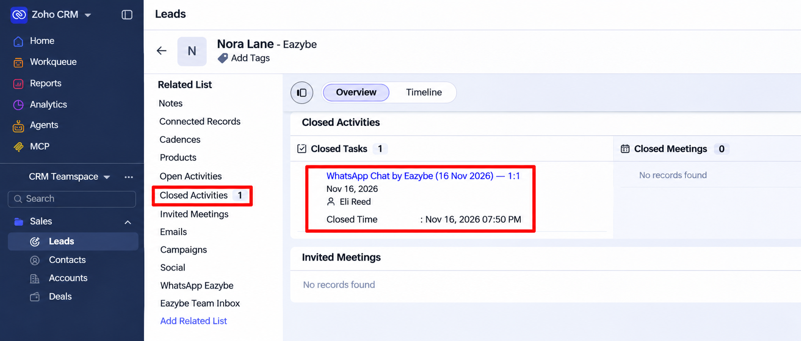
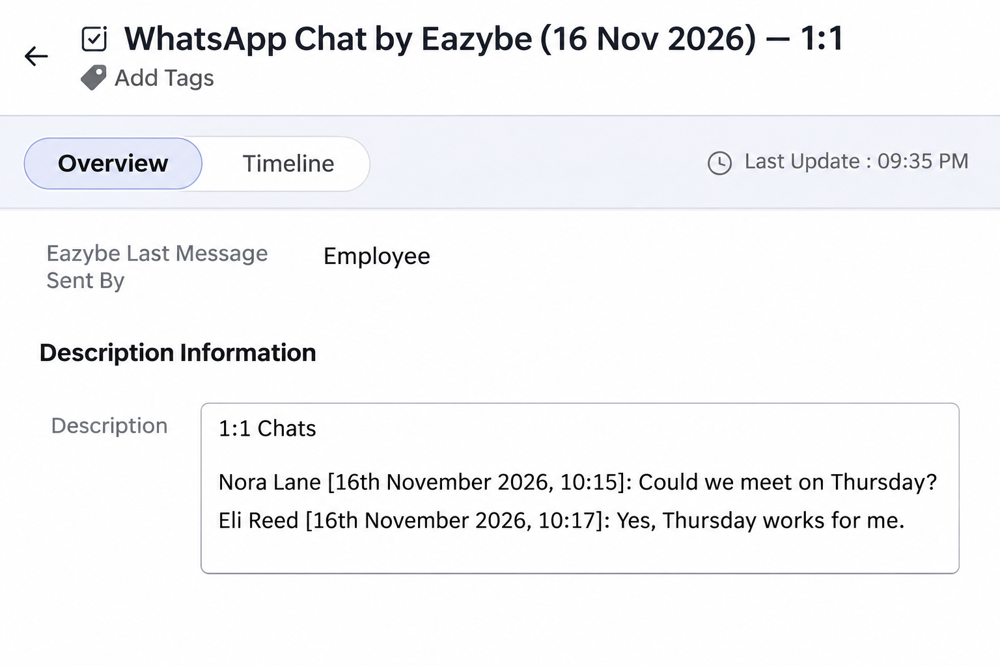

Eazybe crea una tarea completada por chat y por día en el registro correspondiente. Abre la tarea para leer los mensajes sincronizados de ese día.

## Activar la copia en actividades

1. En tu espacio de trabajo de Eazybe, abre **Integraciones**, selecciona tu cuenta de **Zoho CRM** conectada y abre **Configuración general**.
2. Activa **Backup in activities**. El texto debajo del interruptor confirma que las conversaciones se guardan como tareas completadas.

Los administradores y gerentes cambian este ajuste para toda la organización. Los demás usuarios lo cambian solo para su propia conexión con Zoho.

## Consultar una conversación en Zoho

1. Abre el módulo de **Leads** o **Contactos** y selecciona el registro de la persona.
2. En la lista relacionada de la izquierda, selecciona **Actividades cerradas** (Closed Activities). En **Tareas cerradas** (Closed Tasks), abre **WhatsApp Chat by Eazybe** con la fecha que buscas.

En la vista general de la tarea, baja hasta la sección de descripción. El campo **Descripción** muestra el remitente, la hora y el texto de cada mensaje sincronizado.

