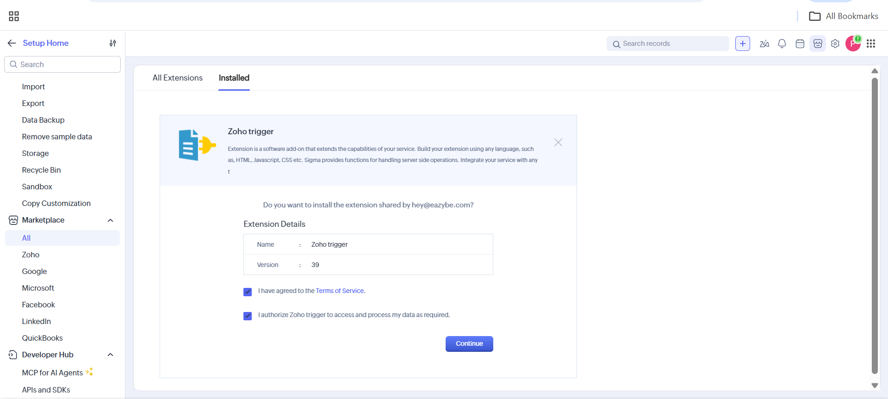
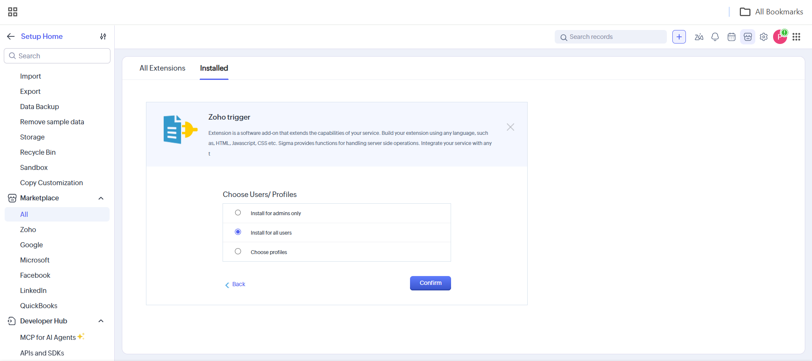
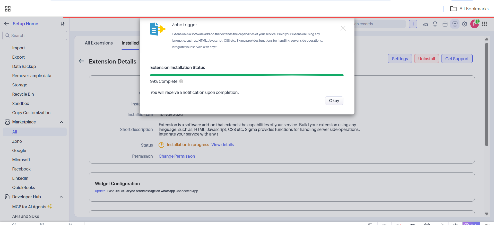
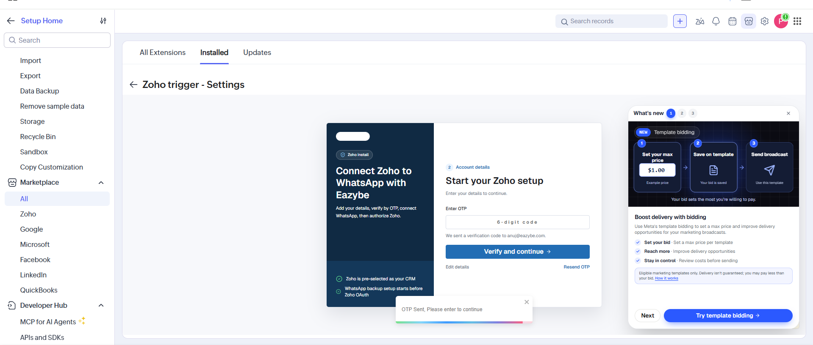
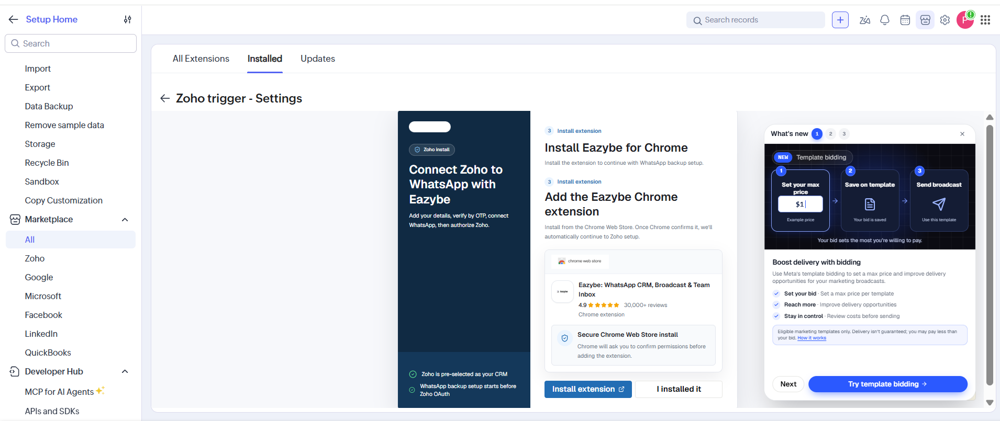
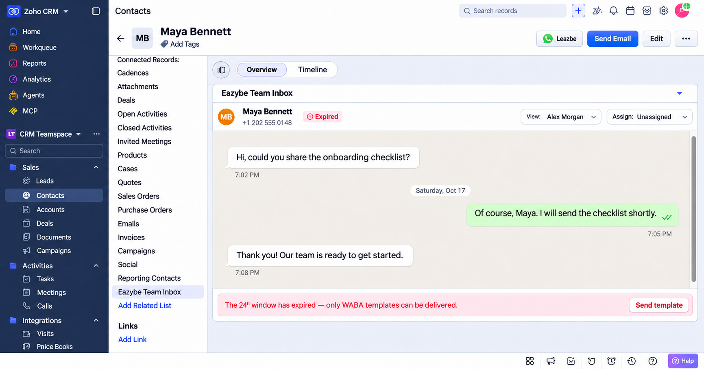
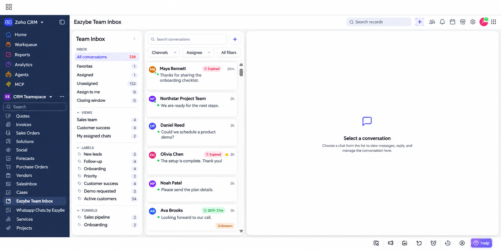

Eazybe Team Inbox integra las conversaciones de WhatsApp en Zoho CRM. Abre la conversación de un contacto o lead desde su registro, o utiliza la bandeja general para gestionar las conversaciones a las que tienes acceso.

<Note>
El paquete **Zoho trigger** incluye tanto la acción de WhatsApp para los flujos de trabajo como **Eazybe Team Inbox**. Al instalarlo, se añade una lista relacionada a los registros de Contactos y Leads y una entrada en la navegación de módulos. La bandeja general no requiere la extensión de Chrome ni una pestaña abierta de WhatsApp Web.
</Note>

## Instalar el Paquete

Utiliza una cuenta con permiso para instalar extensiones de Zoho CRM. Si el paquete ya está instalado, comprueba que **Zoho trigger** aparece como **Active** en **Setup → Marketplace → All → Installed**.

<Steps>
  <Step title="Abrir el paquete y revisar el acceso">
    Abre [Instalar Zoho trigger y Team Inbox](https://crm.zoho.com/market/installPrivatePlugin.do?portalName=rajatverma&nameSpace=zohotrigger&versionIndex=4520363000000438001). Revisa los términos del servicio y la autorización de acceso a los datos. Si estás de acuerdo, marca ambas casillas y pulsa **Continue**.

    
  </Step>
  <Step title="Elegir los usuarios">
    En **Choose Users/Profiles**, selecciona **Install for all users** y pulsa **Confirm**. Para limitar el acceso, elige **Install for admins only** o **Choose profiles**.

    
  </Step>
  <Step title="Esperar a que termine la instalación">
    Zoho muestra **Extension Installation Status**. Pulsa **Okay** y espera la notificación de finalización. Comprueba que el estado es **Active**.

    <Note>La captura muestra **99% Complete**: la instalación todavía está en curso.</Note>

    
  </Step>
  <Step title="Verificar tu cuenta de Eazybe">
    Abre **Settings** en el paquete instalado y sigue la configuración. Introduce tus datos cuando se soliciten. En **Enter OTP**, escribe el código de seis dígitos enviado a tu correo y pulsa **Verify and continue**. Usa **Resend OTP** para solicitar otro código o **Edit details** para corregir el correo.

    
  </Step>
  <Step title="Revisar la configuración de copias de WhatsApp">
    El proceso puede mostrar **Install Eazybe for Chrome** para configurar las copias de seguridad de WhatsApp. Si estás configurando esa función, pulsa **Install extension** o **I installed it**, según corresponda. Sigue las indicaciones para conectar tu cuenta y autorizar Zoho.

    **Team Inbox forma parte del paquete de Zoho. La extensión de Chrome no es un requisito para abrir la bandeja general.**

    
  </Step>
</Steps>

<Tip>
Para usar la acción del mismo paquete, consulta [Enviar mensajes de WhatsApp mediante un flujo de trabajo de Zoho](/es/waba/broadcasting/zoho-workflow/send-whatsapp-message). Debes crear y activar la regla después de instalar el paquete.
</Tip>

## Abrir la Bandeja de un Contacto o Lead

1. Abre **Contacts** o **Leads** y selecciona un registro.
2. Desplázate por **Related List**, a la izquierda, y pulsa **Eazybe Team Inbox**. También puedes bajar por el registro hasta la sección con ese nombre.
3. Consulta la conversación. Usa **View:** para seleccionar una vista disponible y **Assign:** para gestionar la asignación según tus permisos.

<Warning>La captura está editada y contiene un cliente y mensajes ficticios. Muestra un Contacto; la misma entrada está disponible en Leads tras instalar el paquete.</Warning>

<Note>Si aparece **Expired** y el aviso de que ha caducado la ventana de 24 horas, utiliza **Send template** para continuar con una plantilla.</Note>

## Abrir la Bandeja General

1. Busca **Eazybe Team Inbox** en la navegación de módulos, junto a **Vendors**, **Services** y **Projects**. Desplázate por la lista si es necesario; en la captura está a la izquierda.
2. Pulsa **Eazybe Team Inbox** para ver las conversaciones disponibles en tu espacio de trabajo.
3. Selecciona **All conversations**, **Favorites**, **Assigned**, **Unassigned** o **Assign to me**. Filtra con **Search conversations**, **Channels**, **Assignee** y **All filters**.
4. Selecciona una conversación para ver sus mensajes a la derecha. Antes de seleccionarla, aparece **Select a conversation**.

<Warning>Esta captura editada utiliza nombres de clientes, vistas, etiquetas y mensajes ficticios.</Warning>

## Gestionar Conversaciones en Zoho

Tus permisos de Eazybe determinan qué conversaciones puedes ver y gestionar en Zoho CRM. Con un número de **WhatsApp Business API** o **Coexistence (CoEx)** conectado, puedes enviar y recibir mensajes desde Team Inbox.

## Solución de Problemas

### No Aparece Team Inbox

Comprueba que el paquete está instalado y **Active**, que tu usuario o perfil tiene acceso y actualiza Zoho CRM. Busca la entrada en **Related List** para Contactos y Leads, o en la navegación de módulos para la bandeja general.

### Falta la Conversación de un Contacto o Lead

Verifica el número de WhatsApp del registro, incluido el prefijo internacional, la conexión con Eazybe, tus permisos y la selección de **View:**.

### La Bandeja General No Carga o No Muestra los Chats Esperados

Comprueba la instalación, el estado del paquete, el acceso del usuario y la conexión con Eazybe. Recarga la bandeja, compara tus permisos en [app.eazybe.com](https://app.eazybe.com) y elimina búsquedas o filtros que oculten chats. La bandeja general depende del paquete de Zoho, no de la extensión de Chrome.
