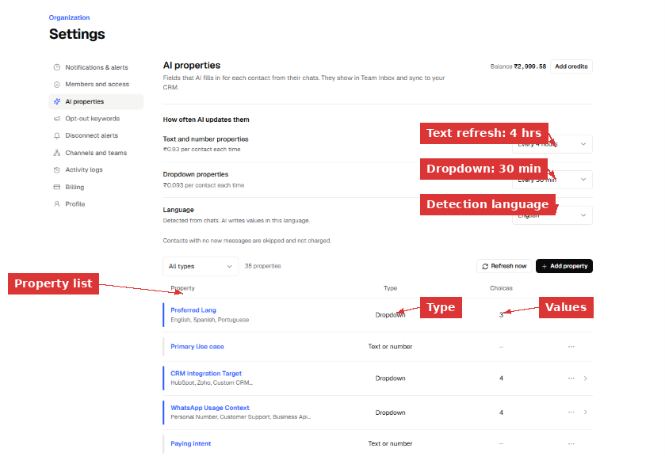
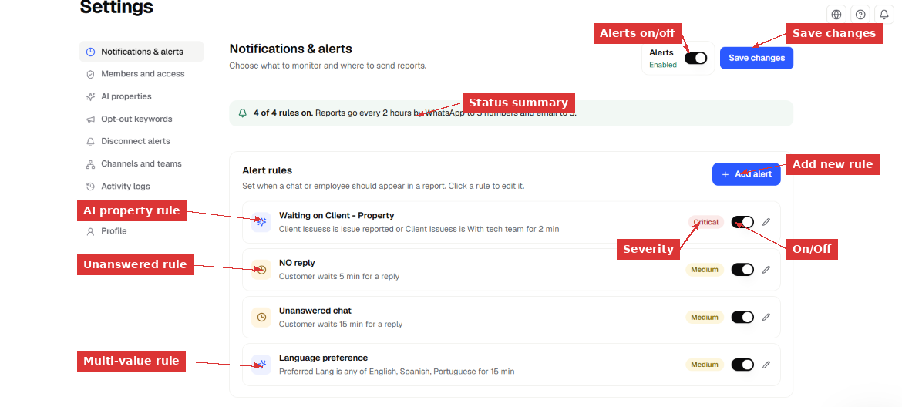
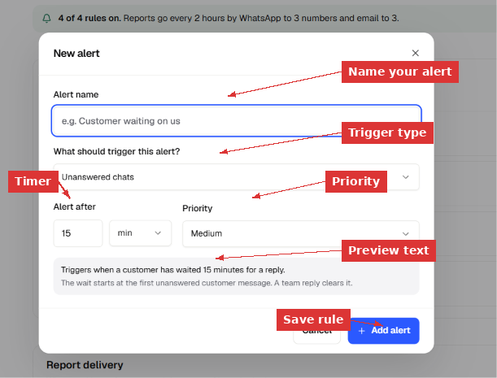
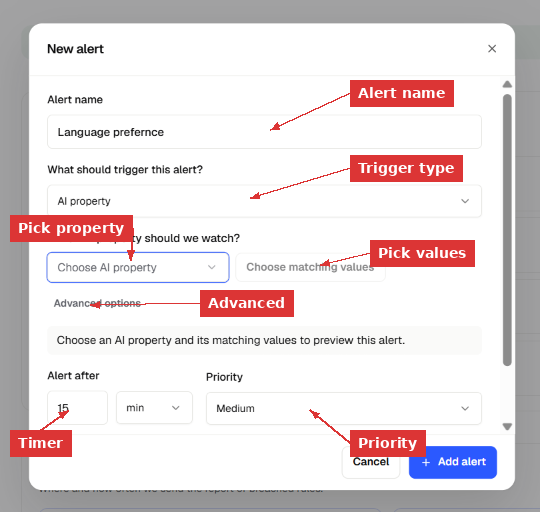
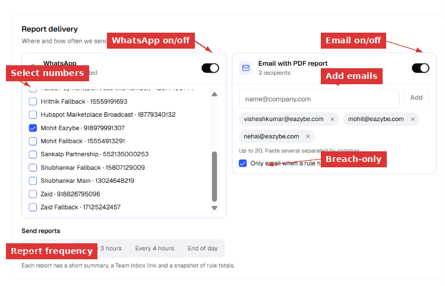
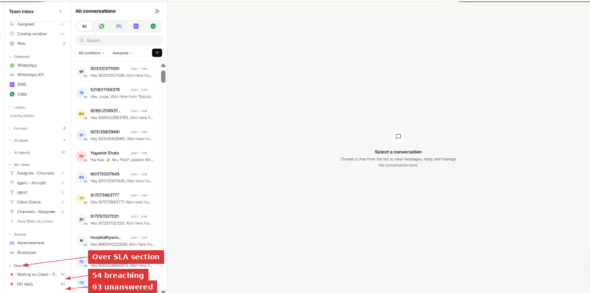

> **Directorio de Documentación**
> Antes de explorar páginas individuales, consulte el índice completo en [https://help.eazybe.com/llms.txt](https://help.eazybe.com/llms.txt) para todos los temas disponibles.

# Notificaciones y Alertas

> Configure reglas de alerta para saber en el momento en que un cliente espera demasiado, una conversación queda en el estado incorrecto o un miembro del equipo se queda inactivo. Eazybe verifica cada regla continuamente y envía un informe a su WhatsApp y correo electrónico cuando algo necesita atención.

Notificaciones y alertas es el centro de control para el monitoreo de tiempos de respuesta en todo su espacio de trabajo. Usted define las reglas — Eazybe vigila sus chats las 24 horas y le avisa cuando algo cruza el límite.

---

## ¿Qué Son las Reglas de Alerta?

Una regla de alerta es una condición más un temporizador. Cuando la condición permanece verdadera más tiempo que el temporizador, la conversación (o empleado) aparece en el siguiente informe programado.

Eazybe soporta dos tipos de disparadores:

### Chats sin responder
Vigila mensajes de clientes que no han recibido respuesta del equipo. El temporizador comienza en el primer mensaje sin responder del cliente. Se reinicia en el momento en que cualquier miembro del equipo responde. Mensajes adicionales del cliente **no** reinician el temporizador — el reloj sigue corriendo desde el mensaje original sin responder.

**Ejemplo:** "Cliente espera 15 min por una respuesta" — si un cliente envía un mensaje a las 2:00 PM y nadie responde antes de las 2:15 PM, este chat aparece en el informe.

### Propiedad de IA
Vigila un valor específico de propiedad de IA en una conversación. El temporizador comienza cuando la propiedad toma el valor coincidente y se mantiene mientras siga así. Cuando la propiedad cambia a otro valor, el temporizador se reinicia.

**Ejemplo:** "Client Issues es Issue reported por 2 min" — cualquier conversación donde la IA ha detectado un problema y permanece sin atender por 2 minutos se marca.

Puede vigilar un **valor único** (ej., Conversation State es "Waiting on Client") o **múltiples valores** (ej., Preferred Lang es cualquiera de English, Spanish, Portuguese).

> [!NOTE]
> Solo las propiedades de IA tipo **dropdown** pueden usarse en reglas de alerta. Las propiedades de texto y número aún no son compatibles. Puede ver qué propiedades son dropdown en **Settings → AI Properties**.

---

## Comprendiendo las Propiedades de IA

Las propiedades de IA son campos que la IA de Eazybe completa automáticamente para cada conversación basándose en lo que se discute en el chat. Aparecen en Team Inbox y se sincronizan con su CRM.

Para ver las propiedades de IA de su espacio de trabajo:

1. Vaya a **Settings → AI Properties**.
2. Verá una lista de todas las propiedades disponibles, su tipo (Dropdown o Text/Number) y cuántos valores tiene cada una.

*Settings → AI Properties muestra cada campo que la IA completa. Las propiedades Dropdown (como "Preferred Lang" con 3 opciones) pueden usarse en reglas de alerta. Las propiedades Text/Number (como "Primary Use case") aún no pueden usarse en reglas.*

### Con qué frecuencia se actualizan las propiedades

Las propiedades de IA no son instantáneas — se actualizan según un programa:

| Tipo de propiedad | Frecuencia de actualización | Costo |
|---|---|---|
| Propiedades **Dropdown** | Cada 30 minutos | ₹0.093 por contacto por actualización |
| Propiedades de **texto y número** | Cada 4 horas | ₹0.93 por contacto por actualización |

Los contactos sin mensajes nuevos desde la última actualización se omiten y no se cobran.

> [!IMPORTANT]
> Debido a que las propiedades dropdown se actualizan cada 30 minutos, una regla de alerta con temporizador de 2 minutos puede no activarse exactamente a los 2 minutos. El cambio de estado solo se detecta en la siguiente actualización. Para alertas precisas, use temporizadores más largos que su intervalo de actualización. Una regla de 2 minutos es útil para detectar problemas que han estado en ese estado durante al menos un ciclo de actualización.

---

## Configurando Reglas de Alerta

### Paso 1: Abra la página de alertas

Vaya a **Settings** en la barra lateral izquierda, luego haga clic en **Notifications & alerts**.

Verá:
- Un interruptor de **Alerts** (arriba a la derecha) — debe estar **Enabled** para que las reglas funcionen.
- Una **barra de resumen** que muestra cuántas reglas están activas, la frecuencia de informes y los canales de entrega.
- Su **lista de reglas de alerta** — cada regla muestra su nombre, descripción, severidad, interruptor de activación/desactivación y un botón de edición.

*La página de Notifications & alerts. La barra de resumen arriba muestra "4 of 4 rules on" con detalles de entrega de informes. Cada tarjeta de regla muestra la condición de disparo, temporizador, insignia de severidad, interruptor de activación/desactivación y lápiz de edición.*

### Paso 2: Crear una nueva alerta

Haga clic en **+ Add alert** (arriba a la derecha de la sección Alert rules). Se abre un diálogo.

#### Crear una alerta de chat sin responder

1. Ingrese un **Alert name** — algo descriptivo como "Customer waiting 15 min" o "No reply 5 min".
2. En **"What should trigger this alert?"** — seleccione **Unanswered chats**.
3. Configure **Alert after** — el número de minutos (u horas) que un cliente puede esperar antes de que se active esta regla. Por ejemplo: 15 min.
4. Configure **Priority** — Critical, High, Medium o Low. Esto controla cómo aparece la regla en los informes.
5. Revise el **texto de vista previa** en la parte inferior — explica exactamente cuándo se activa esta regla y qué la reinicia.
6. Haga clic en **+ Add alert**.

*Creando una alerta de Unanswered chats. La vista previa en la parte inferior confirma: "Triggers when a customer has waited 15 minutes for a reply. The wait starts at the first unanswered customer message. A team reply clears it."*

#### Crear una alerta de propiedad de IA

1. Ingrese un **Alert name** — por ejemplo "Waiting on Client - Property" o "Language preference".
2. En **"What should trigger this alert?"** — seleccione **AI property**.
3. En **"Which AI property should we watch?"** — elija una propiedad dropdown de la lista (ej., Conversation State, Preferred Lang, Client Issues).
4. Haga clic en **Choose matching values** — seleccione uno o más valores. Por ejemplo, seleccione "Waiting on Client" de Conversation State, o seleccione "English, Spanish, Portuguese" de Preferred Lang.
5. Opcionalmente expanda **Advanced options** para configuración adicional.
6. Configure **Alert after** — cuánto tiempo debe permanecer la propiedad en el estado coincidente.
7. Configure **Priority**.
8. Haga clic en **+ Add alert**.

*Creando una alerta de AI property. Seleccione la propiedad a vigilar, elija qué valores activan la alerta y configure cuánto tiempo debe mantenerse la condición antes de activarse.*

> [!NOTE]
> **Valor único vs. múltiples valores:**
> - Valor único (ej., Conversation State **es** "Waiting on Client") — la regla se activa cuando la conversación tiene exactamente este estado.
> - Múltiples valores (ej., Preferred Lang **es cualquiera de** English, Spanish, Portuguese) — la regla se activa cuando la conversación coincide con cualquiera de los valores seleccionados. Esto es útil para monitorear un grupo de estados relacionados.

### Paso 3: Configure cada regla

Después de crear las reglas, puede administrarlas desde la página principal:

- **Activar/desactivar** — el interruptor junto a cada regla la habilita o deshabilita sin eliminarla.
- **Editar** — haga clic en el ícono de lápiz para cambiar el nombre, temporizador, prioridad o condiciones.
- **Insignias de severidad** — Critical (rojo), High (naranja), Medium (amarillo), Low (azul) ayudan a priorizar visualmente.

La **barra de resumen** se actualiza automáticamente: "4 of 4 rules on. Reports go every 2 hours by WhatsApp to 3 numbers and email to 3."

---

## Configurando la Entrega de Informes

Desplácese hacia abajo debajo de las reglas de alerta hasta la sección **Report delivery**. Aquí es donde configura cómo y cuándo se envían las reglas infringidas a su equipo.

*Configuración de entrega de informes. WhatsApp y correo electrónico pueden habilitarse independientemente. Las pestañas de frecuencia controlan con qué frecuencia se envían los informes.*

### Informes por WhatsApp

1. Active el interruptor de **WhatsApp**.
2. Seleccione qué números de WhatsApp conectados deben recibir el informe. Marque las casillas junto a los números que desee.
3. Los informes se envían como mensaje de texto normal (si la ventana de mensajería está abierta) o como la plantilla `sla_notice` (si la ventana está cerrada — el destinatario toca "Send report" para recibir el texto completo).

### Informes por correo electrónico

1. Active el interruptor de **Email with PDF report**.
2. Ingrese direcciones de correo electrónico en el campo **Email recipients** y haga clic en **Add**. Puede agregar hasta 20 destinatarios. Pegue múltiples direcciones separadas por comas.
3. Marque **"Only email when a rule has breached"** — esto es recomendado para no recibir informes vacíos cuando todo está bien.

Cada correo electrónico incluye:
- Un breve resumen del total de infracciones
- Un enlace al Team Inbox para ver las conversaciones infractoras
- Un archivo PDF adjunto con totales de reglas y entradas de conversación de muestra

### Frecuencia de informes

Elija con qué frecuencia se entregan los informes:

| Frecuencia | Mejor para |
|---|---|
| **Every 2 hours** | Equipos de alto tráfico que necesitan actualizaciones frecuentes |
| **Every 3 hours** | Monitoreo estándar |
| **Every 4 hours** | Equipos de menor tráfico |
| **End of day** | Resumen diario — un informe al final del día laboral |

> [!IMPORTANT]
> **Temporizador vs. frecuencia:** El temporizador de cada regla (ej., "15 min") controla cuándo una conversación **califica** como infractora. La frecuencia (ej., "Every 2 hours") controla cuándo se **envía el informe**. Una conversación puede infringir después de 15 minutos pero solo aparecer en el siguiente informe programado hasta 2 horas después. Para mayor rapidez, use intervalos de frecuencia más cortos.

### Guarde sus cambios

Después de configurar las reglas y la entrega, haga clic en **Save changes** (arriba a la derecha). Actualice la página para confirmar que todo se guardó correctamente.

---

## Viendo las Reglas Infringidas en Team Inbox

Una vez que las reglas de alerta están activas y las conversaciones comienzan a infringirlas, puede ver los resultados en Team Inbox.

1. Abra **Team Inbox** desde la barra lateral izquierda.
2. Desplácese hasta la parte inferior del panel izquierdo — encuentre la sección **Over SLA**.
3. Cada regla activa aparece con un **contador en vivo** de cuántas conversaciones la están infringiendo actualmente.
4. Haga clic en el nombre de una regla para **filtrar la lista de chats** — solo se muestran las conversaciones que coinciden con esa regla.

*La sección "Over SLA" en Team Inbox muestra contadores en vivo para cada regla infringida. Haga clic en una regla para filtrar conversaciones. En este ejemplo, 54 chats están infringiendo "Waiting on Client" y 93 están en "NO reply".*

### ¿Qué reinicia una infracción?

| Tipo de regla | Qué la reinicia |
|---|---|
| **Chat sin responder** | Cualquier miembro del equipo responde a la conversación. La infracción se reinicia inmediatamente. Mensajes adicionales del cliente **no** reinician el temporizador. |
| **Propiedad de IA** | El valor de la propiedad cambia a algo que ya no coincide con la condición de la regla. Por ejemplo, si la regla vigila "Conversation State es Waiting on Client" y el estado cambia a "Active", la infracción se reinicia. |

> [!NOTE]
> Una sola conversación puede infringir múltiples reglas al mismo tiempo. Por ejemplo, un chat puede aparecer tanto en "Unanswered 15 min" como en "Waiting on Client" si ambas condiciones son verdaderas. Los conteos de infracciones en Team Inbox e informes cuentan coincidencias de reglas, no conversaciones únicas.

---

## Comprendiendo el Informe por Correo Electrónico

Cuando se ejecuta un informe programado y hay reglas infringidas, recibe un correo electrónico como este:

**Asunto:** "SLA breaches need attention"

El cuerpo del correo incluye:

| Campo | Qué muestra |
|---|---|
| **Workspace** | El ID de su espacio de trabajo |
| **Chat breaches** | Total de conversaciones que cruzaron un umbral de regla |
| **Inactivity breaches** | Empleados que no han enviado mensajes dentro del umbral (si tiene reglas de inactividad) |
| **Critical breaches** | Cantidad de infracciones en reglas de prioridad Critical |
| **Rule breakdown** | Cada regla listada con su conteo individual de infracciones y severidad |

El **PDF** adjunto proporciona una captura con conversaciones de muestra de cada regla infringida, para que un gerente pueda revisar sin abrir el panel de control.

---

## Configuraciones de Alerta de Ejemplo

Configuraciones comunes para diferentes necesidades de equipo:

### Equipo de respuesta rápida (ventas)
| Regla | Disparador | Temporizador | Prioridad |
|---|---|---|---|
| SLA de respuesta rápida | Unanswered chats | 5 min | Critical |
| Lead caliente estancado | AI property: Lead Stage es "Hot" | 10 min | High |

### Equipo de soporte
| Regla | Disparador | Temporizador | Prioridad |
|---|---|---|---|
| Cliente esperando | Unanswered chats | 15 min | Medium |
| Problema sin resolver | AI property: Client Issues es "Issue reported" | 30 min | High |
| Escalación pendiente | AI property: Client Issues es "With tech team" | 60 min | Critical |

### Equipo multilingüe
| Regla | Disparador | Temporizador | Prioridad |
|---|---|---|---|
| SLA de idioma | AI property: Preferred Lang es cualquiera de English, Spanish, Portuguese | 15 min | Medium |
| Sin responder | Unanswered chats | 10 min | High |

---

## Consejos y Mejores Prácticas

- **Comience con temporizadores más largos** (15–30 min) y acórtelos a medida que su equipo se adapte. Una regla de 2 minutos en un equipo que promedia 10 minutos de respuesta generará ruido constante.
- **Nombre sus reglas claramente** — el nombre aparece en Team Inbox, informes de WhatsApp e informes por correo. "Customer waiting 15 min" es mejor que "Rule 1".
- **Use los niveles de prioridad con significado** — Critical para reglas que necesitan acción inmediata, Medium para seguimiento estándar de SLA, Low para monitoreo informativo.
- **Habilite "Only email when breached"** — esto evita que informes vacíos llenen su bandeja de entrada.
- **Verifique el intervalo de actualización de propiedades de IA** — las propiedades dropdown se actualizan cada 30 minutos. Una regla con temporizador menor a 30 minutos puede no activarse en el minuto exacto, pero detectará todo lo que haya estado en ese estado por al menos un ciclo de actualización.
- **Use múltiples valores** para monitoreo más amplio — en lugar de crear 3 reglas separadas para English, Spanish y Portuguese, cree una regla con "Preferred Lang es cualquiera de English, Spanish, Portuguese".
- **Revise la sección Over SLA diariamente** — hágalo parte de su rutina matutina verificar Team Inbox → Over SLA para cualquier infracción nocturna.

---

## Solución de Problemas

**Las alertas están activadas pero no aparecen reglas en Team Inbox**

Asegúrese de tener al menos una regla creada y activada. Haga clic en Save changes y actualice Team Inbox. Las reglas pueden tardar unos minutos en aparecer después de guardarse.

**El conteo de la regla es 0 aunque los chats deberían coincidir**

Para reglas de propiedad de IA, el valor de la propiedad debe coincidir exactamente. Abra una conversación que espera que infrinja, verifique su panel de propiedades de IA y confirme que el valor coincide con la condición de su regla. También verifique si la propiedad se ha actualizado recientemente — las propiedades dropdown se actualizan cada 30 minutos.

**El informe por correo no llega**

Verifique que la dirección de correo esté correctamente añadida en Report delivery. Busque en carpetas de spam/correo no deseado. Si "Only email when a rule has breached" está marcado, los informes solo se envían cuando hay infracciones reales. Verifique la frecuencia — si está configurada en "End of day", el informe llega una vez al final del día laboral.

**El informe de WhatsApp no llega**

Confirme que los números de teléfono estén marcados en Report delivery. Si la ventana de mensajería está cerrada, el informe se envía como la plantilla `sla_notice` — el destinatario necesita tocar "Send report" para recibir el texto real. Verifique que la plantilla esté aprobada en WhatsApp Manager.

**Una conversación se resolvió pero sigue apareciendo en Over SLA**

Los conteos de Over SLA se actualizan en el siguiente ciclo de verificación, no instantáneamente. Después de responder a una conversación, el conteo debería bajar en la siguiente evaluación. Si persiste, la conversación puede seguir coincidiendo con otra condición de la misma regla.

**El temporizador parece inexacto para reglas de propiedad de IA**

Los cambios de estado de propiedades de IA se detectan en el siguiente intervalo de actualización (cada 30 minutos para dropdowns). Una regla con temporizador de 2 minutos no significa que la alerta se active exactamente 2 minutos después del cambio de estado — se activa 2 minutos después de que el sistema detecta el estado, lo cual podría ser hasta 30 minutos después del cambio real. Para alertas sensibles al tiempo, use el disparador "Unanswered chats" que usa marcas de tiempo en tiempo real.

**Una conversación aparece en múltiples reglas**

Esto es esperado. Una conversación puede coincidir con más de una regla al mismo tiempo. Los conteos totales en informes son coincidencias de reglas, no conversaciones únicas.

---

*Última actualización: Noviembre 2026*
