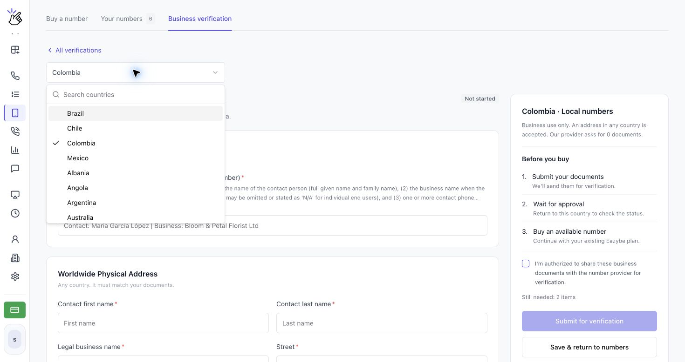
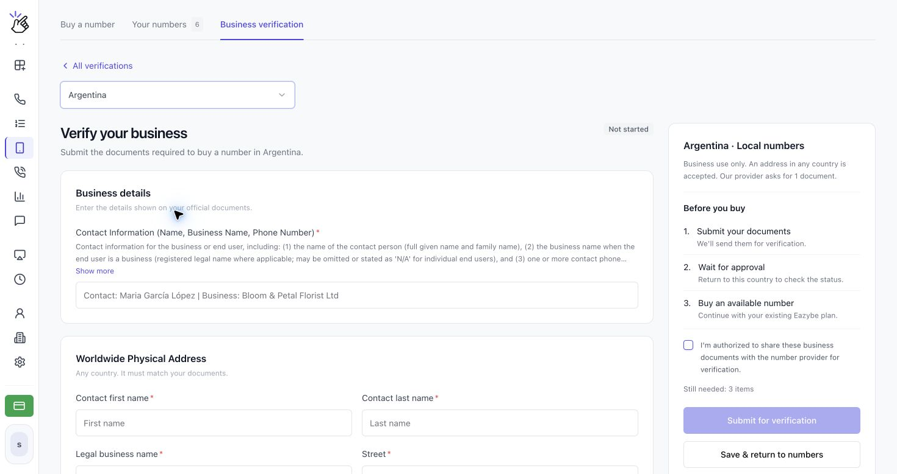
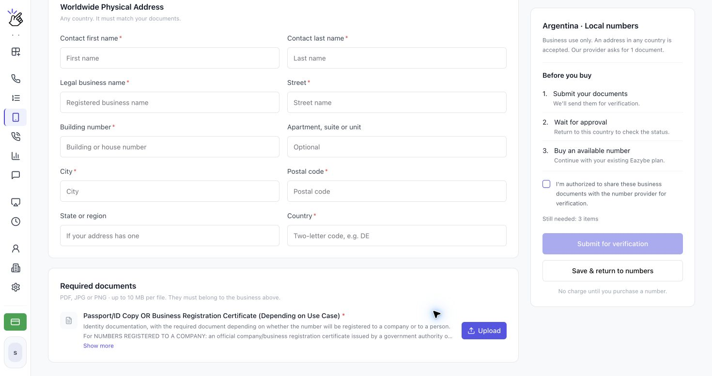
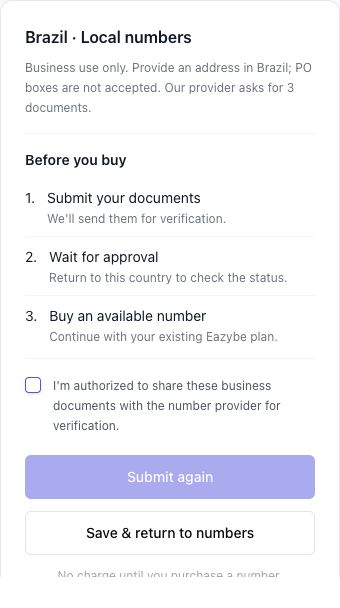
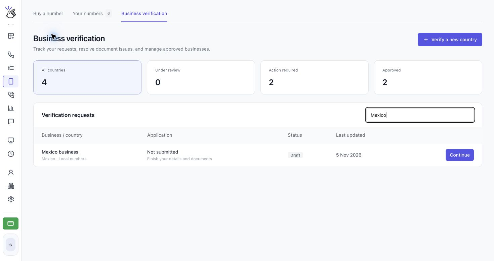
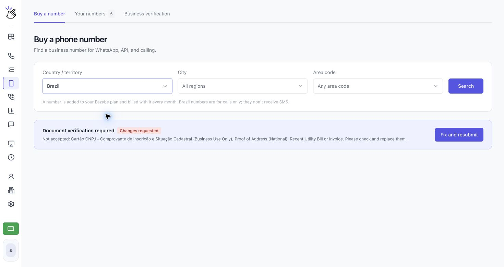

Completa **Business verification** antes de comprar un número en un país que la exija, incluido Brasil. Envía una verificación independiente por cada país donde quieras comprar números.

<Note>El formulario cambia según el país. Las capturas muestran distintos países para ilustrar el proceso; sigue los campos y requisitos documentales del país seleccionado. Los nombres de ejemplo deben sustituirse por tus propios datos.</Note>

## Enviar tu verificación

<Steps>
  <Step title="Abre Business verification">
    Abre **CALLS → Phone Numbers → Business verification**. Haz clic en **Verify a new country** y elige el país en el selector. También puedes hacer clic en **Verify business** desde el aviso **Document verification required** de **Buy a number**.

    

    <Note>Si la página indica que el país aún no está disponible porque su comprobación de identidad no se puede ofrecer aquí, todavía no puedes completar esa verificación en Eazybe. Elige otro país disponible.</Note>
  </Step>
  <Step title="Introduce los datos de tu empresa">
    En **Verify your business**, completa los campos obligatorios de **Business details** con la información de tus documentos oficiales. Haz clic en **Show more** bajo un requisito para leer las instrucciones completas. Los campos con asterisco son obligatorios.

    

    Para Brasil, se solicitan **Contact Information (Name, Business Name, Phone Number)** y **Brazilian CPF Tax Number (Personal Use Only)**. Usa los datos personales del representante autorizado para los requisitos de uso personal y los de la empresa para los de uso empresarial. El identificador empresarial CNPJ no sustituye al CPF.
  </Step>
  <Step title="Añade la dirección y sube los documentos requeridos">
    Completa la sección de dirección. Si se exige una dirección en el país del número, utiliza una dirección local que coincida con los documentos; Brasil exige una dirección en Brasil y no acepta apartados postales. Cuando aparece **Worldwide Physical Address**, se acepta una dirección de cualquier país que coincida con tus documentos.

    En **Required documents**, lee cada requisito y haz clic en **Upload** a su lado. Usa archivos claros en **PDF, JPG o PNG**, de hasta **10 MB por archivo**. Después, usa **View** para revisar un archivo o **Replace** para corregirlo.

    

    <Note>Algunos países solicitan datos y una dirección sin archivos adjuntos. Sigue el formulario de tu país en lugar de subir los mismos documentos para todos los países.</Note>
  </Step>
  <Step title="Revisa y envía tu verificación">
    Revisa **Before you buy** y los elementos de **Still needed**. Cuando hayas completado los campos y documentos obligatorios, marca **I'm authorized to share these business documents with the number provider for verification.** y haz clic en **Submit for verification**. Si corriges una solicitud rechazada, el botón muestra **Submit again**.

    

    <Tip>Usa **Save & return to numbers** para guardar un borrador y terminar más tarde. Guardarlo no lo envía a revisión.</Tip>

    <Warning>Envía únicamente documentos que estés autorizado a compartir con el proveedor del número. El envío los remite a verificación; no compra un número ni genera un cargo.</Warning>
  </Step>
  <Step title="Consulta tu solicitud y vuelve tras la aprobación">
    Abre **Business verification** para ver **Verification requests**. Filtra por **All countries**, **Under review**, **Action required** o **Approved**, o usa **Search business, country or ID**. Abre una solicitud con su botón de acción.

    

    La revisión puede tardar unos días laborables. Eazybe te enviará un correo cuando se haya revisado la solicitud. Cuando aparezca **Approved**, vuelve a **Buy a number**, selecciona el mismo país y busca un número disponible.
  </Step>
</Steps>

## Preparar los documentos para Brasil

El formulario de Brasil solicita actualmente lo siguiente. Antes de subir archivos, lee **Show more** para consultar los detalles actuales sobre los documentos aceptados.

| Requisito | Qué proporcionar |
| --- | --- |
| Información de contacto | Nombre completo del contacto, razón social y teléfono de contacto. |
| CPF brasileño | CPF del representante autorizado, que coincida con sus datos personales. |
| Dirección física en Brasil | Dirección de la empresa que coincida con los documentos; no se admite apartado postal. |
| Proof of Address (National), Recent Utility Bill or Invoice | Justificante aceptado que muestre el nombre y la dirección completa en Brasil. Los documentos no gubernamentales deben haberse emitido en los últimos tres meses; los documentos de identidad oficiales deben estar vigentes cuando tengan fecha de caducidad. |
| Cartão CNPJ - Comprovante de Inscrição e Situação Cadastral (Business Use Only) | Documento oficial de registro CNPJ de la empresa con estado activo. Un pasaporte no lo sustituye. |
| ID/Passport Copy (Personal Use Only) | Copia clara del documento de identidad oficial o pasaporte vigente del representante autorizado. |

## Entender el estado de tu solicitud

| Estado | Próximo paso |
| --- | --- |
| **Not started** | Completa el formulario del país. |
| **Draft** | Haz clic en **Continue** en la lista, completa los elementos pendientes y envía la solicitud. |
| **Under review** | Espera la revisión. No puedes cambiar los datos durante este proceso. Abre la solicitud y usa **Check status** para actualizar el estado. |
| **Changes requested** | Haz clic en **Fix and resubmit**, lee el motivo, corrige los datos o usa **Replace** para los archivos afectados y pulsa **Submit again**. |
| **Approved** | Compra un número disponible en ese país. Revisa la fecha de caducidad indicada, si la hay. |
| **Expired** | Haz clic en **Update documents** y envía la solicitud otra vez antes de comprar más números. Los que ya tienes siguen funcionando. |

<Warning>Cambiar los datos de una verificación aprobada exige una nueva revisión antes de poder comprar más números en ese país.</Warning>

La pantalla **Buy a number** también muestra el estado actual y la siguiente acción para ese país.

## ¿Por qué está desactivado el botón de envío?

Revisa **Still needed**, completa todos los campos obligatorios, sube cada documento requerido y marca la casilla de autorización. Un borrador guardado o un archivo subido no constituyen por sí solos una verificación enviada.

## ¿Por qué todavía no puedo comprar un número?

Confirma que la verificación del país seleccionado tenga el estado **Approved**. Una aprobación en otro país, un borrador o una solicitud en revisión no permiten comprar. La aprobación tampoco reserva números: si no hay disponibilidad, prueba otro código de área o busca en todas las regiones.

Tras la aprobación, sigue [Comprar y administrar números de teléfono](/es/voice-number/phone-numbers). Los números de Brasil y otros de solo llamadas usan una llamada, en lugar de SMS, para la verificación de WhatsApp.
