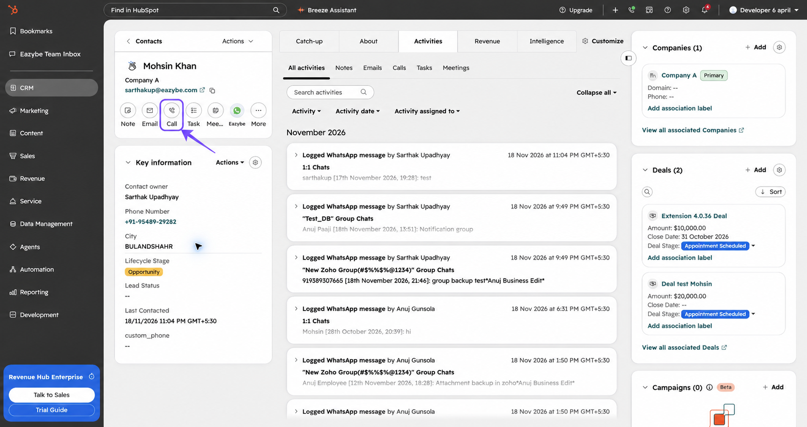
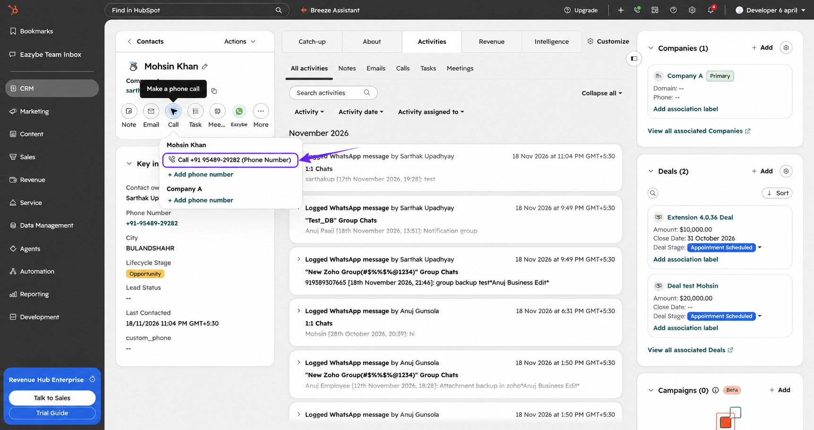
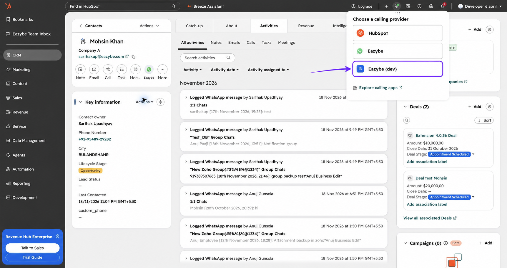
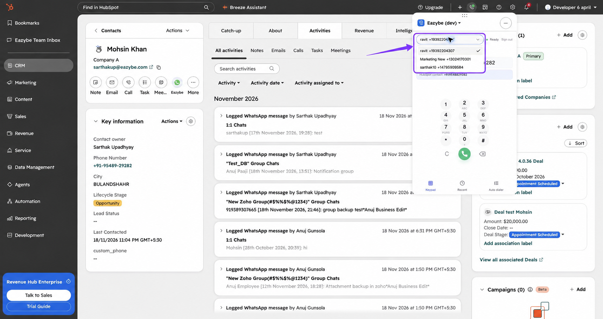
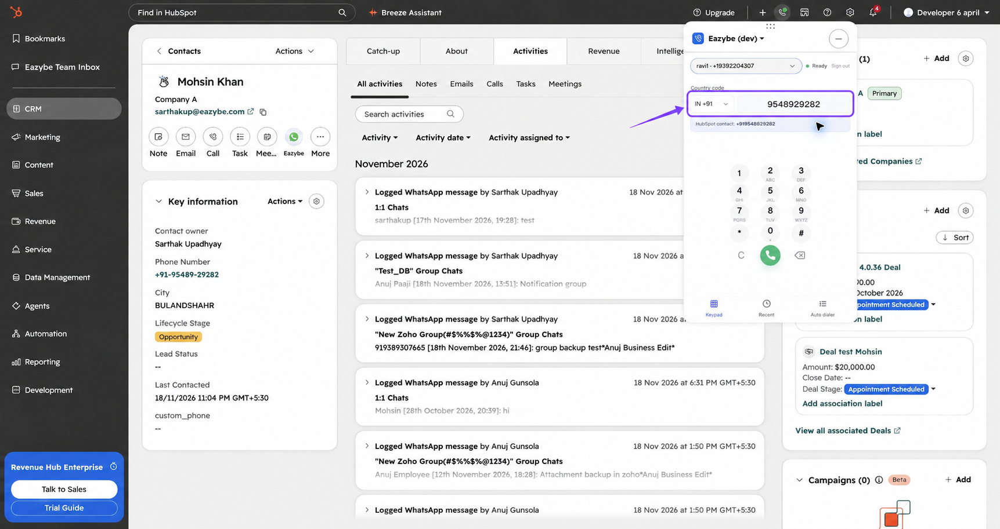
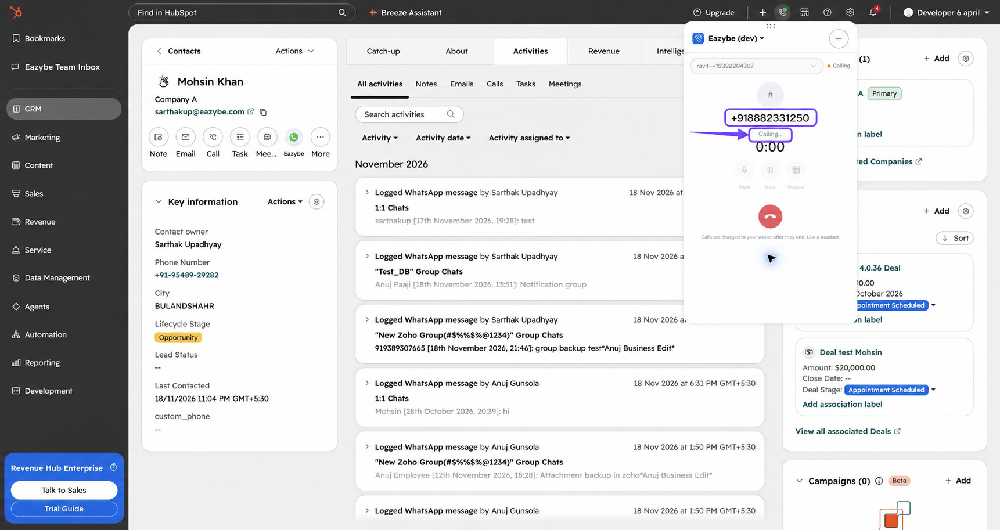
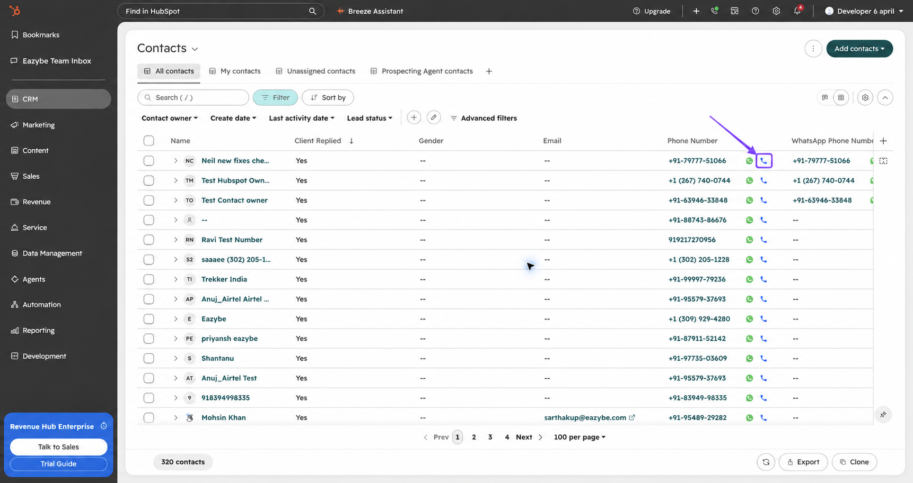
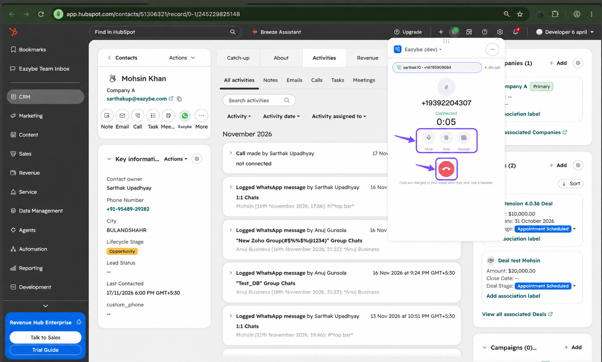
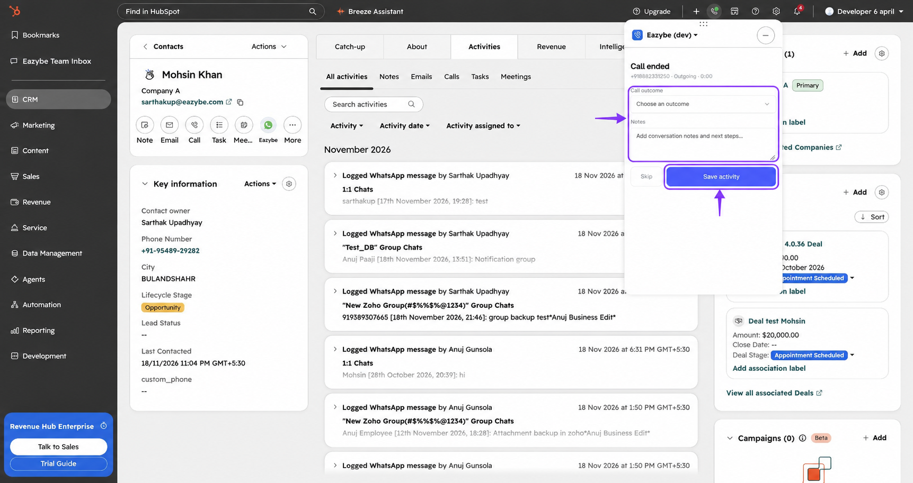

Usa el marcador de Eazybe para llamar a un contacto sin salir de HubSpot. Elige tu número de voz de empresa, comprueba el número del contacto y gestiona la llamada en la misma ventana.

## Antes de empezar

- Conecta tu cuenta de HubSpot a Eazybe e inicia sesión en Eazybe.
- Asegúrate de tener un número de voz de Eazybe activo y disponible para ti, un plan que incluya llamadas y saldo suficiente en el monedero.
- Usa auriculares y permite el acceso al micrófono cuando el navegador lo solicite.

<Note>
Para usar el botón **Call with Eazybe** en la lista de contactos de HubSpot, mantén **abierta la extensión de Eazybe** en el mismo perfil de Chrome que usas para HubSpot.
</Note>

<Note>
Las capturas muestran una cuenta de ejemplo y una interfaz en inglés. Conservamos los nombres de los botones en inglés para que puedas identificarlos en las imágenes. Algunas capturas muestran **Eazybe (dev)** como proveedor de llamadas; elige el proveedor de Eazybe configurado para tu cuenta. Tus contactos y números de voz disponibles serán diferentes.
</Note>

## Llamar desde la ficha de un contacto

<Steps>
  <Step title="Abre el contacto y haz clic en Call">
    Abre un contacto en HubSpot. Debajo de su nombre, haz clic en **Call** (el icono del teléfono). Al pasar el cursor, aparece **Make a phone call**.

    
  </Step>

  <Step title="Selecciona el número del contacto">
    Haz clic en la opción **Call** seguida del número que quieras usar. Se abrirá el marcador de Eazybe o HubSpot te pedirá que elijas un proveedor de llamadas.

    

    <Note>
    Si no hay un número guardado, usa **+ Add phone number** debajo del nombre del contacto antes de continuar.
    </Note>
  </Step>

  <Step title="Elige Eazybe como proveedor de llamadas">
    Si aparece **Choose a calling provider**, selecciona tu proveedor de Eazybe. Puedes omitir este paso si el marcador se abre directamente.

    
  </Step>

  <Step title="Elige tu número para las llamadas salientes">
    Abre el desplegable de números en la parte superior del marcador y elige el número de voz de Eazybe desde el que quieres llamar. Espera a que el estado muestre **Ready**.

    

    <Note>
    El número de arriba es tu número de empresa para las llamadas salientes. El número situado debajo de **Country code** corresponde a la persona a la que vas a llamar.
    </Note>
  </Step>

  <Step title="Comprueba el número del destinatario">
    Revisa **Country code** y el número de teléfono a su lado. Si el campo está vacío y aparece **Use phone number**, haz clic para introducir el número que se muestra junto a **HubSpot contact**.

    También puedes escribir otro número. Selecciona su código de país e introduce los demás dígitos sin repetir el código de país.

    
  </Step>

  <Step title="Inicia la llamada">
    Haz clic en el botón verde del teléfono. El marcador muestra el número de destino y **Calling…** mientras inicia la llamada. Cuando la persona responde, muestra **Connected** y el tiempo de llamada.

    

    <Warning>
    El botón verde del teléfono inicia una llamada real. Comprueba primero el número del destinatario. Las llamadas se cobran al monedero cuando terminan.
    </Warning>
  </Step>
</Steps>

## Llamar desde la lista de contactos

Mantén **abierta la extensión de Eazybe** mientras usas este acceso directo.

<Steps>
  <Step title="Busca el botón de llamada del contacto">
    Abre **CRM → Contacts**. En la fila del contacto, busca el icono azul del teléfono junto a su número. Este botón se llama **Call with Eazybe**.

    
  </Step>

  <Step title="Abre el marcador y comprueba el número">
    Haz clic en **Call with Eazybe**. Comprueba tu número de voz de salida, el código de país del destinatario y su número de teléfono. Después, haz clic en el botón verde del teléfono para llamar.

    

    <Note>
    Si el botón de llamada de la lista no aparece o no responde, comprueba que la extensión de Eazybe esté abierta en este perfil de Chrome. También puedes abrir la ficha del contacto y usar **Call** desde allí.
    </Note>
  </Step>
</Steps>

## Durante una llamada

Cuando la llamada se conecte, usa los controles del marcador:

| Control | Qué puedes hacer |
| --- | --- |
| **Mute** | Desactivar el micrófono para que la otra persona no te oiga. |
| **Hold** | Poner en espera la llamada conectada. |
| **Keypad** | Introducir dígitos para un menú telefónico durante la llamada. |
| Botón rojo del teléfono | Finalizar la llamada. |

## Responder a una llamada entrante

Cuando recibes una llamada, el marcador muestra **Incoming call…** y el número de quien llama. Haz clic en el botón verde para responder o en el rojo para rechazarla.

## Finalizar la llamada

<Steps>
  <Step title="Añade un resultado y notas">
    Al terminar, la pantalla **Call ended** muestra el número, la dirección de la llamada y su duración. Selecciona un resultado en **Call outcome**, añade tus notas en **Notes** y haz clic en **Save activity**. Usa **Skip** si no quieres añadir estos datos.

    
  </Step>
</Steps>

## ¿Necesitas ayuda?

### El número del contacto no aparece en el campo

Haz clic en **Use phone number** si aparece junto a los datos del contacto de HubSpot. Si no, introduce el número del destinatario y selecciona el **Country code** correcto. Revisa siempre el campo antes de llamar, especialmente después de cambiar de contacto.

### No aparece mi número de voz

Comprueba que has iniciado sesión en la cuenta de Eazybe correcta. Pide al administrador que verifique que el número esté activo y disponible para ti.

### No puedo iniciar una llamada

Espera a que aparezca **Ready**, selecciona un número de voz de salida y revisa el número del destinatario. Termina primero cualquier llamada en curso. Si Eazybe muestra un aviso sobre la suscripción o el saldo, pide al administrador que revise el plan de llamadas o recargue el monedero.

### La otra persona no me oye

Revisa el permiso del micrófono en el navegador y la conexión de los auriculares. Si silenciaste la llamada, vuelve a activar el micrófono con el mismo control.
