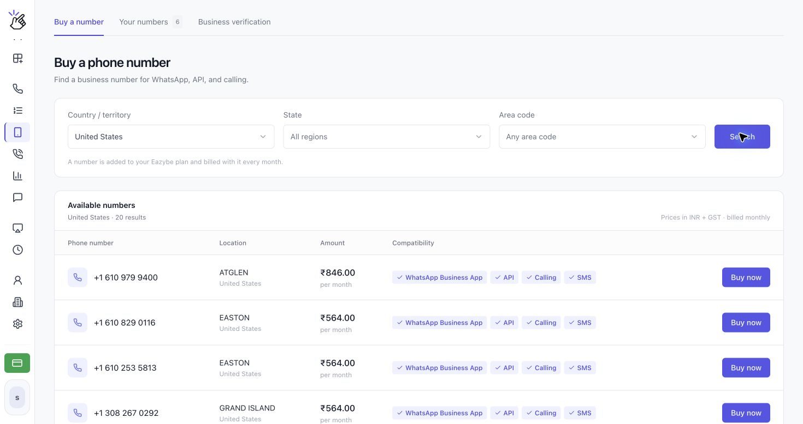
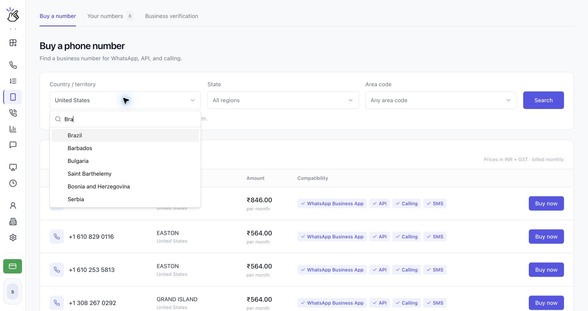
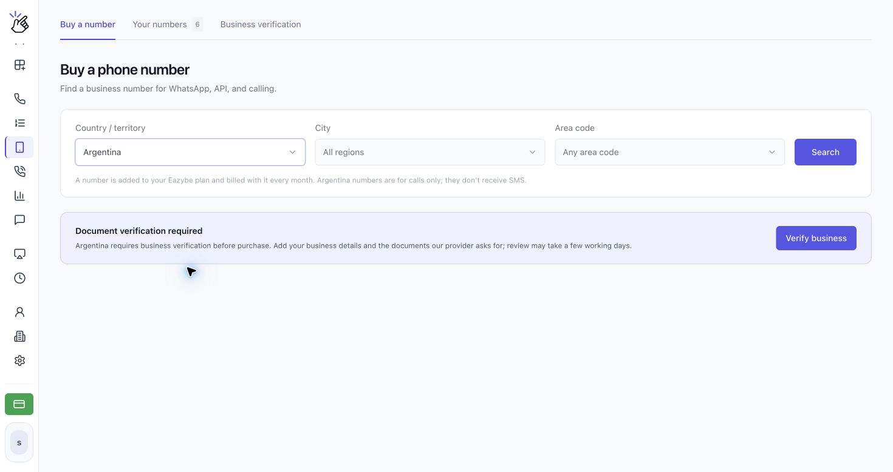
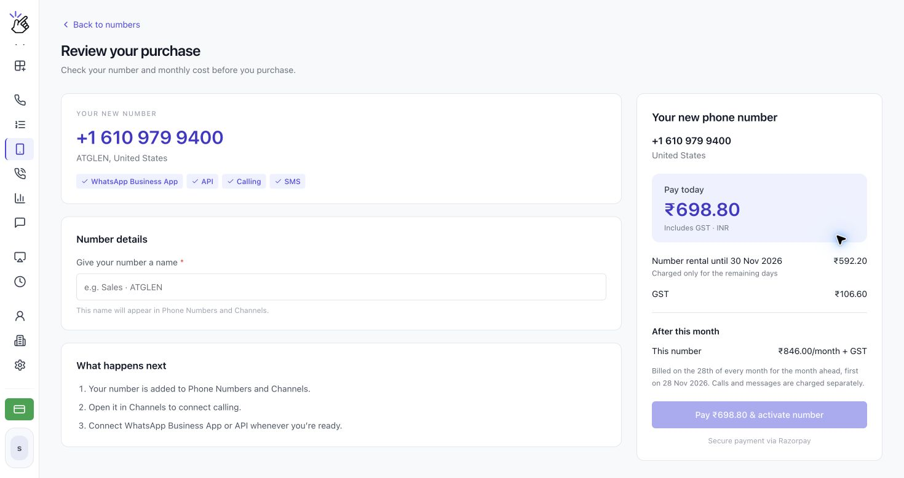

Usa **Phone Numbers** para comprar un número de voz empresarial en Brasil y otros países disponibles y administrar los números de tu organización. En los países que exigen verificación de empresa, necesitas la aprobación antes de comprar.

## Elegir un país

El selector **Country / territory** ahora incluye Brasil, Chile, Colombia, México, Argentina y muchos otros países, además de Estados Unidos, Canadá, Puerto Rico y las Islas Vírgenes de Estados Unidos. Busca tu país en el selector para consultar las opciones actuales.

<Note>Que un país aparezca en el selector no garantiza que haya números disponibles. Los requisitos de verificación y la disponibilidad dependen del país. Sigue los requisitos que se muestran para tu selección.</Note>

## Comprar un número

<Steps>
  <Step title="Abre Phone Numbers">
    Abre **Phone Numbers** en **CALLS** y selecciona **Buy a number**. Las otras pestañas son **Your numbers** y **Business verification**.

    
  </Step>
  <Step title="Elige el país y la ubicación">
    Abre **Country / territory** y busca un país, como **Brazil**. Selecciona **City** o **State** y **Area code** cuando estén disponibles y haz clic en **Search**. Mantén **All regions** y **Any area code** para ampliar la búsqueda.

    

    <Note>Si aparece **No numbers available here today**, prueba otro código de área o busca en todas las regiones. Si las regiones no se cargan, puedes buscar en todo el país.</Note>
  </Step>
  <Step title="Completa la verificación de empresa si es necesaria">
    Si aparece **Document verification required**, haz clic en **Verify business**. Sigue la guía [Verificar tu empresa](/es/voice-number/business-verification) para introducir tus datos, subir los documentos solicitados y enviarlos a revisión. También puedes empezar desde **Business verification → Verify a new country**.

    Si ya comenzaste, el botón puede mostrar **Continue verification**, **View details**, **Fix and resubmit** o **Update documents**. Vuelve a comprar un número cuando recibas la aprobación.

    

    <Note>La verificación es específica de cada país. La aprobación para un país no verifica tu empresa en todos los demás. No se cobra nada hasta que compres un número.</Note>
  </Step>
  <Step title="Compara los números disponibles">
    Los resultados muestran **Phone number**, **Location**, **Amount** y **Compatibility**. Comprueba las funciones del número que quieres y haz clic en **Buy now** para abrir **Review your purchase**.

    

    <Warning>Los números de Brasil y de otros países marcados como solo llamadas no reciben SMS. Para verificarlos en WhatsApp, usa una llamada en lugar de solicitar un código por SMS.</Warning>
  </Step>
  <Step title="Revisa el precio y activa tu número">
    En **Review your purchase**, comprueba el número, el país y la compatibilidad. En **Number details**, introduce un nombre en **Give your number a name**. Este nombre aparece en Phone Numbers y Channels.

    Revisa **Pay today**, **Number rental until**, cualquier **GST** y **After this month**. Cuando estés listo para comprar, haz clic en **Pay … & activate number**, cuyo botón muestra el total. Sigue el proceso de pago indicado para tu cuenta.

    

    <Warning>La activación es una compra de pago con alquiler recurrente. El pago puede cargar el importe a tu tarjeta guardada o abrir un proveedor de pagos. Confirma el total, el período de alquiler y el calendario de renovación antes de continuar. Las llamadas y los mensajes se cobran por separado; los precios de las capturas son ejemplos, no un presupuesto para tu cuenta.</Warning>
  </Step>
  <Step title="Consulta Your numbers">
    Abre **Your numbers** para ver el nombre, el país, el importe mensual y las fechas de compra y renovación de cada número. Usa **View in Channels** para abrir la configuración de su canal. **More actions** incluye **Verification code** y, para los administradores, **Cancel subscription**.

    
  </Step>
</Steps>

<Warning>Un número cancelado permanece disponible hasta que termina el período pagado; después se libera y no se puede recuperar. Cancela antes del día 28 para evitar el siguiente cargo mensual.</Warning>

## Conectar WhatsApp con tu número de voz

Puedes usar un número comprado con la **aplicación WhatsApp Business** o la **API de WhatsApp** cuando la compatibilidad del número incluya esa opción. El método de verificación depende de si el número recibe SMS. La verificación de empresa para comprar un número es independiente de la verificación de ese número en WhatsApp.

### Conectar la aplicación WhatsApp Business

1. Instala y abre **WhatsApp Business** en tu teléfono.
2. Inicia la configuración de la cuenta e introduce el número de voz que aparece en Eazybe, incluido el código de país.
3. Si el número admite SMS, solicita el código por SMS y búscalo en [**SMS en Eazybe**](https://app.eazybe.com/calls/sms). Para un número de solo llamadas, como los de Brasil, elige **Call me** cuando WhatsApp lo ofrezca.
4. Si usas **Call me**, mantén encendido el teléfono de Eazybe, contesta la llamada entrante de WhatsApp en ese número y anota el código que se lee en voz alta.
5. Vuelve a WhatsApp Business e introduce el código para completar la verificación.

### Conectar la API de WhatsApp

1. Abre **Channels** en Eazybe y selecciona **Add channel**.
2. Elige **WhatsApp** para continuar en Meta, inicia sesión y sigue las instrucciones.
3. Introduce el número de voz que aparece en Eazybe. Solicita la verificación por SMS si el número admite SMS, o por llamada si es un número de solo llamadas.
4. Lee el código en [**SMS en Eazybe**](https://app.eazybe.com/calls/sms), o mantén encendido el teléfono de Eazybe y contesta la llamada de verificación para escuchar el código.
5. Vuelve a Meta, introduce el código y completa la conexión.

### Si WhatsApp muestra “Login not available right now”

WhatsApp puede bloquear temporalmente el inicio de sesión por seguridad. Si aparece este mensaje, conecta tu VPN al país donde compraste el número de voz y vuelve a intentar iniciar sesión. Por ejemplo, usa una VPN de Estados Unidos para un número estadounidense si te conectas desde India. Después del nuevo intento, solicita otro código por SMS o llamada según las funciones del número e introdúcelo en WhatsApp Business o Meta.

<Warning>La ubicación de la VPN debe coincidir con el país del número comprado. Solicita un código nuevo después de cambiar la conexión, ya que el anterior puede caducar.</Warning>
