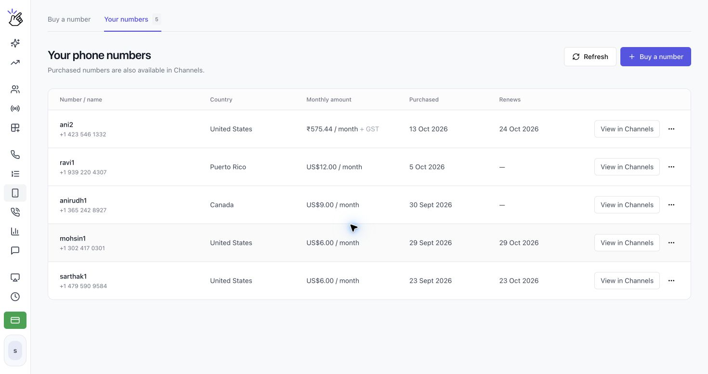

SMS reúne los mensajes entrantes y salientes, incluidos los códigos de verificación. Puedes filtrar por número de voz y enviar un mensaje nuevo desde un número activo.

<Note>SMS solo está disponible en números compatibles. Los números de Brasil y otros de solo llamadas no reciben SMS; usa la verificación por llamada para WhatsApp. Consulta [Comprar y administrar números de teléfono](/es/voice-number/phone-numbers#conectar-whatsapp-con-tu-número-de-voz).</Note>

<Steps>
  <Step title="Abre SMS">
    Abre **SMS** en **CALLS**. La página muestra **Every message. Every code. In one place.** y una lista **All messages**.

    
  </Step>
  <Step title="Filtra o actualiza los mensajes">
    Usa el filtro de números para elegir **All numbers** o un número de voz activo. Haz clic en **Refresh messages** para obtener los mensajes más recientes. La tabla muestra **From**, **To**, **Message**, **Status** y **Sent Time**. Las horas se muestran en IST, la hora estándar de India.
  </Step>
  <Step title="Lee un código de verificación">
    Los mensajes con códigos de verificación aparecen entre los mensajes entrantes del número correspondiente. Usa el icono del ojo para ver el mensaje completo. Cuando haya un código vigente, usa **Copy verification code**. Los códigos caducados se marcan como demasiado antiguos para mostrarse.

    <Note>Abrir un mensaje de código de verificación no leído lo marca como leído.</Note>
  </Step>
  <Step title="Abre el editor de SMS">
    Haz clic en **Send SMS**. En **New message**, elige un número activo en **From**, introduce el destinatario en **To** y escribe el mensaje en **Message**. El destinatario debe incluir el código de país, por ejemplo `+14155552671`.
  </Step>
  <Step title="Envía el mensaje">
    Mantén el mensaje dentro del límite de **1600 caracteres** y haz clic en **Send SMS**. Eazybe muestra el estado en la lista. Para cerrar el editor y conservar el borrador, usa **Close and keep draft**. Para descartarlo, usa **Discard draft**.

    <Warning>Enviar un SMS entrega un mensaje real al destinatario y puede generar cargos. Revisa el número y el mensaje antes de hacer clic en **Send SMS**.</Warning>
  </Step>
</Steps>
