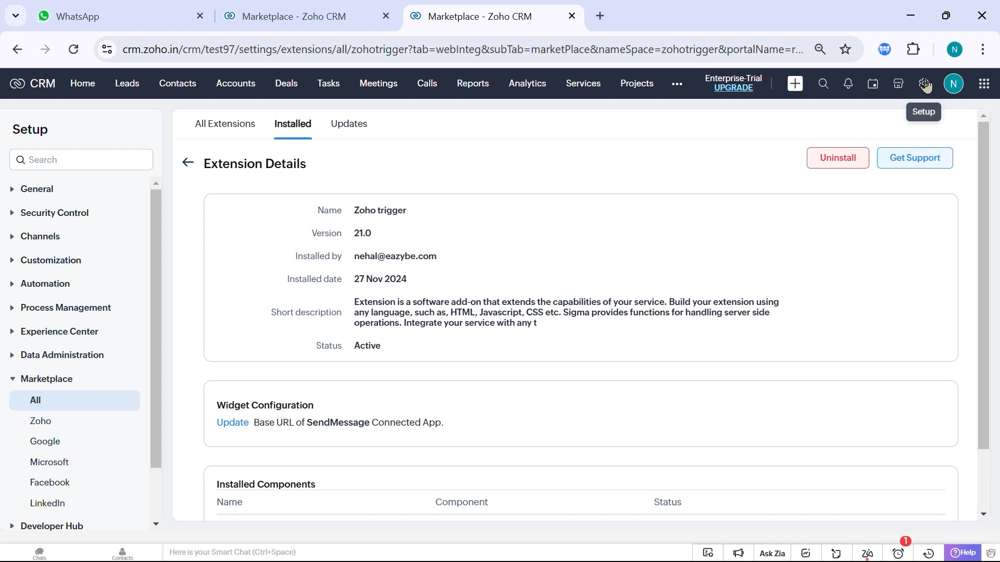
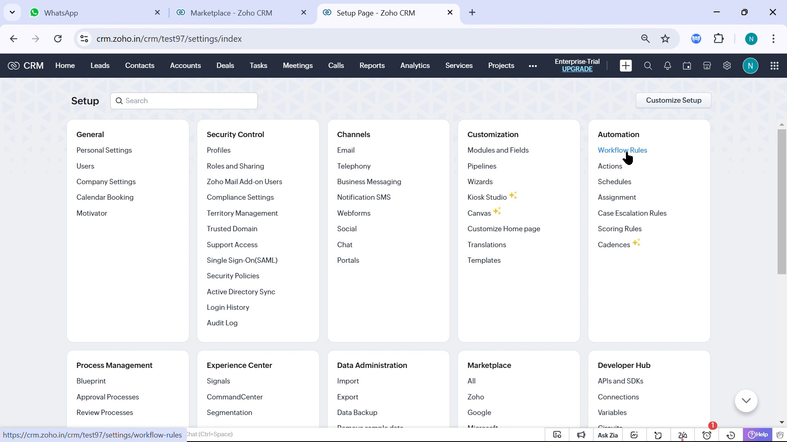
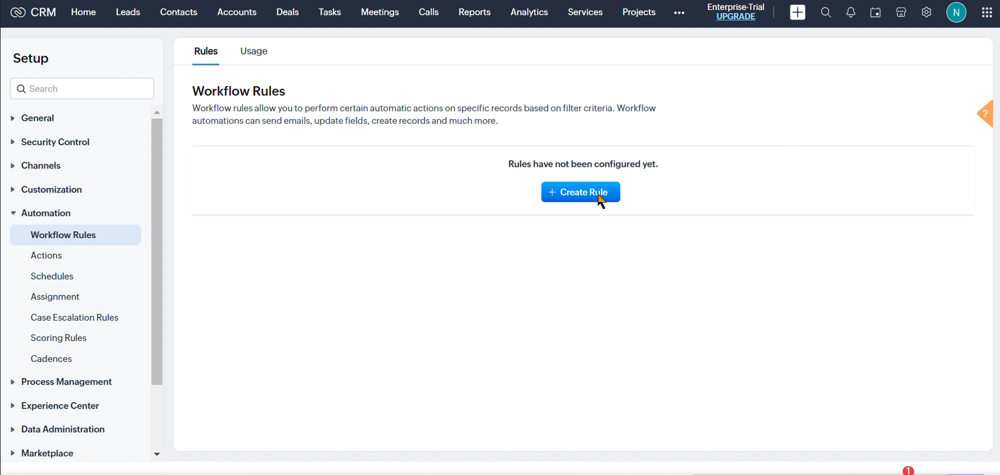
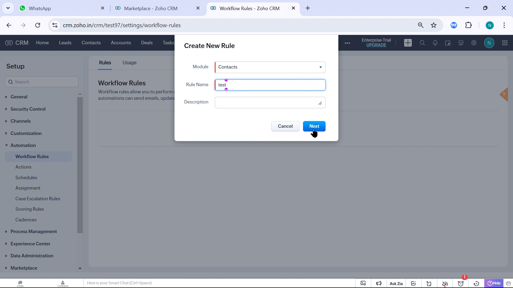
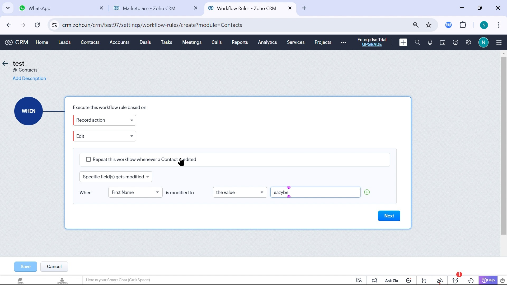
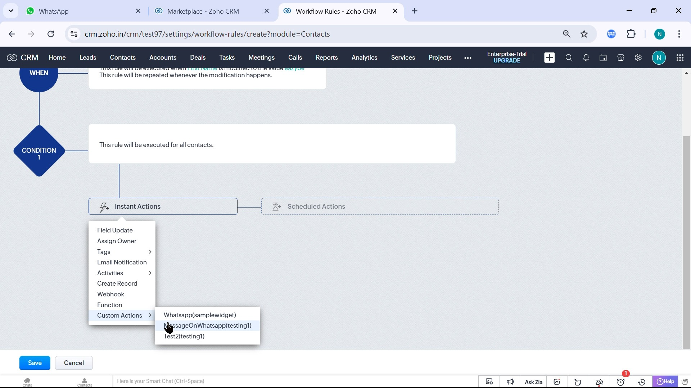
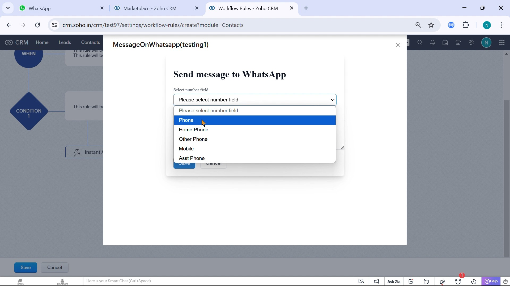

Crea un flujo de trabajo que envíe un mensaje cuando un contacto, lead u otro registro cumpla las condiciones que definas.

## Antes de Empezar

Necesitas permiso para crear reglas, **Zoho trigger** instalado y **Active**, tu cuenta de Zoho conectada a Eazybe y el número del destinatario guardado con el prefijo internacional. El propietario del registro debe tener instalada la extensión o aplicación de Eazybe y una conexión activa de WhatsApp.

<Warning>La integración de flujos de trabajo está disponible en el **Plan Scalar**. El mensaje se envía desde el número de WhatsApp del propietario del contacto o lead. Asigna el propietario correcto antes de ejecutar la regla.</Warning>

<Steps>
  <Step title="Confirmar que Zoho trigger está activo">
    Abre **Setup → Marketplace → All → Installed**, selecciona **Zoho trigger** y confirma **Status: Active**.

    Si falta, [instala Zoho trigger y Team Inbox](https://crm.zoho.com/market/installPrivatePlugin.do?portalName=rajatverma&nameSpace=zohotrigger&versionIndex=4520363000000438001). El mismo paquete incluye la acción de flujo de trabajo y las bandejas de Contactos/Leads y general. Consulta las [instrucciones de instalación](/es/integrations/zoho/team-inbox#instalar-el-paquete).

    
  </Step>
  <Step title="Abrir las reglas de flujo de trabajo">
    En **Setup**, abre **Automation → Workflow Rules**.

    
  </Step>
  <Step title="Crear una regla">
    Pulsa **Create Rule** para abrir **Create New Rule**.

    
  </Step>
  <Step title="Elegir el módulo y nombrar la regla">
    Selecciona **Module**, por ejemplo **Contacts** o **Leads**. Introduce **Rule Name**, añade una descripción si la necesitas y pulsa **Next**. El campo de teléfono y el propietario proceden de este módulo.

    
  </Step>
  <Step title="Definir cuándo se ejecuta">
    En **Execute this workflow rule based on**, elige el evento, por ejemplo **Record action → Edit**. Define los campos y valores de las condiciones y pulsa **Next**.

    <Warning>Activa la ejecución repetida solo si quieres enviar otro mensaje cuando el registro vuelva a cumplir la condición. De lo contrario, podrías enviar duplicados.</Warning>

    
  </Step>
  <Step title="Añadir la acción de WhatsApp">
    Abre **Instant Actions → Custom Actions** y selecciona **MessageOnWhatsapp** de Eazybe. Zoho puede mostrar el espacio de nombres de la extensión entre paréntesis.

    
  </Step>
  <Step title="Elegir el destinatario y escribir el mensaje">
    En **Send message to WhatsApp**, abre **Select number field** y selecciona el campo del destinatario, como **Phone** o **Mobile**. Escribe el mensaje y pulsa **Save**. Guarda el número con su prefijo internacional para evitar errores de entrega o destinatario.

    
  </Step>
</Steps>

## Activar y Verificar

Revisa el evento, las condiciones y la acción. Pulsa **Save** para activar la regla y modifica un registro de prueba para que cumpla las condiciones. Comprueba que el destinatario correcto recibe el mensaje desde el número del propietario y que la regla solo se ejecuta cuando corresponde.

<Info>Los archivos multimedia adjuntos no deben superar **15 MB**.</Info>

Si falta la acción, verifica la instalación y conexión de Zoho trigger. Si no se entrega el mensaje, revisa la conexión del propietario y el campo de número. Si se duplica, revisa la ejecución repetida. Consulta [Solucionar problemas del flujo de trabajo](/es/integrations/zoho/troubleshoot-workflow).
