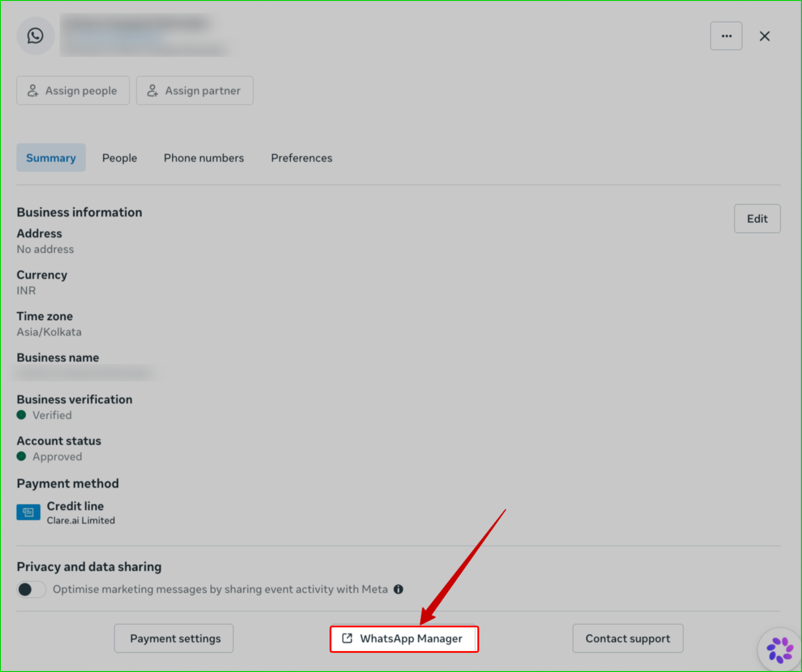
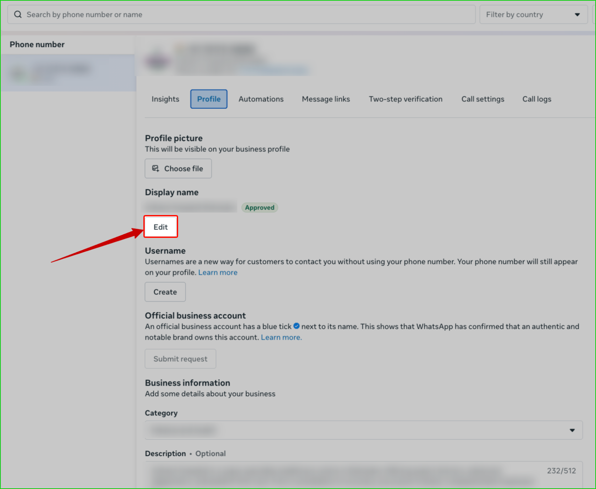
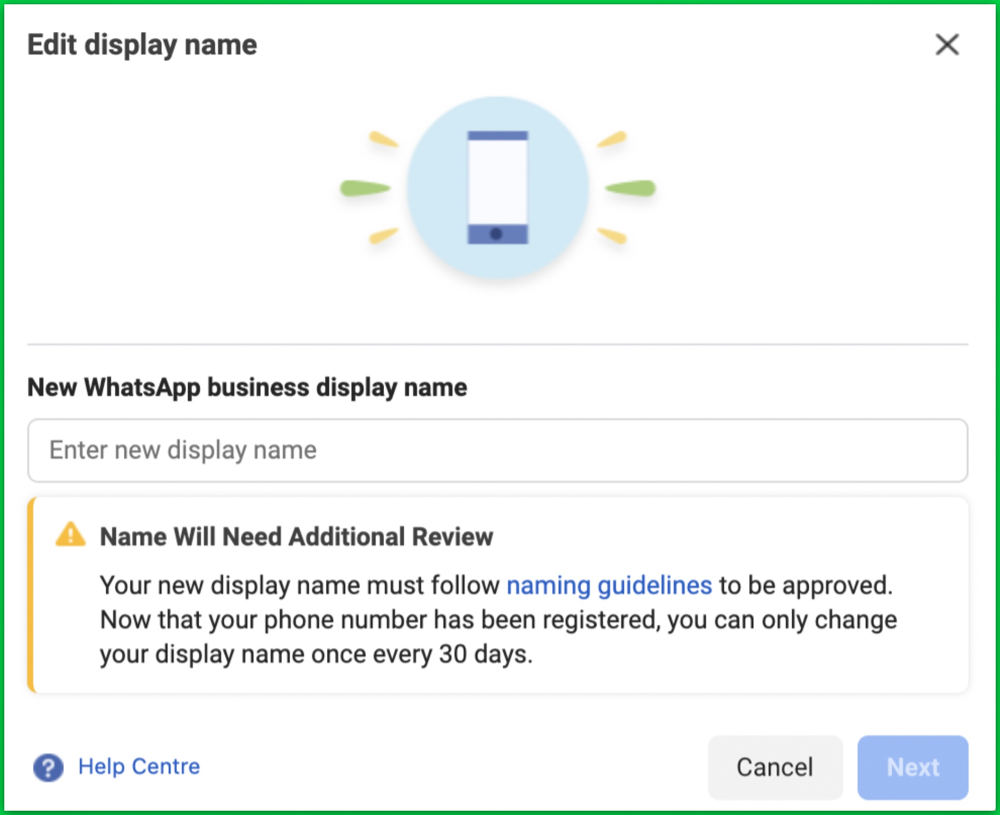
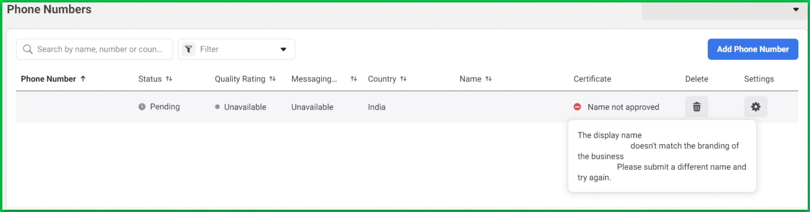
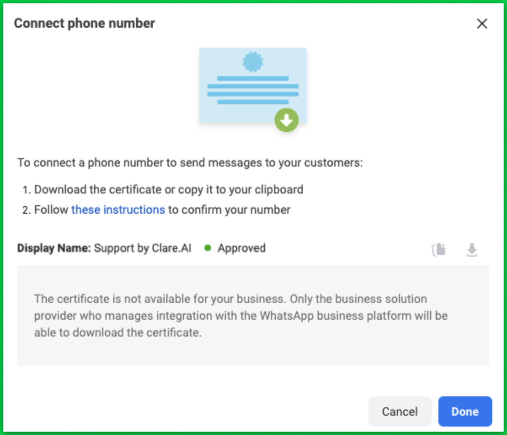

Utiliza WhatsApp Manager para solicitar un nombre nuevo para el número de WhatsApp conectado a Eazybe. Meta debe aprobar la solicitud antes de que puedas utilizarlo.

<Note>
Las capturas muestran Meta en inglés. Tu interfaz puede ser diferente; los datos de la cuenta son ejemplos.
</Note>

<Steps>
  <Step title="Abre WhatsApp Manager">
    Inicia sesión en [Meta Business Manager](https://business.facebook.com/), selecciona tu cuenta de empresa de WhatsApp y abre **WhatsApp Manager**.

    
  </Step>
  <Step title="Selecciona tu número de teléfono">
    Busca el número correcto en **Phone numbers** (Números de teléfono) y selecciona su icono de configuración.

    
  </Step>
  <Step title="Edita el nombre del perfil">
    Abre **Profile** (Perfil) y selecciona **Edit** (Editar) debajo de **Display name** (Nombre para mostrar).

    
  </Step>
  <Step title="Envía el nuevo nombre">
    Introduce el nombre en **New WhatsApp business display name**, selecciona **Next** (Siguiente) y completa el envío para revisión. Lee las normas de nombres y las restricciones de cambio que aparezcan.

    
  </Step>
</Steps>

## Consulta el resultado de la revisión

Vuelve al perfil del número en WhatsApp Manager para consultar la revisión del nombre. Una revisión pendiente aún no tiene una decisión. **Approved** (Aprobado) indica que Meta aceptó el nombre; **Name not approved** (Nombre no aprobado) indica que debes modificarlo.

## Si se rechaza el nombre

Lee el motivo del rechazo, corrige el nombre y utiliza **Edit** para enviar otra solicitud. Por ejemplo, la captura siguiente muestra un nombre que no coincide con la marca de la empresa. Un nuevo envío inicia otra revisión.

## Después de la aprobación

Comprueba si el nombre aprobado aparece en tu número conectado. Si no aparece, o Meta muestra una solicitud de certificado o registro, contacta con [Soporte de Eazybe](mailto:support@eazybe.com) e incluye tu número y una captura del estado para recibir orientación.

## Preguntas frecuentes

### ¿Cuánto tarda la revisión?

Espera a que Meta revise la solicitud. Consulta el resultado más reciente en WhatsApp Manager; la aprobación no es inmediata y los plazos pueden variar.

### ¿Dónde consulto la aprobación?

Consulta el estado del nombre en WhatsApp Manager. El estado de conexión del número es independiente de la aprobación del nombre.

### ¿Tengo que descargar un certificado?

Algunas interfaces de Meta muestran un cuadro de certificado, como el ejemplo anterior. Si aparece, pregunta a Soporte de Eazybe qué paso corresponde a tu conexión.

## Guía relacionada

[Verificar tu empresa en Meta](/es/waba/facebook-business-verification)
