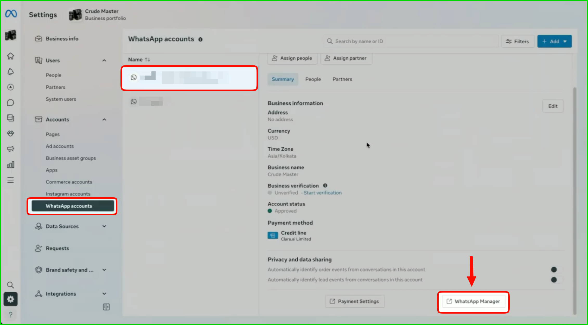

## Qué Significa la Calificación

- La calificación de calidad del número de Meta refleja los comentarios recientes de los clientes, incluidos bloqueos y reportes, durante los últimos siete días.
- **High (alta, verde):** Mantén tu enfoque en mensajes relevantes.
- **Medium (media, amarilla):** Revisa la audiencia, el contenido y la frecuencia.
- **Low (baja, roja):** Investiga cuanto antes los comentarios negativos y revisa las alertas de Meta.

## Cómo Consultar Tu Calificación

1. Abre [Meta Business Suite](https://business.facebook.com/) y selecciona tu portfolio empresarial.
2. Ve a **Settings > Accounts > WhatsApp accounts** y selecciona tu cuenta.
3. Haz clic en **WhatsApp Manager**. Si no puedes acceder, pide al administrador de la empresa que revise tus permisos.

4. Abre **Phone numbers** y busca el número que usas para las difusiones de Eazybe.
5. Consulta **Quality rating** junto a **Status**.

<Note>
  Estas capturas muestran la interfaz de Meta. Los nombres de cuenta y la disposición de los menús pueden ser diferentes en tu cuenta.
</Note>

## Qué Hacer si Baja la Calidad

1. **Revisa las campañas recientes:** Consulta los fallos y las bajas en las [estadísticas de difusión](/es/broadcasts/view-analytics) de Eazybe. Anota la audiencia y la plantilla utilizadas antes de la bajada; ayuda a investigar, pero no demuestra una causa.
2. **Comprueba el consentimiento:** Excluye a quienes se dieron de baja y evita escribir a personas que no esperan tus actualizaciones.
3. **Mejora la relevancia:** Acota la audiencia y adapta el mensaje a sus intereses.
4. **Reduce la frecuencia excesiva:** Coordina las campañas y da un descanso a los clientes que no interactúan.
5. **Revisa las alertas de Meta:** Resuelve los problemas de cuenta o plantilla y supervisa la calificación después de cambiar tu enfoque.

Consulta la lista completa en [Mejorar la entrega de difusiones](/es/waba/improve-broadcast-deliverability).

## Distingue Estas Comprobaciones

- **Calidad del número:** Comentarios asociados con tu número de envío.
- **Estado de la plantilla:** Indica si la plantilla está aprobada y disponible. Consulta las [directrices para plantillas](/es/waba/templates/guideline).
- **Estado de conexión:** Un número conectado puede tener problemas de entrega. Revisa los errores por separado.
- **Límites de mensajería:** Consulta la capacidad actual en WhatsApp Manager. Los límites se aplican al portfolio empresarial.

## Revisa También la Calidad de Tu Plantilla

- **La calidad de la plantilla es distinta de la calidad del número de teléfono.** Meta evalúa cada plantilla según su uso, los comentarios de los clientes y la interacción, incluidas las tasas de lectura.
- En WhatsApp Manager, abre [Manage templates](https://business.facebook.com/latest/whatsapp_manager/message_templates) para revisar la plantilla que vas a enviar.
- Las plantillas aprobadas pueden mostrar **Quality pending** (calidad pendiente), **High quality** (alta), **Medium quality** (media) o **Low quality** (baja). Las plantillas nuevas comienzan con una calificación pendiente, que se actualiza a medida que Meta recopila datos.
- Una calidad media o baja puede poner la plantilla en riesgo de pausa o desactivación. Revisa los comentarios y mejora el mensaje antes de ampliar su uso.
- La calidad puede afectar al ritmo de envío y a las pausas de la plantilla. Si pierde el estado **Approved**, no puede enviarse hasta recuperarlo.

**Referencia oficial:** [Meta — Calificación de calidad de las plantillas](https://developers.facebook.com/documentation/business-messaging/whatsapp/templates/template-quality). Esta guía trata sobre plantillas individuales; usa la vista **Phone numbers** descrita anteriormente para consultar la calidad de tu número de envío.

## Preguntas Frecuentes

### ¿Una calidad alta garantiza la entrega?

No. Revisa los fallos por destinatario en las [estadísticas de difusión](/es/broadcasts/view-analytics) incluso cuando la calidad sea alta.

### ¿Aumentar mi puja corregirá una calidad baja?

El límite de puja controla el precio máximo de entrega. No debe tratarse como una forma de corregir comentarios negativos. Revisa primero la relevancia de la audiencia y la frecuencia; consulta [Precio máximo de puja](/es/waba/templates/max-bidding-price) para conocer cómo funcionan los precios.

### ¿Qué información debo compartir con soporte?

Envía a [support@eazybe.com](mailto:support@eazybe.com) tu número de envío, calificación actual, alerta de Meta correspondiente, nombre de la campaña y motivos de fallo. Adjunta una captura de la calificación y oculta los datos de cuenta no relacionados.
